# РУКОВОДСТВО ПО СУДЕЙСТВУ ОСФ 2026/2027

## ОГЛАВЛЕНИЕ

- [ОБЩИЕ ПОЛОЖЕНИЯ](#общие-положения)
- [ИГРОВАЯ ЗОНА](#игровая-зона)
  - [ПРАВИЛО 1. ИГРОВАЯ ПЛОЩАДКА](#правило-1-игровая-площадка-см-положение-регламент-о-соревновании)
  - [ПРАВИЛО 2. СТОЙКИ И СЕТКА ВОРОТ](#правило-2-стойки-и-сетка-ворот)
  - [ПРАВИЛО 3. СКАМЕЙКИ](#правило-3-скамейки-см-положение-регламент-о-соревновании)
  - [ПРАВИЛО 4. СИРЕНА И ТАБЛО](#правило-4-сирена-и-табло-см-положение-регламент-о-соревновании)
- [КОМАНДЫ](#команды)
  - [ПРАВИЛО 5. КОМАНДЫ](#правило-5-команды-см-положение-регламент-о-соревновании)
  - [ПРАВИЛО 6. КАПИТАН И АССИСТЕНТ КАПИТАНА](#правило-6-капитан-и-ассистент-капитана)
  - [ПРАВИЛО 7. СТАРТОВЫЙ СОСТАВ](#правило-7-стартовый-состав-см-положение-регламент-о-соревновании)
  - [ПРАВИЛО 8. ТРАВМИРОВАННЫЙ ХОККЕИСТ](#правило-8-травмированный-хоккеист)
- [СНАРЯЖЕНИЕ](#снаряжение)
  - [ПРАВИЛО 9. СНАРЯЖЕНИЕ](#правило-9-снаряжение-см-положение-регламент-о-соревновании)
  - [ПРАВИЛО 10. КЛЮШКА](#правило-10-клюшка)
  - [ПРАВИЛО 11. СНАРЯЖЕНИЕ ВРАТАРЯ](#правило-11-снаряжение-вратаря)
  - [ПРАВИЛО 12. НЕЗАКОННОЕ СНАРЯЖЕНИЕ](#правило-12-незаконное-снаряжение)
  - [ПРАВИЛО 13. ШАЙБА](#правило-13-шайба)
  - [ПРАВИЛО 14. ПРИВЕДЕНИЕ В ПОРЯДОК УНИФОРМЫ И СНАРЯЖЕНИЯ](#правило-14-приведение-в-порядок-униформы-и-снаряжения)
- [ШТРАФЫ](#штрафы)
  - [ПРАВИЛО 15. НАЛОЖЕНИЕ ШТРАФОВ](#правило-15-наложение-штрафов)
  - [ПРАВИЛО 16. МАЛЫЙ ШТРАФ](#правило-16-малый-штраф)
  - [ПРАВИЛО 17. МАЛЫЙ СКАМЕЕЧНЫЙ ШТРАФ](#правило-17-малый-скамеечный-штраф)
  - [ПРАВИЛО 18. ДВОЙНОЙ МАЛЫЙ ШТРАФ](#правило-18-двойной-малый-штраф)
  - [ПРАВИЛО 19. CОВПАДАЮЩИЕ ШТРАФЫ](#правило-19-cовпадающие-штрафы)
  - [ПРАВИЛО 20. БОЛЬШОЙ ШТРАФ](#правило-20-большой-штраф)
  - [ПРАВИЛО 21. ОПАСНЫЕ ДЕЙСТВИЯ](#правило-21-опасные-действия)
  - [ПРАВИЛО 22. ДИСЦИПЛИНАРНЫЙ ШТРАФ](#правило-22-дисциплинарный-штраф)
  - [ПРАВИЛО 23. ДИСЦИПЛИНАРНЫЙ ШТРАФ ДО КОНЦА МАТЧА](#правило-23-дисциплинарный-штраф-до-конца-матча)
  - [ПРАВИЛО 24. ШТРАФНОЙ БРОСОК](#правило-24-штрафной-бросок)
  - [ПРАВИЛО 25. ПРИСУЖДЕНИЕ ВЗЯТИЯ ВОРОТ](#правило-25-присуждение-взятия-ворот)
  - [ПРАВИЛО 26. ОТЛОЖЕННЫЙ ШТРАФ](#правило-26-отложенный-штраф)
  - [ПРАВИЛО 27. ШТРАФЫ ВРАТАРЯ](#правило-27-штрафы-вратаря)
  - [ПРАВИЛО 28. ДОПОЛНИТЕЛЬНЫЕ ДИСЦИПЛИНАРНЫЕ САНКЦИИ (см. Положение (Регламент) о соревновании)](#правило-28-дополнительные-дисциплинарные-санкции-см-положение-регламент-о-соревновании)
  - [ПРАВИЛО 29. ЖЕСТЫ СУДЕЙ](#правило-29-жесты-судей)

- [СУДЬИ](#судьи)
  - [ПРАВИЛО 30. НАЗНАЧЕНИЕ СУДЕЙ (см. Положение (Регламент) о соревновании)](#правило-30-назначение-судей-см-положение-регламент-о-соревновании)
  - [ПРАВИЛО 31. ГЛАВНЫЕ СУДЬИ](#правило-31-главные-судьи)
  - [ПРАВИЛО 32. ЛИНЕЙНЫЕ СУДЬИ](#правило-32-линейные-судьи)
  - [ПРАВИЛО 33. СЕКРЕТАРЬ МАТЧА](#правило-33-секретарь-матча)
  - [ПРАВИЛО 34. СУДЬЯ ВРЕМЕНИ МАТЧА (см. Положение (Регламент) о соревновании)](#правило-34-судья-времени-матча-см-положение-регламент-о-соревновании)
  - [ПРАВИЛО 35. СУДЬЯ ПРИ ОШТРАФОВАННЫХ ИГРОКАХ](#правило-35-судья-при-оштрафованных-игроках)
  - [ПРАВИЛО 36. ГРУППА СТАТИСТИКИ (см. Положение (Регламент) о соревновании)](#правило-36-группа-статистики-см-положение-регламент-о-соревновании)
  - [ПРАВИЛО 37. ВИДЕОПРОСМОТР (см. Положение (Регламент) о соревновании)](#правило-37-видеопросмотр-см-положение-регламент-о-соревновании)
  - [ПРАВИЛО 38. ЗАПРОС ТРЕНЕРА (см. Положение (Регламент) о соревновании)](#правило-38-запрос-тренера-см-положение-регламент-о-соревновании)
  - [ПРАВИЛО 39. ОСКОРБЛЕНИЕ СУДЕЙ](#правило-39-оскорбление-судей)
  - [ПРАВИЛО 40. ФИЗИЧЕСКОЕ ВОЗДЕЙСТВИЕ НА СУДЬЮ (см. Положение (Регламент) о соревновании)](#правило-40-физическое-воздействие-на-судью-см-положение-регламент-о-соревновании)
- [НАРУШЕНИЯ, СВЯЗАННЫЕ С ФИЗИЧЕСКИМ КОНТАКТОМ](#нарушения-связанные-с-физическим-контактом)
  - [ПРАВИЛО 41. ТОЛЧОК НА БОРТ](#правило-41-толчок-на-борт)
  - [ПРАВИЛО 42. НЕПРАВИЛЬНАЯ АТАКА](#правило-42-неправильная-атака)
  - [ПРАВИЛО 43. АТАКА СЗАДИ](#правило-43-атака-сзади)
  - [ПРАВИЛО 44. ОТСЕЧЕНИЕ](#правило-44-отсечение)
  - [ПРАВИЛО 45. УДАР ЛОКТЕМ](#правило-45-удар-локтем)
  - [ПРАВИЛО 46. ДРАКА](#правило-46-драка)
  - [ПРАВИЛО 47. УДАР ГОЛОВОЙ](#правило-47-удар-головой)
  - [ПРАВИЛО 48. АТАКА В ГОЛОВУ ИЛИ ШЕЮ](#правило-48-атака-в-голову-или-шею)
  - [ПРАВИЛО 49. УДАР НОГОЙ](#правило-49-удар-ногой)
  - [ПРАВИЛО 50. УДАР КОЛЕНОМ](#правило-50-удар-коленом)
  - [ПРАВИЛО 51. ГРУБОСТЬ](#правило-51-грубость)
  - [ПРАВИЛО 52. ПОДСЕЧКА](#правило-52-подсечка)
  - [ПРАВИЛО 53. БРОСАНИЕ СНАРЯЖЕНИЯ](#правило-53-бросание-снаряжения)
- [СДЕРЖИВАЮЩИЕ НАРУШЕНИЯ](#сдерживающие-нарушения)
  - [ПРАВИЛО 54. ЗАДЕРЖКА СОПЕРНИКА](#правило-54-задержка-соперника)
  - [ПРАВИЛО 55. ЗАДЕРЖКА КЛЮШКОЙ](#правило-55-задержка-клюшкой)
  - [ПРАВИЛО 56. БЛОКИРОВКА](#правило-56-блокировка)
  - [ПРАВИЛО 57. ПОДНОЖКА](#правило-57-подножка)
- [НАРУШЕНИЯ С ИСПОЛЬЗОВАНИЕМ КЛЮШКИ](#нарушения-с-использованием-клюшки)
  - [ПРАВИЛО 58. УДАР КОНЦОМ КЛЮШКИ](#правило-58-удар-концом-клюшки)
  - [ПРАВИЛО 59. ТОЛЧОК КЛЮШКОЙ](#правило-59-толчок-клюшкой)
  - [ПРАВИЛО 60. ИГРА ВЫСОКО ПОДНЯТОЙ КЛЮШКОЙ](#правило-60-игра-высоко-поднятой-клюшкой)
  - [ПРАВИЛО 61. УДАР КЛЮШКОЙ](#правило-61-удар-клюшкой)
  - [ПРАВИЛО 62. КОЛЮЩИЙ УДАР](#правило-62-колющий-удар)
- [ДРУГИЕ НАРУШЕНИЯ](#другие-нарушения)
  - [ПРАВИЛО 63. ЗАДЕРЖКА ИГРЫ](#правило-63-задержка-игры)
  - [ПРАВИЛО 64. СИМУЛЯЦИЯ, ПРИУКРАШИВАНИЕ](#правило-64-симуляция-приукрашивание)
  - [ПРАВИЛО 65. СНАРЯЖЕНИЕ](#правило-65-снаряжение)
  - [ПРАВИЛО 66. ПРЕКРАЩЕНИЕ МАТЧА](#правило-66-прекращение-матча)
  - [ПРАВИЛО 67. ЗАДЕРЖКА ШАЙБЫ РУКОЙ](#правило-67-задержка-шайбы-рукой)
  - [ПРАВИЛО 68. НЕЗАКОННАЯ ЗАМЕНА](#правило-68-незаконная-замена)
  - [ПРАВИЛО 69. БЛОКИРОВКА ВРАТАРЯ / ПОМЕХА ВРАТАРЮ](#правило-69-блокировка-вратаря--помеха-вратарю)
  - [ПРАВИЛО 70. ОСТАВЛЕНИЕ СКАМЕЙКИ ИГРОКОВ ИЛИ СКАМЕЙКИ ОШТРАФОВАННЫХ ИГРОКОВ](#правило-70-оставление-скамейки-игроков-или-скамейки-оштрафованных-игроков)
  - [ПРАВИЛО 71. ПРЕЖДЕВРЕМЕННАЯ ЗАМЕНА](#правило-71-преждевременная-замена)
  - [ПРАВИЛО 72. ОТКАЗ ИГРАТЬ С ШАЙБОЙ](#правило-72-отказ-играть-с-шайбой)
  - [ПРАВИЛО 73. ОТКАЗ НАЧАТЬ МАТЧ](#правило-73-отказ-начать-матч)
  - [ПРАВИЛО 74. НАРУШЕНИЕ ЧИСЛЕННОГО СОСТАВА](#правило-74-нарушение-численного-состава)
  - [ПРАВИЛО 75. НЕСПОРТИВНОЕ ПОВЕДЕНИЕ](#правило-75-неспортивное-поведение)
- [ПРОВЕДЕНИЕ МАТЧА](#проведение-матча)
  - [ПРАВИЛО 76. ВБРАСЫВАНИЕ](#правило-76-вбрасывание)
  - [ПРАВИЛО 77. ВРЕМЯ МАТЧА И ПЕРЕРЫВОВ](#правило-77-время-матча-и-перерывов)
  - [ПРАВИЛО 78. ВЗЯТИЕ ВОРОТ](#правило-78-взятие-ворот)
  - [ПРАВИЛО 79. ПАС РУКОЙ](#правило-79-пас-рукой)
  - [ПРАВИЛО 80. ИГРА ПО ШАЙБЕ ВЫСОКО ПОДНЯТОЙ КЛЮШКОЙ](#правило-80-игра-по-шайбе-высоко-поднятой-клюшкой)
  - [ПРАВИЛО 81. ПРОБРОС](#правило-81-проброс)
  - [ПРАВИЛО 82. СМЕНА СОСТАВА](#правило-82-смена-состава)
  - [ПРАВИЛО 83. ПОЛОЖЕНИЕ «ВНЕ ИГРЫ»](#правило-83-положение-вне-игры)
  - [ПРАВИЛО 84. ПОЛОЖЕНИЕ О ПРОВЕДЕНИИ ДОПОЛНИТЕЛЬНОГО ПЕРИОДА (ОВЕРТАЙМА)](#правило-84-положение-о-проведении-дополнительного-периода-овертайма)
  - [ПРАВИЛО 85. ШАЙБА ЗА ПРЕДЕЛАМИ ИГРОВОЙ ПЛОЩАДКИ](#правило-85-шайба-за-пределами-игровой-площадки)
  - [ПРАВИЛО 86. НАЧАЛО МАТЧА И ПЕРИОДОВ](#правило-86-начало-матча-и-периодов)
  - [ПРАВИЛО 87. ТАЙМ-АУТ](#правило-87-тайм-аут)
- [ХОККЕЙ — ЖЕНЩИНЫ](#хоккей--женщины)
  - [ПРАВИЛО 100. ВОЗРАСТНЫЕ КАТЕГОРИИ](#правило-100-возрастные-категории)
  - [ПРАВИЛО 101. СПЕЦИАЛЬНЫЕ ПРАВИЛА](#правило-101-специальные-правила)
  - [ПРАВИЛО 102. СПЕЦИАЛЬНЫЕ ПРАВИЛА ИСПОЛЬЗОВАНИЯ СНАРЯЖЕНИЯ](#правило-102-специальные-правила-использования-снаряжения)
- [ХОККЕЙ — ЮНИОРЫ](#хоккей--юниоры)
  - [ПРАВИЛО 200. ВОЗРАСТНЫЕ КАТЕГОРИИ](#правило-200-возрастные-категории)
  - [ПРАВИЛО 201. СПЕЦИАЛЬНЫЕ ПРАВИЛА ИГРЫ](#правило-201-специальные-правила-игры)
  - [ПРАВИЛО 202. СПЕЦИАЛЬНЫЕ ПРАВИЛА ИСПОЛЬЗОВАНИЯ СНАРЯЖЕНИЯ](#правило-202-специальные-правила-использования-снаряжения)
- [ПРИЛОЖЕНИЕ 1. ЖЕСТЫ СУДЕЙ](#приложение-1-жесты-судей)
- [ПРИЛОЖЕНИЕ 2. ОПРЕДЕЛЕНИЯ, ТЕРМИНОЛОГИЯ И ПОНЯТИЯ](#приложение-2-определения-терминология-и-понятия)
- [ПРИЛОЖЕНИЕ 3. СНАРЯЖЕНИЕ](#приложение-3-снаряжение)
- [ПРИЛОЖЕНИЕ 4. СПРАВОЧНЫЕ ТАБЛИЦЫ](#приложение-4-справочные-таблицы)
- [ПРИЛОЖЕНИЕ 5. ТЕХНИЧЕСКИЕ ТРЕБОВАНИЯ](#приложение-5-технические-требования)
- [ПРИЛОЖЕНИЕ 6. ИНФОГРАФИКА](#приложение-6-инфографика)

# ОБЩИЕ ПОЛОЖЕНИЯ

## СТАНДАРТЫ СОРЕВНОВАНИЙ

1. Все соревнования по хоккею в Российской Федерации объединены Общероссийской спортивной федерацией по виду спорта «хоккей» (далее — ОСФ) в единую систему, в которую входят спортивные соревнования по хоккею, включенные в ЕКП, физкультурные мероприятия и спортивные мероприятия субъектов Российской Федерации, муниципальных образований и городских округов и иные соревнования, проводимые ОСФ.
2. Соревнования проводятся в спортивных дисциплинах, включенных во Всероссийский реестр видов спорта:
	   - «хоккей»;
	   - «хоккей 2х2, 3х3, 4х4»;
	   - «интерактивный хоккей»;
	   - «хоккейное двоеборье»;
	   - «бросок шайбы на силу».
3. Правила вида спорта «хоккей» (далее — Правила) состоят из общей части, в которую включены общие положения проведения соревнований по виду спорта «хоккей». Также в дополнение к Правилам предусмотрена часть в виде четырех Руководств по судейству, которые включают в себя развернутый вариант правил и разъяснений к ним, процедуру наложения штрафов, а также рекомендации судьям, относящиеся к технике и методике судейства для проведения матчей:

   3.1. Руководство по судейству (ВХЛ, ЖХЛ, РХЛ, СХЛ) — Руководство по судейству официальных профессиональных и студенческих соревнований по хоккею, проводимых профессиональными или студенческими спортивными лигами в спортивной дисциплине «хоккей».

   3.2. Руководство по судейству ОСФ — Руководство по судейству официальных физкультурных и спортивных мероприятий по хоккею, а также иных соревнований по хоккею, проводимых Общероссийской Спортивной Федерацией в спортивной дисциплине «хоккей».

   3.3. Руководство по судейству «хоккей 2х2, 3х3, 4х4» — Руководство по судейству соревнований, проводимых в спортивной дисциплине «хоккей 2х2, 3х3, 4х4».

   3.4. Руководство по судейству «интерактивный хоккей» и «хоккейное двоеборье» — Руководство по судейству соревнований, проводимых в спортивной дисциплине «интерактивный хоккей».

4. Руководства по судейству утверждаются в предусмотренном ОСФ порядке и размещаются на официальном сайте ОСФ.
5. Все матчи должны проводиться в соответствии с Правилами, Руководством по судейству ОСФ и Положением (Регламентом) о соревновании.
6. Положение (Регламент) о соревновании не должен противоречить Правилам вида спорта «хоккей» и Руководству по судейству ОСФ.
7. Правила призваны гарантировать проведение честных соревнований по хоккею на всех уровнях, а также создание оптимальных условий для проведения соревнований и наличие определенного уровня ответственности проводящих соревнования организаций, спортивных судей, спортсменов (далее также — хоккеистов), тренеров и иных официальных представителей команд.
8. Для связности и цельности текста в Руководстве по судейству ОСФ используются существительные и местоимения мужского рода (он), однако все правила равно применимы и к женскому роду.
9. Правила вида спорта «хоккей» разработаны Общероссийской общественной организацией «Федерация хоккея России» (далее — ФХР) с учетом официальной книги правил Международной федерации хоккея на льду (ИИХФ).

## ДОПУСК ИГРОКОВ К СОРЕВНОВАНИЯМ / ВОЗРАСТ ХОККЕИСТА

Соревнования проводятся в следующих возрастных группах (возраст спортсмена для допуска к спортивным соревнованиям в возрастной группе)\*:

- мальчики, девочки (до 11 лет) — (10 лет);
- мальчики, девочки (до 12 лет) — (11 лет)\*\*;
- мальчики, девочки (до 13 лет) — (12 лет)\*\*;
- мальчики, девочки (до 14 лет) — (13 лет)\*\*;
- юноши, девушки (до 15 лет) — (14 лет)\*\*;
- юноши, девушки (до 16 лет) — (15 лет)\*\*;
- юноши, девушки (до 17 лет) — (16 лет)\*\*;
- юниоры (до 18 лет) — (17 лет)\*\*;
- юниорки (до 18 лет) — (14-17 лет):
- юниоры (до 21 года) — (16-20 лет);
- юниоры, юниорки (17–25 лет) — для соревнований, проводимых среди студентов;
- мужчины, женщины — (с 17 лет и старше).

По решению организатора в заявку команды на соревнования могут быть включены хоккеисты младшего возраста, при представлении нотариально заверенного согласия родителей (иных законных представителей) хоккеиста на его участие в спортивных соревнованиях старшего возраста;

\* Для включения в заявку команды и участия в соревнованиях спортивного сезона (с 1 июня по 31 мая) хоккеист должен достичь установленного возраста в календарный год начала спортивного сезона;

\*\* Хоккеист может быть допущен к соревнованиям старшей возрастной группы, следующей непосредственно за той, к которой он относится, если уровень его спортивной квалификации соответствует уровню квалификации старшей возрастной группы в соответствии с Положением (Регламентом) о соревновании.

# ИГРОВАЯ ЗОНА

# ПРАВИЛО 1. ИГРОВАЯ ПЛОЩАДКА (см. Положение (Регламент) о соревновании)

## 1.1. ИГРОВАЯ ПЛОЩАДКА

Матч проводится по всей длине и ширине игровой площадки, которая должна соответствовать размерам и требованиям, предписанным настоящими Правилами. Игровая площадка включает ледовую поверхность, окруженную бортом и защитным стеклом.

На ледовой поверхности игровой площадки не разрешается наносить какие-либо маркировки, за исключением тех, которые предусмотрены Правилами или Положением (Регламентом) о соревновании. Логотипы на льду не должны вступать в конфликт с официальной маркировкой, предусмотренной на льду для надлежащего проведения матча.

В промежутках между периодами ледовая поверхность должна заливаться, если иное не предусмотрено Положением (Регламентом) о соревновании.

## 1.2. РАЗМЕРЫ

Соревнования проводятся на игровой площадке размером от 56 до 61 м в длину и от 26 до 30 м в ширину. Углы должны быть закруглены по дуге окружности радиусом от 7,0 м до 8,5 м. В спортивной дисциплине «хоккей» не допускается проведение матча поперек игровой площадки или на половине игровой площадки.

## 1.3. БОРТ И ЗАЩИТНОЕ СТЕКЛО

Ледовая поверхность должна быть окружена бортом. Высота борта над ледовой поверхностью составляет 1,07 м. За исключением официальной маркировки, предусмотренной настоящими Правилами, вся ледовая поверхность и борт должны быть белого цвета, кроме отбойной планки в нижней части борта, которая окрашивается в светло-желтый цвет. Отклонения от любого из вышеперечисленных параметров требуют официального разрешения организатора соревнования.

Борт устанавливается таким образом, чтобы поверхность, обращенная ко льду, была гладкой и свободной от неровностей или предметов, которые могли бы причинить травму хоккеистам. К борту прикрепляется вертикально установленная конструкция защитного стекла, за исключением борта перед скамейками для игроков.

Минимальная высота защитного стекла над бортом за воротами составляет 1,6 м. Стекло должно простираться не менее 4,0 м от линии ворот в обоих направлениях к синим линиям. Минимальная высота защитного стекла над бортом по обеим сторонам вдоль площадки составляет 0,8 м, за исключением скамеек для игроков. Требуется установка защитного стекла перед скамейками для оштрафованных игроков. Приспособления для крепления защитного стекла должны быть надежно скрыты или защищены и установлены на стороне борта, противоположного ледовой поверхности, включая защитную сетку.

Отклонения от любого из вышеперечисленных параметров требуют официального разрешения организатора соревнования.

## 1.4. ЗАЩИТНАЯ СЕТКА

Защитная сетка определенного вида, размеров по высоте и креплению, утвержденная организатором соревнования, подвешивается на обоих концах площадки.

Защитная сетка подвешивается над защитным стеклом в конечных зонах за воротами и должна простираться вокруг площадки по крайней мере до того места, где линия ворот встречается с бортом.

Защитная сетка устанавливается таким образом, чтобы защищать зрителя, сидящего на верхних рядах. Высота защитной сетки определяется Положением (Регламентом) о соревновании, а также высотой арены и расположением верхних рядов сидений.

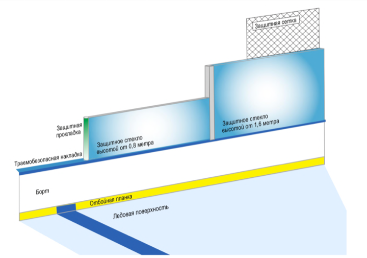

## 1.5. ЛИНИИ

**Линии ворот:**

Красная линия шириной 5 см проводится по всей ширине ледовой поверхности на расстоянии 3,35 м от каждого лицевого борта игровой площадки и продолжается вертикально вверх по боковой поверхности борта. Стойки ворот устанавливаются таким образом, чтобы оставаться неподвижными во время матча на линии ворот.

**Площадь ворот:**

Перед каждыми воротами должна быть обозначена площадь, ограниченная линиями красного цвета, которая называется площадь ворот.

**Синие линии:**

Ледовая поверхность между воротами должна быть разделена на три зоны двумя линиями шириной 30 см синего цвета, которые должны быть нанесены по всей ширине площадки параллельно линиям ворот и продолжаются вертикально вверх по боковой поверхности борта. Эти линии называются синими линиями.

**Центральная красная линия:**

Красная линия шириной 30 см проводится в центре ледовой поверхности по всей ширине параллельно линиям ворот и продолжается вертикально вверх по боковой поверхности борта. Эта линия называется центральной красной линией. В случае, если разрешено размещать рекламу на борту, линия должна быть нанесена, по крайней мере, на отбойной планке.

> _Дополнительную информацию см. в Приложении 6. Инфографика._

## 1.6. ДЕЛЕНИЕ ЛЕДОВОЙ ПОВЕРХНОСТИ

**Зона защиты:**

Часть ледовой поверхности, где расположены ворота, которые защищает команда, называется зоной защиты.

**Нейтральная зона:**

Центральная часть ледовой поверхности называется нейтральной зоной.

**Зона атаки:**

Часть ледовой поверхности, наиболее удаленная от защищаемых ворот, называется зоной атаки.

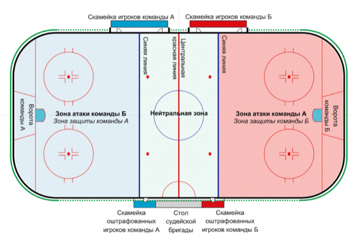

## 1.7. ПЛОЩАДЬ ВОРОТ, ПЛОЩАДЬ СУДЕЙ НА ЛЬДУ

**Площадь ворот (разметка на ледовой поверхности):**

Площадь ворот проводится красной линией шириной 5 см.

> *Правило 1.5 Линии*.

Боковые части линии площади ворот наносятся под прямым углом к линии ворот. Полукруглая красная линия радиусом 1,83 м и шириной 5 см соединяет боковые части линии площади ворот. Область, ограниченная линиями площади ворот и линией ворот, окрашивается в светло-голубой цвет. Область внутри каркаса ворот до линии ворот окрашивается в белый цвет.

**Площадь ворот, границы:**

Площадь ворот включает пространство, ограниченное разметкой на ледовой поверхности, и распространяется вертикально вверх на 1,22 м и далее до верхнего края перекладины ворот.

**Площадь судей на льду:**

Непосредственно перед столом судейской бригады на поверхность льда в форме полукруга наносится площадь, которая называется площадью судей на льду. Красная линия шириной 5 см с радиусом 3,0 м обозначает границы этой площади.

> _Дополнительную информацию см. в Приложении 6. Инфографика._

## 1.8. ОГРАНИЧЕННАЯ ЗОНА ИГРЫ ВРАТАРЯ

— НЕ ПРИМЕНЯЕТСЯ

## 1.9. ТОЧКИ ВБРАСЫВАНИЯ И КРУГИ

**Центральная точка вбрасывания и центральный круг:**

Центральная точка вбрасывания синего цвета диаметром 30 см наносится точно в центре площадки. Из центра этой точки радиусом 4,5 м наносится синей линией шириной 5 см окружность.

**Точки вбрасывания в нейтральной зоне:**

По две точки вбрасывания красного цвета диаметром 60 см наносятся на льду в нейтральной зоне на расстоянии 1,5 м от каждой синей линии. Точки наносятся на расстоянии 14,0 м друг от друга, и каждая должна находиться на одинаковом расстоянии от борта.

Внутри точки вбрасывания наносятся две параллельные линии на расстоянии 8 см от верхней и нижней границ точки. Область, ограниченная двумя линиями, окрашивается в красный цвет, остальная часть в белый.

**Точки вбрасывания и круги в конечных зонах (зона атаки и зона защиты):**

В обеих конечных зонах и по обе стороны от каждых ворот наносятся точки вбрасывания красного цвета диаметром 60 см и круги красного цвета. Точки наносятся на расстоянии 14,0 м друг от друга, и каждая должна находиться на одинаковом расстоянии от борта.

Внутри точки вбрасывания наносятся две параллельные линии на расстоянии 8 см от верхней и нижней границ точки. Область, ограниченная двумя линиями, окрашивается в красный цвет, остальная часть — в белый.

Из центра точек вбрасывания радиусом 4,5 м наносятся красной линией шириной 5 см окружности. На внешней стороне кругов вбрасывания и параллельно линии ворот наносятся две линии красного цвета шириной 5 см и длиной 60 см на расстоянии 1,7 м друг от друга.

На расстоянии 30 см от внешнего края точки вбрасывания наносятся две красные линии шириной 5 см параллельно боковому борту длиной 1,2 м и на расстоянии 45 см друг от друга. Параллельно лицевому борту, начиная с конца линии, ближайшей к точке вбрасывания, наносится красная линия шириной 5 см длиной 90 см.

> _Дополнительную информацию см. в Приложении 6. Инфографика._

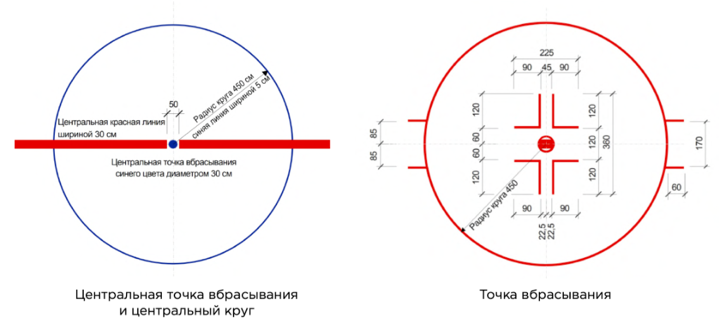

## 1.10. УБОРКА СНЕГА

В случаях, предусмотренных Положением (Регламентом) о соревновании, помимо обычной заливки льда, которая выполняется в перерывах между каждым периодом матча, при необходимости должны быть проведены дополнительные работы по уборке снега.

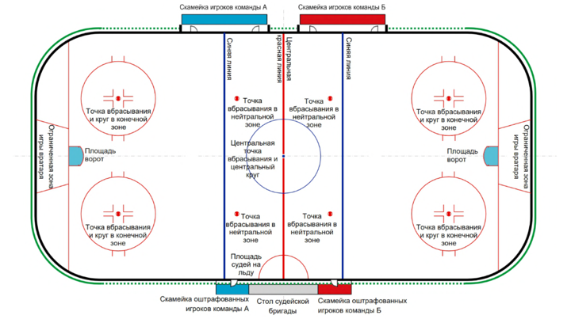

# ПРАВИЛО 2. СТОЙКИ И СЕТКА ВОРОТ

## 2.1. СТОЙКИ ВОРОТ

На ледовой поверхности устанавливаются двое ворот с сетками, по одним в каждом конце игровой площадки. Ворота состоят из каркаса и прикрепленной к нему сетки. Не закрытое сеткой пространство ворот должно быть обращено к центру площадки.

Каждые ворота располагаются по центру линии ворот в концах игровой площадки и установлены таким образом, чтобы оставаться неподвижными во время матча. Стойки ворот должны удерживаться на месте с помощью эластичных фиксаторов, которые вставляются в лед или в основание игровой площадки и могут быть извлечены оттуда только при значительном физическом контакте с воротами. Использование эластичных фиксаторов обязательно, если иное не предусмотрено Положением (Регламентом) о соревновании.

Отверстия для эластичных фиксаторов, удерживающих ворота, должны располагаться точно на линии ворот. Стойки ворот имеют утвержденную ИИХФ конструкцию и материал, располагаются вертикально, высота 1,22 м над поверхностью льда, и на расстоянии 1,83 м друг от друга, измеренном с внутренней стороны стоек. Перекладина из того же материала, что и стойки ворот, должна проходить от вершины одной стойки до вершины другой. Стойки ворот и перекладина должны быть окрашены в красный цвет, а все остальные наружные поверхности каркаса — в белый.

## 2.2. СЕТКА НА ВОРОТАХ

К каждому каркасу ворот прикрепляется сетка, изготовленная из белого нейлонового шнура. Она закрепляется таким образом, чтобы не давать шайбе пройти сквозь сетку, и натягивается так, чтобы шайба оставалась в воротах.

Защита сетки из плотной белой нейлоновой ткани или плотного белого холста обертывается вокруг опорной части каркаса ворот так, чтобы защитить сетку ворот от порезов или повреждений. Установленная защита сетки не должна выступать более чем на 2,5 см над опорной частью основания каркаса. Каркас ворот закрывается нейлоновой сеткой так, чтобы полностью закрыть заднюю часть каркаса.

Защитная обивка каркаса ворот прикрепляется так, чтобы не мешать шайбе полностью пересечь линию ворот, на расстоянии 15 см от внутренней стороны стойки внутрь ворот.

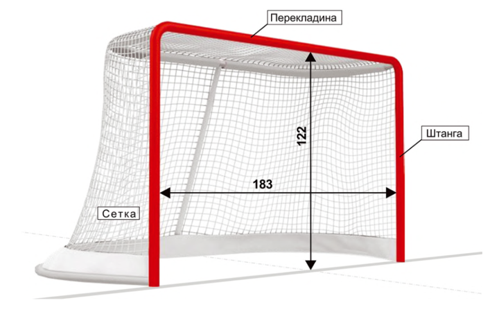

# ПРАВИЛО 3. СКАМЕЙКИ (см. Положение (Регламент) о соревновании)

## 3.1. СКАМЕЙКИ ИГРОКОВ

Игровая площадка оборудуется местами или скамейками для игроков обеих команд. На скамейку игроков будут допущены только одетые в полное игровое снаряжение хоккеисты и персонал команды в количестве, предусмотренном Положением (Регламентом) о соревновании. Команды должны использовать одну и ту же скамейку игроков на протяжении всего матча. Предоставляемое размещение, включая скамейки и калитки, должны быть одинаковыми для обеих команд.

Скамейки игроков располагаются непосредственно вдоль льда, как можно ближе к центру игровой площадки. Две калитки для каждой скамейки игроков должны быть одинаковыми по расположению и размерам, а сами скамейки игроков по возможности располагаются как можно ближе к раздевалкам команд.

Каждая скамейка игроков должна иметь длину 10 м и ширину 1,5 м, и, если она расположена в зрительской зоне, отделяться от зрителей защитным стеклом, чтобы обеспечить необходимую защиту для хоккеистов и персонала команды.

Скамейки игроков должны находиться на одной стороне игровой площадки напротив скамеек оштрафованных игроков и по возможности разделяться друг от друга значительным расстоянием.

**ПРИМЕЧАНИЕ:** Команда, определенная как команда хозяев, имеет право выбора скамейки игроков, если иное не предусмотрено Положением (Регламентом) о соревновании.

> _Дополнительную информацию см. в Приложении 6. Инфографика._

## 3.2. СКАМЕЙКИ ОШТРАФОВАННЫХ ИГРОКОВ

Игровая площадка оборудуется скамейками для оштрафованных игроков.

Для каждой команды должны быть предусмотрены отдельные скамейки оштрафованных игроков, и они должны располагаться по разные стороны от скамейки секретаря матча, напротив скамеек игроков. Команды должны использовать одну и ту же скамейку оштрафованных игроков напротив скамейки игроков своей команды в течение всего матча.

Каждая скамейка оштрафованных игроков должна быть не менее 4,0 м в длину и 1,5 м в ширину и отделена от зрителей защитным стеклом, чтобы обеспечить необходимую защиту для игроков.

Скамейки оштрафованных игроков должны быть одинакового размера и качества, чтобы не создавать никаких преимуществ ни одной из команд, иметь только одну калитку для входа и выхода и быть под контролем судьи при оштрафованных игроках.

Находиться на скамейке оштрафованных игроков разрешено только судье при оштрафованных игроках, оштрафованным игрокам и судьям на льду.

> _Дополнительную информацию см. в Приложении 6. Инфографика._

# ПРАВИЛО 4. СИРЕНА И ТАБЛО (см. Положение (Регламент) о соревновании)

## 4.1. СИРЕНА

Каждая игровая площадка должна быть оснащена звуковым устройством — сиреной, которая звучит автоматически по окончании каждого периода матча. Если звуковое устройство не сработает автоматически по истечении времени, определяющим фактором того, что закончился период, должно быть время на табло.

## 4.2. ТАБЛО

Каждая игровая площадка должна быть оборудована электронным табло с целью точного информирования зрителей, хоккеистов, персонала команд и судей обо всех изменениях времени на всех этапах матча, включая оставшееся время до конца любого периода, и время до окончания наложенных штрафов.

Отсчет времени на табло активируется судьей времени матча с момента вбрасывания шайбы судьей на льду и должен быть остановлен по свистку. Табло должно вести отсчет оставшегося времени матча и оставшееся время штрафов.

Прибор времени матча в течение последней минуты каждого периода должен показывать оставшееся время матча с десятыми долями (1/10) секунды в течение последней минуты каждого периода.

#### СИТУАЦИЯ 1

Судья заметил, что игра началась, но время на табло не отсчитывается. Какова процедура действий?

#### РЕШЕНИЕ

Игра может быть продолжена до того момента, когда судьи будут иметь возможность остановить и (или) будут вынуждены остановить игру (если они хотят остановить игру, это должно быть сделано, когда шайба находится в нейтральной зоне и когда отсутствует неминуемая или реальная возможность произвести взятие ворот — а именно выход один на один, пустые ворота и так далее). Игра может быть продолжена до нормальной остановки в игре. Главный судья должен затем проконсультироваться с судьей времени матча, чтобы установить правильное время матча на табло. *Правило 34.7*.

# КОМАНДЫ

# ПРАВИЛО 5. КОМАНДЫ (см. Положение (Регламент) о соревновании)

## 5.1. ДОПУСК ХОККЕИСТОВ

Матч проводится между двумя командами, под руководством судей на льду и судей в бригаде.

В заявке команды на матч не может быть более предусмотренного Положением (Регламентом) о соревновании количества хоккеистов. В соревнованиях допускается заявить не более двадцати игроков и двух вратарей.

В настоящих Правилах ссылка на хоккеиста относится как к игроку (защитнику или нападающему), так и к вратарю. Ссылка на вратаря означает, что раздел Правил относится только к вратарю. Ссылка на игрока будет означать, что раздел Правил относится только к игроку.

Перед началом матча представитель или тренер команды должен предоставить состав команды либо заявочный лист из хоккеистов, которые имеют право участвовать в матче. Количество хоккеистов, входящих в заявочный лист команды на матч, устанавливается Положением (Регламентом) о соревновании. Для того чтобы команда могла начать матч, она должна иметь возможность вывести на лед не менее пяти игроков и одного вратаря в начале матча.

Только заявленные хоккеисты могут быть включены в состав команды и участвовать в матче. Команда может иметь на льду не более шести хоккеистов — одного вратаря и пятерых игроков в любое время по ходу матча, когда команда не оштрафована.

> *Правило 74 Нарушение численного состава*.

Команда должна выпустить на лед не менее четырех хоккеистов — одного вратаря и трех игроков, если два или более игроков оштрафованы. Команда должна выпустить на лед необходимое количество хоккеистов, чтобы возобновить матч.

> *Правило 66 Прекращение матча*.

## 5.2. ХОККЕИСТЫ, НЕ ИМЕЮЩИЕ ПРАВА УЧАСТВОВАТЬ В МАТЧЕ

В матче могут участвовать только хоккеисты из заявочного листа, предоставленного секретарю матча перед матчем. Всякий раз, когда главный судья идентифицирует хоккеиста, не имеющего права участвовать в матче, этот хоккеист будет отстранен от участия в матче, а команда не сможет заменить его на другого хоккеиста из заявочного списка на сезон.

Никаких дополнительных штрафов не должно быть наложено, но рапорт об инциденте представляется организатору соревнования.

> *Правило 5.3 Вратарь*.

Если происходит взятие ворот, когда на льду находится хоккеист, не имеющий права участвовать в матче (независимо от того, участвовал ли он во взятии ворот или нет), взятие ворот не засчитывается.

Это относится только к взятию ворот, в результате которого в последующую остановку матча был обнаружен не имеющий права играть хоккеист. Все остальные голы, забитые ранее командой хоккеиста, не имеющего права участвовать в матче (с ними на льду или без него), должны быть засчитаны.

Если на хоккеиста налагается штраф, и во время отбывания штрафа будет обнаружено, что хоккеист не имеет права участвовать в матче, он будет отстранен, а другой игрок его команды, назначенный тренером, должен отбыть оставшееся время штрафа.

Никаких дополнительных штрафов не накладывается, но рапорт об инциденте должен быть представлен организатору соревнования.

## 5.3. ВРАТАРЬ

Каждой команде разрешается одновременно иметь на льду по одному вратарю. Вратарь может быть убран со льда и заменен на дополнительного игрока. Такая замена не предусматривает привилегии вратаря дополнительному игроку.

Каждая команда должна заявить двух вратарей в Официальном протоколе матча.

Каждая команда имеет на своей скамейке игроков или на стуле непосредственно рядом со скамейкой игроков (или поблизости) запасного вратаря, который всегда должен быть одет в полное игровое снаряжение и готов к матчу.

За исключением случаев, когда два вратаря выведены из строя, ни одному игроку, указанному в официальном протоколе матча, не разрешается использовать снаряжение вратаря.

В случае если два заявленных на игру вратаря получают травмы или становятся недееспособными, то команде разрешено определить игрока для выполнения функций вратаря. Такому игроку должно быть предоставлено разумное количество времени для переодевания во вратарское снаряжение, в дополнение к двухминутной разминке на льду без шайб. После проведенной замены ни один из указанных в официальном протоколе матча вратарей не имеет права возвращаться в игру.

## 5.4. ТРЕНЕРЫ И ПЕРСОНАЛ КОМАНДЫ

Только хоккеистам в полном игровом снаряжении и персоналу команды, должным образом зарегистрированному в заявочном листе, предоставляется возможность находиться на скамейке игроков.

Каждая команда обязана иметь по крайней мере одного представителя на скамейке игроков, выступающего в качестве тренера, и по крайней мере одного медицинского работника для оказания помощи хоккеистам в случае получения травмы. Если медицинский работник в команде отсутствует, помощь оказывается медицинской бригадой матча.

Если тренер удален до конца матча и команда остается без тренера, официально заявленного на матч, игра должна быть прекращена. Об этом случае будет сообщено в надлежащие инстанции для возможного применения дополнительных дисциплинарных санкций.

## 5.5. ПЕРСОНАЛ КОМАНДЫ И ТЕХНИЧЕСКОЕ ОБЕСПЕЧЕНИЕ

Персонал команды, который находится на скамейке игроков или рядом с ней во время матча, может использовать радиотехнику для связи с другим персоналом команды в зоне, обозначенной организатором соревнований.

Другие формы технического обеспечения разрешены только для целей обучения (например, статистика, видео) и не могут быть использованы, чтобы повлиять на решения судей на льду. Если технические средства используются в этих целях, то главный судья должен наложить соответствующий штраф.

> *Правило 39 Оскорбление судей*.

## 5.6. ПРЕДЫГРОВАЯ РАЗМИНКА НА ЛЬДУ

Во время предыгровой разминки на льду все хоккеисты должны надлежащим образом использовать полное игровое снаряжение. Хоккеисты, зарегистрированные на чемпионате и не указанные в составе команды либо заявочном листе, не могут участвовать в предыгровой разминке на льду. Ни один хоккеист не может провести разминку по окончании периода или во время остановки матча. Во время разминки штрафы не налагаются, но рапорт об инциденте должен быть представлен организатору соревнования.

#### СИТУАЦИЯ 1

В 14:00 первого периода команда А производит взятие ворот. Непосредственно перед вбрасыванием шайбы главным судьей в центре игровой площадки тренер команды Б подзывает главного судью к своей скамейке игроков. Затем тренер информирует главного судью, что фамилия хоккеиста команды А №48, который был на льду в момент взятия ворот, неправильно записана в заявочном списке команды. Что должны предпринять судьи? Где вы найдете это в Правилах?

#### РЕШЕНИЕ

Главные судьи должны отменить взятие ворот, а хоккеист команды А №48 должен быть отстранен от участия в матче, так как он незаконно участвует в матче. *Правило 5.2*, *Правило 78.5 пункт 4*.

**ПРИМЕЧАНИЕ:** Здравый смысл должен возобладать при принятии этого решения. Если, например, фамилия, вызывающая вопрос в составе команды, написана с ошибками, то это не будет считаться нарушением данного правила и взятие ворот должно быть засчитано. Однако, если под данным игровым номером заявлен хоккеист с другой фамилией, то это будет считаться нарушением правила, и взятие ворот должно быть отменено.

#### СИТУАЦИЯ 2

Команда А производит взятие ворот в 12:00 второго периода. Команда Б предъявляет претензию, что игрок команды А №12 не заявлен на игру и находился на льду во время взятия ворот. Команда также заявила, что ему присудили пас при взятии ворот в первом периоде. Какое должно быть решение главного судьи? Где вы найдете это в Правилах?

#### РЕШЕНИЕ

Если взятие ворот произошло, когда незаконный хоккеист находится на льду, вне зависимости от того, принимал ли он участие во взятии ворот или нет, то взятие ворот должно быть отменено. Это относится только ко взятию ворот, на который обратили внимание непосредственно в остановку игры, связанную с этим взятием ворот, при участии незаконного игрока.

Все остальные взятия ворот, произведенные командой незаконного хоккеиста, с его нахождением на льду или нет, должны быть засчитаны. Незаконный хоккеист должен быть отстранен от участия в матче, и никаких дополнительных штрафов не должно быть наложено. *Правило 5.2*.

#### СИТУАЦИЯ 3

Игрок №12 включен в заявку на игру, но под ошибочной фамилией и именем. Фамилия и имя дублируют фамилию и имя другого хоккеиста в заявке на игру. На это обращено внимание главного судьи в процессе игры. Должна ли фамилия или номер или то и другое соответствовать в заявке?

Пример:

- №2 Иван Иванов
- №4 Петр Петров
- №8 Василий Васильев
- №10 Олег Олегов
- №12 Иван Иванов

#### РЕШЕНИЕ

Фамилия и имя должны быть правильными. Хоккеист под номером №12 должен был быть записан как Михаил Михаилов, но произошла ошибка. Таким образом, хоккеист №12 должен быть отстранен от участия в матче.

#### СИТУАЦИЯ 4

Команда А ведет в счете 4-0. В 08:59 первого периода команда Б уведомляет главного судью, что игрок команды А №13 не включен в заявочный список команды. Игрок команды А №13 забросил три шайбы в матче. Что должны предпринять судьи? Где вы найдете это в Правилах?

#### РЕШЕНИЕ

Игрок команды А №13 отстраняется от участия в матче. Так как команда Б уведомила об этом судей во время обычной остановки игры, то все заброшенные шайбы должны быть засчитаны. *Правило 5.2*.

#### СИТУАЦИЯ 5

В самом начале первого периода на вратаря команды А был наложен дисциплинарный штраф до конца матча. Запасной вратарь этой команды вступает в игру и получает травму во втором периоде и не может продолжить игру. Может ли первый вратарь команды А, который был удален из игры в первом периоде, возвратиться обратно в игру?

#### РЕШЕНИЕ

Нет, первый вратарь команды А не имеет права участвовать в игре, так как на него был наложен дисциплинарный штраф до конца матча. Команда А имеет право переодеть одного игрока из заявочного списка на игру во вратаря. *Правило 5.3*.

# ПРАВИЛО 6. КАПИТАН И АССИСТЕНТ КАПИТАНА

## 6.1. КАПИТАН

Каждая команда должна назначить одного капитана, и только он имеет право обсуждать с главным судьей/судьями любые вопросы, касающиеся толкования настоящих Правил, которые могут возникнуть в процессе матча.

Капитан должен иметь букву «К» или «С» на передней части своего свитера размером 8 см в высоту и контрастными по цвету с фоном свитера. Не разрешается иметь двух капитанов. Разрешается иметь одного капитана и не более двух ассистентов капитана.

На капитана, ассистента капитана или на хоккеиста, который покидает скамейку игроков и выражает протест или с любой целью вмешивается в работу судей, накладывается малый штраф за неспортивное поведение.

> *Правило 39 Оскорбление судей*.

Если этот протест продолжается, на него может быть наложен дисциплинарный штраф, а если он будет продолжать и дальше вести себя таким образом, на него должен быть наложен дисциплинарный штраф до конца матча.

Возмущение, касающееся штрафа, не является вопросом, относящимся к трактовке правил, и малый штраф накладывается на капитана, ассистента капитана или любого другого хоккеиста, выражающего такое возмущение.

Перед началом каждого матча главному судье и секретарю матча сообщаются имена капитана и ассистентов капитана обеих команд.

Команда не может менять своего капитана или ассистентов капитана во время матча. Если капитан выбывает из матча или не может продолжать матч из-за травмы, один из ассистентов капитана должен взять на себя его обязанности.

Если оба, капитан и ассистент капитана, находятся на льду, только капитану дано право говорить с главным судьей об интерпретации Правил.

На капитана или ассистента капитана, покидающего скамейку игроков без приглашения главного судьи, накладывается соответствующий штраф.

Играющему тренеру, менеджеру команды или вратарю не разрешается выступать в качестве капитана или ассистента капитана.

> *Правило 39 Оскорбление судей*.

## 6.2. АССИСТЕНТ КАПИТАНА

Если капитан не находится на льду, ассистенту капитана должны быть предоставлены права капитана. Ассистент капитана должен иметь букву «А» на передней части своего свитера размером 8 см в высоту и контрастным по цвету с фоном свитера.

#### СИТУАЦИЯ 1

Команда желает назначить двух капитанов. Может ли главный судья разрешить команде иметь больше одного капитана?

#### РЕШЕНИЕ

Нет, команды должны назначить только одного капитана на каждую игру. Команды имеют право назначить не более двух ассистентов капитана. Отказ назначить капитана не приводит к наложению штрафа, но об этом должно быть сообщено организатору соревнований. *Правило 6*.

#### СИТУАЦИЯ 2

Секретарь матча сообщает главному судье перед началом игры, что тренер команды А отказывается назначить капитана и ассистентов капитана. Как, в случае необходимости, должен поступить главный судья?

#### РЕШЕНИЕ

Главный судья должен проинформировать тренера команды А, что в случае его отказа назначить капитана и (или) ассистентов капитана он теряет свое право иметь представителя в своей команде, имеющего право обсуждать вопросы с судьями в процессе игры. *Правило 6* и *Правило 33*.

# ПРАВИЛО 7. СТАРТОВЫЙ СОСТАВ (см. Положение (Регламент) о соревновании)

# ПРАВИЛО 8. ТРАВМИРОВАННЫЙ ХОККЕИСТ

## 8.1. ТРАВМИРОВАННЫЙ ИГРОК

Когда игрок получает травму или вынужден покинуть лед во время матча, он может быть заменен запасным игроком, а игра продолжается, и команды не должны покидать лед.

Если во время игровых действий травмированный игрок хочет покинуть лед и быть замененным на запасного игрока, он должен сделать это через скамейку игроков. В случае проведения замены через другой выход, ведущий с игровой площадки, на нарушившую правила команду накладывается малый скамеечный штраф.

Если оштрафованный игрок получил травму, он может проследовать в раздевалку, не занимая место на скамейке оштрафованных игроков. Команда оштрафованного игрока должна немедленно поместить на скамейку оштрафованных игроков заменяющего игрока, который должен отбывать штраф до тех пор, пока травмированный игрок не сможет вернуться в матч. Команда может поместить игрока, получившего медицинскую помощь, вместо игрока, отбывающего штраф за него, на скамейку оштрафованных игроков в следующей остановке матча.

Если травмированный оштрафованный игрок, который был заменен на скамейке оштрафованных игроков, получит медицинскую помощь и вернется на свою скамейку игроков до истечения времени своего штрафа, он не будет иметь права играть до истечения времени своего штрафа, пока заменяющий игрок все еще находится на скамейке оштрафованных игроков в ожидании остановки в матче. За нарушение этого правила должен быть наложен малый скамеечный штраф.

Травмированный игрок, получивший медицинскую помощь, должен дождаться, когда заменяющий его игрок не выйдет со скамейки оштрафованных игроков, прежде чем он сможет принимать участие в игровых действиях. Если, однако, происходит остановка матча до истечения его штрафа, он может заменить партнера по команде на скамейке оштрафованных игроков, и тогда он имеет право вернуться на лед, как только время его штрафа истечет.

Если игрок получил травму, из-за которой он не может продолжать игру или покинуть лед, игра не должна останавливаться до тех пор, пока его команда не получит контроль над шайбой. Если команда игрока контролирует шайбу в момент получения им травмы, игра должна быть немедленно остановлена, если только его команда не имеет реальной возможности взятия ворот.

В случае когда очевидно, что игрок получил серьезную травму, главный и (или) линейный судья может немедленно остановить игру.

Если игрок получил травму и произошла остановка матча, врач команды (или работник медицинской бригады матча) может выйти на лед для оказания помощи травмированному игроку, не дожидаясь разрешения от главного судьи.

Когда игра была остановлена главным или линейным судьей из-за травмированного игрока или когда травмированный игрок находится на льду под наблюдением тренера или медицинского персонала, такой игрок должен быть немедленно заменен. Этот травмированный игрок не может вернуться на лед до тех пор, пока игра не возобновится.

Если игра остановлена из-за травмированного игрока, вбрасывание производится в точке вбрасывания, ближайшей к месту нахождения шайбы.

Если команда травмированного игрока контролировала шайбу в зоне атаки, вбрасывание должно быть произведено в ближайшей точке вбрасывания в нейтральной зоне.

Если травмированный игрок находился в своей зоне защиты, а команда соперника владела шайбой в этой же зоне, вбрасывание должно быть произведено в точке вбрасывания, ближайшей к месту нахождения шайбы.

На игрока, который лежит на льду, симулирует травму и (или) отказывается встать со льда, будет наложен малый штраф.

## 8.2. ТРАВМИРОВАННЫЙ ВРАТАРЬ

Если вратарь получил травму или почувствовал себя плохо, он должен быть готов немедленно возобновить игру или должен быть заменен запасным вратарем. Дополнительное время для того, чтобы травмированный или почувствовавший себя плохо вратарь мог вернуться на свою позицию, не предоставляется.

Во всех матчах не допускается разминка для запасного вратаря.

Запасной вратарь подчиняется обычным правилам, относящимся к вратарям, и имеет те же самые привилегии.

После замены травмированного вратаря ему не разрешено возвращаться на свою позицию до следующей остановки матча. За нарушение правила должен быть наложен малый штраф за задержку игры.

Если игра была остановлена главным или линейным судьей из-за травмы вратаря, такой вратарь будет заменен только в том случае, если он проследует на скамейку игроков для получения медицинской помощи.

В случае травмы вратаря и остановки матча врач команды (или работник медицинской бригады матча) может выйти на лед для оказания помощи травмированному вратарю, не дожидаясь разрешения главного судьи.

Если врач или работник медицинской бригады матча вышел на лед, чтобы оказать помощь вратарю, и нет неоправданной задержки времени матча, вратарь может остаться в игре. Однако главный судья не должен давать ему дополнительного времени для разминки.

## 8.3. КРОВЬ

Хоккеист, имеющий видимую кровь на униформе, снаряжении или открытых частях тела, должен быть отправлен со льда во время следующей остановки матча. Такой хоккеист не может вернуться в игру до тех пор, пока кровотечение не будет остановлено, а порез или ссадина не будут обработаны (если это необходимо). Требуется, чтобы униформа или любая часть снаряжения, испачканная кровью, была продезинфицирована или заменена.

#### СИТУАЦИЯ 1

За 10 секунд до окончания первого периода на игроков обеих команд был наложен малый штраф за грубость. Один из оштрафованных игроков должен отправиться в раздевалку, чтобы исправить снаряжение. Должна ли команда поместить другого игрока на скамейку для оштрафованных для отбывания этого штрафа? Если да, то должен ли это быть кто-либо из игроков, находившихся на льду? В какой момент необходимо определить кого-либо из игроков, находившихся на льду? Где вы найдете это в Правилах?

#### РЕШЕНИЕ

В правилах указано, что команда должна немедленно произвести замену получившего травму игрока, и заменяющий игрок должен отбывать штраф до момента, когда травмированный игрок сможет возвратиться в игру. Любой игрок может отбывать штраф, за исключением запасного вратаря. Только штрафы на вратаря должны отбываться кем-либо, находящимся на льду, в момент совершения нарушения. *Правило 8.1 абзац 3* и *Правило 27.1*.

#### СИТУАЦИЯ 2

На игроков налагается совпадающий штраф, который не будет показан на табло. Оштрафованный игрок ушел в раздевалку, чтобы исправить снаряжение. По окончании его штрафного времени, но до того, как произошла остановка игры, следующая за окончанием его штрафа, игрок возвращается на скамейку игроков. Может ли он участвовать в игре (выйти на лед в процессе замены по ходу игры) или он будет считаться незаконно вступившим в игру игроком? Где вы найдете это в Правилах?

#### РЕШЕНИЕ

Он будет считаться незаконно вступившим в игру, так как он не по правилам покинул скамейку для оштрафованных игроков. *Правило 8.1 абзац 3*, *Правило 68.1 абзац 2* и *Правило 78.5 пункт 4*.

#### СИТУАЦИЯ 3

Вбрасывание в зоне защиты команды А, игрок команды А №20 пытается выиграть шайбу движением клюшки назад, и в процессе действия попадает концом своей клюшки в лицо игроку команды Б №10. Игрок команды Б №10 сразу же падает на лед и у игрока идет кровь, игра останавливается. Главный судья не видел, что произошло. Линейный судья информирует главного судью о том, что произошло. Какое решение должен принять главный судья? Где будет вбрасывание? Где вы найдете это в Правилах?

#### РЕШЕНИЕ

Если после совещания с линейным судьей, который видел, что произошло, выясняется, что контакт был случайным вследствие того, что оба игрока были наклонены в процессе вбрасывания, то штраф не должен быть наложен. Вбрасывание должно быть проведено в ближайшей точке вбрасывания в нейтральной зоне. *Правило 8.1 абзац 12* и *Правило 60.1*.

#### СИТУАЦИЯ 4

Во время выполнения бросков, определяющих победителя матча, игрок, выполняющий бросок, пытаясь обыграть вратаря, падает и скользит во вратаря. Шайба не заходит в ворота, но вратарь получает травму. Команда Б выставила запасного вратаря в ворота для участия в следующем броске. Разрешена ли вратарю разминка? Где вы найдете это в Правилах?

#### РЕШЕНИЕ

Разминка вратарю не разрешена. *Правило 8.2 абзац 2*.

#### СИТУАЦИЯ 5

Во втором периоде игра была остановлена вследствие травмы, полученной вратарем команды А. Он покинул лед и был заменен запасным вратарем. Игра возобновилась, и в промежутке времени до первой остановки команда А меняет вратарей по ходу игры, возвращая в ворота основного вратаря, который получил травму. Это разрешено? Где вы найдете это в Правилах?

#### РЕШЕНИЕ

Это не разрешено, и штраф за участие незаконного хоккеиста в игре должен быть наложен. Если вратарь вступает в игру со скамейки игроков во время остановки игры для замены вратаря, находящегося на льду, получившего травму, вратари не могут меняться местами до следующей остановки в игре. *Правило 8.2 абзац 4*.

#### СИТУАЦИЯ 6

Вратарь команды А получил травму и был заменен запасным вратарем. Игра возобновляется, а травмированный вратарь, находящийся на скамейке игроков, оправился от травмы и хочет возвратиться на лед в ворота. Команда А решает произвести замену вратарей по ходу игры. Сразу же после замены команда А производит взятие ворот. Как, если необходимо, должны поступить судьи?

#### РЕШЕНИЕ

Получивший травму вратарь не может возвратиться в игру до первой остановки в игре (*Правило 8.2 абзац 4*). Кроме того, он считается незаконно участвующим в игре хоккеистом, и команде А не может быть засчитано взятие ворот. Взятие ворот отменяется, и на вратаря налагается малый штраф. *Правило 78.5 пункт 4*.

#### СИТУАЦИЯ 7

Вратарь команды А получил травму и был заменен на запасного вратаря. Игра возобновляется, а травмированный вратарь, находящийся на скамейке игроков, оправился от травмы и хочет возвратиться на лед в ворота. Команда А решает произвести замену вратарей по ходу игры. Сразу же после замены команда Б случайно забрасывает шайбу в свои ворота. Как, если необходимо, должны поступить судьи?

#### РЕШЕНИЕ

Получивший травму вратарь не может возвратиться в игру до первой остановки в игре (*Правило 8.2 абзац 4*). Кроме того, он считается незаконно участвующим в игре хоккеистом, и команде А не может быть засчитано взятие ворот (даже если команда Б забросила шайбу в свои ворота). Взятие ворот отменяется, и на вратаря налагается малый штраф. *Правило 78.5 пункт 4*.

#### СИТУАЦИЯ 8

Разрешается ли замена основного вратаря на запасного вратаря по ходу игры (т.е. может ли вратарь, находящийся на льду, поменяться с запасным вратарем по ходу игры)?

#### РЕШЕНИЕ

*Правило 74.1* гласит: «Хоккеисты могут быть заменены в любое время во время игры со скамейки игроков...». Правило не исключает замену вратарей. Так что да, можно. Вратари могут меняться по ходу игры. Однако существуют три исключения из правила:

- **а)** Если вратарь, находящийся на скамейке игроков, вступает в игру в остановку игры с целью замены вратаря, находящегося на льду, получившего травму, обратная замена вратарей не может быть произведена до следующей остановки игры. *Правило 8.2 абзац 4*.
- **б)** Если команда решает заменить своего вратаря для защиты ворот при назначении штрафного броска, замененный вратарь должен оставаться в игре до первой остановки игры. *Правило 24.2 абзац 11*.
- **в)** Вратарь, замененный на дополнительного игрока в дополнительном периоде в игре регулярного чемпионата, должен дождаться следующей остановки игры, чтобы вернуться на лед в ворота. Любая попытка вернуться на лед в ворота до следующей остановки игры (по ходу игры) должна трактоваться как неправильная замена, и малый скамеечный штраф должен быть наложен. *Правило 74.5*.

Следует заметить, что замена вратарей, описанная в *Правиле 82.1 абзац 8*, относится к замене вратарей в остановку игры и не относится к данной ситуации.

#### СИТУАЦИЯ 9

Оба вратаря либо травмированы, плохо себя чувствуют, либо по некоторым причинам не могут принять участие в игре. Как поступить команде?

#### РЕШЕНИЕ

Если это обнаружилось перед игрой, то команда может переодеть любого игрока из заявочного списка команды во вратаря и тем самым включить его в командный состав на игру. Если это случилось в процессе игры, команде должно быть предоставлено разумное количество времени, чтобы переодеть одного игрока из заявочного списка команды во вратаря, и данному игроку будет предоставлены все права вратаря на оставшееся время игры. *Правило 5.3*.

#### СИТУАЦИЯ 10

Команда Б находится в положении отложенного положения «вне игры». Команда А владеет шайбой за своими воротами, и в этот момент раздается свисток, так как игрок команды А получил на льду травму в нейтральной зоне. Где должно быть проведено вбрасывание? Превалирует ли получение игроком травмы над отложенным положением «вне игры»?

#### РЕШЕНИЕ

Так как положение отложенного «вне игры» действует, то вбрасывание должно быть проведено в нейтральной зоне в ближайшей точке вбрасывания, примыкающей к зоне защиты команды А. *Правило 8.1 абзац 11*.

#### СИТУАЦИЯ 11

Игрок команды Б №8 попал в лицо игроку команды А №4 высоко поднятой клюшкой. Отложенный штраф фиксируется на игрока команды Б №8. Игра останавливается, как только команда Б получает владение и контроль над шайбой. Игрок команды А №4 не травмирован, но игровой персонал появляется на льду, чтобы оказать помощь игроку. Несмотря на то, что игра была остановлена по причине наложения штрафа, разрешено ли игроку команды А №4 остаться на льду? Где вы найдете это в Правилах?

#### РЕШЕНИЕ

Вне зависимости от причины, по которой произошла остановка игры, всякий раз, когда травмированному игроку оказывается на льду помощь со стороны командного или медицинского персонала, данный игрок должен быть немедленно заменен. Травмированный игрок не может вернуться на лед до возобновления игры. *Правило 8.1*.

#### СИТУАЦИЯ 12

Во время игры в зоне защиты команды А защитник команды А получает травму, блокируя бросок. Игрок ползет к скамейке игроков, а в это время персонал команды открывает калитку в борту за пределами скамейки игроков, вытаскивает травмированного защитника со льда и направляется немедленно в раздевалку. Это разрешено и где вы найдете это в Правилах?

#### РЕШЕНИЕ

Нет, это считается неправильной заменой игроков. Если травмированный игрок хочет покинуть лед и быть замененным, он должен сделать это на скамейке игроков, а не через любой другой выход. Поэтому должен быть наложен малый скамеечный штраф. *Правило 8.1 абзац 2*.

# СНАРЯЖЕНИЕ

# ПРАВИЛО 9. СНАРЯЖЕНИЕ (см. Положение (Регламент) о соревновании)

## 9.1. УНИФОРМА КОМАНД

Все хоккеисты каждой команды должны быть одеты в одинаковую униформу — свитеры, шорты, гамаши и шлемы с утвержденным организатором соревнований дизайном и цветом.

Все свитеры команды должны иметь одинаковый дизайн, включая логотип спереди, номера на рукавах и спине и нашивку с фамилией на спине. Основной цвет униформы должен составлять приблизительно 80 % поверхности свитеров и гамаш, за исключением нашивки с фамилией и номера. Если, по мнению главного судьи, цвета униформы соперничающих команд слишком похожи и существует вероятность неправильной идентификации хоккеистов, команда хозяев должна поменять свитеры.

Все хоккеисты команды должны носить одинаковую униформу и номера на свитерах во время разминки на льду, как и во время матча. Любые изменения униформы, например вставки на липучках, свитеры большого размера, измененные воротники и так далее, не допускаются. Игрок или вратарь, не соблюдающий это правило, не допускается к участию в матче. Хоккеистам не разрешается менять номера или меняться номерами после начала матча. Они должны носить свитеры с присвоенными номерами на протяжении всего матча и на протяжении всего соревнования.

Исключением из этого правила являются случаи, когда свитер хоккеиста оказывается запачканным кровью или сильно разорван во время матча. Тогда судья на льду может потребовать, чтобы хоккеист покинул лед и переоделся в специально приготовленный (запасной) свитер с другим номером и без нашивки с фамилией.

Каждая команда должна разработать и носить отличительную и контрастную униформу для своих домашних и выездных игр, никакие части которой не должны быть взаимозаменяемыми, кроме шорт. О проблемах, связанных с униформой хоккеиста, главный судья должен сообщить организатору соревнования.

Все хоккеисты должны носить игровые шорты в опрятном виде. Шорты должны быть одного цвета по всей окружности и по всей длине. Шорты не должны быть разорваны, обрезаны или порваны в области ноги или бедра.

Рисунки в стиле граффити, орнаменты, росписи или лозунги оскорбительного или нецензурного содержания, касающиеся культуры, расовой принадлежности или вероисповедания, не допускается размещать ни на одной части униформы.

## 9.2. НОМЕРА И НАШИВКИ С ФАМИЛИЕЙ

Хоккеисты, не соблюдающие эти правила, не допускаются к участию в матче, если иное не предусмотрено Положением (Регламентом) о соревновании.

Каждый хоккеист, указанный в составе команды, должен носить индивидуальный идентификационный номер высотой 25–30 см на спине свитера и 10 см на обоих рукавах. Числа ограничены целыми числами от 1 до 99. Номера свитеров, такие как 00, дроби (½), десятичные дроби (.05), трехзначные (101), не допускаются. В одной команде не должно быть двух хоккеистов под одним и тем же номером в одном и том же матче.

Кроме того, каждый хоккеист должен иметь нашивку со своей полной фамилией, печатными буквами высотой 10 см, расположенную поперек своего свитера на спине на уровне плеч, выполненную заглавными латинскими буквами, шрифтом, одобренным до начала матча или соревнования.

Если у хоккеиста длинные волосы, которые скрывают номер на спине свитера, он должен собрать волосы в косичку или убрать их под шлем. Если хоккеист не соблюдает это требование, на него после предупреждения должен быть наложен дисциплинарный штраф.

> *Правило 75.4 пункт 5 Неспортивное поведение*.

## 9.3. СВИТЕР ИГРОКА

Игроки, не соблюдающие эти правила, не допускаются к участию в матче, если иное не предусмотрено Положением (Регламентом) о соревновании.

Свитер не должен опускаться по длине ниже шорт, а рукава не должны быть ниже пальцев перчаток. Стандартный свитер, изготовленный производителем, не должен иметь вставок или дополнений. Модификации на заводе-изготовителе не допускаются, если они заранее не одобрены организатором соревнований.

Свитеры должны надеваться поверх шорт и надежно пристегиваться к шортам специальным ремнем на протяжении всего времени.

Несоблюдение этого правила любым игроком команды после вынесенного предупреждения приведет к наложению малого штрафа.

> *Правило 63 Задержка игры*.

## 9.4. СВИТЕР ВРАТАРЯ

Вратари, не соблюдающие эти правила, не допускаются к участию в матче, если иное не предусмотрено Положением (Регламентом) о соревновании. Свитер не должен быть чрезмерно большим.

Стандартный свитер вратаря, изготовленный производителем, не должен иметь вставок или дополнений. Модификации на заводе-изготовителе не допускаются, если они заранее не одобрены организатором соревнований.

Не допускается «стягивание» свитера на запястьях, если это создает натяжение свитера, позволяющее создать «эффект паутины», который не допускается. Никаких иных стяжек, ведущих к созданию такого эффекта, не допускается. Свитер считается незаконным, если длина его такова, что закрывает любое пространство между ног вратаря.

## 9.5. ЗАЩИТНОЕ СНАРЯЖЕНИЕ

Защитное снаряжение должно соответствовать стандартам безопасности и использоваться только для защиты хоккеистов, а не для повышения или улучшения игровых навыков или нанесения травм сопернику.

Всем хоккеистам настоятельно рекомендуется носить устойчивое к порезам нательное белье и носки.

Все защитное снаряжение, за исключением перчаток, защиты головы, капы, средств защиты шеи и щитков вратарей, должно быть надето под униформой. Полное игровое снаряжение должно использоваться во время матча и во время предыгровой разминки.

Всякий раз, когда главный судья считает, что хоккеист использует защитное снаряжение, не соответствующее правилам, он должен дать ему указание исправить или заменить это защитное снаряжение. Соответствующий хоккеист и его команда будут предупреждены привести защитное снаряжение в соответствие.

После предупреждения все хоккеисты этой команды, использующие такое защитное снаряжение, должны быть наказаны в соответствии с *Правилом 12 Незаконное снаряжение* без предупреждения.

Если до сведения главного судьи будет доведено, что у игрока, например налокотник, не прикрыт его свитером, он должен будет проинструктировать игрока и предоставить ему возможность исправить замечание и прикрыть этот налокотник. Второе нарушение того же самого игрока или другого с таким же нарушением приведет к наложению малого штрафа. Если тот же игрок отказывается выполнить указание главного судьи и продолжает играть, не исправив защитное снаряжение, на него должен быть наложен дисциплинарный штраф. Если это произойдет в третий раз, на игрока будет наложен дисциплинарный штраф до конца матча.

## 9.6. ШЛЕМ

Все хоккеисты должны носить шлем, форма которого, материал и конструкция предназначены для игры в хоккей с шайбой, с подбородным ремешком, который всегда должен быть надежно застегнут, в том числе во время предыгровой разминки, во время матча, нахождения на игровой площадке, на скамейке игроков или оштрафованных игроков.

Шлем должен быть надет таким образом, чтобы он не мог слететь с головы. Если шлем слетел с головы, а не был сдернут с головы соперником, значит он был неправильно одет на голову.

Игроку на льду, шлем которого слетел с его головы во время игровых действий, не разрешается поднять его и надеть обратно на голову. Игрок должен немедленно проследовать к своей скамейке игроков и покинуть ледовую поверхность. Каждый раз, когда игрок не соблюдает это правило, на него должен быть наложен малый штраф без предупреждения.

> *Правило 12 Незаконное снаряжение*.

Если игрок возвращается на свою скамейку игроков для замены, он может вернуться на лед во время матча только в шлеме с застегнутым подбородным ремешком.

Ни один игрок не может выйти со скамейки игроков и скамейки оштрафованных игроков во время матча без шлема или в шлеме с незастегнутым подбородным ремешком. Каждый раз, когда игрок не соблюдает данное правило, игра будет остановлена, как только его команда получит контроль над шайбой, и на нарушившего правила игрока должен быть наложен малый штраф.

Если подбородный ремешок игрока отстегивается во время игровых действий, но шлем остается на голове, он может продолжать играть до следующей остановки или до тех пор, пока не покинет лед. На игрока, который намеренно сбивает шлем соперника во время матча, должен быть наложен малый штраф за грубость.

> *Правило 51 Грубость*.

Если шайба попадает в лицевую маску вратаря после сильного броска, и главный судья считает, что вратарь ошеломлен и не может выполнять свои обязанности после такого броска, главный судья может остановить матч по соображениям безопасности, если атакующая команда не имеет неминуемой возможности произвести взятие ворот.

Если вратарь обронил шлем или любую часть защитного снаряжения, или защита шеи расстегнулась или слетела с шеи, игра должна быть немедленно остановлена, чтобы дать вратарю возможность подобрать снаряжение и надеть обратно. За исключением ситуации, когда команда соперника имеет неминуемую возможность взятия ворот. Остановка матча должна быть осуществлена главным судьей. Когда игра остановлена, вбрасывание должно быть произведено в точке вбрасывания, ближайшей к месту нахождения шайбы.

Если вратарь намеренно снимает шлем или любую часть защитного снаряжения, чтобы вызвать остановку матча, главный судья должен остановить игру, как описано выше, и наложить на вратаря малый штраф за задержку игры.

> *Правило 63 Задержка игры*.

Если вратарь намеренно снимает шлем или любую часть защитного снаряжения, когда игрок команды соперника находится в положении выхода один на один (*Правило 24.8 Нарушения*), главный судья должен присудить взятие ворот не нарушившей правила команде.

Если вратарь намеренно снимает шлем или любую часть защитного снаряжения во время выполнения штрафного броска или бросков, определяющих победителя матча, главный судья должен присудить взятие ворот не нарушившей правила команде.

> *Правило 63 Задержка игры*.

## 9.7. ЗАЩИТА ЛИЦА

Существует четыре разрешенных вида защиты лица, которые можно прикрепить к передней части шлема хоккеиста: козырек для защиты глаз, решетчатая маска, полная пластмассовая маска или комбинированная маска. Решетчатая маска, решетчатая полумаска, полная пластмассовая маска и комбинированная маска без мягкой защиты подбородка запрещены.

Все игроки, родившиеся после 31 декабря 1974 года, должны носить, как минимум, козырек для защиты глаз в качестве защиты лица. Козырек для защиты глаз должен быть надлежащим образом прикреплен к шлему и должен быть опущен так, чтобы обеспечить достаточную защиту глаз, полностью закрывая глаза и нос. Он должен быть прикреплен к шлему так, чтобы его нельзя было поднять. Игрок, чей козырек для защиты глаз треснул или сломался во время игровых действий, должен немедленно покинуть лед.

Игрокам не разрешается носить цветной или тонированный козырек для защиты глаз, который препятствует зрительному контакту хоккеистов. Представители и тренеры команды должны убедиться, что их игроки снаряжены шлемами и защитой лица, изготовленными и одобренными специально для хоккея с шайбой, и что к шлему должным образом прикреплен козырек для защиты глаз или маска, полностью защищающая лицо.

Специальные правила и руководства для соответствующей защиты головы, лица, шеи, рта (капа) в соревнованиях среди спортсменов женского пола и юниоров в категории «до 21 года» и «до 18 лет» можно найти в соответствующих правилах, указанных ниже.

> *Правило 102 Специальные правила использования снаряжения*;
> *Правило 202 Специальные правила использования снаряжения*.

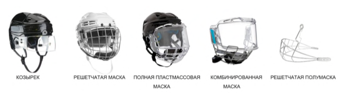

## 9.13. КАПА

Капа предназначена для защиты зубов и челюстей от ударов, а также снижает риск сотрясения мозга.

Все игроки, рожденные после 31 декабря 1998 года, использующие козырек для защиты глаз, обязаны использовать капу. В остальных случаях использование капы на протяжении всего времени нахождения на льду игроков, независимо от их возраста, носит исключительно рекомендательный характер.

Игроки, участвующие в соревновании взрослых команд, относящиеся к возрастной категории «до 21 года» и «до 18 лет», обязаны использовать соответствующее защитное снаряжение этих возрастных категорий «до 21 года» и «до 18 лет» в соответствии со специальными правилами.

Специальные правила и руководства для защиты головы, лица, шеи, рта (капа) в соревнованиях среди спортсменов женского пола и юниоров в категории «до 21 года» и «до 18 лет» можно найти в соответствующих правилах, указанных ниже.

> *Правило 102 Специальные правила использования снаряжения*;
> *Правило 202 Специальные правила использования снаряжения*.

#### СИТУАЦИЯ 1

Свитер игрока порвался в процессе игры. Разрешается ли игроку продолжать игру с разорванным свитером или должен ли он быть уведомлен, что ему надлежит заменить или отремонтировать свитер, прежде чем ему будет разрешено продолжить участие в игре?

#### РЕШЕНИЕ

Свитер будет считаться незаконным и должен быть отремонтирован или заменен, прежде чем игроку будет разрешено вернуться в игру. *Правило 9.1 абзац 4*.

#### СИТУАЦИЯ 2

Во время игры игрок теряет свой шлем. Он решает произвести замену по ходу игры. Игра продолжается без остановок, и этот же игрок возвращается на лед для участия в игре, все еще без шлема. Это разрешено? Где вы найдете это в Правилах?

#### РЕШЕНИЕ

Нет, это не разрешено. Если он возвращается на лед без шлема, игра должна быть остановлена, как только его команда завладеет шайбой, и на него должен быть наложен малый штраф. *Правило 9.6 абзац 4*.

#### СИТУАЦИЯ 3

Игрок команды А теряет свой шлем во время игры. Он меняется по ходу игры и сразу возвращается на лед без шлема. Судьи немедленно фиксируют это и дают свисток на остановку игры, как только команда А осуществляет контроль над шайбой. Где будет вбрасывание?

#### РЕШЕНИЕ

Так как в результате остановки был наложен малый штраф на игрока команды А, вбрасывание должно быть проведено в одной из точек вбрасывания зоны защиты команды А. *Правило 9.6 абзац 4*.

#### СИТУАЦИЯ 4

Игрок находится на скамейке для оштрафованных без шлема (его ремонтируют на скамейке игроков его команды). Игра идет без остановок, и он не может получить свой шлем до окончания своего штрафа. Он выходит на лед без шлема и направляется по льду к скамейке игроков своей команды в процессе игры. Как, если необходимо, должны поступить судьи? Где вы найдете это в Правилах?

#### РЕШЕНИЕ

Данное действие должно быть рассмотрено аналогично действию игрока, выходящего на лед со скамейки игроков без шлема. Как только его команда завладеет контролем над шайбой, игра останавливается и налагается малый штраф на игрока, вступившего в игру без шлема. *Правило 9.6 абзац 4*. Тем не менее судьи должны убедиться, что игрок получает запасной шлем до возобновления игры, связанной с началом его штрафа.

#### СИТУАЦИЯ 5

Вратарь команды А теряет свою вратарскую маску в ходе игры. Что должен предпринять главный судья? Где вы найдете это в Правилах?

#### РЕШЕНИЕ

Если команда А контролирует шайбу, игра должна быть немедленно остановлена. Если команда Б владеет шайбой, то игра должна быть остановлена только если команда Б не имеет неминуемой или реальной возможности произвести взятие ворот. Эта остановка игры должна быть произведена главным судьей. *Правило 9.6 абзац 10 и 11*.

#### СИТУАЦИЯ 6

Игрок команды А находится в положении выхода один на один. Вратарь команды Б выкатывается из своей площади ворот навстречу сопернику и умышленно снимает свою вратарскую маску, как только игрок команды А пересекает синюю линию зоны атаки. Какие действия должен предпринять главный судья? Где вы найдете это в Правилах?

#### РЕШЕНИЕ

Главный судья должен присудить взятие ворот команде А. *Правило 9.6 абзац 12*.

#### СИТУАЦИЯ 7

Во время процедуры бросков, определяющих победителя матча, или при выполнении штрафного броска вратарь умышленно снимает свой шлем. Какие действия должен предпринять главный судья? Где вы найдете это в Правилах?

#### РЕШЕНИЕ

Главный судья должен присудить взятие ворот не нарушившей правила команде. *Правило 9.6 абзац 12*.

#### СИТУАЦИЯ 8

Главного судью проинформировали о том, что игрок носит незаконный свитер. После осмотра свитера главным судьей было подтверждено, что свитер незаконный. Какие действия должен предпринять главный судья? Где можно найти соответствующую ссылку на правила в книге правил?

#### РЕШЕНИЕ

Главный судья должен попросить игрока заменить незаконный свитер, и, если он отказывается от этого и возвращается на лед, не сделав необходимых изменений, на него должен быть наложен малый штраф за задержку игры. Если он возвращается на лед вторично, не сделав необходимых изменений, на него должен быть наложен дисциплинарный штраф. В третий раз — дисциплинарный штраф до конца матча. *Правило 9.1 абзац 2* и *Правило 9.5 абзац 4*.

#### СИТУАЦИЯ 9

На игроков команды А и Б наложены совпадающие штрафы. Команды собираются играть 4 на 4. Ремешок на шлеме игрока команды А порвался во время стычки, и шлем забрали на скамейку игроков его команды, чтобы специалист по снаряжению починил его. В процессе отбывания штрафа в игре не было каких-либо остановок, и игрок не смог получить назад свой шлем. Что делать игроку? Что должны предпринять судьи в бригаде? Что должны предпринять судьи на льду?

#### РЕШЕНИЕ

Для предотвращения ситуации, связанной с участием в игре игрока без шлема, судьи на льду должны убедиться, что игрок получил запасной шлем до возобновления игры. Попросите товарища по команде взять сломанный шлем и убедитесь, что оштрафованный игрок получил запасной шлем. *Правило 9.6 абзац 5*.

#### СИТУАЦИЯ 10

Игрок или вратарь потерял лезвие своего конька во время игры. Должны ли судьи остановить игру?

#### РЕШЕНИЕ

Если партнер по команде контролирует шайбу, главный судья может остановить игру. Если противоположная команда контролирует шайбу, то игра может быть остановлена, только если отсутствует неминуемая или реальная возможность взятия ворот.

#### СИТУАЦИЯ 11

Игрок теряет свой шлем в процессе игры. Шайба находится у него в коньках, и он решает сделать пас своему товарищу. Это разрешено?

#### РЕШЕНИЕ

Нет, игрок, у которого слетел шлем во время игры, должен немедленно покинуть игровую площадку. *Правило 9.6 абзац 3*.

#### СИТУАЦИЯ 12

Игрок теряет свой шлем в процессе игры. Он решает поднять свой шлем и надеть его обратно, но пренебрегает застегнуть подбородный ремешок. Это разрешено?

#### РЕШЕНИЕ

Нет, игрок, у которого слетел шлем во время игры, должен немедленно покинуть игровую площадку. *Правило 9.6 абзац 3*.

#### СИТУАЦИЯ 13

Во время борьбы за шайбу в углу игровой площадки игрок команды А хватает сзади шлем игрока команды Б и срывает с его головы. Как, если необходимо, должны поступить судьи?

#### РЕШЕНИЕ

На игрока команды А должен быть наложен малый штраф за грубость за снятие шлема с соперника в процессе игры. *Правило 51.2*.

# ПРАВИЛО 10. КЛЮШКА

## 10.1. КЛЮШКА ИГРОКА

Клюшка не должна иметь никаких выступов. Клейкая лента любого цвета может быть обернута вокруг клюшки в любом месте с целью усиления или улучшения контроля над шайбой.

Черенок клюшки от верхнего конца вниз до пятки крюка должен быть прямым. Длина черенка не должна превышать 1,63 м от верхнего конца черенка до пятки крюка. Максимальная ширина черенка — 3 см, максимальная толщина — 2,54 см. Длина крюка не должна превышать 32,0 см от пятки до крайней точки конца крюка.

Просьбы об особых исключениях, касающихся только длины черенка, могут быть поданы в письменном виде и должны быть одобрены организатором соревнований до использования любой такой клюшки. Только игроки ростом 2,0 м и более подпадают под данное исключение. Максимальная длина черенка, предоставленной в качестве исключения в соответствии с этим правилом, составляет 1,65 м.

Торцевой конец клюшки должен быть закрыт специальным защитным колпачком. Если колпачок на торцевой части изготовленной клюшки (например, из металла или углерода) был снят или соскочил, то такая клюшка будет считаться опасным снаряжением.

Ширина крюка клюшки не должна превышать 7,6 см в любой точке от пятки до точки, расположенной на расстоянии 1,5 см от середины кончика крюка, и не должна быть по ширине менее 5,0 см. Все края крюка должны быть скруглены.

> *Правило 9.8 Опасное снаряжение*.

Загиб крюка клюшки должен быть ограничен таким образом, чтобы расстояние перпендикулярной линии, измеренное от прямой линии, проведенной из любой точки пятки до конца крюка в точке максимальной кривизны, не превышало 1,9 см.

> _Дополнительную информацию см. в Приложении 6. Инфографика._

## 10.2. КЛЮШКА ВРАТАРЯ

Клюшка не должна иметь никаких выступов. Клейкая лента любого цвета может быть обернута вокруг клюшки в любом месте с целью усиления или улучшения контроля над шайбой.

Клюшка вратаря должна иметь набалдашник из белой ленты или другого защитного материала, одобренного организатором соревнований. Набалдашник должен быть толщиной не менее 1,3 см на конце черенка.

Несоблюдение этого правила приведет к тому, что клюшка вратаря будет признана незаконной для игры. Клюшка вратаря должна быть заменена без наложения малого штрафа.

Черенок клюшки от верхнего конца вниз до начала крюка должен быть прямым. Длина черенка не должна превышать 1,63 м от верхнего конца черенка до пятки крюка. Максимальная ширина черенка — 3 см, максимальная толщина — 2,54 см.

Крюк клюшки вратаря не должен превышать 9,0 см в ширину в любой точке, за исключением пятки, где ширина не должна превышать 11,5 см. Кроме того, крюк клюшки вратаря не должен превышать 39,5 см в длину от пятки до конца крюка.

Загиб крюка клюшки должен быть ограничен таким образом, чтобы расстояние перпендикулярной линии, измеренное от прямой, проведенной из любой точки на пятке до конца крюка, в точке максимальной кривизны, не превышало 1,9 см. Расширенная часть клюшки вратаря, продолженная вверх по черенку клюшки, не должна простираться более чем на 71 см от пятки клюшки и не должна превышать 9,0 см в ширину.

## 10.3. СЛОМАННАЯ КЛЮШКА У ИГРОКА

Сломанной клюшкой считается такая клюшка, которая, по мнению главного судьи, непригодна для нормальной игры.

Игрок без клюшки может участвовать в матче. Игрок, чья клюшка сломана, может участвовать в матче при условии, что он бросит сломанную клюшку. Продолжение игры со сломанной клюшкой влечет за собой наложение малого штрафа.

Игрок, который потерял или сломал свою клюшку, может получить взамен клюшку из рук в руки со своей скамейки игроков, получить клюшку из рук партнера по команде на льду или подобрать свою несломанную клюшку или такую же клюшку партнера по команде со льда.

На хоккеиста будет наложен штраф, если он бросает или подбрасывает клюшку партнеру по команде на льду рукой или клюшкой, подбирает со льда и играет клюшкой соперника, забирает клюшку со скамейки игроков команды соперника или оштрафованных игроков.

Игрок не может участвовать в игре, используя клюшку вратаря. За нарушение этого правила налагается малый штраф.

Хоккеист, использующий клюшку, брошенную на лед со скамейки игроков или скамейки оштрафованных игроков, не будет оштрафован. Однако штраф должен быть наложен на нарушившего правила хоккеиста или команду, ответственную за бросок клюшки в соответствии с *Правилом 75.2* и *Правилом 75.3*.

## 10.4. СЛОМАННАЯ КЛЮШКА ИЛИ ПОТЕРЯННАЯ КЛЮШКА У ВРАТАРЯ

Вратарь не может продолжать играть со сломанной клюшкой. Клюшка взамен сломанной не может быть брошена вратарю на ледовую поверхность. Клюшка должна быть передана из рук в руки вратарю партнером по команде на льду. За нарушение этого правила на игрока должен быть наложен малый штраф за бросок клюшки.

> *Правило 53 Бросание снаряжения*.

Потерянная неповрежденная клюшка, случайно выроненная вратарем, может быть передана вратарю из рук в руки или перемещена, подвинута по льду в сторону вратаря партнером по команде, находящимся рядом с вратарем на льду, при условии что перемещаемая клюшка не мешает игре. Если игрок создает помехи в игре или отвлекает игрока соперника, перемещая потерянную клюшку, то на него должен быть наложен малый штраф или назначен штрафной бросок.

> *Правило 53 Бросание снаряжения*.

Вратарь не должен быть оштрафован за то, что он получил клюшку.

Вратарь может участвовать в игре с клюшкой игрока до тех пор, пока ему по правилам не будет предоставлена клюшка вратаря. Вратарь, чья клюшка сломана или получена незаконным путем, не может поехать на свою скамейку игроков для ее замены, а должен получить свою клюшку от партнера по команде, как описано выше.

За нарушение этого правила на вратаря должен быть наложен малый штраф.

## 10.5. ИЗМЕРЕНИЕ КЛЮШКИ

Количество запросов на измерение клюшки, которые команда может сделать в матче, не ограничено, но запрос на измерение клюшки должен быть ограничен одним запросом на команду во время любой остановки в матче.

Когда капитан или ассистент капитана команды подает официальный запрос на измерение клюшки соперника, он должен быть на льду с клюшкой в момент подачи запроса главному судье. Необходимо указать, какая часть клюшки должна быть измерена.

Как только запрос сделан и до тех пор, пока судьи на льду поддерживают визуальный контакт с клюшкой, ее можно измерить. Это означает, что, если хоккеист, чья клюшка должна быть измерена, уходит со льда на свою скамейку игроков, его клюшка все еще может быть измерена при условии, что запрос был получен до того, как он покинул поверхность льда, а клюшка остается в поле зрения по крайней мере одного из судей на льду.

Главный судья должен привезти клюшку на скамейку оштрафованных игроков, где будет произведено необходимое измерение. Игроки обеих команд должны удалиться на свои соответствующие скамейки игроков. Используя специальный измерительный прибор, главный судья должен закрепить его на пятке клюшки и измерить кривизну крюка от пятки до любой точки вдоль носовой части крюка. Для измерения любого другого размера клюшки главный судья должен использовать измерительную рулетку.

Результат измерения должен быть сообщен секретарю матча и судье при оштрафованных игроках, который должен записать его в форму учета наложенных штрафов. Главный судья передает результат измерения капитану или ассистенту капитана команды, чья клюшка была измерена.

На хоккеиста, у которого была измерена клюшка, и после измерения было установлено, что она не соответствует правилам, должен быть наложен малый штраф, а клюшка будет возвращена главным судьей на скамейку игроков. Если запрос не будет удовлетворен, на команду, подавшую запрос, будет наложен малый скамеечный штраф.

На хоккеиста, который участвует в игре (т.е. совершает физический контакт или препятствует движению соперника или играет с шайбой), имея при себе две клюшки (в том числе при передаче клюшки своему вратарю), должен быть наложен малый штраф в соответствии с этим правилом.

Запрос на измерение клюшки в основное время матча разрешен, в том числе после взятия ворот. Однако взятие ворот не может быть отменено в результате измерения. Запрос на измерение клюшки после взятия ворот в дополнительном периоде (овертайме), включая то, которое произошло со штрафного броска, не допускается.

Измерения клюшек до или во время бросков, определяющих победителя матча, разрешены в соответствии с руководящими принципами, изложенными в *Правиле 10.7 Измерение клюшки перед выполнением броска, определяющего победителя матча*.

На хоккеиста, который отказывается отдать свою клюшку для измерения, когда об этом просит главный судья, или намеренно ломает ее, должен быть наложен малый и дисциплинарный штрафы.

> *Правило 75.4 пункт 5 Неспортивное поведение*.

## 10.6. ИЗМЕРЕНИЕ КЛЮШКИ ПЕРЕД ВЫПОЛНЕНИЕМ ШТРАФНОГО БРОСКА

Запрос на измерение клюшки может быть сделан до того, как главный судья даст свисток на выполнение броска.

Если клюшка оказывается законной, команда, подавшая запрос, наказывается малым скамеечным штрафом, и игрок немедленно помещается на скамейку оштрафованных игроков.

Независимо от результата штрафного броска малый скамеечный штраф сохраняется и отбывается в полном объеме.

Если клюшка оказывается незаконной, на игрока накладывается малый штраф, и он должен немедленно отправиться на скамейку оштрафованных игроков, чтобы отбыть свой штраф. Другой игрок должен быть назначен для выполнения штрафного броска.

Если игрок отказывается передать свою клюшку для измерения, выполнение штрафного броска не разрешается, а на игрока должен быть наложен дисциплинарный штраф. *Правило 75.4 пункт 5 Неспортивное поведение*.

## 10.7. ИЗМЕРЕНИЕ КЛЮШКИ ПЕРЕД ВЫПОЛНЕНИЕМ БРОСКА, ОПРЕДЕЛЯЮЩЕГО ПОБЕДИТЕЛЯ МАТЧА

Запрос на измерение клюшки должен быть сделан до того, как главный судья даст свисток на выполнение броска.

Если клюшка оказывается законной, команда, подавшая запрос, лишается права на выполнение броска. Эта попытка будет записана как «гола нет».

Если клюшка оказывается незаконной, команда-нарушительница лишается права на выполнение броска, а игрок лишается права участвовать в бросках, определяющих победителя матча. Эта попытка будет записана как «гола нет».

Если хоккеист отказывается передать свою клюшку для измерения, команда-нарушительница лишается права на выполнение броска, а на хоккеиста должен быть наложен дисциплинарный штраф. *Правило 75.4 пункт 5 Неспортивное поведение*.

## 10.8. НЕЗАКОННАЯ КЛЮШКА

Незаконная клюшка — та, которая по результатам измерения считается не соответствующей правилам. Незаконной клюшкой также считается клюшка, полученная игроком не на законных основаниях, в том числе со скамейки игроков, скамейки оштрафованных игроков, от партнера по команде или когда хоккеист на льду пытается вести игру клюшкой соперника.

#### СИТУАЦИЯ 1

Игрок производит бросок по воротам. Вратарь жонглирует с шайбой, и шайба в итоге попадает в ворота. Непосредственно перед тем, как шайба пересекает линию ворот, главный судья замечает, что палка клюшки игрока, совершившего бросок шайбы, сломана. Считается ли взятие ворот правильным? Где вы найдете это в Правилах?

#### РЕШЕНИЕ

Если судья не может быть уверен, что клюшка была сломана до произведения броска, взятие ворот засчитывается. Если, однако, судья уверен, что клюшка была сломана до произведения броска, взятие ворот должно быть отменено, и малый штраф должен быть наложен на игрока, участвующего в игре со сломанной клюшкой. *Правило 10.3*.

#### СИТУАЦИЯ 2

В процессе игры игрок ломает или теряет деревянную вставку на конце своей клюшки. Он бросает кусок деревянной вставки и продолжает играть своей клюшкой. Как должен поступить главный судья? Где вы найдете это в Правилах?

#### РЕШЕНИЕ

Если клюшка, по мнению главного судьи, не пригодна для нормальной игры, судья должен наложить на игрока малый штраф. *Правило 10.3*.

#### СИТУАЦИЯ 3

Игрок команды А теряет свою клюшку в своей зоне защиты. Партнер по команде использует свою клюшку, чтобы послать по льду клюшку игрока команды А к его ногам, которую он немедленно поднимает. Считается ли это нарушением? Где вы найдете это в Правилах?

#### РЕШЕНИЕ

Малый штраф должен быть наложен на игрока, который посылает клюшку товарищу по команде. *Правило 10.3 абзац 4* (см. также *Правило 53.2 пункт 2*).

#### СИТУАЦИЯ 4

Игрок команды А ломает свою клюшку, а игрок команды Б случайно теряет свою клюшку в процессе игры. Может ли игрок команды А подобрать клюшку игрока команды Б и использовать ее, подразумевая, что клюшка не сломана?

#### РЕШЕНИЕ

Нет, игрок команды А может получить клюшку на замену только на своей скамейке игроков, получить из рук в руки от одного из своих товарищей по команде, находящегося на льду, или подобрать потерянную и несломанную клюшку со льда своего товарища по команде. В противном случае должен быть наложен малый штраф. *Правило 10.3 абзац 3*.

Или, если игрок команды Б, который потерял свою клюшку, еще находится на льду, может быть применено *Правило 56.2 пункт 5*, если главный судья посчитает, что игрок команды А препятствовал игроку команды Б подобрать свою клюшку.

#### СИТУАЦИЯ 5

Игрок команды А ломает свою клюшку в своей зоне атаки. Его команда осуществляет контроль над шайбой. Игрок команды А на скамейке игроков бросает клюшку на лед непосредственно в направлении игрока, у которого сломалась клюшка. Игрок подбирает клюшку и использует ее. Как должен поступить главный судья? Где вы найдете это в Правилах?

#### РЕШЕНИЕ

Малый скамеечный штраф должен быть наложен на команду А за бросок клюшки со скамейки запасных игроков. *Правило 10.3 абзац 6*.

#### СИТУАЦИЯ 6

Линейный судья оказался свидетелем, как игрок команды А на скамейке игроков подбросил клюшку партнеру по команде, который сломал свою клюшку. Как должен поступить линейный судья, заметивший это действие? Где вы найдете это в Правилах?

#### РЕШЕНИЕ

Линейный судья должен сообщить об увиденном главному судье, который может наложить соответствующий малый скамеечный штраф. *Правило 32.4 пункт 1* и *Правило 10.3 абзац 4*.

#### СИТУАЦИЯ 7

Игрок или вратарь теряют свою клюшку в углу игровой площадки. Партнер по команде кладет свою клюшку (крюк) на клюшку, лежащую на льду, и двигает своей клюшкой клюшку партнера обратно в направлении игрока без клюшки, оставляя ее на расстоянии метра от него. Игрок без клюшки затем подкатывается и подбирает клюшку со льда. Какое должно быть решение главного судьи и где вы найдете это в Правилах?

#### РЕШЕНИЕ

Поскольку партнер по команде не кидает, не бросает клюшку и не посылает клюшку по льду, и клюшка не создает помех шайбе или какому-нибудь игроку атакующей команды, никакого штрафа не должно быть наложено. *Правило 10.3 абзац 3*, *Правило 10.4*.

#### СИТУАЦИЯ 8

Вратарь теряет свою клюшку, и она оказывается в конечном счете в углу игровой площадки. Партнер по команде подбирает клюшку и посылает ее по льду вратарю. Это разрешено? Какое должно быть решение? Где вы найдете это в Правилах?

#### РЕШЕНИЕ

Это не разрешено. Партнер по команде должен передать клюшку из рук в руки вратарю. За нарушение данного правила малый штраф налагается на нарушившего игрока за бросок клюшки. *Правило 10.3 абзац 4*.

#### СИТУАЦИЯ 9

В остановку игры команда А просит главного судью измерить загиб крюка клюшки у игрока команды Б №7. Когда игрок команды Б №7 понял, что его клюшку хотят измерить, он ломает ее. Какие действия должен предпринять главный судья? Где вы найдете это в Правилах?

#### РЕШЕНИЕ

На игрока команды Б №7 должен быть наложен малый и дисциплинарный штраф. *Правило 10.5 абзац 11*.

#### СИТУАЦИЯ 10

Вратарь теряет или ломает свою клюшку. В ходе игры партнер по команде получает новую вратарскую клюшку со скамейки игроков и начинает движение в направлении вратаря, чтобы передать ему клюшку. Прежде чем он доехал до вратаря, к нему попадает шайба. Что произойдет если:

- **а)** он играет с шайбой, имея в руках обе — свою и вратарскую клюшку?
- **б)** он роняет вратарскую клюшку и играет с шайбой?

Где вы найдете это в Правилах?

#### РЕШЕНИЕ

- **а)** наложить малый штраф. *Правило 10.5 абзац 7*;
- **б)** штраф не налагается.

#### СИТУАЦИЯ 11

Игрок команды Б №4 готовится выполнять штрафной бросок, но прежде, чем он начинает выполнение штрафного броска, команда А просит измерить его клюшку. Игрок команды Б №4 отказывается предоставить свою клюшку. Какой штраф должен быть наложен? Где вы найдете это в Правилах?

#### РЕШЕНИЕ

Если игрок отказывается предоставить свою клюшку для измерения перед выполнением штрафного броска, выполнение штрафного броска не разрешается, и на игрока должен быть наложен дисциплинарный штраф. *Правило 10.6 абзац 4*.

#### СИТУАЦИЯ 12

Во время процедуры выполнения бросков, определяющих победителя матча, можно ли измерить клюшку и, если можно, какова процедура? Где вы найдете это в Правилах?

#### РЕШЕНИЕ

Клюшка может быть измерена в процессе выполнения бросков, определяющих победителя матча. Просьба должна быть сделана главному судье до того, как главный судья даст свисток на начало выполнения броска, определяющего победителя матча.

Если клюшка признана законной, то команда, подавшая запрос, лишается выполнения своей следующей попытки броска, определяющего победителя матча. Эта попытка выполнения броска, определяющего победителя матча, будет засчитана команде как «взятия ворот нет».

Если клюшка признается незаконной, то нарушившая команда лишается выполнения своей попытки броска, определяющего победителя матча, и этому нарушившему игроку не разрешается больше участвовать в процедуре бросков, определяющих победителя матча. Эта попытка выполнения броска, определяющего победителя матча, будет засчитана команде как «взятие ворот нет». *Правило 10.7*.

#### СИТУАЦИЯ 13

Во время выполнения процедуры бросков, определяющих победителя матча, при ничейном счете команда хозяев просит произвести замер клюшки перед выполнением командой гостей последнего броска в серии. Клюшка признана «законной». Каким будет следующий шаг?

#### РЕШЕНИЕ

Если клюшка признается «законной», команда хозяев теряет право на выполнение своего следующего броска. *Правило 10.7 абзац 2*.

#### СИТУАЦИЯ 14

Игрок команды А теряет свою клюшку в своей зоне защиты. Партнер по команде использует свою клюшку для того, чтобы послать по льду клюшку игрока команды А к нему, и игрок немедленно подбирает ее. Что должны предпринять судьи?

#### РЕШЕНИЕ

Наложите малый штраф на игрока, который послал по льду клюшку своему партнеру по команде. *Правило 10.3 абзац 4*, *Правило 53.2 абзац 2*.

#### СИТУАЦИЯ 15

В процессе борьбы перед воротами атакующий игрок теряет свою клюшку, затем быстро овладевает клюшкой соперника, немедленно получает пас, бросает и производит взятие ворот клюшкой соперника. Является ли взятие ворот правильным? Каковы будут обязанности линейных судей, если данный момент был не замечен главным судьей?

#### РЕШЕНИЕ

Взятие ворот проведено не по правилам, так как игрок, забросивший шайбу, использовал незаконную клюшку. Игрок, который потерял или сломал клюшку, может получить другую только со своей скамейки игроков или от своего напарника на льду из рук в руки. Линейный судья должен сообщить главному судье обстоятельства взятия ворот, а главный судья — наложить малый штраф за незаконное получение клюшки. *Правило 10.3 абзац 4*.

#### СИТУАЦИЯ 16

Игрок бросает свою клюшку со скамейки игроков партнеру по команде, находящемуся на льду, у которого сломалась клюшка. Каким штрафом должен быть наказан игрок, бросающий клюшку со скамейки игроков? Каким штрафом должен быть наказан игрок, который ловит клюшку и играет с ней?

#### РЕШЕНИЕ

Малый скамеечный штраф должен быть наложен на команду игрока, бросающего клюшку со скамейки игроков, а на игрока, получившего брошенную клюшку и играющего ей, штраф не налагается. *Правило 10.3 абзац 6*.

#### СИТУАЦИЯ 17

Вратарь теряет свою клюшку, и один из его партнеров по команде дает ему свою клюшку. Вратарь ломает переданную ему клюшку игрока. Может ли вратарь продолжать играть со сломанной клюшкой игрока?

#### РЕШЕНИЕ

Вратарь не может продолжать играть со сломанной клюшкой. *Правило 10.4*.

#### СИТУАЦИЯ 18

Игрок команды «Синих» №10 совершает правильный силовой прием против игрока команды «Белых» №91. Оба игрока теряют свои клюшки. В спешке оба подбирают чужие клюшки, думая, что каждый из них подобрал свою клюшку. Игра продолжается, и игрок команды «Синих» №10 производит взятие ворот. В это же время игрок команды «Белых» №12 подъезжает к судьям и сообщает, что игрок №10 произвел взятие ворот с помощью его клюшки. Какое решение должно быть принято на льду — гол или отмена гола? Должны ли быть наложены другие штрафы в игре?

#### РЕШЕНИЕ

Взятие ворот не засчитывается. Оба игрока должны быть оштрафованы малым штрафом за игру незаконной клюшкой. *Правило 10.3*. Это согласуется с ситуациями 4 и 15 данного правила.

#### СИТУАЦИЯ 19

Отложенный штраф фиксируется на команду А. Команда Б производит взятие ворот прежде, чем игра была остановлена. Команда А просит произвести измерение клюшки у игрока, который произвел взятие ворот. Какие действия должен предпринять главный судья?

#### РЕШЕНИЕ

Отложенный штраф на команду А не налагается в результате взятия ворот командой Б. Главный судья должен затем попросить клюшку у игрока команды Б, который произвел взятие ворот. Если клюшка незаконна, на игрока команды Б должен быть наложен малый штраф (взятие ворот не отменяется). Если клюшка признана законной, на команду А налагается малый скамеечный штраф. *Правило 10.5 абзац 6 и 8* и *Правило 15.2*.

#### СИТУАЦИЯ 20

Игрок команды А №4 ломает свою клюшку в процессе игры. Игрок команды А №33, имеющий клюшку по длине, подпадающую под исключение из правил, отдает свою клюшку игроку команды А №4. Игрок команды А №33 затем покидает лед во время смены игроков. Когда раздается свисток, капитан команды Б немедленно направляется к главному судье и просит измерить длину клюшки игрока команды А №4. Разрешается ли делать это?

#### РЕШЕНИЕ

Никаких измерений не должно быть проведено главным судьей. Игрок команды А №4 не может быть привлечен к ответственности за то, что взял клюшку, которая была утверждена Лигой к применению игроком команды А №33. Если бы он вышел на лед со скамейки игроков с этой клюшкой, возможно, это был бы иной случай, так как в этом случае он попытался бы нарушить смысловое значение исключения из правила. *Правило 10.1 абзац 3*.

#### СИТУАЦИЯ 21

Сломанная клюшка лежит на льду в определенном месте. Вратарь перемещает сломанную клюшку в свои ворота, чтобы она не мешала игре. Один конец клюшки выступает из ворот до линии ворот. Противоположная команда производит бросок, и шайба ударяется о конец сломанной клюшки, которая не дает шайбе пересечь линию ворот. Какое решение должен принять главный судья?

#### РЕШЕНИЕ

Если, по мнению главного судьи, вратарь не положил клюшку на линии ворот специально, то штраф не должен быть наложен и, к неудовольствию противоположной команды, взятие ворот не может быть засчитано, так как шайба не зашла в ворота. *Правило 67.3 пункт 5* и *Правило 67.5*.

#### СИТУАЦИЯ 22

Команда А производит взятие ворот в третьем периоде. Немедленно капитан команды Б направляется к главному судье и просит его произвести измерение загиба крюка клюшки игрока, забросившего шайбу. Это разрешено? Если нет, то как при необходимости следует наказать капитана команды А за просьбу произвести измерение? Если да, то как надо поступить, если клюшка признается незаконной?

#### РЕШЕНИЕ

Это разрешено. Однако взятие ворот не может быть отменено в результате измерения. Если клюшка признается незаконной, на игрока команды А будет наложен малый штраф. Если клюшка признается законной, на команду Б будет наложен малый скамеечный штраф. *Правило 10.5 абзац 6 и 8*.

#### СИТУАЦИЯ 23

Во время остановки игры капитан команды А просит, чтобы главный судья измерил загиб крюка клюшки соперника. Команда Б, зная, что их могут уличить с незаконной клюшкой, посылает своего капитана к главному судье с просьбой, чтобы он измерил загиб крюка у одного из игроков команды А, находящегося все еще на льду. Что должен предпринять главный судья?

#### РЕШЕНИЕ

Главный судья должен произвести измерения обеих клюшек и, если это необходимо, наложить соответствующие штрафы по результатам двух измерений. *Правило 10.5 абзац 1*.

#### СИТУАЦИЯ 24

После того, как каждая из команд произвела по одному броску, определяющему победителя матча, тренер команды «Белых» извещает главного судью, что вратарь команды «Синих» имеет оранжевый цвет набалдашника на конце своей клюшки. Какой штраф должен быть наложен на вратаря «Синих»?

#### РЕШЕНИЕ

Никакого штрафа не будет наложено, но он должен соблюдать правило и замотать набалдашник лентой белого цвета. Если он отказывается это сделать, клюшка должна быть признана непригодной для игры. Если он отказывается заменить или переделать клюшку, на него должен быть наложен дисциплинарный штраф. *Правило 10.2 абзац 3*.

#### СИТУАЦИЯ 25

Судью просят измерить загиб крюка клюшки. После измерений клюшка признана незаконной. Что делать с клюшкой?

#### РЕШЕНИЕ

Клюшка должна быть возвращена на скамейку игроков. *Правило 10.5*.

#### СИТУАЦИЯ 26

Игрок, находящийся на скамейке оштрафованных игроков, передает клюшку партнеру по команде, находящемуся на льду, у которого сломалась клюшка.

#### РЕШЕНИЕ

Малый штраф на партнера по команде, который взял клюшку. *Правило 10.3*.

# ПРАВИЛО 11. СНАРЯЖЕНИЕ ВРАТАРЯ

## 11.1. СНАРЯЖЕНИЕ ВРАТАРЯ

За исключением коньков и клюшки все защитное снаряжение, которое носит вратарь, должно быть сконструировано исключительно в целях защиты, и оно не должно включать никакой дополнительной одежды или аксессуаров, которые давали ему преимущества при защите ворот.

## 11.2. ЩИТКИ

Наличие защиты из любого материала, закрывающей пространство между ледовой поверхностью и нижней кромкой вратарских щитков перед коньками, не допускается.

Не разрешается размещать рисунки в стиле граффити, орнаменты, росписи или лозунги оскорбительного или нецензурного содержания, касающиеся культуры, расовой принадлежности или вероисповедания. Щитки могут быть любого нефлуоресцентного цвета.

Ни на одной части щитков не допускается размещение дополнительных накладок, таких как дополнительные ловушки для шайб из пластика. Щитки для ног, используемые вратарями, не должны превышать 28 см от края до края по ширине, когда они находятся на ноге вратаря.

> _Дополнительную информацию см. в Приложении 6. Инфографика._

## 11.3. ЗАЩИТА РУК И ГРУДИ (НАГРУДНИК)

Защита груди и рук, которую носит каждый вратарь, должна быть анатомически пропорциональной и иметь определенный размер, основанный на индивидуальных физических характеристиках этого вратаря.

Не допускается наличие выступающих деталей на передних краях или по бокам нагрудника, на внутренней или внешней поверхности защиты рук, а также на плечах. Наслоение по боковому краю туловища допускается для добавления защиты ребер, однако указанная толщина не должна превышать толщину защиты на передней части нагрудника, при условии, что боковая защита должна охватывать контур туловища вратаря.

Когда вратарь принимает основную стойку в приседе, и его нагрудник или защитные чашечки плеч приподнимаются выше контура плеч, то такой нагрудник будет считаться незаконным.

Любая защита груди и рук, признанная слишком большой для вратаря по результатам измерений, проведенных судьями, будет считаться незаконным снаряжением для этого вратаря, независимо от того, соответствовала ли бы она предыдущим максимальным значениям защитного снаряжения.

> _Дополнительную информацию см. в Приложении 6. Инфографика._

## 11.4. ШОРТЫ

Шорты, которые носит каждый вратарь, должны быть анатомически пропорциональны и соответствовать размеру, основанному на индивидуальных физических характеристиках этого вратаря.

Не допускается наличие внутренних или внешних прокладок на шортах в ножной или поясничной их части для целей защиты (т.е. не должно быть ребер ни изнутри, ни снаружи).

Если вратарь носит свои чехлы для шорт спущенными, позволяющими ему перекрывать открытое пространство между ног выше щитков в позиции приседа, то такие чехлы будут считаться незаконными. Набедренные щитки внутри шорт должны соответствовать контуру бедра вратаря. Плоские набедренные защитные щитки не разрешены.

Любые шорты, которые судьи сочтут несоответствующими этому правилу, будут считаться незаконным снаряжением для этого вратаря, независимо от того, соответствовали ли бы они предыдущим максимальным значениям защитного снаряжения.

> _Дополнительную информацию см. в Приложении 6. Инфографика._

## 11.5. ЗАЩИТА КОЛЕНЕЙ

Защита колена должна быть пристегнута ремнями к ноге и подогнана под контур набедренного щитка шорт. Защита колена, прикрепленная к внутренней стороне вратарских щитков выше колена, которая не подогнана под контур набедренного щитка шорт, не допускается. Боковая защита колена — это накладка, которая отделяет внутреннюю или внешнюю часть колена от льда.

Боковая защита колена должна быть надежно зафиксирована ремешком таким образом, чтобы защита не закрывала какую-либо часть области между щитками вратаря или пространство между щитками, когда вратарь находится в основной стойке в приседе «домик». Этот стандарт измерения не влияет на прокладку между защитой колена и внутренним каналом колена. Дополнительные валики (приподнятые края швов) не допускаются.

> _Дополнительную информацию см. в Приложении 6. Инфографика._

## 11.6. ЛОВУШКА

Максимально разрешенный периметр ловушки — 114,3 см. Периметр — это расстояние вокруг ловушки.

Ширина манжеты ловушки на запястье должна быть 10,2 см. Манжета — это часть вратарской ловушки, защищающая запястье от места соединения большого пальца и запястья. Любой элемент защиты, соединяющий либо усиливающий манжету с ловушкой, будет считаться частью ловушки, а не манжеты.

Максимально допустимая длина манжеты, включая шнуровку — 20,3 см. Все измерения проводятся по контуру манжеты.

Расстояние от точки соединения манжеты с карманом ловушки до верхней точки кармана ловушки по внутренней поверхности кармана ловушки не должно превышать 45,7 см. Точкой соединения манжеты с карманом ловушки считается точка, в которой прямая вертикальная линия от манжеты встречается с карманом.

> _Дополнительную информацию см. в Приложении 6. Инфографика._

## 11.7. БЛИН

Вратарский блин должен быть прямоугольной формы. Манжета, защищающая большой палец и запястье, должна быть надежно прикреплена к телу блина и соответствовать контуру большого пальца и запястья. На любой части блина не должно быть отогнутых краев.

Защитная пластина, прикрепленная к тыльной части блина или являющаяся составной частью блина, не должна превышать 20,3 см в ширину и 38,1 см в длину в любой точке (включая шнуровку). Все измерения проводятся по контуру тыльной стороны блина.

Размер защиты большого пальца не должен превышать 17,8 см в длину от края до края при измерении от верхней части блокирующей поверхности.

> _Дополнительную информацию см. в Приложении 6. Инфографика._

## 11.8. МАСКА

Вратарь, в том числе запасной, должен носить маску на протяжении всего матча. Маска, признанная для ношения только с целью увеличения площади для остановки шайбы, будет считаться незаконной.

Маска должна быть сконструирована таким образом, чтобы шайба не могла пройти через ячейку решетчатой части защитной маски. Вратарям разрешается использовать маску другого цвета и дизайна, чем у их партнеров по команде. Запасной вратарь обязан надевать маску, когда он пересекает лед, чтобы вернуться на скамейку игроков после перерыва.

Специальные правила и руководства для соответствующей защиты головы, лица, шеи, рта (капа) в соревнованиях среди спортсменов женского пола и юниоров в категории «до 21 года» и «до 18 лет» можно найти в соответствующих правилах, указанных ниже.

> *Правило 102 Специальные правила использования снаряжения* и
> *Правило 202 Специальные правила использования снаряжения*.

> _Дополнительную информацию см. в Приложении 6. Инфографика._

## 11.9. ИЗМЕРЕНИЕ СНАРЯЖЕНИЯ

Измерение защитного снаряжения вратаря разрешено производить только в первом или втором перерыве матча. Измерение защитного снаряжения вратаря проводятся судьями в соответствии с нормативными документами, утвержденными ОСФ. При запросе на измерение необходимо указать, какая часть защитного снаряжения вратаря должна быть измерена.

> _Дополнительную информацию см. в Приложении 6. Инфографика._

Только капитан или ассистент капитана команды вправе подать официальный запрос судье на измерение защитного снаряжения вратаря команды соперника. Запрос на измерение определенной детали защитного снаряжения должен быть подан до окончания первого или второго периода матча.

Измерение защитного снаряжения вратаря должно производиться в судейской раздевалке в присутствии официальных представителей обеих команд.

Если вратарь отказывается предоставить защитное снаряжение для измерения, то на него должен быть наложен дисциплинарный штраф до конца матча за неспортивное поведение.

Если защитное снаряжение вратаря было измерено и признано незаконным, то вратарь должен исправить незаконное снаряжение и на него должен быть наложен малый штраф за использование незаконного снаряжения.

Если защитное снаряжение вратаря было измерено и признано незаконным повторно в одном матче, то на вратаря должен быть наложен малый штраф и дисциплинарный штраф до конца матча за использование незаконного снаряжения.

Если защитное снаряжение вратаря было измерено и признано законным, то на команду, подавшую официальный запрос об измерении, должен быть наложен малый скамеечный штраф за задержку игры.

# ПРАВИЛО 12. НЕЗАКОННОЕ СНАРЯЖЕНИЕ

## 12.1. НЕЗАКОННОЕ СНАРЯЖЕНИЕ

Незаконное снаряжение — это снаряжение, которое не соответствует стандартам и поэтому считается неприемлемым для игровых действий.

Всё защитное снаряжение, за исключением перчаток, шлема, капы, средств защиты шеи от порезов и щитков вратаря, должно быть надето под униформой. За нарушение этого правила после предупреждения главного судьи на хоккеиста должен быть наложен малый штраф. Хоккеисты, нарушающие это правило, не допускаются к участию в матче до тех пор, пока защитное снаряжение не будет исправлено или снято.

Если хоккеист отказывается выполнять указание главного судьи, на него должен быть наложен малый штраф за задержку игры, а если он продолжит играть, не исправив снаряжение, на него будет наложен дисциплинарный штраф. Если это произойдет в третий раз, на хоккеиста будет наложен дисциплинарный штраф до конца матча.

> *Правило 63 Задержка игры*.

## 12.2. ПЕРЧАТКИ

Перчатка, у которой удален полностью или частично материал на ладони, чтобы дать возможность играть с голой рукой, считается незаконным снаряжением, и, если какой-либо игрок использует такую перчатку во время матча, на него должен быть наложен малый штраф.

Если команда подает претензию в соответствии с этим правилом, и она не подтверждается, на команду, выдвинувшую претензию, должен быть наложен малый скамеечный штраф за задержку игры.

## 12.3. НАЛОКОТНИКИ

Все налокотники, не имеющие мягкого защитного наружного покрытия из губчатой резины или аналогичного материала толщиной не менее 1,3 см, считаются опасным снаряжением.

## 12.4. ПРИНЦИП СПРАВЕДЛИВОЙ ИГРЫ

Настоящие Правила, касающиеся снаряжения, написаны в духе принципов справедливой игры. Если организатор соревнования почувствует, что этим принципом стали злоупотреблять, проблемное снаряжение будет считаться незаконным для использования в матче до тех пор, пока по нему не будет принято решение во время разбирательства.

#### СИТУАЦИЯ 1

Команда А выражает пожелание, чтобы главный судья проверил защиту ладони у перчатки игрока соперника. Главный судья, после осмотра перчатки, обнаруживает, что у перчатки отсутствует защита ладони. Что должен предпринять главный судья? Какие штрафы, если надо, должны быть наложены? Налагаются ли какие-либо штрафы, если подтверждается, что перчатка в хорошем состоянии? Где вы найдете это в Правилах?

#### РЕШЕНИЕ

Если главный судья обнаруживает, что защита ладони у перчатки отсутствует или обрезана, что создает возможность использовать голую руку, на нарушившего игрока должен быть наложен малый штраф. Если подтверждается, что перчатка находится в хорошем состоянии, то на выразившую претензию команду должен быть наложен малый скамеечный штраф за задержку игры. *Правило 12.2*.

#### СИТУАЦИЯ 2

У игрока команды А рукав майки не закрывает налокотник, и он участвует в игре на льду. На этот факт было обращено внимание главного судьи во время следующей остановки игры. Как правильно поступить?

#### РЕШЕНИЕ

Предупредите игрока, чтобы он закрыл налокотник рукавом майки. Второе нарушение одного и того же игрока приведет к наложению на него малого штрафа. *Правило 12.2*.

# ПРАВИЛО 13. ШАЙБА

## 13.1. РАЗМЕРЫ

Шайба черного цвета должна быть изготовлена из вулканизированной резины или другого одобренного материала толщиной 2,5 см и диаметром 7,6 см и весить от 156 г до 170 г. Все шайбы, используемые в соревнованиях, должны быть одобрены организатором соревнований. Печатный логотип, торговая марка и реклама на шайбе не должны превышать 4,5 см в диаметре площади каждой стороны шайбы или 35% площади каждой стороны шайбы. Допускается наличие надписей с обеих сторон шайбы.

## 13.2. ХРАНЕНИЕ ШАЙБ

Команда хозяев несет ответственность за обеспечение достаточного количества игровых шайб, которые должны храниться в контейнере со льдом на скамейке оштрафованных игроков под контролем одного из судей в бригаде.

## 13.3. НЕЗАКОННАЯ ШАЙБА

Если во время матча на ледовой поверхности появляется шайба, отличная от той, которая находится в игре на законных основаниях, игра не останавливается, а продолжается с законной шайбой до момента перехода владения шайбой к другой команде.

#### СИТУАЦИЯ 1

Во время игры посторонняя шайба была брошена на лед болельщиком. Обязаны ли судьи остановить игру немедленно? Где вы найдете это в Правилах?

#### РЕШЕНИЕ

Нет, не обязаны. Игра не должна быть остановлена, а должна продолжаться законной шайбой до завершения смены владения шайбой. *Правило 13.3*.

# ПРАВИЛО 14. ПРИВЕДЕНИЕ В ПОРЯДОК УНИФОРМЫ И СНАРЯЖЕНИЯ

## 14.1. ПРИВЕДЕНИЕ В ПОРЯДОК УНИФОРМЫ И СНАРЯЖЕНИЯ

Игра не должна останавливаться или задерживаться по причине приведения в порядок униформы, защитного снаряжения, коньков или клюшек.

Ответственность за поддержание униформы и защитного снаряжения в надлежащем состоянии лежит на хоккеисте.

Если требуется произвести подгонку снаряжения, хоккеист должен покинуть лед, а игра должна продолжаться с участием вышедшего на замену хоккеиста.

Не допускается задержек для ремонта или приведения в порядок снаряжения вратаря. Если требуется произвести подгонку снаряжения, вратарь должен покинуть лед, и его место должен немедленно занять запасной вратарь.

#### СИТУАЦИЯ 1

Вратарю требуется привести в порядок свои щитки. Разрешается ли ему проследовать к скамейке игроков или он должен оставаться в воротах?

#### РЕШЕНИЕ

Вратарь может проследовать к скамейке игроков, с разрешения судей, для приведения в порядок своего снаряжения, при условии, что ожидаемая задержка носит незначительный характер. Если задержка становится существенной, вратарь должен быть заменен на запасного до следующей остановки игры. *Правило 14.1*.

#### СИТУАЦИЯ 2

Вратарь теряет ловушку или блин во время игры? Останавливается ли игра? Где вы найдете это в Правилах?

#### РЕШЕНИЕ

Если, по мнению главного судьи, существует непосредственный риск получения травмы вратарем, игра должна быть остановлена. Главный судья может разрешить игре продолжиться, если у команды соперника есть неминуемая возможность взятия ворот. Здравый смысл — путь к правильному принятию решения в данном моменте.

# ШТРАФЫ

## ПРАВИЛО 15. НАЛОЖЕНИЕ ШТРАФОВ

### 15.1. СИТУАЦИИ, ПРИ КОТОРЫХ МОГУТ БЫТЬ НАЛОЖЕНЫ ШТРАФЫ

Штрафы могут быть наложены до матча, в любое время матча и по окончании матча.

Под выражением «до матча» понимаются минуты, предшествующие вбрасыванию перед началом матча, когда судьи и команды на льду, а матч еще не начался.

Под любым временем матча понимаются 60 минут основного времени, дополнительный период, серия бросков, определяющих победителя матча, паузы или остановки во время матча, в том числе в связи с уходом хоккеистов со льда в раздевалки.

Под выражением «по окончании матча» подразумевается время с момента окончания матча до ухода хоккеистов в подтрибунное помещение.

Судья должен лично засвидетельствовать нарушение, за которое будет наложен штраф и который должен быть зафиксирован в официальном протоколе матча.

Штрафы могут быть наложены за нарушения, совершенные на игровой площадке или в непосредственной близости от нее, когда момент нарушения находится в зоне видимости судей.

За нарушения правил, совершенные на предыгровой разминке или в подтрибунном помещении, штрафы не налагаются, однако любые такие нарушения могут быть рассмотрены надлежащими инстанциями.

### 15.2. НАЛОЖЕНИЕ ШТРАФОВ

Если нарушение правил, которое повлечет за собой наложение малого, малого скамеечного, большого, дисциплинарного, дисциплинарного штрафа до конца матча, будет совершено хоккеистом или персоналом команды, контролирующей шайбу, главный судья должен немедленно дать свисток на остановку игры и наложить штраф на нарушившего правила хоккеиста или команду.

Если нарушение правил, которое повлечет за собой наложение малого, малого скамеечного, большого, дисциплинарного, дисциплинарного штрафа до конца матча, будет совершено хоккеистом или персоналом команды, не контролирующей шайбу, главный судья должен поднять руку вверх, фиксируя наложение отложенного штрафа. Когда команда, на которую должен быть наложен штраф, овладевает шайбой (игрок) или получает контроль над шайбой (вратарь), главный судья должен немедленно дать свисток на остановку игры и наложить штраф на нарушившего правила хоккеиста или команду.

Когда хоккеист, менеджер команды, тренер или персонал команды отстраняются от участия в матче за нарушение правил, он должен покинуть скамейку игроков и никоим образом не имеет права участвовать в матче. Это включает руководство командой из зрительской зоны или по радиосвязи. О любых таких нарушениях следует доложить организатору соревнования.

> _Дополнительную информацию см. в Приложении 4 — Справочные таблицы — Таблица 1._

### 15.3. НАЛОЖЕНИЕ МАЛОГО ШТРАФА — ВЗЯТИЕ ВОРОТ

Если штраф, подлежащий наложению, является малым штрафом, и происходит взятие ворот командой, не нарушившей правила, то малый штраф не налагается, но большой штраф должен быть наложен в обычном порядке, независимо от того, произошло взятие ворот или нет.

Если должны были быть наложены два или более малых штрафа, и происходит взятие ворот командой, не нарушившей правила, капитан нарушившей правила команды должен сообщить главному судье, какой малый штраф (штрафы) должен быть наложен, а какой малый штраф будет отменен в результате взятия ворот.

### 15.4. НАЛОЖЕНИЕ ДВОЙНОГО МАЛОГО ШТРАФА — ВЗЯТИЕ ВОРОТ

Когда штраф, подлежащий наложению, применяется в соответствии с *Правилом 47 Удар головой, Правилом 58 Удар концом клюшки, Правилом 60 Опасная игра высоко поднятой клюшкой или Правилом 62 Колющий удар*, и происходит взятие ворот, на нарушившего правила игрока будет наложен только один малый штраф.

По системе оповещения зрителей будет объявлено о наложении двойного малого штрафа за соответствующее нарушение, а на игрока будет наложен только малый штраф.

### 15.5. НАЛОЖЕНИЕ ШТРАФА — КОМАНДА В ЧИСЛЕННОМ МЕНЬШИНСТВЕ — ВЗЯТИЕ ВОРОТ

Если команда играет в численном меньшинстве вследствие одного или нескольких малых или малых скамеечных штрафов, а главный судья сигнализирует о наложении дополнительного малого штрафа или штрафов на команду, играющую в численном меньшинстве, и происходит взятие ворот командой, не нарушившей правила, до свистка на остановку игры, то взятие ворот должно быть засчитано.

Назначенный штраф или штрафы должны быть наложены, а первый из уже отбываемых малых штрафов автоматически заканчивается в соответствии с *Правилом 16 Малый штраф*. Большой штраф должен быть наложен в обычном порядке независимо от того, произошло взятие ворот или нет.

Если малый или малый скамеечный штраф сигнализируется команде, которая уже играет в численном меньшинстве по причине большого штрафа, но прежде, чем игра была остановлена для наложения малого или малого скамеечного штрафа, не нарушившая правила команда производит взятие ворот, сигнализируемый малый или малый скамеечный штраф не налагается вследствие взятия ворот.

Если штраф сигнализируется команде, которая уже играет в численном меньшинстве по причине одного или более малых или малых скамеечных штрафов, и сигнализируемый штраф должен привести к назначению штрафного броска, но прежде чем главный судья смог остановить матч, команда, не нарушившая правила, производит взятие ворот, тогда сигнализируемый штраф, который привел бы к назначению штрафного броска, должен быть наложен как малый (двойной малый или большой штраф), а первый из уже отбываемых малых штрафов автоматически заканчивается.

> *Правило 16 Малый штраф.*

### 15.6. ТОЧКИ ВБРАСЫВАНИЯ

Когда хоккеисты наказываются в остановку матча, таким образом, что в результате на табло устанавливается штраф одной из команд, вбрасывание будет произведено в одной из двух точек вбрасывания в конечной зоне нарушившей команды.

Есть только два исключения из этого правила:

- Когда штраф налагается после взятия ворот — вбрасывание производится в центральной точке вбрасывания;
- Когда на защищающуюся команду налагается штраф, а атакующие игроки в зоне атаки пересекают внешний край круга в конечной зоне — вбрасывание производится в нейтральной зоне.

Если нарушение правил было совершено хоккеистами обеих команд, приведшее к остановке игры, последующее вбрасывание будет произведено в точке вбрасывания ближайшей к месту нахождения шайбы, если иное не предусмотрено правилами.

> *Правило 76 Вбрасывание.*

#### СИТУАЦИЯ 1

Главный судья сигнализирует малый штраф игроку команды А №44. Его партнер по команде, находящийся в своей зоне защиты, бросает шайбу, которая летит через защитное стекло к зрителям. Как должен поступить в данной ситуации главный судья? Где вы найдете это в Правилах?

#### РЕШЕНИЕ

Так как свисток звучит на остановку игры, как только хоккеист команды А овладевает шайбой (бросает шайбу), никакого дополнительного штрафа на хоккеиста команды А за выброс шайбы через защитное стекло не налагается. *Правило 15.2 абзац 2*.

**ПРИМЕЧАНИЕ:** Штраф может быть наложен на хоккеиста команды А, если, по мнению главного судьи, он бросает шайбу через защитное стекло умышленно, как протест на решение судьи. *Правило 39.1* и *Правило 63.2 пункт 2*.

#### СИТУАЦИЯ 2

Отложенный штраф сигнализируется команде А. Во время осуществления контроля над шайбой командой Б, звучит свисток на умышленное положение «вне игры» командой Б. Где должно быть проведено вбрасывание?

#### РЕШЕНИЕ

Вбрасывание должно быть проведено в точке вбрасывания в зоне защиты команды А. *Правило 83.6*. (*Правило 76.2* и *Правило 15.5* — без исключений).

#### СИТУАЦИЯ 3

За 0:43 до окончания третьего периода и после замены командой А вратаря на дополнительного игрока, главный судья сигнализирует отложенный малый штраф на игрока команды А. Во время этого отложенного штрафа игрок команды Б выходит один на один. Игрок команды А бросает клюшку в игрока с шайбой команды Б. Главный судья останавливает игру и присуждает взятие ворот команде Б. Должен ли быть наложен отложенный штраф?

#### РЕШЕНИЕ

Нет, малый штраф не налагается вследствие взятия ворот командой Б (присуждение). *Правило 15.2*, *Правило 16.2*, *Правило 25.1* и *Правило 25.3*.

#### СИТУАЦИЯ 4

На игрока команды А №3 будет наложен двойной малый штраф за игру высоко поднятой клюшкой. При отложенном штрафе за данное нарушение игрок команды А №12 совершает толчок клюшкой в отношении игрока команды Б перед воротами и это нарушение тоже фиксируется отложенным штрафом. Команда Б производит взятие ворот, при сигнализации двух отложенных штрафов за совершенные нарушения. Какой штраф или штрафы должны быть наложены в остановку игры?

#### РЕШЕНИЕ

Право выбора принадлежит капитану команды А. Они могут выбрать игру в численном меньшинстве на одного игрока в течение четырех минут. При этом игрок команды А №3 будет отбывать двойной малый штраф, а штраф игрока команды А №12 отменяется. Или, они могут выбрать игру в численном меньшинстве на два игрока в течение двух минут, при котором, игрок команды А №12 отбывает малый штраф и один малый штраф из двойного малого штрафа, отбывается игроком команды А №3. *Правило 15.2 абзац 2*.

#### СИТУАЦИЯ 5

Главный судья фиксирует отложенный штраф на игрока команды А №6 и собирается назначить штрафной бросок за совершенное нарушение. Прежде чем игра была остановлена, игрок команды А №6 совершает второе нарушение, за которое полагается малый штраф. Команда Б производит взятие ворот до того, как игра была остановлена, для наложения штрафов. Каким будет решение главного судьи?

#### РЕШЕНИЕ

Отложенный малый штраф, за который полагалось назначить штрафной бросок, отменяется, в результате взятия ворот командой Б, а игрок команды А №6 отправляется на скамейку для оштрафованных игроков отбывать свой второй малый штраф. *Правило 15.2* и *Правило 15.4*.

#### СИТУАЦИЯ 6

Команда А отбывает малый штраф. Главный судья фиксирует отложенный штраф и собирается назначить штрафной бросок за нарушение, совершенное игроком команды А. Команда Б производит взятие ворот до остановки игры. Какие действия предпримет главный судья?

#### РЕШЕНИЕ

Малый штраф, отбываемый командой, заканчивается со взятием ворот командой Б. малый (двойной малый, большой) штраф, который первоначально должен был бы завершиться назначением штрафного броска, теперь назначается и отбывается в обычном порядке. *Правило 15.2* и *Правило 15.5 абзац 3*.

#### СИТУАЦИЯ 7

Главный судья сигнализирует малый штраф игроку команды А №44. Его партнер по команде играет в шайбу, и она отскакивает к не нарушившей правила команде. Должен ли главный судья остановить игру? Где вы найдете это в Правилах?

#### РЕШЕНИЕ

Главный судья должен остановить игру, так как хоккеист совершает преднамеренное действие — играет в шайбу и это будет считаться владением шайбой, в отличии от отскока шайбы. *Правило 15.2*.

#### СИТУАЦИЯ 8

Главный судья сигнализирует малый штраф игроку команды А №44. Вратарь его команды играет в проходящую мимо него шайбу, и она отскакивает к не нарушившей правила команде. Должен ли главный судья остановить игру? Где вы найдете это в Правилах?

#### РЕШЕНИЕ

Нет, главный судья не может остановить игру. Для остановки игры вратарь должен контролировать (поймать, прижать) шайбу. *Правило 15.2*.

# ПРАВИЛО 16. МАЛЫЙ ШТРАФ

## 16.1. МАЛЫЙ ШТРАФ

При наложении малого штрафа любой игрок, кроме вратаря, должен быть удален со льда на 2 минуты, в течение которых замена оштрафованного хоккеиста на льду не допускается.

## 16.2. ЧИСЛЕННОЕ МЕНЬШИНСТВО

Численное меньшинство означает, что численный состав команды на льду меньше, чем численный состав на льду команды соперника в момент взятия ворот. Малый или малый скамеечный штраф, который автоматически прекращается — это штраф с наименьшим количеством штрафного времени на табло. Таким образом, совпадающие малые штрафы, наложенные на обе команды, не приводят одну из команд к численному меньшинству.

Если команда играет в численном меньшинстве вследствие одного или более малых или малых скамеечных штрафов, а команда соперника производит взятие ворот, первый из таких штрафов должен автоматически прекратиться.

Это правило также применяется при присуждении взятия ворот. Правило не применяется, когда взятие ворот происходит со штрафного броска (т. е. оштрафованный(-ые) игрок(-и) нарушившей команды не покидает(-ют) скамейку оштрафованных игроков после взятия ворот со штрафного броска).

Критерии истечения времени действия малого штрафа::

1. Произвела ли команда взятие ворот команды, которая находилась в численном меньшинстве?
2. Произвела ли команда взятие ворот команды, игрок которой отбывает малый штраф, установленный на табло?

Если оба критерия присутствуют, малый штраф с наименьшим количеством времени на табло должен прекратиться, за исключением случаев, когда отбываются совпадающие штрафы.

> Дополнительную информацию см. в Приложении 4. Справочные таблицы. Таблица 11.

Время действия штрафа не истекает, если взятие ворот произошло со штрафного броска. Когда малые штрафы двух игроков одной и той же команды заканчиваются одновременно, капитан этой команды должен сообщить главному судье, кто из этих игроков вернется на лед первым, а главный судья соответствующим образом проинструктирует судью при оштрафованных игроках.

## 16.3. НАРУШЕНИЯ

Перечень нарушений, за которые может быть наложен малый штраф — смотрите конкретные номера Правил с полным описанием.

> Дополнительную информацию см. в Приложении 4. Справочные таблицы. Таблица 2.

#### СИТУАЦИЯ 1

В 3:00 на A №15 и Б №12 были наложены совпадающие малые штрафы. В 4:30 на А №23 налагается большой штраф. Игра возобновляется и дополнительный малый штраф фиксируется на игрока А №6. Во время отложенного штрафа команда Б производит взятие ворот в 4:00. Какие действия предприняты главным судьей? Где вы найдете это в Правилах?

#### РЕШЕНИЕ

В данной ситуации малый штраф фиксируемый на А6 не налагается в результате взятия ворот произведенной командой Б. *Правило 16, Таблица 11, Пример Ж12.*

#### СИТУАЦИЯ 2

В 3:18 в третьем периоде, на игрока А №42 налагается двойной малый штраф за игру высоко поднятой клюшкой. За 1:27 до окончания третьего периода, на А №16 налагается малый штраф за задержку соперника и дополнительно малый штраф за неспортивное поведение. В 0:52 команда Б производит взятие ворот. В момент взятия ворот какие штрафы должны быть на табло для команды А?

#### РЕШЕНИЕ

Штрафы на табло для команды А будут выглядеть следующим образом:

А42 — 1:34  
А16 — 2:00

В момент взятия ворот, игроку А16 остается отбывать 1:25 от его первого малого штрафа. Следовательно, он является штрафом с наименьшим остаточным временем, а потому данный штраф должен завершиться вследствие взятия ворот командой Б. *Правило 16.2 абзац 2*.

#### СИТУАЦИЯ 3

Если взятие ворот присуждается команде, играющей в численном большинстве, вследствие малого штрафа, отбывающего игроком противоположной команды, означает ли это, что малый штраф заканчивается вследствие присуждения взятия ворот?

#### РЕШЕНИЕ

Да. *Правило 16.2 абзац 2*.

#### СИТУАЦИЯ 4

Команда А играет в численном меньшинстве, по причине малого штрафа. Команда А производит очевидное взятие ворот, но оно остается незамеченным, и игра продолжается. Теперь на команду А фиксируется отложенный малый штраф и во время отложенного штрафа, команда Б производит взятие ворот. Какие действия должен предпринять главный судья?

#### РЕШЕНИЕ №1

Очевидное взятие ворот командой А будет просмотрено судьей видеоповторов во время остановки игры. Если видеопросмотр определяет, что произошло правильное взятие ворот с игры, время игры будет скорректировано на момент взятия ворот, время первоначального малого штрафа команды А будет также скорректировано, второй штраф на команду А будет наложен в обычном порядке и взятие ворот командой Б не будет засчитано.

#### РЕШЕНИЕ №2

Очевидное взятие ворот командой А будет просмотрено судьей видеоповторов во время остановки игры. Если видеопросмотр определяет, что взятия ворот не произошло с игры, то взятие ворот командой Б должно быть засчитано, первоначальный штраф команды А должен закончиться, в результате взятия ворот, а второй штраф на команду А должен быть наложен в обычном порядке.

#### РЕШЕНИЕ №3

Если очевидное взятие ворот командой А было проведено с нарушением правил, то взятие ворот будет не засчитано, и, так как игра должна была быть остановлена по причине отмены взятия ворот, взятие ворот командой Б не может быть засчитано. Время (включая время штрафа на табло) должно быть скорректировано на момент отмены взятия ворот командой А. Любые штрафы, зафиксированные в промежутке времени между очевидным взятием ворот и следующей остановкой игры, должны быть наложены в обычном порядке. При возобновлении игры команда А будет играть в численном меньшинстве на два игрока. *Правило 16.2*.

#### СИТУАЦИЯ 5

Как будут отбываться штрафы после взятия ворот команды Б в 4:30, в ситуации отложенного штрафа на команду Б?

| Команда А | Команда Б |
| --- | --- |
| №15 — 2 в 3:00 | №12 — 2 в 3:30 |
| №23 — 2 в 4:00 | №15 — (С*) — сигнализируемый малый штраф во время игры |
| Гол в 4:30 | |

#### РЕШЕНИЕ

После взятия ворот в 4:30 штрафы на табло остаются без изменений. *Правило 16.2*. Сигнализируемый малый штраф во время игры не налагается. *Правило 15.2*.

## ПРАВИЛО 17. МАЛЫЙ СКАМЕЕЧНЫЙ ШТРАФ

### 17.1. МАЛЫЙ СКАМЕЕЧНЫЙ ШТРАФ

Малый скамеечный штраф предполагает удаление со льда одного игрока команды, в отношении которой назначается штраф, на 2 минуты.

Любой хоккеист, за исключением вратаря, может быть назначен для отбывания штрафа тренером, через капитана, и такой игрок должен немедленно занять свое место на скамейке оштрафованных игроков и отбывать штраф, как если бы этот штраф был наложен на него.

### 17.2. ЧИСЛЕННОЕ МЕНЬШИНСТВО

> *Правило 16.2 Численное меньшинство*.

### 17.3. НАРУШЕНИЯ

Перечень нарушений, которые могут привести к наложению малого скамеечного штрафа — смотрите конкретные номера Правил с полным описанием.

> Дополнительную информацию см. в Приложении 4. Справочные таблицы. Таблица 3.

#### СИТУАЦИЯ 1

Команда А получила малый скамеечный штраф за нарушение численного состава. Тренер команды А протестует до такой степени, что на него налагается малый скамеечный штраф (неспортивное поведение). Играет ли команда А в меньшинстве на одного игрока четыре минуты или в меньшинстве на двух игроков две минуты?

#### РЕШЕНИЕ

Эти нарушения представляют собой два раздельных действия и за них должны отбывать два разных игрока, назначенных тренером через играющего капитана. *Правило 17.1*.

#### СИТУАЦИЯ 2

Возвращаясь к Ситуации 1, если второй малый скамеечный штраф налагается в остановку игры, после того, как первый малый скамеечный уже начался, должна ли команда А поместить второго игрока на скамейку для оштрафованных игроков и играть в меньшинстве на два игрока или можно ли добавить время штрафа к уже существующему малому скамеечному штрафу, чтобы команда А оставалась бы в меньшинстве на одного игрока?

#### РЕШЕНИЕ

Это отдельный от первого малый скамеечный штраф и должен отбываться другим игроком, в результате чего команда будет играть в меньшинстве на два игрока. *Правило 17.1*.

#### СИТУАЦИЯ 3

Когда на команду налагается штраф за совершение второго нарушения при вбрасывании, кто должен отбывать этот штраф? Где вы можете найти это в правилах?

#### РЕШЕНИЕ

Так как это малый скамеечный штраф за задержку игры, любой игрок, кроме вратаря, может быть выбран для отбывания малого скамеечного штрафа. *Правило 17.1* и *Правило 76.6 абзац 1*.

#### СИТУАЦИЯ 4

Во время вбрасывания в зоне защиты, команде А было вынесено предупреждение за нарушение правил вбрасывания. Крайний нападающий команды А совершает въезд в круг и на команду А налагается штраф за второе нарушение процедуры вбрасывания. Кто должен отбывать малый скамеечный штраф? Где вы найдете это в Правилах?

#### РЕШЕНИЕ

Любой игрок, кроме вратаря, нарушившей команды может быть выбран для отбывания малого скамеечного штрафа. *Правило 17.1* и *Правило 76.6 абзац 1*.

#### СИТУАЦИЯ 5

Команда А получила малый скамеечный штраф за нарушение численного состава. Тренер команды А протестует до такой степени, что на него налагается малый скамеечный штраф. Главный судья предоставляет тренеру команде А право выбора играть 5 на 4 в течение четырех минут или 5 на 3 в течение двух минут. Где вы найдете это в Правилах?

#### РЕШЕНИЕ

Судья поступает неправильно, предоставляя выбор. Эти нарушения представляют собой два раздельных действия и за них должны отбывать два разных игрока (5 на 3 в течение двух минут). *Правило 17.1*.

# ПРАВИЛО 18. ДВОЙНОЙ МАЛЫЙ ШТРАФ

## 18.1. ДВОЙНОЙ МАЛЫЙ ШТРАФ

При наложении двойного малого штрафа любой игрок, кроме вратаря, должен быть удален со льда на 4 минуты, в течение которых замена оштрафованного хоккеиста на льду не допускается.

## 18.2. ЧИСЛЕННОЕ МЕНЬШИНСТВО

Если главный судья сигнализирует о наложении двойного малого штрафа, а не нарушившая правила команда производит взятие ворот в ситуации отложенного штрафа, один из малых штрафов должен быть отменен, и оштрафованный игрок будет отбывать оставшиеся 2 минуты двойного малого штрафа.

Штраф будет объявлен через систему оповещения зрителей, как двойной малый штраф, но только 2 минуты штрафного времени будут установлены на табло.

> *Правило 16.2 Численное меньшинство*.

## 18.3. НАРУШЕНИЯ

Перечень нарушений, за которые может быть наложен двойной малый штраф, — смотрите конкретные номера Правил с полным описанием в Приложении 4. Справочные таблицы. Таблица 4.

## 18.4. ВИДЕОПРОСМОТР ДВОЙНОГО МАЛОГО ШТРАФА ЗА ИГРУ ВЫСОКО ПОДНЯТОЙ КЛЮШКОЙ — НЕ ПРИМЕНЯЕТСЯ

# ПРАВИЛО 19. CОВПАДАЮЩИЕ ШТРАФЫ

Одинаковое количество малых, малых скамеечных или больших штрафов, наложенных на обе команды в одну остановку матча, будут считаться совпадающими штрафами.

## 19.1. СОВПАДАЮЩИЕ МАЛЫЕ ШТРАФЫ

Когда совпадающие малые штрафы или совпадающие малые скамеечные штрафы одинаковой продолжительности налагаются на хоккеистов обеих команд, все оштрафованные (или заменяющие, дополнительные) игроки должны занять свои места на скамейке оштрафованных игроков и не покидать скамейку оштрафованных игроков до первой остановки матча после истечения времени их соответствующих штрафов. В этом правиле задействованы штрафы вратарей.

> *Правило 27.1 Малый штраф, наложенный на вратаря*.

Немедленная замена должна быть произведена для одинакового количества совпадающих малых или малых скамеечных штрафов одинаковой продолжительности в каждой оштрафованной команде, и штрафы игроков, для которых были сделаны замены, не должны приниматься в расчет по правилу отложенного штрафа. *Правило 26 Отложенный штраф*. Это правило применяется только в том случае, если хотя бы одна команда уже отбывает штраф на скамейке оштрафованных игроков, что приводит ее к игре в численном меньшинстве.

Когда один малый или малый скамеечный штраф налагается на одного игрока каждой команды в одну и ту же остановку матча, эти штрафы будут отбываться без замены при условии, что другие штрафы не отбываются и не показываются на табло. Таким образом, обе команды будут играть с четырьмя игроками против четырех игроков соперника в течение действия малых штрафов.

Правило будет применено и в случае, если один или оба этих игрока или любые другие игроки будут оштрафованы также дисциплинарным штрафом в дополнение к одному малому штрафу, и команды всё равно будут играть с четырьмя игроками против четырех игроков соперника.

Хоккеист, дополнительно наказанный дисциплинарным штрафом, должен будет отбыть 12 минут — малый штраф и дисциплинарный штраф, а его команда должна будет поместить дополнительного игрока на скамейку оштрафованных игроков для отбывания малого штрафа. Затем по истечении малого штрафа, он будет иметь возможность вернуться на лед.

В случае наложения нескольких штрафов обеим командам равное количество малых и больших штрафов должно быть взаимно компенсировано с использованием правила про совпадающие штрафы, а разница во времени в наложенных штрафах должна отбываться обычным образом и отображаться соответственно на табло.

> *Правило 19.5 Применение правила совпадающих штрафов*.

Если нет разницы в штрафном времени, все игроки будут отбывать положенное им штрафное время, но не будут выпущены со скамейки для оштрафованных игроков до первой остановки матча после истечения времени их соответствующих штрафов. В отношении совпадающих штрафов, действие которых переносится в дополнительный период (овертайм) или наложенных в дополнительном периоде (овертайме).

> *Правило 84 Положение о проведении дополнительного периода (овертайма)*.

Перечень совпадающих штрафов.

> Дополнительную информацию см. в Приложении 4. Справочные таблицы. Таблица 12 и Таблица 14.

## 19.2. СОВПАДАЮЩИЕ БОЛЬШИЕ ШТРАФЫ

Когда совпадающие большие и дисциплинарные до конца матча штрафы, налагаются на хоккеистов обеих команд, оштрафованные хоккеисты должны уйти в раздевалку, никаких заменяющих игроков не требуется помещать на скамейку оштрафованных игроков.

Немедленные замены оштрафованных хоккеистов на льду должны быть сделаны для одинакового количества больших штрафов или совпадающих штрафов одинаковой продолжительности, включая большой и дисциплинарный штраф до конца матча, наложенный на каждую команду, и штрафы игроков, для которых были сделаны замены, не должны приниматься в расчет.

> *Правило 26 Отложенный штраф*.

## 19.3. СОВПАДАЮЩИЕ МАТЧ-ШТРАФЫ — НЕ ПРИМЕНЯЕТСЯ

## 19.4. ПОСЛЕДНИЕ ПЯТЬ МИНУТ И ДОПОЛНИТЕЛЬНЫЙ ПЕРИОД (ОВЕРТАЙМ) — НЕ ПРИМЕНЯЕТСЯ

## 19.5. ПРИМЕНЕНИЕ ПРАВИЛА СОВПАДАЮЩИХ ШТРАФОВ

Когда на обе команды налагаются несколько штрафов в одну и ту же остановку матча, главные судьи должны использовать следующие правила для определения составов обеих команд на льду:

1. Сократить как можно больше больших штрафов, насколько это возможно;
2. Сократить как можно больше малых, малых скамеечных и (или) двойных малых штрафов, насколько это возможно.

Перечень совпадающих штрафов смотрите в Приложение 4. Справочные таблицы. Таблица 12.

#### СИТУАЦИЯ 1

Следующие штрафы были наложены в одну и туже остановку игры во втором периоде:

| Команда А | Команда Б |
| --- | --- |
| №45 — 2 + 5+20 | №12 — 5+20 |
| №14 — 2 + 5+20 | №52 — 5+20 |
| №20 — 5+20 | №29 — 5+20 + 5+20 |

В каких составах играют обе команды и как Вы пришли к такому заключению?

#### РЕШЕНИЕ

Все большие и дисциплинарные до конца матча штрафы команды А компенсируются, используя правило совпадающих штрафов. Однако, команда А должна поместить двух игроков на скамейку для оштрафованных игроков для отбывания малых штрафов за № А 45 и А №14. Команда А будет играть в неполном численном составе на два игрока в течение двух минут.

Три из четырех больших и дисциплинарных штрафов до конца матча команды Б компенсируются, используя правило совпадающих штрафов. Команда Б будет играть в неполном численном составе в течение пяти минут. Команда имеет право выбрать либо Б №12 или Б №52 для отбывания большого штрафа, или они могут поместить другого игрока на скамейку для оштрафованных игроков для отбывания дополнительного большого штрафа, наложенного на Б29.

В течение первых двух минут состав команд на льду будет 4 на 3 в пользу команды Б. После двух минут состав команд на льду будет 5 на 4 в пользу команды А.

#### СИТУАЦИЯ 2

Приведенные штрафы были наложены в одну и туже остановку игры во втором периоде:

| Команда А | Команда Б |
| --- | --- |
| №3 — 5+20 — удар локтем | №7 — 2 — грубость |
| №34 — 5+20 — драка | №11 — 5+20 — драка |

Применяя правило совпадающих штрафов, мы можем определить, что команда А будет играть в неполном численном составе 5 минут, а команда Б №2 минуты.

Какие штрафы команды А отображаются на табло? Какое ваше обоснование?

#### РЕШЕНИЕ

Право выбора принадлежит команде А. Игроки команды А №3 и А №34 и команды Б №11 покидают площадку. Большой и дисциплинарный штраф до конца матча игрока команды Б №11 компенсируется с одним из больших и дисциплинарных штрафов до конца матча игроков команды А №3 или А №34. Поэтому команда А должна поместить одного дополнительно игрока на скамейку для оштрафованных игроков за того игрока, чей номер будет отображен на табло. *Правило 19.1*.

#### СИТУАЦИЯ 3

К концу первого периода команда А играет в численном меньшинстве по причине малого штрафа и продолжит играть в меньшинстве во втором периоде. Непосредственно перед сигналом на окончание первого периода, главный судья фиксирует отложенный штраф на игрока команды Б. Штраф налагается, когда звучит сигнал на окончание периода (0:00 на табло). По возвращении команд на лед для возобновления игры во втором периоде, на другого игрока команды А налагается малый штраф за неспортивное поведение (20:00 на табло). В каких составах начнут игру команды?

#### РЕШЕНИЕ

Команды начнут период 5 на 4 в пользу команды Б. Малый штраф, наложенный на команду Б по окончании первого периода, и малый штраф, наложенный на команду А перед началом второго периода, считаются наложенными в одну и туже остановку игры, и поэтому считаются совпадающими, а так как команда А уже играла в численном меньшинстве, то эти штрафы не показываются на табло. *Правило 19.1*.

#### СИТУАЦИЯ 4

Обе команды играют в полных численных составах. В одной и той же остановке игры, на игрока А №21 были наложены две минуты за блокировку вратаря и две минуты за грубость. На игрока Б №1 (вратарь) были наложены две минуты за удар клюшкой, а на игрока Б №25 были наложены две минуты за грубость. В каких составах играют команды? Кто отбывает штраф за вратаря? Где вы найдете это в Правилах?

#### РЕШЕНИЕ

Команды играют 5 на 5. *Правило 19.1 абзац 7*, *Правило 19.5* и *Правило 27.1*.

Малый штраф, наложенный на вратаря, должен отбываться другим игроком его команды, который был на льду в остановку игры (даже, если штраф не будет установлен на табло). Оштрафованный игрок не может отбывать штраф, наложенный на вратаря. *Правило 27.1*.

#### СИТУАЦИЯ 5

Приведенные штрафы были наложены в одну и ту же остановку игры.

| Команда А | Команда Б |
| --- | --- |
| №3 — 2 + 5+20 | №5 — 2 + 5+20 |
| №4 — 2 + 2 + 5+20 | №7 — 5+20 + 5+20 |

В каких составах будут играть команды и какие штрафы будут отображены на табло и каких игроков? Где вы можете найти это в правилах?

#### РЕШЕНИЕ

Команда А будет играть в неполном численном составе на одного игрока в течение четырех минут или на двоих игроков в течение двух минут (выбор капитана). Команда Б будет в неполном численном составе на одного игрока в течение пяти минут (выбор капитана). *Правило 19, Таблица 12, Пример 25.*

#### СИТУАЦИЯ 6

Приведенные штрафы были наложены в одну и туже остановку игры во втором периоде:

| Команда А | Команда Б |
| --- | --- |
| №3 — 2 — удар клюшкой | №5 — 2 — зачинщик драки |
| №3 — 5+20 — удар локтем | №5 — 5+20 — драка |
| №3 — 5+20 — драка | №7 — 5+20 — удар клюшкой |

В каких составах играет каждая из команд (больше никаких штрафов не отбывается в это время)?

#### РЕШЕНИЕ

Команды играют в полных составах. *Правило 19, Таблица 12, Пример 28.*

#### СИТУАЦИЯ 7

За 4:59 до конца третьего периода, на команду А был наложен большой и дисциплинарный штраф до конца матча, а на команду Б малый штраф. Какие штрафы отображаются на табло? Где будет вбрасывание? Где вы найдете это в Правилах?

#### РЕШЕНИЕ

Команде А на табло будет отображено 5:00 минут штрафа (большой штраф), а команде Б 2:00 минуты штрафа (малый штраф). вбрасывание будет проведено в точке вбрасывания ближайшей к месту нахождения шайбы. *Правило 76.2 абзац 6*.

#### СИТУАЦИЯ 8

2:45 осталось до конца третьего периода. Команда А играет в численном меньшинстве на два игрока. В данную остановку игры, на игрока команды А №15 налагается малый штраф, а на игрока команды Б №6 большой штраф и дисциплинарный штраф до конца матча. В каких составах возобновят игру команды? Какие штрафы вы увидите на табло? Где вы найдете это в Правилах?

#### РЕШЕНИЕ

Команды играют 4 на 3 в пользу команды Б. Предыдущие штрафы, наложенные на команду А, остаются на табло. Штраф игрока команды А №15 является отложенным. Команда Б должна поместить на скамейку оштрафованных заменяющего игрока за Б №6.

Штрафы на табло выглядят следующим образом:

| Команда А | Команда Б |
| --- | --- |
| №3 — 0:45 | №6 — 5:00 |
| №8 — 1:10 | |

*Правило 20* и *Правило 26*.

#### СИТУАЦИЯ 9

Игрок команды А №8 Иванов и игрок команды Б №7 Петров оба были оштрафованы малым штрафом за игру высоко поднятой клюшкой. Их штрафы были наложены в 10:30 второго периода. Игрок команды А №1 Сидоров наказывается малым штрафом за подножку в 10:00 второго периода. Команда Б производит взятие ворот в 09:30. Кто покидает скамейку для игроков и почему?

#### РЕШЕНИЕ

Игрок команды А №1 Сидоров покидает скамейку для оштрафованных игроков, так как А №8 отбывает совпадающий штраф. *Правило 19.1*.

#### СИТУАЦИЯ 10

За 7:57 до конца второго периода, на игрока команды А №3 налагается большой и дисциплинарный штраф до конца матча за драку. На игрока команды Б №27 наложен большой и дисциплинарный штраф до конца матча за драку. На игрока команды А №65 наложен малый штраф за грубость. На игрока команды Б №12 наложен малый штраф за грубость. Большие штрафы компенсируются, а совпадающие малые штрафы отображаются на табло, и команды играют 4 на 4. Правильно или неправильно?

#### РЕШЕНИЕ

Неправильно. *Правило 19.1 абзац 7* гласит, «В случае наложения нескольких штрафов обеим командам равное количество малых и больших штрафов должно быть взаимно компенсировано с использованием правила совпадающие штрафы, а любая разница во времени в наложенных штрафах должна отбываться обычным образом и отображаться соответственно на табло». И *Правило 19.1 абзац 8* «Если нет разницы в штрафном времени, все игроки будут отбывать положенное им штрафное время, но не будут выпущены со скамейки для оштрафованных игроков до первой остановки матча после истечения срока их соответствующих штрафов».

#### СИТУАЦИЯ 11

Во время одной и той же остановки игры наложены следующие штрафы:

| Команда А | Команда Б |
| --- | --- |
| №3 — 5+20 + 2 | №7 — 5+20 + 2 |
| №4 — 5+20 + 2 + 2 | №8 — 5+20 + 5+20 |

Какие варианты существуют для команд с учетом правила совпадающих штрафов?

#### РЕШЕНИЕ

**Вариант 1**

| Команда А | Команда Б |
| --- | --- |
| №3 — 5+20 + 2 | №7 — 5+20 + 2 |
| №4 — 5+20 + 2 + 2 | №8 — 5+20 + 5+20 |

Команда А должна поместить дополнительно игрока на скамейку для оштрафованных игроков и продолжить игру на одного игрока меньше в своем составе 4 минуты.

Команда Б должна поместить дополнительно игрока на скамейку для оштрафованных игроков и продолжить игру на одного игрока меньше в своем составе 5 минут.

**Вариант 2**

| Команда А | Команда Б |
| --- | --- |
| №3 — 5+20 + 2 | №7 — 5+20 + 2 |
| №4 — 5+20 + 2 + 2 | №8 — 5+20 + 5+20 |

Команда А должна поместить дополнительно двух игроков на скамейку для оштрафованных игроков и продолжить игру на двух игроков меньше в своем составе 2 минуты.

Команда Б должна поместить дополнительно игрока на скамейку для оштрафованных игроков и продолжить игру на одного игрока меньше в своем составе 5 минут.

**Вариант 3**

| Команда А | Команда Б |
| --- | --- |
| №3 — 5+20 + 2 | №7 — 5+20 + 2 |
| №4 — 5+20 + 2 + 2 | №8 — 5+20 + 5+20 |

Команда А должна поместить дополнительно игрока на скамейку для оштрафованных игроков и продолжить игру на одного игрока меньше в своем составе 4 минуты.

Команда Б должна поместить дополнительно игрока на скамейку для оштрафованных игроков и продолжить игру на одного игрока меньше в своем составе 5 минут.

#### СИТУАЦИЯ 12

Команда «Синие» играет в численном меньшинстве по причине малого штрафа, и игра остановлена в зоне защиты вследствие наложения дополнительного малого штрафа на команду «Синие», за удар клюшкой. Команда «Красные» готовится начать игру в большинстве 5 на 3. Во время вбрасывания команда «Красные» совершает нарушение процедуры вбрасывания и на нее налагается малый скамеечный штраф. В каких составах будут играть команды при возобновлении игры?

#### РЕШЕНИЕ

Состав команд на льду должен быть 5 на 4. Малый штраф за удар клюшкой команды «Синие» и малый скамеечный штраф за нарушение процедуры вбрасывания команды «Красные» считаются совершенными во время одной и той же остановки игры, и тем самым не отражаются на табло. Точка вбрасывания не меняется с наложением совпадающих штрафов. *Правило 19.1*.

#### СИТУАЦИЯ 13

В каких составах будут играть команды в 3:30?

| Команда А | Команда Б |
| --- | --- |
| A6 — 2 мин. в 3:00 | Б7 — 2 + 2 мин. в 3:00 |
| | Б7 — 2 мин. в 3:30 (находясь на скамейке для оштрафованных) |

#### РЕШЕНИЕ

В 3:00, после сокращения штрафов А6 и Б7, команда Б должна поместить дополнительного игрока на скамейку оштрафованных и продолжить игру на одного игрока меньше в своем составе 2 минуты. В 3:30 команда Б продолжит играть в численном меньшинстве 4 на 5, а малый штраф прибавится к общему времени штрафа Б7.

# ПРАВИЛО 20. БОЛЬШОЙ ШТРАФ

## 20.1. БОЛЬШОЙ ШТРАФ

Большой штраф и дисциплинарный штраф до конца матча налагается на любого хоккеиста, который совершает физическое воздействие с нарушением правил и безответственно подвергает опасности соперника таким образом, что, по мнению главного судьи, такой хоккеист не будет в полной мере наказан наложением на него малого или двойного малого штрафа.

Такая оценка безответственного воздействия должна основываться на тяжести нарушения, чрезмерной силы контакта, степени тяжести и связанной с этим общей демонстрацией своего пренебрежения к предсказуемым последствиям своих действий.

Когда один хоккеист наказан большим штрафом и малым штрафом в одно и то же время, большой штраф должен отбываться заменяющим игроком (или игроком заменяющим вратаря) первым, за исключением *Правила 19.2 Совпадающие Большие штрафы*. А в случае применения этого правила малый штраф должен быть записан и отбываться первым.

## 20.2. ЧИСЛЕННОЕ МЕНЬШИНСТВО

Хотя большой штраф действительно приводит к тому, что команда оказывается в численном меньшинстве, оштрафованный игрок, отбывающий большой штраф, не может покинуть скамейку оштрафованных игроков, когда команда соперника производит взятие ворот.

Игрок должен дождаться полного окончания большого штрафа, прежде чем ему будет разрешено покинуть скамейку оштрафованных игроков.

## 20.3. ЗАМЕНА

Если хоккеист был оштрафован большим и дисциплинарным штрафом до конца матча и был удален из игры, команда нарушившего правила хоккеиста должна немедленно поместить заменяющего игрока на скамейку оштрафованных игроков.

Хоккеист может законно покинуть скамейку оштрафованных игроков по истечении времени большого штрафа.

## 20.4. АВТОМАТИЧЕСКИЙ ДИСЦИПЛИНАРНЫЙ ШТРАФ ДО КОНЦА МАТЧА

Дисциплинарный штраф до конца матча должен быть наложен автоматически, когда на любого хоккеиста налагается второй дисциплинарный штраф в одном и том же матче.

Дисциплинарный штраф до конца матча должен быть наложен автоматически, когда на хоккеиста налагается большой штраф за любое из нарушений, перечисленных в справочных таблицах или в соответствующих правилах с полным описанием.

> Дополнительную информацию см. в Приложении 4. Cправочные таблицы. Таблица 5.

При наложении большого и дисциплинарного штрафа до конца матча хоккеист должен быть удален со льда на оставшееся до конца матча время, но заменяющему игроку должно быть разрешено вступить в игру и заменить удаленного до конца матча хоккеиста по истечении 5 минут.

## 20.5. НАРУШЕНИЯ

Перечень нарушений, которые могут привести к наложению большого штрафа и дисциплинарного штрафа до конца матча, смотрите в Приложении 4. Справочные таблицы. Таблица 5.

## 20.6. ВИДЕОПРОСМОТР БОЛЬШОГО ШТРАФА — НЕ ПРИМЕНЯЕТСЯ

## 20.7. РАПОРТ

Главный судья обязан сообщать обо всех дисциплинарных, и больших и дисциплинарных штрафах до конца матча и сопутствующих обстоятельствах организатору соревнования сразу после матча, в котором они произошли.

#### СИТУАЦИЯ 1

Приведенные штрафы были наложены в одну и туже остановку игры

| Команда А | Команда Б |
| --- | --- |
| №7 — 5+20 + 5+20 | №3 — 5+20 + 2 |
| №11 — 5+20 + 2 | №17 — 5+20 + 2 + 2 |

В каких составах будут играть обе команды? Каковы будут требования по замене для оштрафованных игроков?

#### РЕШЕНИЕ

Команда А будет играть на одного игрока меньше в течение пяти минут. Команда Б (выбор капитана) имеет право выбора, либо играть на одного игрока меньше в течение 4 минут, либо на двух игроков в течение двух минут. Команда А должна немедленно поместить заменяющего игрока на скамейку для оштрафованных игроков для отбывания времени большого штрафа. Команда Б должна поместить, либо одного заменяющего игрока на скамейку для оштрафованных на 4 минуты, либо двух заменяющих игроков на скамейку для оштрафованных на 2 минуты каждого. *Правило 20.3*.

# ПРАВИЛО 21. ОПАСНЫЕ ДЕЙСТВИЯ

## 21.1. БОЛЬШОЙ И ДИСЦИПЛИНАРНЫЙ ШТРАФ ДО КОНЦА МАТЧА

На любого хоккеиста, совершающего опасное действие, которое не подпадает под действующие правила и, по мнению судьи, представляет опасность для любого лица, участвующего в матче должен быть наложен большой и дисциплинарный штраф до конца матча.

## 21.2. ДИСЦИПЛИНАРНЫЕ САНКЦИИ

(см. Положение (Регламент) о соревновании)

Если это будет сочтено целесообразным, надлежащие инстанции могут применить дополнительные дисциплинарные санкции по своему усмотрению.

> *Правило 28 Дополнительные дисциплинарные санкции*.

# ПРАВИЛО 22. ДИСЦИПЛИНАРНЫЙ ШТРАФ

## 22.1. ДИСЦИПЛИНАРНЫЙ ШТРАФ

В случае наложения дисциплинарных штрафов на игроков, кроме вратаря, игроки должны быть удалены со льда на 10 минут каждый. Разрешается немедленно заменить игрока на льду, отбывающего дисциплинарный штраф. Игрок, дисциплинарный штраф которого истек, должен оставаться на скамейке оштрафованных игроков до следующей остановки матча. Дисциплинарный штраф до конца матча должен быть применен к любому хоккеисту, на которого был наложен второй дисциплинарный штраф в одном и том же матче.

## 22.2. ДИСЦИПЛИНАРНЫЙ ШТРАФ — ВРАТАРЬ

Если на вратаря на льду налагается дисциплинарный штраф, этот штраф будет отбывать другой игрок его команды, который был на льду в остановку игры. Этот игрок должен быть назначен тренером команды-нарушительницы через капитана.

## 22.3. ЧИСЛЕННОЕ МЕНЬШИНСТВО

Хоккеист, наказанный дисциплинарным штрафом, не приводит свою команду к игре в численном меньшинстве, если только он также не будет оштрафован малым штрафом в дополнение к дисциплинарному штрафу.

Когда хоккеист наказывается малым штрафом и дисциплинарным штрафом одновременно, оштрафованная команда должна немедленно поместить дополнительного игрока на скамейку оштрафованных игроков, и он должен отбывать малый штраф без замены.

Если команда соперника производит взятие ворот во время отбывания малого штрафа, малый штраф должен закончиться (если не применяется *Правило 15.4 Наложение двойного малого штрафа — взятие ворот*), а дисциплинарный штраф в отношении первоначально наказанного игрока должен немедленно начаться.

## 22.4. ИНФОРМИРОВАНИЕ

Обо всех дисциплинарных штрафах, наложенных за оскорбление судей, должно быть подробно доложено организатору соревнования.

## 22.5. НАРУШЕНИЯ

Перечень нарушений, которые могут привести к наложению дисциплинарного штрафа смотрите в Справочных таблицах. Таблица 6. Перечень дисциплинарных штрафов.

#### СИТУАЦИЯ 1

Команде А остается играть 1:30 в численном меньшинстве по причине малого штрафа. В текущей остановке игры на одного игрока в каждой команде был наложен малый штраф. В следующей остановке игры, на одного из этих игроков, отбывающих совпадающие малые штрафы, налагается дополнительно дисциплинарный штраф. Должна ли данная команда поместить дополнительного игрока на скамейку для оштрафованных игроков для отбывания остатка малого штрафа или может ли нарушивший игрок, первоначально отбыть остаток своего малого штрафа и свой дисциплинарный штраф, без требования поместить заменяющего игрока?

#### РЕШЕНИЕ

Так как это не связано с численным игровым преимуществом на льду (вследствие малых совпадающих штрафов и то, что они не показаны на табло), и принимая во внимание, что игрок, на которого налагается дисциплинарный штраф, уже находится на скамейке для оштрафованных игроков, не требуется помещать дополнительного игрока на скамейку для оштрафованных игроков.

#### СИТУАЦИЯ 2

На любого игрока, на которого наложен второй дисциплинарный штраф в одной и той же игре должен быть автоматически наложен дисциплинарный штраф до конца матча. Да или нет?

#### РЕШЕНИЕ

Да. *Правило 22.1*.

# ПРАВИЛО 23. ДИСЦИПЛИНАРНЫЙ ШТРАФ ДО КОНЦА МАТЧА

## 23.1. ДИСЦИПЛИНАРНЫЙ ШТРАФ ДО КОНЦА МАТЧА

Дисциплинарный штраф до конца матча означает отстранение хоккеиста на оставшееся время матча, но заменяющему хоккеисту разрешается заменить удаленного хоккеиста на льду. 20 минут записывается в статистику хоккеисту, на которого был наложен дисциплинарный штраф до конца матча.

## 23.2. ДИСЦИПЛИНАРНЫЕ САНКЦИИ — (см. Положение (Регламент) о соревновании)

Обо всех случаях наложения на хоккеистов, тренеров или персонал команды, дисциплинарных штрафов до конца матча, должно быть сообщено организатору соревнования, для возможного применения дополнительных дисциплинарных санкций.

> *Правило 28 Дополнительные дисциплинарные санкции*.

## 23.3. ДИСЦИПЛИНАРНЫЕ САНКЦИИ — ОБЩАЯ КАТЕГОРИЯ — НЕ ПРИМЕНЯЕТСЯ

## 23.4. ДИСЦИПЛИНАРНЫЕ САНКЦИИ — КАТЕГОРИЯ ОСКОРБЛЕНИЕ СУДЕЙ — НЕ ПРИМЕНЯЕТСЯ

## 23.5. ДИСЦИПЛИНАРНЫЕ САНКЦИИ — КАТЕГОРИЯ НАРУШЕНИЯ КЛЮШКОЙ — НЕ ПРИМЕНЯЕТСЯ

## 23.6. ДИСЦИПЛИНАРНЫЕ САНКЦИИ — ФИЗИЧЕСКОЕ ВОЗДЕЙСТВИЕ С НАРУШЕНИЕМ ПРАВИЛ — НЕ ПРИМЕНЯЕТСЯ

## 23.7. АВТОМАТИЧЕСКИЙ ДИСЦИПЛИНАРНЫЙ ШТРАФ ДО КОНЦА МАТЧА

Для объяснений: *Правило 20.4 Автоматический дисциплинарный штраф до конца матча*.

## 23.8. ДРУГИЕ НАРУШЕНИЯ — КОТОРЫЕ МОГУТ ПРИВЕСТИ К НАЛОЖЕНИЮ ДИСЦИПЛИНАРНОГО ШТРАФА ДО КОНЦА МАТЧА

Перечень нарушений, которые могут привести к наложению дисциплинарного штрафа до конца матча, смотрите конкретные номера Правил с полным описанием. Кроме того, представленный ниже список нарушений может также привести к наложению дисциплинарного штрафа до конца матча:

1. Физическое воздействие на зрителя;
2. За расовые оскорбления или насмешки, ремарки, жесты сексуального характера;
3. Плевок, пачкание кровью соперника или зрителя;

На хоккеиста или персонал команды, который физически мешает зрителям, вступает в конфликт со зрителем или бросает в зрителя какой-либо предмет, должен быть наложен дисциплинарный штраф до конца матча, и главный судья должен сообщить обо всех таких нарушениях организатору соревнования, которые будут иметь полное право наложить такое дополнительное наказание, которое он сочтет целесообразным.

Перечень нарушений правил, которые могут привести к наложению дисциплинарного штрафа до конца матча смотрите в Приложении 4. Справочные таблицы. Таблица 7.

#### СИТУАЦИЯ 1

Сирена извещает об окончании матча. В момент, когда игроки и тренеры покидают лед один из ассистентов тренера проигравшей команды, начинает использовать ненормативную лексику в адрес судей на льду. Какими штрафами он должен быть наказан?

#### РЕШЕНИЕ

На нарушившего правила тренера должен быть наложен дисциплинарный штраф до конца матча. *Правило 75.5 пункт 2*.

#### СИТУАЦИЯ 2

После драки линейный судья, сопровождая игрока команды гостей, становится свидетелем, как игрок был словесно оскорблен болельщиком. Игрок отвечает тем, что хватает и трясет зрителя. Как поступить линейному судье?

#### РЕШЕНИЕ

Необходимо доложить главному судье об инциденте, в результате чего на игрока должен быть наложен дисциплинарный штраф до конца матча, и главный судья должен проинформировать комиссара лиги. *Правило 23.8* гласит, что «На любого игрока или персонал команды, который физически мешает зрителям, вступает в конфликт со зрителем или бросает в зрителя какой-либо предмет, должен быть наложен дисциплинарный штраф до конца матча. *Правило 32.4* гласит, что «Линейные судьи должны сообщить главному судье свою интерпретацию любого инцидента, который мог произойти во время матча».

# ПРАВИЛО 24. ШТРАФНОЙ БРОСОК

## 24.1. ШТРАФНОЙ БРОСОК

Штрафной бросок предназначен для восстановления реальной возможности взятия ворот, которая была утрачена в результате нарушения правил, совершенного командой-нарушительницей, на основе критериев, изложенных в настоящих Правилах, или форс-мажорных обстоятельств в матче.

## 24.2. ПРОЦЕДУРА

Главный судья должен сообщить причину назначения штрафного броска и игрока, выбранного командой, имеющего право на выполнение штрафного броска, которого необходимо объявить по системе оповещения зрителей.

Затем линейный судья должен поместить шайбу на точку вбрасывания в центре игровой площадки. Игрок, выполняющий штрафной бросок, по свистку главного судьи начинает движение с шайбой из центра площадки и пытается забросить шайбу в ворота, защищаемые вратарем.

Шайба должна постоянно двигаться к линии ворот соперника, и как только будет произведен бросок шайбы или шайба пересечет линию ворот, выполнение штрафного броска будет завершено.

Штрафной бросок считается завершенным, если вратарь остановил или отбил шайбу. Если вратарь, в попытке выбить шайбу, касается шайбы, но игрок не теряет контроль над шайбой, то штрафной бросок не закончен, и игрок может играть в шайбу.

Взятие ворот, после добивания шайбы в ворота, не будет засчитано.

Взятие ворот не может быть засчитано в результате любого отскока, за исключением отскока шайбы от стойки ворот или перекладины, затем от вратаря непосредственно в ворота, и в любой момент, когда шайба пересекает линию ворот или полностью останавливается, штрафной бросок считается завершенным.

Движение в стиле «лакросс», при котором шайба поднимается на крюк клюшки и забрасывается в ворота, разрешается, при условии, что шайба не поднимается выше линии плеч в любое время и в момент отрыва от крюка клюшки ее проносят не выше, чем перекладина ворот.

> *Правило 80.1 Игра по шайбе высоко поднятой клюшкой*.

Движение типа «спин-о-рама», при котором игрок совершает поворот на 360 градусов по мере приближения к воротам, не допускается. Если игрок выполняет такое движение во время выполнения штрафного броска, то штрафной бросок должен быть остановлен главным судьей, в результате чего он завершится без взятия ворот.

Только хоккеист, назначенный вратарем или запасным вратарем, может защищать ворота при выполнении штрафного броска.

Вратарь должен оставаться в своей площади ворот до тех пор, пока игрок, выполняющий штрафной бросок, не коснется шайбы.

Если в момент назначения штрафного броска вратарь оштрафованной команды был заменен на льду на дополнительного игрока, вратарю будет разрешено вернуться на лед до выполнения штрафного броска.

Команда, в ворота которой был назначен штрафной бросок, может заменить своего вратаря для защиты ворот во время выполнения штрафного броска, однако запасной вратарь должен оставаться в матче до следующей остановки матча.

Во время выполнения штрафного броска игроки обеих команд должны находится на своих скамейках игроков.

## 24.3. НАЗНАЧЕННЫЙ ИГРОК

Во всех случаях, когда был назначен штрафной бросок, он должен быть выполнен игроком, выбранным тренером или капитаном команды, не нарушившей правила, из числа всех неоштрафованных игроков его команды. Такой выбор должен быть доведен до сведения главного судьи и не может быть изменен.

## 24.4. НАРУШЕНИЯ ВО ВРЕМЯ ВЫПОЛНЕНИЯ ШТРАФНОГО БРОСКА

Если игрок начинает выполнять штрафной бросок без свистка главного судьи, то необходимо повторить штрафной бросок. Повторное нарушение правила любым игроком одной команды, приведет к наложению на него малого штрафа за неспортивное поведение.

Если вратарь покидает площадь ворот до того, как игрок, выполняющий штрафной бросок, коснется шайбы или совершит нарушение в процессе выполнения броска, главный судья должен разрешить выполнение штрафного броска.

Если штрафной бросок не реализован, главный судья должен разрешить выполнение штрафного броска повторно. Если нарушение, заслуживающее наложение малого штрафа, совершается вратарем во время выполнения штрафного броска, в результате чего штрафной бросок не реализован, то штраф не налагается, и главный судья должен разрешить выполнение штрафного броска повторно.

Если вратарь совершает второе нарушение, и штрафной бросок не реализован, вратарь наказывается дисциплинарным штрафом, а главный судья должен разрешить выполнение штрафного броска повторно.

Третье такое нарушение должно завершиться наложением на вратаря дисциплинарного штрафа до конца матча и присуждением взятия ворот.

Если вратарь совершает нарушение, за которое полагается наложение большого штрафа и дисциплинарного штрафа до конца матча, в результате которого штрафной бросок не реализован, главный судья должен разрешить выполнение штрафного броска повторно, и наложить соответствующие штрафы на вратаря.

Вратарь может попытаться остановить штрафной бросок любым способом, за исключением броска своей клюшки, части снаряжения или другого предмета, снятия маски или части снаряжения или намеренного сдвига ворот, что в этом случае должно привести к присуждению взятия ворот.

Если во время выполнения штрафного броска вратарь, пытаясь отразить бросок шайбы в ворота, случайно сдвинет ворота, главный судья должен принять одно из следующих решений:

1. Засчитать взятие ворот, если он считает, что игрок произвел бы взятие ворот попав в область, обычно занимаемую воротами, если бы они не были бы сдвинуты;
2. Разрешить заново выполнить штрафной бросок, если взятие ворот не произошло или если не удалось определить, попала ли шайба в область, обычно занимаемую воротами;
3. Если ворота сдвигаются после того, как шайба пересекла линию ворот, тем самым завершая штрафной бросок, вышеуказанные определения не применяются, и штрафной бросок считается завершенным.

Если во время выполнения штрафного броска хоккеист, тренер или персонал команды соперника бросает любой предмет или часть снаряжения, вмешивается или отвлекает игрока, выполняющего штрафной бросок, и из-за такого действия штрафной бросок не реализован, должна быть разрешена вторая попытка.

Главный судья должен наложить малый скамеечный штраф на нарушившую команду, а если известен ответственный за это действие хоккеист на скамейке игроков, наложить на него дисциплинарный штраф.

Если тренер или персонал команды совершил данное нарушение, на нарушителя необходимо наложить дисциплинарный штраф до конца матча и отправить его в раздевалку. Об этом инциденте необходимо сообщить организатору соревнования для возможного применения дополнительных дисциплинарных санкций.

Если во время выполнения штрафного броска игрок, вратарь, тренер или персонал команды, выполняющей штрафной бросок, мешает или отвлекает вратаря, защищающего ворота при выполнении штрафного броска, и из-за такого действия произошло взятие ворот со штрафного броска, главный судья должен вынести решение об отмене взятия ворот и наложить малый скамеечный штраф на команду нарушителя.

Если во время выполнения штрафного броска зритель бросает на лед какой-либо предмет, который, по мнению главного судьи, мешает игроку выполнить штрафной бросок или вратарю, защищающему ворота при выполнении штрафного броска, он должен разрешить выполнение штрафного броска заново. Для инцидентов, связанных с измерениями клюшек см. *Правило 10.5 Измерение клюшки* и *Правило 10.6 Измерение клюшки — перед выполнением штрафного броска*.

## 24.5. ТОЧКА ВБРАСЫВАНИЯ

Если взятие ворот произошло со штрафного броска, шайба должна быть вброшена в центре игровой площадки. Если взятия ворот не произошло, шайба должна быть вброшена в одной из точек вбрасывания в зоне, где была предпринята попытка выполнения штрафного броска, кроме случаев, когда другое правило диктует, чтобы точка вбрасывания была бы в другом альтернативном месте, например, когда атакующие игроки въезжают в зону атаки за пределы внешнего края кругов в конечной зоне, или когда атакующая команда была наказана в этом же игровом эпизоде.

> *Правило 76.2 Точки вбрасывания*.

## 24.6. РЕЗУЛЬТАТЫ

Если произошло взятие ворот со штрафного броска, дополнительный штраф на нарушившего игрока или вратаря не налагается, за исключением случаев, когда нарушение, за которое был назначен штрафной бросок, сопровождалось наложением большого, дисциплинарного или дисциплинарного штрафа до конца матча. В этом случае соответствующий штраф должен быть наложен.

Если нарушение, за которое был назначен штрафной бросок, обычно влечет за собой наложение малого штрафа, то независимо от исхода штрафного броска, дополнительный малый штраф не должен отбываться.

Если нарушение, за которое был назначен штрафной бросок, влечет за собой наложение двойного малого штрафа, или если нарушившая правила команда наказывается дополнительным малым штрафом в этом же игровом эпизоде за другое нарушение правил, то первый малый штраф не налагается, так как штрафной бросок был назначен для восстановления упущенной возможности произвести взятие ворот. Второй малый штраф должен быть наложен и будет отбываться независимо от того, произойдет ли взятие ворот со штрафного броска. Наложенный штраф будет объявлен как двойной малый штраф за соответствующее нарушение, а игрок будет отбывать только 2 минуты.

Время действия штрафа не истекает, если произошло взятие ворот со штрафного броска. Если два штрафных броска будут назначены одной и той же команде в одну и ту же остановку матча в разных игровых ситуациях, только одно взятие ворот может быть засчитано или присуждено в одну остановку матча.

Если первый штрафной бросок приведет к взятию ворот, второй штрафной бросок не выполняется, но соответствующий штраф должен быть наложен и отбываться за совершенное нарушение.

## 24.7. ВРЕМЯ ВЫПОЛНЕНИЯ

Если нарушение, за которое полагается назначение штрафного броска, происходит в течение фактического игрового времени, штрафной бросок должен быть назначен и выполнен немедленно в обычном порядке, несмотря на любую задержку, вызванную задержанным свистком главного судьи, или когда матч продолжается до тех пор, пока владение шайбой не перейдет от атакующей команды к защищающейся команде, и эта задержка приводит к окончанию основного времени периода/матча.

Время, необходимое для выполнения штрафного броска, не должно быть включено в основное время матча или дополнительного периода (овертайма).

## 24.8. НАРУШЕНИЯ

Если против игрока, находящегося в нейтральной зоне или в зоне атаки, владеющего и контролирующего шайбу (или который мог бы получить владение и контроль над шайбой) и не имеющего другого соперника, которого необходимо обыграть, кроме вратаря, совершают нарушение правил сзади, тем самым предотвращая реальную возможность произвести взятие ворот, должно быть назначено выполнение штрафного броска не нарушившей правила команде. Тем не менее главный судья не должен прекращать матч до тех пор, пока атакующая команда не потеряет владение шайбой в пользу защищающейся команды.

Цель этого правила состоит в том, чтобы восстановить реальную возможность произвести взятие ворот, которая была упущена.

Однако если игрок, на котором нарушили правила, способен продолжить игру и восстановить реальную возможность произвести взятие ворот, или партнер по команде способен получить реальную возможность произвести взятие ворот, то штрафной бросок не должен быть назначен, но соответствующий штраф фиксируется и накладывается, если взятие ворот с игры произведено не было.

Контроль над шайбой означает действие, связанное с продвижением шайбы клюшкой, рукой или ногой.

Для того, чтобы был назначен штрафной бросок должны быть выполнены следующие четыре критерия:

1. Нарушение должно произойти в нейтральной зоне или зоне атаки (т.е. за синей линией зоны защиты хоккеиста с шайбой);
2. Нарушение должно быть совершено сзади либо по диагонали сзади (за пределами периферийного зрения игрока);
3. Хоккеист, владеющий и контролирующий шайбу или, по мнению главного судьи, хоккеист, который, очевидно, может получить владение и контроль над шайбой, должен быть лишен реальной возможности выйти один на один с вратарем команды соперника и произвести взятие ворот. Тот факт, что хоккеист произвел бросок, не исключает автоматически этот игровой момент из критериев на назначение штрафного броска. Если нарушение было совершено сзади, и хоккеист был лишен «более чем реальной возможности произвести взятие ворот» вследствие нарушения, тогда выполнение штрафного броска все равно должно быть назначено;
4. Хоккеист, владеющий и контролирующий шайбу или, по мнению главного судьи, игрок, который очевидно может получить владение и контроль над шайбой, не должен иметь игрока соперника между собой и вратарем.

Для настоящего правила выход хоккеиста один на один определяется, как условие, при котором хоккеист владеет или контролирует шайбу или может получить «владение или контроль над шайбой», которая направлена в сторону зоны атаки и находится за синей линией своей зоны защиты и между хоккеистом и вратарем нет соперника.

Если, по мнению главного судьи, вратарь клюшкой играет в шайбу, совершая при этом подножку, штраф за подножку не должен быть наложен.

Если, по мнению главного судьи, игрок сначала совершает контакт с шайбой, а затем, при этом, совершает подножку сопернику, штрафной бросок не будет назначен, но должен быть наложен малый штраф за подножку.

Следует отметить, что, если атакующему игроку удается объехать вратаря, и между ним и пустыми воротами нет защищающегося игрока, и он атакован сзади с нарушением правил вратарем или любым защищающимся игроком, взятие ворот не может быть присуждено, так как вратарь все еще находится на льду. Будет назначен штрафной бросок.

Перечень нарушений, которые должны привести к назначению штрафного броска, см. в Приложении 4. Справочные таблицы. Таблица 8.

#### СИТУАЦИЯ 1

Во время выполнения штрафного броска или броска, определяющего победителя матча, игрок, выполняющий попытку, на пути к воротам теряет шайбу. Шайба продолжает скользить вперед по направлению ворот. Игрок совершает вираж назад, подбирает шайбу и продолжает движение вперед, выполняя свою попытку. Это разрешено?

#### РЕШЕНИЕ

Да, до тех пор, пока шайба полностью не остановится, он может подобрать шайбу и продолжить движение вперед в направлении ворот, выполняя свою попытку произвести взятие ворот. *Правило 24.2*.

#### СИТУАЦИЯ 2

Перед игрой тренер спрашивает Вас, где он может найти описание маневра «spin-o-rama» в правилах.

#### РЕШЕНИЕ

Описание можно найти в *Правиле 24.2 абзац 6*.

#### СИТУАЦИЯ 3

Во время выполнения штрафного броска или броска, определяющего победителя матча, игрок, производящий попытку, теряет равновесие, при попытке произвести бросок, достигнув «усов» кругов вбрасывания. Он пытается произвести бросок, но не выполняет его (но его действия походят на то, что он совершил попытку броска). Шайба продолжает движение в направлении линии ворот. Игрок восстанавливает владение над шайбой и производит бросок и в конечном счете производит взятие ворот. Засчитывается ли взятие ворот? Как вы обоснуете ваше решение?

#### РЕШЕНИЕ

Да, взятие ворот должно быть засчитано. По шайбе не был реально произведен бросок. Шайба сохраняла движение в направлении линии ворот. Не было отскока. *Правило 24.2*.

#### СИТУАЦИЯ 4

Может ли вратарь быть заменен по ходу игры (т.е. может ли вратарь на льду замениться на запасного вратаря по ходу игры не в остановку)?

#### РЕШЕНИЕ

*Правило 74.1* гласит: «Хоккеисты могут быть заменены в любое время игры со скамейки игроков при условии...». Таким образом, раз вратари не подпадают под исключение из данного правила, тогда они могут меняться по ходу игры.

Однако, существуют три исключения к данному правилу:

- **а)** Если вратарь со скамейки игроков вступает в игру в остановку игры для замены вратаря на льду, получившего травму, то вратари не могут обратно поменяться местами до следующей остановки в игре. *Правило 8.2 абзац 3*.
- **б)** Если команда решила заменить своего вратаря для защиты ворот на время выполнения штрафного броска, вышедший на замену вратарь должен оставаться в игре до следующей остановки игры. *Правило 24.2 абзац 11*.
- **в)** Если вратарь был заменен на дополнительного игрока в дополнительном периоде в игре регулярного чемпионата, он должен дождаться следующей остановки игры для того, чтобы опять занять свое место на льду. Любая попытка возвратиться на лед до следующей остановки игры (по ходу игры) будет считаться неправильной заменой и малый скамеечный штраф должен быть наложен. *Правило 74.5*.

Следует подчеркнуть, что ссылка на вратарскую замену в *Правиле 82.1 абзац 8*, относится к замене вратарей в процессе остановки игры и не применима к ситуации, представленной в данном вопросе.

#### СИТУАЦИЯ 5

Игрока атаковали сзади с нарушением правил при выходе один на один, и главный судья фиксирует отложенный штраф (штрафной бросок будет назначен, когда нарушившая правило команда получит контроль над шайбой). Идет борьба в площади ворот и защитник защищающейся команды накрывает шайбу своей рукой в площади ворот. Возникает ситуация с назначением двух штрафных бросков. Как должен поступить главный судья? Где вы найдете это в Правилах?

#### РЕШЕНИЕ

Главный судья должен назначить два штрафных броска. Однако, только одно взятие ворот может быть засчитано или присуждено в одну остановку игры. Если первый штрафной бросок завершится взятием ворот, второй штрафной бросок не будет выполняться, но соответствующий штраф должен быть наложен и отбываться за совершенное нарушение. *Правило 24.6 абзац 4 и 5*.

#### СИТУАЦИЯ 6

Защищающийся игрок блокирует бросок атакующего игрока, и шайба отскакивает чуть-чуть за синюю линию в нейтральную зону. Игрок, который блокировал бросок, имеет реальную возможность овладеть свободной шайбой и выйти один на один. Однако, он атакован сзади с нарушением правил (сделали подножку) непосредственно в своей зоне, потеряв шанс овладеть свободной шайбой. Какое решение примет главный судья?

#### РЕШЕНИЕ

Малый штраф за подножку. Игрок, атакованный с нарушением правил, не был еще в нейтральной зоне, и поэтому штрафной бросок не может быть назначен. *Правило 24.8 пункт 1*.

#### СИТУАЦИЯ 7

Игрок команды А производит бросок по воротам соперника в зоне своей атаки вблизи синей линии. Игрок, защищающийся команды Б блокирует бросок и шайба, отскакивая от него, проходит мимо игрока команды А, совершившего бросок в нейтральную зону. Игрок команды Б, который блокировал бросок, проезжает мимо игрока команды А пересекает синюю линию в нейтральную зону и оказывается в положении выхода один на один. Его задерживают клюшкой сзади, и главный судья поднимает свою руку для назначения штрафного броска. Через 1 секунду после фиксации штрафа звучит сирена на окончание периода. Даже если бы игрока команды Б не задержали клюшкой, у него в принципе не было времени пересечь игровую площадку с шайбой и выполнить бросок по воротам. Принимая во внимание данный факт, назначается ли штрафной бросок? Где вы найдете это в Правилах?

#### РЕШЕНИЕ

Да, штрафной бросок должен быть назначен и выполнен. *Правило 24.7* и *Правило 57.6*.

#### СИТУАЦИЯ 8

Команде Б назначено выполнение штрафного броска. Команда А решает заменить своего вратаря на время штрафного броска. Обязан ли запасной вратарь команды А оставаться в игре после выполнения штрафного броска? Где вы найдете это в Правилах?

#### РЕШЕНИЕ

Да, он должен оставаться в игре до следующей остановки игры. *Правило 24.2 абзац 11*.

#### СИТУАЦИЯ 9

Во время процедуры выполнения бросков, определяющих победителя матча, как должен поступить главный судья, если вратарь покидает площадь своих ворот до того, как игрок, производящий бросок, касается шайбы? Что, если вратарь вторично сделает это? Где вы найдете это в Правилах?

#### РЕШЕНИЕ

За первое нарушение, если бросок оканчивается неудачей, главный судья должен предоставить возможность продолжить выполнения броска, и, если бросок оканчивается неудачей, он должен разрешить выполнить бросок снова. Если вратарь повторяет свои действия, и бросок заканчивается неудачей, назначьте выполнение повторного броска, а главный судья должен наложить на него дисциплинарный штраф. Команде потребуется определить игрока, из числа тех, кто еще не выполнял бросок, для отбывания дисциплинарного штрафа вратаря, что теперь исключает участие данного игрока в процедуре выполнения бросков, определяющих победителя матча. *Правило 24.4* и *Правило 84.4 пункт 3*.

#### СИТУАЦИЯ 10

Два игрока команды А выходят вдвоем на вратаря. Игрока А №12, не владеющего шайбой, задерживает клюшкой игрок Б №6. Сразу же после этого, против игрока А №13, контролирующего шайбу, совершает подножку сзади игрок Б №3, и главный судья собирается назначить штрафной бросок. Какие штрафы появятся на табло, если произойдет взятие ворот со штрафного броска?

Какие штрафы появятся на табло, если не произойдет взятие ворот со штрафного броска? Где вы найдете это в Правилах?

#### РЕШЕНИЕ

Малый штраф Б №6 должен быть на табло, вне зависимости от результата штрафного броска. *Правило 24.6 абзац 3 и 4*.

#### СИТУАЦИЯ 11

Команда А производит взятие ворот со штрафного броска, находясь в численном большинстве. Означает ли это, что игрок команды Б покидает скамейку для оштрафованных игроков? Где вы найдете это в Правилах?

#### РЕШЕНИЕ

Игроку команды Б не разрешается покинуть скамейку для оштрафованных игроков при взятии ворот со штрафного броска. *Правило 16.2 абзац 3* и *Правило 24.6 абзац 4*.

#### СИТУАЦИЯ 12

Был назначен штрафной бросок. Во время выполнения штрафного броска, игрок или тренер со скамейки игроков команды соперника, бросает клюшку или другой предмет в игрока, производящего бросок. Какие действия должен предпринять главный судья и какие штрафы наложить? Где вы найдете это в Правилах?

#### РЕШЕНИЕ

Если попытка выполнения штрафного броска заканчивается неудачей, игроку предоставляется право выполнить вторую попытку. На нарушившую правило команду налагается малый скамеечный штраф. Если игрок на скамейке игроков, совершивший подобные действия известен, то на данного игрока должен быть наложен дисциплинарный штраф. Если тренер или неиграющий персонал команды, совершившие подобные действия известен, он должен быть удален с игры и ему должно быть приказано отправиться в раздевалку, а о случае должно быть доложено организатору соревнований. *Правило 24.4 абзац 8*.

#### СИТУАЦИЯ 13

Во время выполнения штрафного броска или броска, определяющего победителя матча игрок, выполняющий бросок, попадает шайбой в штангу, отскакивая от штанги шайба попадает во вратаря, а затем попадает прямо в ворота. Правильно или нет проведено взятие ворот? Где вы найдете это в Правилах?

#### РЕШЕНИЕ

Да, правильно. Взятие ворот не может быть засчитано в результате любых отскоков (за исключением после отскока от штанг или перекладины ворот, затем от вратаря и затем непосредственного пересечения линии ворот). *Правило 24.2 абзац 4*.

#### СИТУАЦИЯ 14

Защитник команды А накрывает шайбу своей рукой в своей площади ворот. Главный судья останавливает игру и назначает штрафной бросок. Во время остановки происходит стычка в районе площади ворот, и защитник команды Б вкатывается в зону конфронтации и вступает в стычку. Линейные судьи эффективно локализуют стычку, и приступают к подготовке проведения штрафного броска. Команда Б не реализует попытку произвести взятие ворот.

1. Где будет вбрасывание?
2. Где будет вбрасывание, если, в аналогичной ситуации, описанной выше, команда Б получит малый штраф после стычки? Игрок команды Б опять не реализовал попытку произвести взятие ворот.

#### РЕШЕНИЕ

Хотя *Правило 24.5* гласит: «Если взятие ворот не произошло, шайба должна быть вброшена в одной из точек вбрасывания в зоне, где была предпринята попытка штрафного броска…», мы должны принять к сведению что после назначения штрафного броска, произошло дополнительное нарушение правил.

В первом случае, описанном выше, определенные игроки атакующей команды въехали в зону конфронтации, пересекая внешние края кругов вбрасывания, и, вследствие этого, вбрасывание должно быть перенесено в нейтральную зону у синей линии зоны защиты защищающейся команды. *Правило 76.2 пункт 3*.

Во втором случае, описанным выше, атакующая команда была наказана после назначения штрафного броска. Следовательно, после неудачной попытки произвести взятие ворот со штрафного броска, вбрасывание должно быть проведено в одной из точек вбрасывания в зоне защиты нарушившей правила команды. *Правило 76.2 абзац 4*.

#### СИТУАЦИЯ 15

А №12 находится в положении выхода один на один и атакован сзади с нарушением правил игроком команды Б №6. Он не производит взятия ворот и вследствие этого, главный судья назначает штрафной бросок. Во время остановки игры перед началом выполнения штрафного броска А №12 ударяет клюшкой Б №16. Как должен поступить главный судья в данном случае? Где вы найдете это в Правилах?

#### РЕШЕНИЕ

А №12 должен отправиться на скамейку оштрафованных игроков, где будет отбывать назначенный штраф. Вместо него штрафной бросок будет выполнять другой игрок, назначенный главным тренером. *Правило 24.3*.

#### СИТУАЦИЯ 16

Во время выполнения штрафного броска, перед тем как игрок собрался произвести свой бросок, вратарь выбросом своей клюшки вперед попадает по шайбе, заставляя шайбу подскочить вверх в воздухе. Затем шайба отскакивает от ноги игрока, выполняющего штрафной бросок, и заходит в ворота. Засчитывается или нет взятие ворот?

#### РЕШЕНИЕ

Взятие ворот не засчитывается. *Правило 24.2, абзац 4* гласит, что взятие ворот не может быть засчитано в результате любых отскоков. Как только вратарь играет с шайбой, взятие ворот может быть засчитано только в том случае, если шайба на прямую пересекает линию ворот, без какого-то вмешательства со стороны игрока, производящего штрафной бросок. В противном случае взятие ворот не засчитывается.

#### СИТУАЦИЯ 17

Во время выполнения штрафного броска или броска, определяющего победителя матча, при движении игрока, выполняющего бросок, к воротам, вратарь выбрасывает клюшку вперед, попадая по шайбе. Шайба, отскакивая от клюшки вратаря, перелетает через вратаря в направлении ворот. Игрок подбирает шайбу и направляет ее в ворота. Каким будет решение главного судьи?

#### РЕШЕНИЕ

Взятие ворот не может засчитано в результате каких-либо отскоков (за исключением, когда шайба отскакивает от штанги или перекладины, затем от вратаря и в конечном счете непосредственно заходит в ворота). Как только игрок производит бросок, он не может вторично сыграть с шайбой. *Правило 24.2*.

#### СИТУАЦИЯ 18

Отложенный малый штраф сигнализируется на игрока команды А. Во время данной задержки, против игрока команды Б, в ситуации выхода один на один, совершили подножку. Назначается штрафной бросок. Команда Б производит взятие ворот со штрафного броска. Означает ли это, что первоначально наложенный малый штраф на команду А отменяется в результате взятия ворот со штрафного броска?

#### РЕШЕНИЕ

Первоначально наложенный штраф на команду А должен быть наложен и отбываться в обычном порядке вне зависимости от результата штрафного броска. «Ни один штраф не заканчивается при взятии ворот команды со штрафного броска. *Правило 24.6 абзац 3 и 4*.

#### СИТУАЦИЯ 19

Команда А играет в численном меньшинстве на одного игрока вследствие малого штрафа. Игрока команды Б в ситуации выхода один на один задерживают клюшкой в результате чего клюшка поднимается и случайно рассекает лицо игроку команды Б. Назначается штрафной бросок. Команда Б производит взятие ворот со штрафного броска. В конечном счете каким будет на льду состав команды А?

#### РЕШЕНИЕ

Команда А будет играть в численном меньшинстве на два игрока 5 на 3. Игрок на скамейке для оштрафованных игроков, отбывает остаток своего малого штрафа. Будет объявлено о наложении двойного малого штрафа за игру высоко поднятой клюшкой. Один малый штраф не налагается, так как был назначен штрафной бросок, чтобы восстановить упущенную возможность произвести взятие ворот. Второй малый штраф должен быть наложен и отбываться вне зависимости произойдет или нет взятие ворот со штрафного броска. Ни один штраф не заканчивается при взятии ворот со штрафного броска. *Правило 24.6 абзац 3 и 4*.

#### СИТУАЦИЯ 20

Команде А назначено выполнение штрафного броска. Команда Б выпускает своего запасного вратаря для защиты ворот во время выполнения штрафного броска. После выполнения штрафного броска, когда может команда Б выпустить основного вратаря, который защищал ворота до выполнения штрафного броска?

#### РЕШЕНИЕ

Запасному вратарю требуется оставаться в игре до следующей остановки игры. *Правило 24.2 абзац 11*.

#### СИТУАЦИЯ 21

Команда А уже отбывает малый штраф и совершает нарушение правил, за которое полагается назначение штрафного броска команде Б. Во время отложенного свистка команда Б производит взятие ворот. Назначается ли штрафной бросок?

#### РЕШЕНИЕ

Нет, взятие ворот командой Б прерывает малый штраф, отбываемый командой А. Соответствующий малый или большой штраф должен быть наложен за нарушение, за которое полагалось назначение штрафного броска. Целью назначения штрафного броска является восстановление потерянной возможности произвести взятие ворот и так как команда Б произвела взятие ворот с игры, возможность взятия ворот не была потеряна, однако нарушение должно быть все равно отмечено наложением соответствующего штрафа. *Правило 24.6*.

#### СИТУАЦИЯ 22

Во время выполнения штрафного броска или броска, определяющего победителя матча вратарь, в попытке сделать спасение, сдвигает случайно ворота. Что должен предпринять главный судья?

#### РЕШЕНИЕ

Главный судья должен предпринять одно из следующих решений:

- **а)** Присудить взятие ворот, если он считает, что шайба попала бы в ворота, если они не были бы сдвинуты.
- **б)** Разрешить повторить бросок, если игрок не произведет взятие ворот или, если невозможно определить, что шайба попала бы в ворота, если они не были бы сдвинуты.
- **в)** Если ворота сдвигаются после того, как шайба пересекла линию ворот, таким образом, завершая выполнение штрафного броска, вышеупомянутые решения не принимаются к сведению. Бросок считается завершенным.

#### СИТУАЦИЯ 23

Команда А пытается произвести бросок непосредственно после пересечения ею синей линии ее зоны атаки. Игрок команды Б блокирует бросок, и шайба отскакивает в нейтральную зону. Игрок команды Б пытается проехать мимо игрока команды А, который также сейчас находится в нейтральной зоне. Осознавая, что игрок команды Б может оказаться в ситуации выхода один на один, игрок команды А задерживает клюшкой игрока команды Б. Главный судья фиксирует отложенный штрафной бросок. При отложенном штрафе игрок команды Б продолжает находиться в положении выхода один на один. Тот же игрок команды А настигает игрока команды Б и снова совершает нарушение правил против него сзади, лишае его реальной возможности произвести взятие ворот. Как должен поступить главный судья?

#### РЕШЕНИЕ

Главный судья должен присудить выполнение штрафного броска игроку команды Б, против которого нарушили правила для того, чтобы восстановить упущенную возможность произвести взятие ворот и наложить на игрока команды А дополнительный малый штраф за задержку клюшкой. Этот штраф должен отбываться вне зависимости от того произойдет ли взятие ворот со штрафного броска или нет. *Правило 24.6 абзац 3*.

**ПРИМЕЧАНИЕ:** Два различных нарушения (относящиеся к назначению штрафного броска) означают, что произошло два действия, относящиеся к назначению штрафного броска. Например, против игрока совершили нарушение правил сзади в ситуации выхода один на один, а затем защищающийся игрок накрывает шайбу в площади ворот.

Это будет два различных нарушения, за которые назначается штрафной бросок, и поэтому, за них должно быть назначено выполнение двух штрафных бросков.

Однако в СИТУАЦИИ, рассмотренной выше, только одно из двух нарушений приводит к назначению штрафного броска, потому что, только одно из нарушений соответствует всем критериям назначения штрафного броска. Первое нарушение больше не лишает игрока, ведущего шайбу, реальной возможности произвести взятие ворот, так как игрок может продолжать находиться в ситуации выхода один на один *Правило 24.8 абзац 3*. Однако за первое нарушение должен быть назначен малый штраф.

#### СИТУАЦИЯ 24

Игрок А №7 находится в положении выхода один на один и его атакуют сзади с нарушением правил. Главный судья назначает штрафной бросок. В процессе выполнения штрафного броска игрок Б №2 начинает стучать своей клюшкой по борту. А №7 не производит взятие ворот со штрафного броска. Как, при необходимости, должен поступить главный судья?

#### РЕШЕНИЕ

Если Главный судья посчитают, что удары клюшкой по борту действительно отвлекали А №7, тогда он должен назначить вторую попытку выполнения штрафного броска и наложить малый скамеечный штраф на команду Б и дисциплинарный штраф на Б №2. *Правило 24.4 абзац 9*.

#### СИТУАЦИЯ 25

А №19 находится в положении выхода один на один и его атакует сзади с нарушением правил Б №5. Главный судья поднимает свою руку вверх, фиксируя отложенный штраф. А №20 подбирает потерянную шайбу, двигается к воротам, но он не производит взятия ворот. Каким будет решение главного судьи?

#### РЕШЕНИЕ

Возможность произвести взятие ворот не была утрачена, так как А №20 подобрал потерянную шайбу. Таким образом, штрафной бросок не назначается, однако малый штраф должен быть наложен на Б №5. *Правило 24.1*.

#### СИТУАЦИЯ 26

Игрок команды «Синих» №71 совершает пас рукой из своей зоны защиты в направлении центральной красной линии. Другой игрок команды «Синих» №75 стремительно проезжает защитника команды «Красных» и перед ним не будет игроков, которых нужно будет обыграть, и он окажется один перед вратарем. Защитнику команды «Красных» №54 не оставалось ничего кроме как задержать клюшкой и завалить игрока команды «Синих» №75 на красной линии. Какое будет принято решение? Где вы найдете это в Правилах?

#### РЕШЕНИЕ

Малый штраф за задержку клюшкой на игрока команды «Красных» №54. Несмотря на то, что он был один, штрафной бросок не может быть назначен вследствие того, что шайба была направлена пасом рукой из зоны защиты и игра была бы остановлена, если бы игрок команды «Красных» №75 коснулся шайбы. Не соблюдены все критерии для назначения штрафного броска. *Правило 24.8 пункт 3* и *Правило 79.1*.

#### СИТУАЦИЯ 27

Игрок команды «Синих» №4, выполняющий штрафной бросок или бросок, определяющий победителя матча, катится по льду в направлении вратаря команды «Белых». Он подъезжает поближе и совершает разворот в движении, пересекая площадь ворот. Он попадает своим коньком по щитку вратаря в момент, когда он направляет шайбу с разворота в ворота. Контакт происходит до взятия ворот. Каким будет решение на льду? Можно ли использовать видеопросмотр для принятия правильного решения?

#### РЕШЕНИЕ

Взятие ворот не засчитывается с игры, и все судьи на льду могут участвовать в принятии правильного решения. Данный момент может быть просмотрен. *Правило 37.3 пункт 10*.

#### СИТУАЦИЯ 28

Игрока команды А №23 атакуют сзади с нарушением правил в положении выхода один на один, в результате чего фиксируется отложенное назначение штрафного броска. Во время последовавшей борьбы около ворот команды Б защитник накрывает шайбу в площади ворот, приводящую к назначению второго штрафного броска в пользу команды А. Тренер команды А выбирает №55 для выполнения второго штрафного броска, а так как №23 не техничный игрок, тренер просит, чтобы первым штрафной бросок выполнял более техничный игрок №55. Каким должен быть ответ?

#### РЕШЕНИЕ

Хотя *Правило 24.6 абзац 5* не предусматривает порядок выполнения штрафных бросков, штрафные броски будут выполнены в порядке их назначения. Любой игрок, назначенный тренером ли капитаном команды, может выполнять штрафной бросок *Правило 24.3*. При маловероятном исходе, когда А №23 удается забить, второй бросок выполняться не будет. Это приведет к наложению малого штрафа на игрока команды Б, который накрыл шайбу.

#### СИТУАЦИЯ 29

Во время выполнения штрафного броска или броска, определяющего победителя матча, при движении игрока к воротам, вратарь быстро перемещается по льду поперек своей площади ворот и случайно сдвигает ворота. Бросок игрока четко видно идет выше ворот на несколько сантиметров. Каким будет решение главного судьи?

#### РЕШЕНИЕ

Так как было очевидно видно, что брошенная шайба не попала бы в расположение ворот, будь они находились бы в нормальном положении, разрешите повторить бросок снова. *Правило 24.4 абзац 7, пункт 2*.

#### СИТУАЦИЯ 30

Игрок находится в положении выхода один на один с вратарем соперника в воротах и звучит сирена, останавливающая игру. Сирена звучала вследствие ошибки судьи времени игры или из-за технического сбоя. По мнению главного судьи оставшегося времени матча было достаточно для завершения выхода один на один.

#### РЕШЕНИЕ

Игроку должна быть восстановлена ситуация выхода один на один. Поэтому нужно назначить штрафной бросок. *Правило 24.1* и *Правило 24.7*.

#### СИТУАЦИЯ 31

Игрок А №47 находится в положении выхода один на один. При пересечении им синей линии зоны атаки, Б №4 пытается задержать его клюшкой сзади, но попадает ему в лицо высоко поднятой клюшкой, оканчивающиеся нанесением травмы на его лице. Данное действие одновременно сопряжено с наложением двойного малого штрафа и назначением штрафного броска, так как А №47 лишился реальной возможности произвести взятие ворот. Что последует за этим?

#### РЕШЕНИЕ

А №47 назначается выполнение штрафного броска, а на Б №4 налагается двойной малый штраф за игру высоко поднятой клюшкой. Вне зависимости от взятия ворот со штрафного броска Б №4 будет отбывать 2-минутный малый штраф. *Правило 24.6 абзац 3 и 4*.

#### СИТУАЦИЯ 32

Игрок начинает выполнение штрафного броска или броска, определяющего победителя матча без свистка главного судьи. Главный судья останавливает выполнение броска. Что последует за этим?

#### РЕШЕНИЕ

Необходимо повторить выполнение броска. Если любой игрок этой команды повторно нарушит данное правило, то на него необходимо наложить малый штраф за неспортивное поведение и повторить выполнение броска.

#### СИТУАЦИЯ 33

Штрафной бросок должен быть назначен за нарушение правил, но звучит сирена на окончание периода. Штрафной бросок реализован после окончания времени. *Правило 24.7*. Какое время необходимо отменить в официальном протоколе матча в графе «Удаления» и «Взятие ворот»?

#### РЕШЕНИЕ

В графе «Удаления» будет отмечено время 20:00, в графе «Взятие ворот» — 19:59. *Правило 33.2*.

#### СИТУАЦИЯ 34

Во время штрафного броска или попытки броска, определяющего победителя матча, когда игрок приближается к воротам, вратарь пытается выбить шайбу касаясь ее клюшкой, но полевой игрок продолжает контролировать шайбу клюшкой. Затем полевой игрок отправляет шайбу в ворота. Какое решение принимает судья?

#### РЕШЕНИЕ

Взятие ворот засчитывается. Поскольку игрок не терял контроль над шайбой в данной ситуации, это не считается отскоком.

# ПРАВИЛО 25. ПРИСУЖДЕНИЕ ВЗЯТИЯ ВОРОТ

## 25.1. ПРИСУЖДЕНИЕ ВЗЯТИЯ ВОРОТ

Взятие ворот будет присуждено атакующей команде в случае, когда команда соперника убрала со льда своего вратаря, и атакующего игрока, владеющего и контролирующего шайбу или очевидно получившего бы владение и контроль над шайбой, в нейтральной зоне или зоне атаки, не имеющего защищающегося игрока между собой и воротами соперника, лишают возможности произвести взятие ворот в результате нарушения, совершенного защищающейся командой.

## 25.2. НАРУШЕНИЯ — КОГДА ВРАТАРЬ НАХОДИТСЯ НА ЛЬДУ

Взятие ворот будет засчитано, когда атакующий игрок производит бросок по воротам соперника в ситуации неминуемого взятия ворот и лишается возможности произвести взятие ворот в результате того, что защищающийся игрок или вратарь намеренно или случайно сдвигают стойку ворот. При этом должно быть определено, что шайба попала бы в ворота между нормальным положением стоек ворот.

## 25.3. НАРУШЕНИЯ — КОГДА ВРАТАРЬ УБРАН СО ЛЬДА

Перечень нарушений, которые должны привести к присуждению взятия ворот, когда вратарь был убран со льда для замены на дополнительного игрока — см. конкретные номера Правил с полным описанием.

## 25.4. НАРУШЕНИЯ — В ПРОЦЕССЕ ВЫПОЛНЕНИЯ ШТРАФНОГО БРОСКА

Взятие ворот будет засчитано, если вратарь попытается остановить штрафной бросок броском своей клюшки, любой части снаряжения или другого предмета в игрока, выполняющего штрафной бросок, или сдвинет ворота (намеренно или случайно), или снимет маску или любую часть снаряжения, заставляя игрока прервать выполнение штрафного броска.

#### СИТУАЦИЯ 1

Игрок команды А №16 находится в положении выхода один на один в нейтральной зоне. Вратарь команды Б был заменен на дополнительного игрока. Против игрока команды А №16 нарушили правила сзади, поэтому должно быть засчитано взятие ворот. Прежде чем главный судья смог дать свисток на остановку игры и присудить взятие ворот команде А, игрок команды А №16 совершает удар клюшкой игрока команды Б, который атаковал его сзади, за которое полагается малый штраф. Какие действия должен предпринять главный судья?

#### РЕШЕНИЕ

Взятие ворот присуждается команде А. Штраф за удар соперника клюшкой игроку команды А №16 должен быть наложен в обычном порядке. *Правило 25.1* и *Правило 61.2*.

#### СИТУАЦИЯ 2

Во время выполнения броска, определяющего победителя матча, игрок команды А двигается в направлении ворот и вратаря команды Б. При попытке игроком А обыграть вратаря, вратарь команды Б прибегает к уловке и совершает скользящее движение в направлении штанги ворот, сдвигая ворота с пластиковых фиксаторов. В момент сдвига ворот, игрок, выполняющий штрафной бросок, перемещает шайбу назад на удобную сторону и направляет шайбу в направлении пустых ворот. Так как ворота сдвинуты до того, как шайба пересекла линию ворот, будет ли засчитано взятие ворот или игровой момент завершен?

#### РЕШЕНИЕ

«Когда вратарь находится на льду» — Взятие ворот будет засчитано, когда атакующего игрока, имеющего неминуемую возможность произвести взятие ворот, лишают возможности произвести взятие ворот вследствие того, что защищающийся игрок или вратарь сдвигают ворота намеренно или случайно. *Правило 25.2*, *Правило 25.4* и *Правило 63.6*.

#### СИТУАЦИЯ 3

Команда А атакует 3 в 2. Защищающийся игрок команды Б №2, откатывается назад, чтобы препятствовать одному из игроков команды А. Во время их перемещения к воротам Б №2 запинается и падает в ворота, сдвигая штанги. В тот же самый момент, А №5 замахивается клюшкой для совершения броска и бросает шайбу, шайба попадает в ворота и пересекает линию ворот, но перед этим, ворота слетают с пластмассовых фиксаторов. Засчитывается ли взятие ворот и где вы найдете это в правилах?

#### РЕШЕНИЕ

Да, это взятие ворот засчитывается. Если ворота сдвигаются намеренно или случайно защищающимся игроком, до того, как шайба пересекает линию ворот, главный судья может засчитать взятие ворот. Игрок должен иметь неминуемую возможность произвести взятие ворот для того, чтобы было засчитано взятие ворот. *Правило 25.2* и *Правило 63.6*.

# ПРАВИЛО 26. ОТЛОЖЕННЫЙ ШТРАФ

## 26.1. ОТЛОЖЕННЫЙ ШТРАФ

Если третий игрок любой команды наказывается штрафом в то время, как два игрока одной и той же команды отбывают наказание, штрафное время третьего игрока не начинается до тех пор, пока не истечет штрафное время одного из двух оштрафованных игроков.

Третий оштрафованный игрок должен немедленно проследовать на скамейку оштрафованных игроков и заменен на льду, чтобы сохранить состав на льду, состоящий из не менее чем трех игроков его команды.

Когда время действия штрафов двух игроков одной и той же команды истекает в одно и тоже время, капитан этой команды должен проинформировать главного судью, какой игрок вернется на лед первым. Главный судья соответствующим образом проинструктирует судью при оштрафованных игроках, чтобы оштрафованный игрок вышел быстрее со скамейки оштрафованных игроков, когда команда соперника производит взятие ворот в численном большинстве.

## 26.2. ОКОНЧАНИЕ ШТРАФА

Если в любой команде есть три игрока, отбывающих штраф одновременно, и из-за правила отложенного штрафа игрок, заменяющий третьего оштрафованного игрока, находится на льду, ни один из трех оштрафованных игроков, находящихся на скамейке оштрафованных игроков, не может вернуться на лед до тех пор, пока игра не будет остановлена. Когда игра остановлена, игрок, у которого штрафное время полностью истекло, может вернуться на лед.

Во время матча судья при оштрафованных игроках должен разрешить оштрафованным игрокам возвращаться на лед в порядке окончания их штрафов, но только в том случае, если оштрафованная команда имеет право иметь на льду более четырех хоккеистов.

В противном случае оштрафованные игроки должны дождаться первой остановки матча после окончания их штрафов, чтобы их выпустили со скамейки оштрафованных игроков.

## 26.3. БОЛЬШОЙ И МАЛЫЙ ШТРАФЫ

Когда большой и малый штрафы налагаются одновременно на разных игроков одной и той же команды, судья при оштрафованных игроках должен записать малый штраф как первый наложенный.

#### СИТУАЦИЯ 1

Какой штраф будет считаться первым в следующих ситуациях:

- **а)** В 6:36 первого периода на игрока команды А №5 налагается большой и дисциплинарный штраф до конца матча за неправильную атаку, а на игрока команды А №12 налагается малый штраф за грубость.

- **б)** В 6:35 первого периода на игрока команды А №5 налагается малый штраф за неправильную атаку, а на игрока команды А №12 налагается малый штраф за грубость.

#### РЕШЕНИЕ

- **а)** *Правило 26.3* гласит, «Когда большой и малый штраф налагаются одновременно на разных игроков одной и той же команды, судья при оштрафованных игроках должен записать малый штраф как первый наложенный». Таким образом штраф А №12 регистрируется как первый наложенный.

- **б)** *Правило 16.2 абзац 6* и *Правило 26.1 абзац 2* гласят, «Когда время действия малых штрафов двух игроков одной и той же команды истекает в одно и тоже время, капитан этой команды должен проинформировать главного судью, какой игрок вернется на лед первым . . .». Таким образом в ситуации б право выбора предоставляется капитану.

#### СИТУАЦИЯ 2

Приведенные ниже малые штрафы все были наложены на команду А во 2-м периоде:

№19 — в 13:21  
№23 — в 13:02  
№22 — в 12:30

После наложения штрафа в 12:30 игра продолжилась до 8:45. В какое время каждый из игроков возвратился на лед?

#### РЕШЕНИЕ

№19 — возвращается в 11:02  
№23 — возвращается в 9:21  
№22 — возвращается в 8:45 в остановку.

*Правило 26.2* — игроки возвращаются в порядке окончания их штрафов.

#### СИТУАЦИЯ 3

Приведенные ниже малые штрафы были наложены на команду А:

№17 — в 14:25  
№23 — в 13:16  
№38 — в 12:58

Игра продолжается (без остановки). Когда время на табло будет 11:16 что произойдет?

#### РЕШЕНИЕ

В 11:16 малые штрафы №17 и №23 закончатся, но команда А продолжает играть на одного игрока меньше. Таким образом одному игроку разрешено покинуть скамейку для оштрафованных игроков. Так как штрафное время №17 закончилось первым, его должны выпустить первым.

**ПРИМЕЧАНИЕ:** Если игра продолжается без остановок, в 10:25 №23 должны выпустить, и команда А будет играть в полном численном составе. Игроки выходят на лед в порядке окончания их штрафов. №38 должен дождаться остановки в игре, чтобы покинуть скамейку для оштрафованных игроков.

#### СИТУАЦИЯ 4

На указанных ниже игроков команды А были наложены малые штрафы в указанные промежутки времени:

№4 — в 8:00  
№6 — в 7:20  
№8 — в 7:00

Первая остановки в игре в 3:45

Когда А №6 возвратится на лед?

#### РЕШЕНИЕ

В 4:00. *Правило 26.2*.

#### СИТУАЦИЯ 5

Приведенные ниже малые штрафы были наложены на команду А:

№6 — в 16:00  
№7 — в 15:30  
№8 — в 15:00

После наложения последнего штрафа на №8 в 15:00 в игре не было остановок. Мы знаем, что в 13:30 штраф №7 заканчивается, и со скамейки для оштрафованных игроков должен выйти на лед игрок команды А. Игрок №6, является игроком, которого необходимо выпустить, однако, судья при оштрафованных игроках выпускает по ошибке игрока №7. Линейный судья видит это и знает, что выпустили не того игрока. Что должен предпринять линейный судья?

#### РЕШЕНИЕ

Чтобы избежать потенциальных осложнений для судей, линейный судья должен остановить игру, как только команда А овладеет контролем над шайбой и сообщить главному судье, чтобы можно было бы исправить ситуацию.

Так как ошибка была совершена судьей в бригаде, дополнительного штрафа на команду А не налагается.

- **а)** Игрока №6 выпускают со скамейки для оштрафованных игроков.

- **б)** Игрока №7 возвращают на скамейку для оштрафованных игроков и выпустят только тогда, когда это возможно (12:00). Если время игры уже меньше, чем 12:00 тогда нет необходимости возвращать его на скамейку для игроков.

- **в)** Если время на табло 12:00 или меньше, игрок №8 должен также покинуть скамейку для оштрафованных игроков.

# ПРАВИЛО 27. ШТРАФЫ ВРАТАРЯ

## 27.1. МАЛЫЙ ШТРАФ, НАЛОЖЕННЫЙ НА ВРАТАРЯ

Вратарь не может отбывать штраф на скамейке оштрафованных игроков за нарушение, которое влечет за собой наложение малого штрафа, но вместо него малый штраф должен отбывать другой игрок его команды, который был на льду в остановку игры. Этот игрок должен быть назначен тренером нарушившей правила команды через капитана, и замена такого игрока не допускается. Оштрафованный игрок или уже отбывающий штраф игрок не может отбывать штраф за вратаря.

Если штраф вратаря вовлечен в наложении совпадающих штрафов, и в результате его команда должна играть в численном меньшинстве из-за дополнительных штрафов, наложенных на вратаря, штраф за вратаря может отбывать любой игрок, назначенный тренером нарушившей правила команды через капитана.

## 27.2. БОЛЬШОЙ ШТРАФ, НАЛОЖЕННЫЙ НА ВРАТАРЯ

Когда на вратаря наложен большой штраф это автоматически влечет за собой наложение дисциплинарного штрафа до конца матча. Большой штраф за вратаря должен отбывать другой игрок его команды, который был на льду в остановку игры. Этот игрок должен быть назначен тренером нарушившей правила команды через капитана, и замена такого игрока не допускается.

Когда на вратаря налагается большой штраф и дисциплинарный штраф до конца матча, который является совпадающим штрафом с большим и дисциплинарным штрафом до конца матча, наложенным на соперника, партнер по команде не обязан отбывать штрафы за вратаря на скамейке оштрафованных игроков, поскольку вратарь был удален до конца матча.

## 27.3. ДИСЦИПЛИНАРНЫЙ ШТРАФ, НАЛОЖЕННЫЙ НА ВРАТАРЯ

Если на вратаря на льду налагается дисциплинарный штраф, этот штраф должен будет отбывать другой игрок его команды, который был на льду в остановку игры. Этот игрок должен быть назначен тренером нарушившей правила команды через капитана, и замена такого игрока не допускается.

## 27.4. ДИСЦИПЛИНАРНЫЙ ШТРАФ ДО КОНЦА МАТЧА, НАЛОЖЕННЫЙ НА ВРАТАРЯ

Если на вратаря налагается дисциплинарный штраф до конца матча, его место должен занять запасной вратарь или игрок его команды, который имеется в распоряжении команды, и такому игроку будет разрешено использовать полное игровое снаряжение вратаря.

## 27.5. МАТЧ-ШТРАФ, НАЛОЖЕННЫЙ НА ВРАТАРЯ — НЕ ПРИМЕНЯЕТСЯ

## 27.6. ОСТАВЛЕНИЕ ПЛОЩАДИ ВОРОТ

Малый штраф должен быть наложен на вратаря, который покидает непосредственную близость своей площади ворот во время конфронтации.

Однако, если конфронтация происходит в или около площади ворот, главный судья должен приказать вратарю направиться в безопасное место на льду и не назначать штраф за то, что он покинул непосредственную близость площади ворот. Соответственно, если вратарь на законных основаниях находится за пределами непосредственной близости от площади ворот с целью проследования на скамейку игроков, чтобы быть замененным на дополнительного игрока, и он потом участвует в конфронтации, малый штраф за оставление площади ворот не накладывается.

Кроме того, во время остановки в матче вратарь не должен подъезжать к своей скамейке игроков с целью получения или замены клюшки, части снаряжения или с целью приведения их в порядок, или вследствие получения травмы, или для получения инструкций, без предварительного получения разрешения на это от главного судьи. В противном случае он должен быть немедленно заменен запасным вратарем без задержек или подвергнут малому штрафу за задержку игры.

## 27.7. УЧАСТИЕ В ИГРЕ ЗА ЦЕНТРАЛЬНОЙ КРАСНОЙ ЛИНИЕЙ

Если вратарь каким-либо образом участвует в игре, намеренно играет шайбой или совершает силовой прием против соперника, когда он находится за центральной красной линией, на него должен быть наложен малый штраф. Положение шайбы является определяющим фактором для применения этого правила.

## 27.8. ОГРАНИЧЕННАЯ ЗОНА ИГРЫ ВРАТАРЯ — НЕ ПРИМЕНЯЕТСЯ

## 27.9. НАРУШЕНИЯ — СПЕЦИФИЧНЫЕ ДЛЯ ВРАТАРЯ

Перечень нарушений, которые приведут к наложению штрафа на вратаря — смотрите конкретные номера Правил с полным описанием.

> Дополнительную информацию см. в Приложении 4. Справочные таблицы. Таблица 10.

#### СИТУАЦИЯ 1

Обе команды играют в полных составах. Во время одной и той же остановки игры, на игрока А №21 наложен малый штраф за блокировку вратаря и малый штраф за грубость. Игрок Б №1 (вратарь) наказывается двумя минутами за удар клюшкой, а игрок Б №25 наказывается двумя минутами за грубость. В каких составах на льду играют команды? Кто отбывает штраф за вратаря? Где вы найдете это в Правилах?

#### РЕШЕНИЕ

Команды играют 5 на 5. *Правило 19.1 абзац 7* и *Правило 19.5*. Малый штраф, наложенный на вратаря, должен отбываться другим членом его команды, который был на льду в остановку игры (даже, если штрафное время не устанавливается на табло). Оштрафованный игрок не может отбывать штраф за вратаря. *Правило 27.1*.

#### СИТУАЦИЯ 2

Во время остановки игры, где были наложены штрафы за драку на обе команды, оба вратаря также были оштрафованы. Один вратарь был наказан малым штрафом за грубость, другой малым штрафом за оставление своей площади ворот. Эти малые штрафы сокращены, используя правило совпадающих штрафов и не отсчитываются как штрафное время на табло. Необходимо ли каждой команде поместить игрока на скамейку для оштрафованных для отбывания малых штрафов, наложенных на вратарей?

#### РЕШЕНИЕ

Да, вратарь не должен быть направлен на скамейку для оштрафованных игроков за нарушения, за которые полагается наложение малого штрафа, а вместо него, малый штраф должен отбывать другой член его команды, кто был на льду в остановку игры. *Правило 27.1*.

#### СИТУАЦИЯ 3

Вслед за взятием ворот, после первого броска в процедуре выполнения бросков, определяющих победителя матча, вратарь наказывается дисциплинарным штрафом. Разрешается ему продолжить участие в процедуре выполнения бросков, определяющих победителя матча? Какие действия должен предпринять главный судья?

#### РЕШЕНИЕ

Да, вратарь может продолжать участвовать в процедуре выполнения бросков, определяющих победителя матча. *Правило 84.4 пункт 3* гласит, что «любой игрок, чей штраф не закончился по окончании дополнительного периода, не имеет права быть одним из игроков, выбранных для выполнения бросков, и должен оставаться на скамейке оштрафованных игроков или находиться в раздевалке. Кроме того, игроки, отбывающие штрафы, назначенные во время серии бросков, должны оставаться на скамейке оштрафованных игроков или находиться в раздевалке до окончания процедуры выполнения бросков, определяющих победителя матча». Так как вратарь фактически не отбывает дисциплинарный штраф, он может продолжать участвовать в процедуре выполнения бросков, определяющих победителя матча.

Однако, игрок, назначенный для отбывания дисциплинарного штрафа за вратаря, лишается права участвовать в процедуре бросков, определяющих победителя матча (что также было бы, верно, в случае, если игрок отбывает дисциплинарный штраф за вратаря к моменту начала выполнения процедуры бросков, определяющих победителя матча) см. также *Правило 27.3*.

**ПРИМЕЧАНИЕ:** Если на вратаря наложен дисциплинарный штраф во время процедуры выполнения бросков, определяющих победителя матча, команда должна определить любого игрока, который не отбывает штраф, для отбывания дисциплинарного штрафа. Это согласуется с процедурой во время игры, когда команде оштрафованного вратаря приходится исключать из игры игрока на время штрафа(-ов), наложенного на вратаря.

#### СИТУАЦИЯ 4

Вратарь на пути к своей скамейке игроков для замены на дополнительного атакующего игрока. На пути к скамейке он совершает нарушение, приводящее к наложению малого штрафа. Должен ли он также дополнительно быть оштрафован малым штрафом за оставление площади своих ворот? Где вы найдете это в Правилах?

#### РЕШЕНИЕ

Дополнительный штраф за оставление площади ворот не налагается, так как, он был законно за пределами площади ворот, по причине замены на дополнительного игрока. *Правило 27.6*.

#### СИТУАЦИЯ 5

Вратарь выезжает из площади ворот в нейтральную зону и играет с шайбой, находящейся на стороне соперника за красной линией. Однако, его коньки остаются на его половине игровой площадки. Является ли это нарушением правил? Где вы найдете это в Правилах?

#### РЕШЕНИЕ

Да, это малый штраф на вратаря. Положение шайбы является определяющим фактором при применении данного правила. *Правило 27.7*.

#### СИТУАЦИЯ 6

За десять секунд до окончания первого периода игроки обеих команд наказываются малыми штрафами за грубость. Один из игроков должен проследовать в свою раздевалку по причине получения травмы. Должна ли команда поместить игрока на скамейку для оштрафованных игроков для отбывания штрафа? Если должна, должен ли это быть игрок, находящийся на льду? Где вы можете найти это в правилах?

#### РЕШЕНИЕ

Правило гласит, что команда должна немедленно произвести замену травмированного игрока и заменяющий игрок должен отбывать штраф до тех пор, пока травмированный игрок не сможет возвратиться в игру. Любой игрок может отбывать штраф, за исключением запасного вратаря. Только штрафы вратаря должны отбываться кем-либо из находящихся на льду во время совершения нарушения. *Правило 8.1 абзац 3* и *Правило 27.1*.

#### СИТУАЦИЯ 7

Вратарь команды А наказывается большим и дисциплинарным штрафом до конца матча. Должна ли команда А немедленно поместить игрока на скамейку для оштрафованных игроков для отбывания этого штрафа или она может решить поместить заменяющего игрока на скамейку для оштрафованных игроков в любое время до окончания большого штрафа?

#### РЕШЕНИЕ

Заменяющий игрок должен быть помещен на скамейку для оштрафованных игроков немедленно, так как это должен быть игрок, который был на льду в остановку игры. *Правило 27.2*.

#### СИТУАЦИЯ 8

Игрок команды А наказан большим и дисциплинарным штрафом до конца матча за неправильную атаку соперника. В этом же отрезке игры вратарь команды Б наказан большим и дисциплинарным штрафом до конца матча за грубость. Должны ли обе команды поместить игроков на скамейку для оштрафованных игроков? Где вы найдете это в Правилах?

#### РЕШЕНИЕ

Нет, штрафы сокращаются. *Правило 19.2* и *Правило 27.2 абзац 2*.

#### СИТУАЦИЯ 9

Во время стычки в районе ворот вратарь команды А покидает площадь своих ворот для участия в драке и на него налагается малый штраф за оставление своей площади ворот, большой и дисциплинарный штраф до конца матча за драку. Форвард команды Б наказывается большим и дисциплинарным штрафом до конца матча за драку. Как отбываются штрафы вратаря?

#### РЕШЕНИЕ

Все штрафы, наложенные на вратаря, должны отбываться другим членом его команды, который был на льду в остановку игры. большой и дисциплинарный штраф до конца матча вратаря команды А и форварда команды Б являются совпадающими и должны быть сокращены. Никто не должен отбывать эти штрафы. Малый штраф, наложенный на вратаря, будет отбывать игрок, выбранный главным тренером или тренером нарушившей команды через играющего капитана. *Правило 27.1 абзац 3* и *Правило 27.2 абзац 1*.

#### СИТУАЦИЯ 10

Во время остановки игры, главный судья, выполняющий процедуру замены игроков, замечает, что вратарь команды находится у скамейки для игроков получая новую клюшку. Как должен поступить в этом случае главный судья?

#### РЕШЕНИЕ

*Правило 27.6* — «Кроме того, во время остановки в матче вратарь не должен подъезжать к своей скамейке игроков с целью получения или замены клюшки, части снаряжения или с целью приведения их в порядок, или вследствие получения травмы, или для получения инструкций, без предварительного получения разрешения на это от главного судьи. В противном случае он должен быть немедленно заменен запасным вратарем без каких-либо задержек или подвергнут малому штрафу за задержку игры».

#### СИТУАЦИЯ 11

Игрок команды Б атаковал вратаря команды А в площади ворот. Завязалась драка и игрок команды Б был оштрафован большим и дисциплинарным штрафом до конца матча за неправильную атаку и большим и дисциплинарным штрафом до конца матча за драку. На вратаря команды А был наложен малый штраф за оставление площади ворот и большой и дисциплинарный штраф до конца матча за драку. Как будут отбываться штрафы вратаря?

#### РЕШЕНИЕ

Большой и дисциплинарный штраф до конца матча вратаря команды А и игрока команды Б сокращаются, поэтому никто не должен отбывать большой штраф за вратаря, так как он выбыл из игры. Малый штраф за вратаря отбывается любым игроком, определенным тренером через капитана. *Правило 27.1 абзац 3* и *Правило 27.2 абзац 1*.

#### СИТУАЦИЯ 12

Есть ли какие-либо случаи, когда штраф за вратаря не должен отбываться игроком на льду?

#### РЕШЕНИЕ

Да, есть. Если вратарь вовлечен в наложении совпадающих штрафов, и в результате, его команде придется играть в численном меньшинстве, вследствие дополнительных штрафов, наложенных на вратаря, игрок, выбранный для отбывания дополнительных штрафов, наложенных на вратаря, может быть любым игроком. *Правило 27.1 абзац 3*. Кроме того, когда вратарь наказан большим дисциплинарным штрафом до конца матча, который является совпадающим с большим и дисциплинарным штрафом до конца матча, наложенным на команду соперника, не требуется помещать игрока на скамейку для оштрафованных игроков для отбывания большого штрафа за вратаря. *Правило 27.2 абзац 2*.

#### СИТУАЦИЯ 13

В остановку игры команда А наказывается малым штрафом, а вратарь команды Б наказывается двумя малыми штрафами. Очевидно, что команда Б должна поместить игрока, который находился на льду в остановку игры, на скамейку для оштрафованных игроков для отбывания 4 минут, наложенных на вратаря. Они должны поместить второго игрока для отбывания малого штрафа, из-за которого команда Б должна играть в меньшинстве. Должен ли этот игрок быть игроком, который находился на льду в остановку игры?

#### РЕШЕНИЕ

Нет, не должен. *Правило 27.1 абзац 3* гласит: «Если штраф вратаря вовлечен в наложении совпадающих штрафов, и в результате чего команда должна играть в численном меньшинстве из-за дополнительных штрафов, наложенных на вратаря, штраф за вратаря может отбывать любой игрок, назначенный тренером нарушившей правила команды через капитана».

# ПРАВИЛО 28. ДОПОЛНИТЕЛЬНЫЕ ДИСЦИПЛИНАРНЫЕ САНКЦИИ (см. Положение (Регламент) о соревновании)

## 28.1. ДОПОЛНИТЕЛЬНЫЕ ДИСЦИПЛИНАРНЫЕ САНКЦИИ

Надлежащие инстанции могут по своему усмотрению расследовать любой инцидент, который происходит в связи с проведением любого матча, проходящей под юрисдикцией организатора соревнования, включая любые чемпионаты, предсезонные, тренировочные матчи и матчи лиги.

Надлежащие инстанции могут наложить дополнительные дисциплинарные санкции за любое нарушение, совершенное до, во время или после матча игроком, вратарем, тренером или персоналом команды или руководителем команды, независимо от того, было ли такое нарушение зафиксировано главным судьей (судьями) или нет.

## 28.2. ДОПОЛНИТЕЛЬНЫЕ ДИСЦИПЛИНАРНЫЕ САНКЦИИ — «ТРЕНИРОВОЧНЫЕ» МАТЧИ ПЕРЕД ЧЕМПИОНАТОМ

За информацией, касающейся дополнительных дисциплинарных санкций в играх перед началом чемпионатов и выставочных играх, обратитесь к «Положению о спортивно-дисциплинарном комитете ФХР».

# ПРАВИЛО 29. ЖЕСТЫ СУДЕЙ

> _Дополнительную информацию см. в Приложении 1._

# СУДЬИ

# ПРАВИЛО 30. НАЗНАЧЕНИЕ СУДЕЙ (см. Положение (Регламент) о соревновании)

## 30.1. НАЗНАЧЕНИЕ СУДЕЙ

Назначение судей осуществляется в соответствии с Требованиями к включению в судейские коллегии и Квалификационными требованиями к спортивным судьям по виду спорта «хоккей» и с Положением (Регламентом) о соревновании.

Спортивные судьи обязаны контролировать соблюдение Правил при проведении соревнований. При выявлении случаев ненадлежащего соблюдения Правил спортивные судьи обязаны незамедлительно направить в ОСФ письменное уведомление с подробным описанием имеющихся отклонений.

# ПРАВИЛО 31. ГЛАВНЫЕ СУДЬИ

## 31.1. УНИФОРМА И ЗАЩИТНОЕ СНАРЯЖЕНИЕ

Все главные судьи должны быть одеты в черные брюки, официальные судейские свитеры, черный шлем с козырьком для защиты глаз, иметь защитное снаряжение и судейский свисток.

## 31.2. СПОРНЫЕ РЕШЕНИЯ

Главные судьи должны осуществлять общий надзор за игрой и иметь полный контроль над всеми судьями и хоккеистами во время матча, включая остановки. В случае любых разногласий их решение является окончательным.

В случае возникновения какого-либо спора относительно времени или истечения срока действия штрафов этот вопрос должен быть переадресован главному судье для внесения корректив, и его решение должно быть окончательным.

## 31.3. ВБРАСЫВАНИЕ

Один из главных судей должен проводить вбрасывание в начале каждого периода. Линейные судьи несут ответственность за проведение остальных вбрасываний (если иное не предусмотрено соответствующим Положением (Регламентом) о соревновании).

## 31.4. ОБЩИЕ ОБЯЗАННОСТИ

В обязанности главного судьи входит наложение штрафов, которые предусмотрены правилами за нарушения, и они должны выносить окончательное решение на льду по вопросам спорных взятий ворот в соответствии с Положением (Регламентом) о соревновании.

Главные судьи могут проконсультироваться с линейными судьями, прежде чем принять окончательное решение.

## 31.5. ВЗЯТИЕ ВОРОТ

Главные судьи должны сообщать секретарю матча имя или номер хоккеиста, забросившего шайбу, а также сообщать обо всех хоккеистах, имеющих право на голевую передачу при взятии ворот.

Имена хоккеиста, забросившего шайбу, и всех хоккеистов, имеющих право на голевую передачу, должны быть объявлены по системе оповещения зрителей.

В случае, если главный судья отменяет взятие ворот вследствие любого нарушения правил, он должен сообщить о причине отмены секретарю матча и диктору, который должен правильно объявить решение главного судьи через систему оповещения зрителей.

Любые отклонения от любого из вышеперечисленных параметров требуют официального разрешения организатора соревнования.

## 31.6. СУДЬИ В БРИГАДЕ

Перед началом матча главные судьи должны удостовериться, что назначенные судьи в бригаде находятся на своих соответствующих местах и убедиться, что табло и сирена работают.

## 31.7. ШТРАФЫ

Любое нарушение правил, за которое был наложен штраф, должно быть правильно объявлено, в соответствии с информацией, полученной от главного судьи, по системе оповещения зрителей. Если хоккеисты обеих команд оштрафованы одновременно, то сначала должен быть объявлен штраф хоккеисту команды гостей.

## 31.8. СНАРЯЖЕНИЕ ХОККЕИСТОВ

Полное игровое снаряжение хоккеиста состоит из клюшки, коньков, защитного снаряжения и униформы. В обязанности главных судей входит следить за тем, чтобы все хоккеисты были надлежащим образом снаряжены и чтобы утвержденное Положением (Регламентом) о соревновании снаряжение, включая утвержденную программу по использованию торговых знаков на льду, использовалось на протяжении всего матча.

## 31.9. РАПОРТ

Главный судья должен незамедлительно и подробно сообщить организатору соревнования об обстоятельствах, связанных с:

1. Наложением дисциплинарных штрафов за оскорбление судей;
2. Наложением дисциплинарных штрафов до конца матча;
3. Участием игрока, вратаря или персонала команды в конфликте со зрителем;
4. Любыми необычными инцидентами, которые имели место на льду или вне него, до, во время или после матча.

## 31.10. НАЧАЛО И КОНЕЦ МАТЧА И ПЕРИОДОВ

Главные судьи или судья времени матча должны давать указания командам для выхода на лед в назначенное время для начала матча и его возобновления в начале каждого периода.

Если по какой-либо причине существует задержка начала матча более чем на пятнадцать минут или любая неоправданная задержка в возобновлении матча, главные судьи должны указать в своем рапорте организатору соревнования причину задержки и команду или команды, виновные в этом.

Главные судьи должны оставаться на льду по окончании каждого периода до тех пор, пока все хоккеисты не уйдут в свои раздевалки.

## 31.11. РЕЗЕРВНЫЕ СУДЬИ — (см. Положение (Регламент) о соревновании)

#### СИТУАЦИЯ 1

Атакующий игрок перед воротами соперника борется за свою позицию и теряет свой шлем. Проводится бросок с точки, и шайба попадает и остается внутри шлема, игрока, находящегося на льду. Игрок без своего шлема немедленно направляет шлем (вместе с шайбой внутри) в ворота прежде, чем может прозвучать свисток. Засчитывается ли взятие ворот? Какое ваше обоснование?

#### РЕШЕНИЕ

Взятие ворот не может быть засчитано и на игрока должен быть наложен малый штраф за игру без шлема. *Правило 9.6*.

#### СИТУАЦИЯ 2

Во время свалки около ворот, хотя вам, как судье очевидно, что шайба не попала в ворота (она ударилась о заднюю часть ворот), загорается красный сигнал. Какие действия должны вы предпринять?

#### РЕШЕНИЕ

Вы должны либо сами или через систему оповещения зрителей, объявить, что взятия ворот не было, так как шайба не попала в ворота. *Правило 31.5*.

# ПРАВИЛО 32. ЛИНЕЙНЫЕ СУДЬИ

## 32.1. УНИФОРМА И ЗАЩИТНОЕ СНАРЯЖЕНИЕ

Все линейные судьи должны быть одеты в черные брюки, официальные судейские свитеры, черный шлем с козырьком для защиты глаз, использовать защитное снаряжение и иметь судейский свисток.

## 32.2. ВБРАСЫВАНИЕ

Линейные судьи должны проводить вбрасывание во всех случаях, за исключением начала каждого периода.

## 32.3. ОБЩИЕ ОБЯЗАННОСТИ

Линейные судьи, как правило, несут ответственность за фиксацию нарушений правил, связанных с положением «вне игры» и с пробросом шайбы.

## 32.4. ОПОВЕЩЕНИЕ ГЛАВНЫХ СУДЕЙ

Линейные судьи должны сообщить главным судьям свою интерпретацию любого инцидента, который мог произойти во время матча. Линейный судья может остановить игру и сообщить судьям:

1. Когда хоккеист, потерявший или сломавший свою клюшку, получает ее незаконно — *Правило 10 Клюшка*;
2. Когда персонал команды вмешивается в действия судей — *Правило 39 Оскорбление судей*;
3. Когда любой идентифицируемый хоккеист на скамейке игроков или на скамейке оштрафованных игроков с помощью своей клюшки или своими действиями мешает движению шайбы или соперника — *Правило 56 Блокировка*;
4. О нарушение численного состава — *Правило 74 Нарушение численного состава*;
5. Когда предметы, брошены на лед со скамейки игроков или со скамейки оштрафованных игроков — *Правило 75 Неспортивное поведение*.

Линейные судьи должны сообщать по завершении игрового эпизода о любых обстоятельствах, связанных с:

1. Большим штрафом и Дисциплинарным штрафом до конца матча — *Правило 20 Большой штраф*;
2. Дисциплинарным штрафом — *Правило 22 Дисциплинарный штраф*;
3. Дисциплинарным штрафом до конца матча — *Правило 23 Дисциплинарный штраф до конца матча*;
4. Оскорблением судей — *Правило 39 Оскорбление судей*;
5. Физическим воздействием в отношении судей — *Правило 40 Физическое воздействие на судей*;
6. Неспортивным поведением — *Правило 75 Неспортивное поведение*.

Если линейный судья станет свидетелем нарушения из перечисленных выше, совершённого атакующим игроком, которое осталось незамеченным главными судьями до того, как атакующая команда произведет взятие ворот, линейный судья должен сообщить, что он видел, главным судьям, взятие ворот должно быть отменено, и соответствующий штраф должен быть наложен.

Линейный судья должен немедленно остановить матч и сообщить главным судьям в случае:

1. Когда очевидно, что нанесена травма в результате игры высоко поднятой клюшкой, которая осталась незамеченной главными судьями, и требуется наложить двойной малый штраф — *Правило 60 Игра высоко поднятой клюшкой*.

## 32.5. ОСТАНОВКА ИГРЫ

Линейные судьи должны остановить игру:

1. Когда считают, что хоккеист получил серьезную травму, и это осталось незамеченным главным судьёй — *Правило 8 Травмированный хоккеист*;
2. Когда имело место вмешательство со стороны зрителей — *Правило 24 Штрафной бросок*;
3. Когда должен быть назначен штрафной бросок — *Правило 53 Бросание снаряжения*;
4. Когда произошла преждевременная замена вратаря — *Правило 71 Преждевременная замена*;
5. Когда произошло нарушение «численного состава» — *Правило 74 Нарушение численного состава*;
6. За вторжение в зону проведения вбрасывания — *Правило 76 Вбрасывание*;
7. Когда шайба была отбита рукой любым игроком, участвующим во вбрасывании, в попытке выиграть вбрасывание в любой зоне — *Правило 76 Вбрасывание*;
8. Когда произошло взятие ворот, которое не было замечено главным судьёй — *Правило 78 Взятие ворот*;
9. Когда шайба была направлена рукой партнеру по команде в любой зоне, кроме зоны защиты, и это осталось незамеченным главным судьёй — *Правило 79 Пас рукой*;
10. Когда в шайбу сыграли клюшкой, расположенной выше уровня своих плеч, и это осталось не замеченным главным судьёй — *Правило 80 Игра по шайбе высоко поднятой клюшкой*;
11. Когда любая из команд совершает проброс шайбы — *Правило 81 Проброс*;
12. За любое нарушение правил, касающегося положения «вне игры» на синих линиях — *Правило 83 Положение «вне игры»*;
13. Когда движению шайбы мешает незаконный хоккеист/лицо — *Правило 5 Команды*, *Правило 74 Нарушение численного состава*, *Правило 78 Взятие ворот* и *Правило 84 Положение о проведении дополнительного периода (овертайма)*;
14. Когда шайба выходит за пределы игровой площадки или с ней невозможно сыграть — *Правило 85 Шайба за пределами площадки*.

## 32.6. РЕЗЕРВНЫЕ СУДЬИ

Если линейный судья случайно покинет лед или получит травму, которая лишит его возможности выполнять свои обязанности во время матча, игра должна быть остановлена. Для получения дополнительной информации см. «Национальную программу подготовки судей по виду спорта «хоккей».

#### СИТУАЦИЯ 1

Линейный судья становится свидетелем, как игрок совершает нарушение, за которое полагается наложение большого и дисциплинарного штрафа до конца матча. Может ли он остановить игру? Где вы найдете это в Правилах?

#### РЕШЕНИЕ

Линейный судья должен сообщить свое мнение главному судье по завершению игрового эпизода. *Правило 32.4*. За исключением, если он считает, что игрок получил серьезную травму. *Правило 32.5*.

#### СИТУАЦИЯ 2

Линейный судья становится свидетелем, как игрок команды А на скамейке игроков, швыряет клюшку товарищу по команде, у которого сломалась клюшка. Что должен предпринять линейный судья, который был свидетелем этого действия? Где вы найдете это в Правилах?

#### РЕШЕНИЕ

Линейный судья может остановить игру и сообщить свое мнение главному судье, который может затем наложить соответствующий штраф (малый скамеечный штраф). *Правило 32.4 пункт 1*, *Правило 32.4 пункт 5* и *Правило 10.3 абзац 6*.

#### СИТУАЦИЯ 3

Игра идет в зоне команды А. Игрок команды Б №33 владеет шайбой, и он собирается совершить передачу партнеру по команде, находящемуся на линии ворот. При попытке совершить передачу, игрок команды А №2 бросает сломанную клюшку в игрока команды Б №33, выбивая у него шайбу с клюшки. Это остается незамеченным главным судьей. Однако, это замечает один из линейных судей. Что должен предпринять линейный судья в данной ситуации? Где вы найдете это в Правилах?

#### РЕШЕНИЕ

Линейный судья должен остановить игру и сообщить главному судье о том, что произошло. Выполнение штрафного броска должно быть назначено команде Б. *Правило 32.5 пункт 3* и *Правило 53.8*.

#### СИТУАЦИЯ 4

Во время игры в зоне атаки команды А перчатка лежит на льду около синей линии. Защитник команды А контролирует шайбу и приготовился совершить передачу шайбы одному из своих партнеров по команде. Игрок команды Б бросает перчатку в шайбу и выбивает ее с клюшки защитника. Данное действие остается незамеченным главным судьей, однако это замечает линейный судья. Что должен предпринять линейный судья в данной ситуации? Где вы найдете это в Правилах?

#### РЕШЕНИЕ

Линейный судья должен остановить игру и сообщить главному судье о том, что произошло. Выполнение штрафного броска должно быть назначено команде А. *Правило 32.5 пункт 3* и *Правило 53.8*.

#### СИТУАЦИЯ 5

Если вратарь бросает свою клюшку в шайбу в зоне защиты, может ли линейный судья немедленно остановить игру? Где вы найдете это в Правилах?

#### РЕШЕНИЕ

Да, линейный судья может остановить игру для назначения штрафного броска по *Правилу 53* и *Правилу 32.5 пункт 3*.

#### СИТУАЦИЯ 6

Игрок команды А №57 несется по льду вдоль игровой площадки. Болельщик бросает контейнер с попкорном на лед. Может ли линейный судья остановить игру, если это остается незамеченным главным судьей?

#### РЕШЕНИЕ

Да. *Правило 32.5 пункт 13* и *Правило 56.10 пункт 2*.

#### СИТУАЦИЯ 7

Линейный судья становится свидетелем, как игрок играет с шайбой своей клюшкой до того, как выйти на лед со скамейки игроков. Что должен предпринять линейный судья?

#### РЕШЕНИЕ

Линейный судья должен сообщить главному судье о том, что произошло, который должен наложить малый штраф. *Правило 32.4 пункт 3* и *Правило 56.2 пункт 7*.

# ПРАВИЛО 33. СЕКРЕТАРЬ МАТЧА

## 33.1. ОСНОВНЫЕ ОБЯЗАННОСТИ

Перед началом матча секретарь матча должен получить от представителей команд список всех имеющих право играть хоккеистов каждой команды, информация о которых должна быть доведена до сведения тренеров противоположных команд до начала матча.

Представитель команды должен предоставить состав команды или заявочный лист команды секретарю матча не позднее чем за 70 минут до начала матча.

Секретарь матча должен получить имена капитана и ассистентов капитанов от менеджера команды или тренера во время получения состава команды и указать тех, кто был назначен капитаном и ассистентом капитана, пометив буквой «К»/«С» и «А» напротив их имен в официальном протоколе матча.

Секретарь матча должен вести учет заброшенных шайб, номера хоккеистов, которые произвели взятие ворот, и хоккеистов, имеющих право на «голевую передачу», и отмечать тех хоккеистов в официальном протоколе матча, которые фактически приняли участие в матче. Вести запись всех штрафов, наложенных судьями на льду, включая имена оштрафованных хоккеистов, наложенные штрафы, продолжительность каждого штрафа и время, в которое был наложен каждый штраф. Подробная статистика и комментарии должны быть заполнены в соответствии с кодами и правилами сбора статистической информации организатора соревнования. Информация о травмах хоккеистов вносится в официальный протокол матча через секретаря матча врачами команд или главным врачом соревнований в соответствии с текущей кодировкой диагноза травмы по действующей международной классификации болезней (МКБ) и заверяется подписью врача.

По окончании матча секретарь матча должен оформить официальный протокол матча, предоставить его для подписи главными судьями и направить организатору соревнования.

## 33.2. ВЗЯТИЕ ВОРОТ И ПЕРЕДАЧИ

Главные судьи должны сообщать секретарю матча имя или номер хоккеиста, который произвел взятие ворот, а также сообщать имя каждого хоккеиста, имеющего право на передачу при этом взятии ворот.

Никакие просьбы об изменении присуждения очков не будут приниматься к рассмотрению, если они не были сделаны немедленно или до завершения игрового момента в матче капитаном команды или сразу после матча представителем команды.

> *Правило 78 Взятие ворот*.

Передача присуждается хоккеисту или хоккеистам (максимум двум), которые касаются шайбы до игрока, который производит взятие ворот, при условии, что ни один соперник не играет шайбу или не владеет шайбой между ними.

Если взятие ворот происходит на последней минуте периода, когда на часах отображаются десятые доли секунды, то для записи в официальном протоколе матча время взятия ворот округляется до ближайшей секунды (19:59).

## 33.3. ИГРОВЫЕ СОСТАВЫ

Представитель команды предоставляет секретарю матча список допущенных к матчу хоккеистов и имена назначенных капитанов и ассистентов капитанов не позднее чем за 70 минут до начала матча, если иное не предусмотрено Положением (Регламентом) о соревновании.

## 33.4. МЕСТОНАХОЖДЕНИЕ

Секретарь матча должен находиться на скамейке судей в бригаде напротив скамеек игроков и иметь хороший обзор поверхности льда с этой позиции.

## 33.5. ШТРАФЫ

Секретарь матча должен помочь судье при оштрафованных игроках определить номера игроков на льду в случае, если вратарь получает штраф, или хоккеист удален до конца матча.

Он также должен следить за скамейками игроков во время конфликта и фиксировать номера всех хоккеистов, которые покидают свои соответствующие скамейки игроков или скамейки оштрафованных игроков, и порядок, в котором они покидают их.

# ПРАВИЛО 34. СУДЬЯ ВРЕМЕНИ МАТЧА (см. Положение (Регламент) о соревновании)

## 34.1. ОСНОВНЫЕ ОБЯЗАННОСТИ

Судья времени матча должен фиксировать время начала и окончания каждого периода в матче.

Во время матча судья запускает электронное табло времени с вбрасыванием шайбы и останавливает его по свистку судей на льду, если иное не предусмотрено Положением (Регламентом) о соревновании.

Судья времени матча должен инициировать объявление по системе оповещения зрителей:

1. В 1-м и 2-м периодах, когда в каждом из этих периодов осталось сыграть 1 минуту.
2. В 3-м периоде, когда в этом периоде осталось сыграть 2 минуты. Ручные секундомеры должны быть в наличии для определения правильного игрового времени в случае сбоя системы хронометража.

## 34.2. ПЕРЕРЫВЫ

Для информирования зрителей о времени, оставшемся во время перерывов, используется табло. Табло начинает отсчет времени перерыва сразу же по окончании периода. Перерывы длятся пятнадцать минут, если иное не предусмотрено Положением (Регламентом) о соревновании.

Если по какой-либо причине возникают непредвиденные задержки, например конфронтация, ремонт арены, проблемы со льдом или заливка льда, важно проявлять осмотрительность при запуске табло.

## 34.3. ПРОВЕДЕНИЕ ДОПОЛНИТЕЛЬНОГО ПЕРИОДА (ОВЕРТАЙМА)

В случае дополнительного периода (овертайма) судья времени матча должен переустановить время на табло для подготовки к дополнительному периоду (овертайму). Время на табло должно быть установлено в соответствии с Положением (Регламентом) о соревновании. Дополнительный период (овертайм) начинается сразу же после дополнительной очистки ледовой поверхности.

> *Правило 84 Положение о проведении дополнительного периода (овертайма)*.

## 34.4. СИРЕНА

Если арена не оборудована устройством автоматической сигнализации или если такое устройство не работает, судья времени матча подает сигнал на окончание каждого периода свистком.

## 34.5. НАЧАЛО ПЕРИОДОВ

Судья времени матча должен подать сигнал главным судьям и командам о начале матча и о начале каждого последующего периода, и главные судьи должны незамедлительно начать матч.

> *Правило 77 Время матча и перерывов*.

## 34.6. ТЕЛЕВИДЕНИЕ И ОСНОВНОЙ ТЕЛЕВЕЩАТЕЛЬ (см. Положение (Регламент) о соревновании)

## 34.7. КОРРЕКТИРОВКА ВРЕМЕНИ

Любая потеря времени матча или времени штрафов на табло из-за ошибочного вбрасывания должна быть устранена соответствующим образом.

В случае возникновения любых разногласий относительно времени этот вопрос должен быть переадресован главным судьям на рассмотрение, и их решение будет являться окончательным.

Судья времени матча должен помочь в сверке времени матча с помощью дополнительного временного устройства (ручной секундомер). В случае, если часы на табло не работают, при возобновлении матча главные судьи на льду могут принять решение остановить матч при условии, что нет неминуемой или реальной возможности взятия ворот, или подождать до следующей законной остановки матча.

В сотрудничестве с судьей времени матча время на табло должно быть переустановлено соответствующим образом.

#### СИТУАЦИЯ 1

Штраф налагается на команду А. Когда игра возобновилась, время на табло пошло, а штрафное время нет. Что должны предпринять судьи в бригаде? Где вы найдете это в Правилах?

#### РЕШЕНИЕ

Не останавливайте игру до следующей остановки игры. Судьи на льду должны взять под контроль судей в бригаде в процессе игры, чтобы быть уверенными, что они выпустят оштрафованного игрока в нужное время. *Правило 34.7*.

#### СИТУАЦИЯ 2

Штраф налагается на команду А. Когда игра возобновилась, время на табло пошло, а штрафное время нет. Что должны предпринять судьи на льду?

#### РЕШЕНИЕ

Не останавливайте игру до следующей остановки игры. Если возможно, штрафное время должно быть скорректировано и установлено на табло во время остановки. Если невозможно установить время на табло, тогда обе команды должны быть информированы о штрафном времени игрока по мере его истечения. Если игра продолжается без остановки, судьи на льду должны взять под контроль судей в бригаде, чтобы быть уверенными, что они выпустят оштрафованного игрока в нужное время. *Правило 34.7*.

#### СИТУАЦИЯ 3

За несколько секунд до конца игры с очевидным результатом возникает стычка, и один из линейных судей пытается вступить в нее. Зная, что только несколько секунд осталось до конца матча, никто из судей на льду не дает свисток на остановку. Однако судья времени матча останавливает время за 1,2 секунды до окончания. Что должны предпринять судьи на льду?

#### РЕШЕНИЕ

Прежде всего наложить штрафы. Судьи на льду должны проинформировать судью времени матча, что игра не была остановлена, и попросить его убрать оставшееся время с табло, подчеркнув тем самым, что игра закончилась. Это предотвратит любые дальнейшие конфликты. *Правило 34.7*.

#### СИТУАЦИЯ 4

За несколько секунд до конца однозначной игры во время игры возникает стычка, и один из линейных судей пытается вступить в нее. Зная, что только несколько секунд осталось до конца матча, никто из судей на льду не дает свисток на остановку. Однако судья времени матча останавливает время за 1 секунду до окончания. Что должны предпринять судьи на льду?

#### РЕШЕНИЕ

Прежде всего наложить штрафы. Судьи на льду должны проинформировать судью времени матча, что игра не была остановлена, и попросить его убрать оставшееся время с табло, подчеркнув тем самым, что игра закончилась. Это предотвратит любые дальнейшие конфликты.

# ПРАВИЛО 35. СУДЬЯ ПРИ ОШТРАФОВАННЫХ ИГРОКАХ

## 35.1. ОСНОВНЫЕ ОБЯЗАННОСТИ

Судья при оштрафованных игроках должен вести запись всех штрафов, наложенных судьями на льду, включая номера оштрафованных хоккеистов, наложенные штрафы, продолжительность каждого штрафа и время, в которое был наложен каждый штраф. Эта информация также должна быть записана секретарем матча в официальный протокол матча.

Судья при оштрафованных игроках должен информировать оштрафованных игроков о соответствующем времени окончания их штрафов.

В случае неисправности отсчета штрафного времени на табло отсчет игрового времени на табло должен быть использован для определения времени окончания каждого штрафа. Иными словами, отсчет штрафного времени на табло должен быть официальным хронометражным устройством для всех штрафов, которые требуют, чтобы команда играла с менее чем пятью игроками.

Игроки должны быть выпущены со скамейки оштрафованных игроков только в том случае, когда на это указывает информация о штрафном времени на табло или по другим критериям, описанным в правилах матча.

Любое нарушение правил, за которое был наложен штраф, будет объявлено по системе оповещения зрителей, о чем сообщит главный судья. Если хоккеисты обеих команд будут наказаны одновременно, то сначала будет объявлен штраф хоккеиста команды гостей.

В ситуациях, когда несколько дисциплинарных штрафов до конца матча были наложены на одного хоккеиста в одну и ту же остановку матча, только один дисциплинарный штраф до конца матча должен быть объявлен.

Дисциплинарные штрафы и совпадающие большие штрафы не должны отражаться на табло, но такие оштрафованные игроки должны быть предупреждены и выпущены со скамейки оштрафованных игроков при первой остановке матча, следующей после окончания времени их штрафов.

Когда на хоккеиста наложен дисциплинарный штраф в дополнение к другим штрафам, дисциплинарный штраф должен начаться только после того, как все другие штрафы были отбыты или отменены вследствие взятия ворот.

Если игрок покидает скамейку оштрафованных игроков до истечения штрафного времени, судья при оштрафованных игроках обязан отметить время выхода игрока и уведомить главных судей при первой же возможности.

В обязанности судьи при оштрафованных игроках входит обеспечение того, чтобы оштрафованные игроки вернулись на скамейку оштрафованных игроков до того, как шайба будет вброшена для возобновления матча в начале каждого периода. В случае если оштрафованный игрок не находится на скамейке оштрафованных игроков, судья при оштрафованных игроках должен уведомить главных судей и предотвратить возобновление матча до тех пор, пока игрок не займет место на ней.

## 35.2. ОБОРУДОВАНИЕ

Ручные секундомеры должны быть в наличии для определения правильного штрафного времени в случае сбоя в системе хронометража.

## 35.3. ШТРАФЫ ВРАТАРЯ

В случае, если вратарь оштрафован, штраф должен отбываться другим игроком его команды, который находился на льду в остановку игры. Взаимодействие с секретарем матча и (или) статистическим персоналом в этот момент играет важную роль, поскольку они могут сообщить судье при оштрафованных игроках, кто был на самом деле на льду, для того чтобы гарантировать, что только соответствующие игроки могут отбывать штраф.

## 35.4. ШТРАФНОЙ БРОСОК

Судья при оштрафованных игроках должен зафиксировать в форме учета штрафов каждый назначенный штрафной бросок, имя игрока, выполняющего его, и результат штрафного броска.

## 35.5. ШТРАФНОЕ ВРЕМЯ НА ТАБЛО

Судья при оштрафованных игроках будет нести ответственность за правильную установку штрафного времени на табло в любое время и должен незамедлительно обратить внимание главных судей на любое несоответствие между временем, показанным на табло, и официальным правильным временем. Судья при оштрафованных игроках несет ответственность за внесение любых корректировок времени по распоряжению главных судей.

В случае если два хоккеиста из одной команды и один хоккеист из команды соперника оштрафованы одновременно, судья при оштрафованных игроках должен запросить через главного судью или капитана нарушившей правила команды, штраф какого хоккеиста следует установить на табло.

## 35.6. УВЕДОМЛЕНИЕ

Если на хоккеиста налагается штраф, который приводит к автоматическому отстранению хоккеиста от участия в матче, об этом необходимо сообщить главному судье во время наложения штрафа, чтобы быть уверенным в наложении дисциплинарного штрафа до конца матча. Если штрафы налагаются в последнюю минуту периода, когда на часах отображаются десятые доли секунды, то для записи в официальном протоколе матча время штрафа должно быть округлено до ближайшей секунды.

## 35.7. ИЗМЕРЕНИЕ КЛЮШЕК

Судья при оштрафованных игроках должен иметь официальный шаблон для измерения клюшки, рулетку и другие инструменты для измерения снаряжения, доступные для использования главными судьями во время матча. Он будет ответственным за запись в официальном протоколе матча о результатах любого измерения клюшки, выполненного главными судьями во время матча.

## 35.8. КОРРЕКТИРОВКА ВРЕМЕНИ

В случае если взятие ворот было присуждено на основании видеопросмотра, даже если игра продолжалась, судья при оштрафованных игроках должен скорректировать любые существующие штрафы в соответствии с ситуацией.

Время на табло должно быть возвращено назад на момент взятия ворот. Если в процессе матча был наложен штраф, время наложения штрафа должно быть также возвращено назад на момент взятия ворот.

#### СИТУАЦИЯ 1

За 5:26 до конца первого периода игрок команды Б №24 наказывается малым штрафом за подножку. Во время следующей остановки игры 1 секунда остается от штрафа Б №24. Хотя табло показывает оставшееся штрафное время, основное время игры на табло показывает 3:26 до конца периода. Разрешается ли Б №24 покинуть скамейку для оштрафованных игроков или он должен отсидеть свою оставшуюся секунду? Где вы найдете это в Правилах?

#### РЕШЕНИЕ

Если отсчет штрафного времени неисправен, время игры на табло должно быть использовано для определения времени окончания штрафов. В противном случае отсчет штрафного времени на табло считается правильным. В приведенной выше ситуации оштрафованный игрок должен оставаться на скамейке для оштрафованных игроков до того, пока штрафное время на табло не покажет 0:00. *Правило 35.1*.

#### СИТУАЦИЯ 2

Игрок команды А находится на скамейке для оштрафованных игроков и случайно покидает ее из-за ошибки судьи штрафного времени до истечения его времени штрафа. Его команда контролирует шайбу в зоне атаки, когда главный судья фиксирует отложенный штраф на команду Б. Прежде чем игра была остановлена для наложения штрафа, команда А производит взятие ворот, когда удаленный игрок находился на льду. Во время остановки до сведения главного судьи довели, что игрок был выпущен по ошибке. Что должен предпринять главный судья? Где вы найдете это в Правилах?

#### РЕШЕНИЕ

Взятие ворот командой А должно быть отменено. Штраф на команду Б должен быть наложен. Игрок из команды А должен вернуться на скамейку для оштрафованных игроков для отбывания оставшегося своего времени. Никаких дополнительных штрафов на команду А не налагается, так как игрок был выпущен вследствие ошибки судьи штрафного времени. *Правило 68.5*, *Правило 78.5 пункт 4*, *Правило 70.4 абзац 10*, *Правило 35.1 абзац 4* и *Правило 70.9*.

#### СИТУАЦИЯ 3

Игрок «Красных» №15 наказывается малым штрафом за 5:13 до конца периода. В 3:13 происходит остановка игры. Штрафное время на табло показывает 0:01 оставшееся от штрафа. Означает ли это, что штраф закончился?

#### РЕШЕНИЕ

Нет, отсчет штрафного времени на табло считается правильным. В приведенной выше ситуации оштрафованный игрок должен оставаться на скамейке для оштрафованных игроков до того, пока штрафное время на табло не достигнет отметки 0:00. *Правило 35.1 абзац 2 и абзац 3*.

#### СИТУАЦИЯ 4

Игрок команды «Красных» №15 наказывается малым штрафом за 2:13 до конца периода. За 0:13.6 до конца периода происходит остановка игры. Штрафное время на табло показывает 0:01 оставшееся от штрафа. Означает ли это, что штраф закончился?

#### РЕШЕНИЕ

Нет, так как штрафное время на табло еще не достигло отметки 0:00, то штраф еще не закончился.

#### СИТУАЦИЯ 5

Игрок команды «Красных» №15 наказывается малым штрафом за 2:13 до конца периода. За 0:13.6 до конца периода происходит остановка игры. Штрафное время на табло показывает 0:00 оставшееся от штрафа. Означает ли это, что штраф закончился?

#### РЕШЕНИЕ

Да, так как штрафное время на табло достигло отметки 0:00, то штраф закончился.

#### СИТУАЦИЯ 6

Команда А лидирует 4-3 в концовке упорной игры. Команда наказывается малым штрафом за 2:25 до конца третьего периода. Затем команда опять наказывается вторым малым штрафом за подножку за 1:11 до конца. Команда Б производит взятие ворот, сравнивая счет за 25,9 секунд до окончания. В каких составах на льду играют команды за 25,9 секунд до окончания?

#### РЕШЕНИЕ

Предполагая, что от первого штрафа все еще остается 0:01, это будет штраф, который будет отменен после взятия ворот командой Б. Игрок, наказанный за подножку, продолжит находиться на скамейке для оштрафованных игроков, и команды будут играть 5 на 4 за 25,9 секунд до окончания периода. *Правило 16.2* и *Правило 35.1*.

#### СИТУАЦИЯ 7

Приведенные малые штрафы наложены на команду А:

- №6 — в 14:02
- №12 — в 13:27

Команда Б производит взятие ворот в 12:02, и штрафное время на табло показывает:

- №6 — 0:01
- №12 — 0:35

Какие действия должен предпринять главный судья?

#### РЕШЕНИЕ

Так как штрафное время на табло еще показывает 0:01 штрафа игрока А №6, это будет штраф, который заканчивается при взятии ворот командой Б в 12:02. Команда А будет продолжать играть в меньшинстве с А №12, оставшимся на скамейке для оштрафованных игроков. *Правило 35.1* и *Правило 16.2*.

# ПРАВИЛО 36. ГРУППА СТАТИСТИКИ (см. Положение (Регламент) о соревновании)

# ПРАВИЛО 37. ВИДЕОПРОСМОТР (см. Положение (Регламент) о соревновании)

## 37.1. КОМНАТА ВИДЕОПРОСМОТРОВ ФХР — НЕ ПРИМЕНЯЕТСЯ

## 37.2. ПРОЦЕДУРА ВИДЕОПРОСМОТРА

Главный судья имеет право просматривать любое взятие ворот по собственной инициативе. Просмотр в первую очередь должен быть направлен на определение того, правильно ли было произведено взятие ворот.

Если возникает необходимость задержать возобновление матча после очевидного взятия ворот, судья времени матча должен быть готов подать сигнал одному из главных судей, чтобы он дал паузу со вбрасыванием в центре льда.

Если шайба заброшена в ворота, либо только кажется, что шайба заброшена, судья должен дать свисток и принять решение по взятию ворот (гол или отмена гола), после чего при необходимости осуществить видеопросмотр взятия ворот.

Диктор на арене должен объявить, что идет видеопросмотр игрового момента.

В случае, если видеопросмотр не проясняет ситуацию, то первоначальное решение главного судьи остается в силе.

Если видеопросмотр определяет, что взятие ворот должно быть отменено, главный судья должен объявить причину отмены взятия ворот, а диктор на арене объявить причину отмены взятия ворот.

Если судья на льду не осуществил просмотр взятия ворот в остановку матча после взятия ворот или просмотр возможного взятия ворот в течение следующей остановки матча, то видеопросмотр невозможен после выполнения вбрасывания.

При отсутствии видеопросмотра после окончания периода просмотр невозможен, когда хоккеисты покинули игровую площадку и ушли в раздевалки.

Если видеопросмотр подтверждает, что взятие ворот должно быть засчитано, время матча на табло (включая штрафное время, если оно установлено) должно быть переустановлено на момент времени, когда произошло взятие ворот.

Если видеопросмотр покажет, что взятия ворот не было, никаких корректировок времени не будет выполнено.

Только одно взятие ворот может быть присуждено в любую остановку матча.

Если произошло взятие ворот командой А, что впоследствии было подтверждено видеопросмотром, любое взятие ворот командой Б в течение периода времени между взятием ворот командой А и остановкой матча на взятие ворот командой Б засчитано не будет.

Если произошло взятие ворот командой А, но в результате видеопросмотра было признано незаконным, например, по причине отчетливого удара по шайбе ногой, то взятие ворот не будет засчитано. Взятие ворот командой Б в течение периода времени между взятием ворот командой А и остановкой матча (взятие ворот командой Б) засчитано не будет, поскольку игра должна была быть остановлена в момент пересечения шайбой линии ворот. Время матча на табло, включая штрафное время, если оно установлено, должно быть переустановлено на момент, когда шайба пересекла линию ворот в результате действий атакующей команды А — независимо от того, присуждено взятие ворот или нет.

Штрафы, зафиксированные в течение периода между взятием ворот и следующей остановкой матча, должны быть наложены в обычном порядке, за исключением случая, когда малый штраф должен быть наложен на команду, в ворота которой была заброшена шайба, так как он аннулируется в связи со взятием ворот.

> *Правило 16.2 Численное меньшинство* и *Правило 18.2 Численное меньшинство*.

Если нарушение происходит после первой остановки матча, следующей после взятия ворот (нарушение после свистка) любой из команд, штраф налагается и отбывается в обычном порядке, независимо от решения, принятого при видеопросмотре.

Когда идет видеопросмотр, все игроки (за исключением вратарей) должны немедленно проследовать к своим скамейкам игроков, и невыполнение этого требования может привести к наложению дисциплинарного штрафа до конца матча на нарушившего игрока (игроков) и сообщено организатору соревнования.

## 37.3. СИТУАЦИИ СО ВЗЯТИЕМ ВОРОТ, ПОДЛЕЖАЩИЕ ВИДЕОПРОСМОТРУ

Нижеприведенные ситуации могут быть просмотрены:

1. Пересечение шайбой линии ворот;
2. Попадание шайбы в ворота до сдвига ворот или если присутствует критерий для присуждения взятия ворот после того, как ворота были сдвинуты;
3. Шайба попадает в ворота до или после истечения времени в конце периода;
4. Шайба направлена в ворота ногой/коньком, отчетливый удар ногой был очевиден;
5. Шайба преднамеренно направлена, отбита или заброшена в ворота атакующим хоккеистом любым способом или с помощью любой части его тела, кроме как его клюшкой;
6. Шайба попадает непосредственно в ворота в результате отскока от судьи;
7. По шайбе ударили или перенаправили в ворота клюшкой, расположенной выше уровня перекладины ворот;
8. Шайба, попадающая в ворота надлежащим образом через открытое пространство спереди ворот, чтобы убедиться, что шайба не попала в ворота неправильно, например сквозь сетчатую сетку или под основанием ворот и так далее;
9. Законность всех потенциальных взятий ворот при выполнении штрафного броска или попытки броска, определяющего победителя матча. Чтобы обеспечить соблюдение применимых правил: вратарь покидает площадь ворот до касания шайбы в центре игровой площадки, бросает клюшку, сдвигает ворота. Игрок, выполняющий бросок, проносит шайбу на крюке клюшке выше уровня своих плеч, применяет незаконный маневр «спин-о-рама» (вращение с шайбой вокруг своей оси), прерывает непрерывное продвижение шайбы вперед, совершает повторный бросок или шайба отскакивает от игрока в ворота и так далее;
10. Если правило «Запроса тренера» не применяется, главный судья может воспользоваться видеопросмотром момента, касающегося блокировки вратаря, по своему усмотрению.

> *Правило 69 Блокировка вратаря/помеха вратарю*.

## 37.4. ОТЧЕТЛИВЫЙ УДАР НОГОЙ

В игровых моментах, в которых шайба попадает в сетку ворот в результате отчетливого удара ногой, взятие ворот не должно засчитываться.

Отчетливый удар ногой как причина видеопросмотра — это видеоматериалы, на которых отчетливо видно, что атакующий хоккеист намеренно направляет шайбу в ворота соперника ударом ноги или конька.

Взятие ворот не может быть засчитано, когда атакующий хоккеист направляет шайбу своим коньком в ворота, используя отчетливый удар ногой, даже в случае последующего отскока шайбы от другого хоккеиста.

Взятие ворот также не будет засчитано, когда атакующий хоккеист попадает по шайбе, ударяя ногой по части снаряжения (по клюшке, перчатке, шлему и т. д.), включая удар по крюку своей клюшки, в результате чего шайба пересекает линию ворот.

Взятие ворот, когда шайба отскакивает в ворота от конька атакующего хоккеиста, который не использует отчетливое движение ногой, должно быть засчитано.

Взятие ворот должно быть засчитано, если шайба направлена в ворота от конька атакующего хоккеиста и при этом нет отчетливого удара ногой.

> *Правило 49.2 Взятие ворот*.

## 37.5. УДАР ПО ШАЙБЕ ВЫСОКО ПОДНЯТОЙ КЛЮШКОЙ

Определяющим фактором для видеопросмотра при игре высоко поднятой клюшкой является место, где шайба соприкасается с клюшкой, по отношению к уровню перекладины ворот.

Если шайба соприкасается с частью клюшки, которая находится на уровне или ниже уровня перекладины ворот, несмотря на то, что другая часть клюшки находится выше уровня перекладины ворот, и попадает в ворота, взятие ворот должно быть засчитано.

> *Правило 80.3 Отмена взятия ворот*.

## 37.6. ИСПОЛЬЗОВАНИЕ ВИДЕОПРОСМОТРА ДЛЯ КОРРЕКТИРОВКИ ВРЕМЕНИ НА ТАБЛО

Видеопросмотр можно использовать для установления правильного времени на табло.

Тайм-код отсчета времени матча обязательно должен отражаться на двух видеопотоках с камер, расположенных над воротами, и быть доступен ведущим телевещателям на как можно большем количестве дополнительных видеопотоков.

> *Правило 76.8 Процедура вбрасывания — корректировка времени*;
> *Правило 85.7 Корректировка времени*.

Судья времени матча должен помочь в сверке времени матча с помощью дополнительного временного устройства (ручной секундомер). В случае, если часы на табло не работают, при возобновлении матча главные судьи на льду могут принять решение остановить матч при условии, что нет неминуемой или реальной возможности взятия ворот, или подождать до следующей законной остановки матча.

> *Правило 34.7 Корректировка времени*.

Если судья видеоповтора имеет возможность определить, что взятие ворот было произведено, и, тем не менее, игра на льду продолжается, он должен дать команду на остановку матча и осуществить видеопросмотр потенциального взятия ворот или сделать это в остановку матча. Игровое время на табло и штрафное время, если оно отражается на табло, должно быть переустановлено на время взятия ворот.

Если первая остановка матча, следующая после очевидного взятия ворот, совпадет с окончанием периода, главный судья (судьи) на льду должен дать указания обеим командам оставаться на соответствующих скамейках своих игроков до тех пор, пока не будет завершен видеопросмотр игрового момента.

## 37.7. СУДЬИ ЗА ВОРОТАМИ — ОТСУТСТВИЕ ВИДЕОПРОСМОТРА

В соревнованиях, где не используется видеопросмотр, должны быть назначены судьи за воротами. За каждыми воротами должен находиться один судья за воротами, по возможности в надлежащих, безопасных местах, чтобы не было никакого вмешательства в их деятельность. Они не должны меняться воротами во время игры. Судьи за воротами должны быть одеты в судейские свитеры.

Судья за воротами должен сигнализировать, как правило, с помощью включения красной лампы, решение о том, прошла ли шайба между стойками ворот и полностью ли пересекла линию ворот.

Единственное решение, которое должен принять судья за воротами, — пересекла ли шайба линию ворот.

Лампа должна быть включена в течение 5 секунд каждый раз, когда шайба попадает в ворота, независимо от обстоятельств. В обязанности главного судьи входит принятие окончательного решения.

#### СИТУАЦИЯ 1

Во время выполнения броска, определяющего победителя матча, вратарь пытается выбить шайбу выпадом своей клюшки, заставляя игрока, выполняющего бросок, объезжать вратаря, выполняя свою попытку произвести взятие ворот. В момент, когда игрок, выполняющий бросок, объезжает вратаря, шайба на его крюке находится примерно на 15 см за линией ворот, когда он с ней расстается. Шайба отскакивает от вратаря и заходит в ворота.

Главный судья не заметил того факта, что шайба была за линией ворот, когда с ней расстался игрок, производивший бросок, и поэтому главный судья жестом показывает взятие ворот. Может ли главный судья осуществить видеопросмотр, чтобы гарантировать принятие правильного решения в данном моменте? Где вы найдете это в Правилах?

#### РЕШЕНИЕ

Да, видеопросмотр может помочь в установлении легитимности всех потенциальных взятий ворот. *Правило 37.3 пункт 9*.

#### СИТУАЦИЯ 2

Атакующий игрок держит свою клюшку таким образом, что крюк клюшки расположен четко выше уровня перекладины ворот. Брошенная шайба совершает контакт с палкой клюшки этого игрока в районе его поясницы и заходит непосредственно в ворота соперника. Надо ли отменить это взятие ворот из-за контакта высоко поднятой клюшкой? Где вы найдете это в Правилах?

#### РЕШЕНИЕ

Нет, взятие ворот произошло по правилам. Определяющим фактором является место контакта шайбы с клюшкой. Если шайба совершает контакт с клюшкой ниже уровня перекладины и заходит в ворота, то данное взятие ворот засчитывается. *Правило 80.3 абзац 1*.

# ПРАВИЛО 38. ЗАПРОС ТРЕНЕРА (см. Положение (Регламент) о соревновании)

# ПРАВИЛО 39. ОСКОРБЛЕНИЕ СУДЕЙ

## 39.1. ОБЩИЕ ПОЛОЖЕНИЯ

Игрок, вратарь, тренер или персонал команды не должны оспаривать или протестовать против решения судьи до, во время или после матча, на льду или вне его в любом месте на арене и в прилегающих к ней помещениях.

Игрок, вратарь, тренер или персонал команды не должны демонстрировать неспортивное поведение, включая, но не ограничиваясь, непристойными, нецензурными или оскорбительными словами, выражениями или жестами, комментариями личного характера, направленными на унижение судьи, или продолжать упорное оспаривание решения судьи после того, как им было указано прекратить такое поведение или после наложения штрафа за такое поведение.

**ПРИМЕЧАНИЕ:** Когда такое поведение направлено против кого-либо, кроме судьи, применяется *Правило 75 Неспортивное поведение*.

## 39.2. МАЛЫЙ ШТРАФ

Малый штраф за неспортивное поведение — оскорбление судей должен быть наложен в соответствии с настоящим правилом:

1. На любого хоккеиста, который протестует, оспаривает или подвергает сомнению решение судьи;
2. На идентифицируемого хоккеиста, который использует непристойные, нецензурные, оскорбительные слова или выражения в отношении любого судьи на льду, вне льда или в подтрибунных помещениях, или использует имя любого судьи в сочетании с любыми громогласными высказываниями. Дополнительно налагается дисциплинарный штраф до конца матча за использование непристойных жестов, оскорблений или комментариев, связанных с расовой или национальной принадлежностью, насмешек или комментариев сексуального характера. *Правило 39.5 Дисциплинарный штраф до конца матча*;
3. На хоккеиста или хоккеистов, которые бьют/стучат по борту или стеклу клюшкой или другим предметом в любое время или которые каким-либо образом проявляют неуважение к решению судьи. Если это делается для того, чтобы привлечь внимание судей на льду по уважительной причине (например, серьезной травмы, поломки оборудования и так далее), то главные судьи не должны накладывать штраф;
4. На капитана, ассистента капитана или любого другого хоккеиста, который покидает скамейку игроков, чтобы поставить под сомнение или опротестовать решение судьи на льду;
5. На оштрафованного игрока за неспортивное поведение до или после того, как он начинает отбывать свой первоначальный штраф (штрафы). Дополнительный малый штраф добавляется к его оставшемуся времени и отбывается последовательно.

## 39.3. МАЛЫЙ СКАМЕЕЧНЫЙ ШТРАФ

Малый скамеечный штраф за неспортивное поведение — оскорбление судей должен быть наложен в соответствии с настоящим правилом:

1. Когда тренер или персонал команды бьет/стучит клюшкой или другим предметом по борту или стеклу в любое время, выражая протест на решение судьи. Если это делается для того, чтобы привлечь внимание судей на льду по уважительной причине (например, серьезной травмы, поломки оборудования и так далее), то главные судьи не должны накладывать штраф;
2. Когда неидентифицируемый хоккеист, тренер или персонал команды использует непристойные, нецензурные, оскорбительные слова или выражения, расовые оскорбления или комментарии, связанные с расовой или национальной принадлежностью, в отношении любого судьи на льду, вне льда или в подтрибунных помещениях, или использует имя любого судьи в сочетании с любыми громогласными высказываниями;
3. Когда тренер или персонал команды вмешивается каким-либо образом в действия любого судьи, выполняющего свои обязанности, включая главных судей, линейных судей, судью времени матча или судью при оштрафованных игроках;
4. Когда хоккеист, тренер или персонал команды использует технические средства (планшет и так далее) для оспаривания решения судьи на льду.

## 39.4. ДИСЦИПЛИНАРНЫЙ ШТРАФ

Дисциплинарный штраф за неспортивное поведение — оскорбление судей должен быть наложен в соответствии с настоящим правилом:

1. На хоккеиста, который продолжает использовать непристойные, нецензурные, оскорбительные слова или выражения в отношении любого судьи на льду и вне льда, за которые на него уже был наложен малый штраф.
2. На хоккеиста, который намеренно отбрасывает шайбу из зоны досягаемости судьи, который ее подбирает.
3. На хоккеиста, который, получив малый штраф за неспортивное поведение, продолжает оспаривать или подвергать сомнению решение судьи;
4. На хоккеиста или хоккеистов, которые бьют/стучат по борту или стеклу клюшкой или другим предметом в любое время, выражая протест на решение судьи, за которое на них уже был наложен малый штраф за неспортивное поведение;
5. На хоккеиста или хоккеистов, которые входят или остаются в площади судьи, пока судьи сообщают или консультируются с любым судьей, включая другого главного судью, линейных судей, судью времени матча, судью при оштрафованных игроках, секретаря матча или диктора системы оповещения зрителей. За исключением случаев, когда они направляются на скамейку оштрафованных игроков и прокатываются по площади судьи;
6. На оштрафованного хоккеиста, который не идет непосредственно на скамейку оштрафованных игроков после указания судьи на льду;
7. На участников, как правило демонстрирующих неспортивный тип поведения, после наложения малого штрафа должен быть наложен дисциплинарный штраф, если они продолжают демонстрировать подобное поведение.

## 39.5. ДИСЦИПЛИНАРНЫЙ ШТРАФ ДО КОНЦА МАТЧА

Дисциплинарный штраф до конца матча за неспортивное поведение — оскорбление судей должен быть наложен в соответствии с настоящим правилом:

1. На хоккеиста, который после того, как на него был наложен дисциплинарный штраф, продолжает оспаривать или подвергать сомнению решение судьи.
2. На хоккеиста, тренера или персонал команды, который использует непристойные жесты, оскорбления или комментарии, связанные с расовой или национальной принадлежностью, насмешки или комментарии сексуального характера в отношении любого судьи на льду, вне льда или в подтрибунных помещениях.
3. На хоккеиста, тренера или персонал команды за использование непристойных, нецензурных, оскорбительных слов или выражений или за использование имени любого судьи в сочетании с любыми громогласными высказываниями, за что ранее был наложен малый штраф (*Правило 39.2 п. 2*) или малый скамеечный штраф (*Правило 39.3 п. 3*), должен быть наложен дисциплинарный штраф до конца матча. О данном нарушении необходимо сообщить организатору соревнования для возможного применения дополнительных дисциплинарных санкций. Если такой вид поведения имеет место после окончания матча на льду или вне льда в любом месте на арене, дисциплинарный штраф до конца матча налагается без необходимости наложения малого штрафа или малого скамеечного штрафа.
4. На хоккеиста, тренера или персонал команды, который замахивается клюшкой на судью, намеренно применяет физическую силу в отношении судьи, физически унижает или пытается травмировать или намеренно применяет физическую силу к судье исключительно с целью освободиться от него, мешая тем самым судье выполнять свои обязанности во время или сразу после конфронтации, должен быть наложен дисциплинарный штраф до конца матча и применены санкции, изложенные в *Правиле 40 Физическое воздействие на судью*.
5. На игрока, который покидает скамейку оштрафованных игроков до истечения своего штрафного времени с целью оспаривания решения судьи, должен быть наложен дисциплинарный штраф до конца матча. Это правило не заменяет собой другого более сурового наказания, которое может быть назначено за выход со скамейки оштрафованных игроков с целью начала или участия в конфронтации. *Правило 70.4 Оставление скамейки оштрафованных игроков*.
6. На хоккеиста, который намеренно выбрасывает клюшку или любую ее часть, или любую часть снаряжения, или любой другой предмет за пределы игровой площадки. Когда это совершено в знак протеста на решение судьи, должен быть наложен малый штраф за неспортивное поведение и дисциплинарный штраф до конца матча по *Правилу 53.6*.
7. На хоккеиста, тренера или персонал команды, который бросает часть снаряжения или другой предмет в направлении судьи, но не попадает в него. Это действие может происходить как на льду, так и вне льда.
8. На хоккеиста, тренера или персонал команды, который плюет в судью или вытирает кровь о судью.
9. На участников, которые, как правило, демонстрируют неспортивный тип поведения, после наложения малого штрафа должен быть наложен дисциплинарный штраф, а затем дисциплинарный штраф до конца матча, если они продолжают демонстрировать подобное поведение.

## 39.6. РАПОРТ

В обязанности всех судей на льду входит направить организатору соревнования рапорт с изложением всех подробностей, касающихся использования непристойных жестов, расовых оскорблений или насмешек, ремарок сексуального характера или выражений, совершенных любым хоккеистом, тренером или персоналом команды. Если это будет сочтено целесообразным, надлежащие инстанции могут применить дополнительные дисциплинарные санкции по своему усмотрению.

> *Правило 28 Дополнительные дисциплинарные санкции*.

#### СИТУАЦИЯ 1

Главный судья сигнализирует малый штраф игроку команды А №44. Его партнер по команде, находящийся в своей зоне защиты, бросает шайбу, которая летит через защитное стекло к зрителям. Как должен поступить в данной ситуации главный судья? Где вы найдете это в Правилах?

#### РЕШЕНИЕ

Так как свисток звучит на остановку игры, как только хоккеист команды А овладеет контролем над шайбой (бросает шайбу), никакого дополнительного штрафа на хоккеиста команды А за выброс шайбы через защитное стекло не налагается. *Правило 15.2 абзац 2*.

**ПРИМЕЧАНИЕ:** штраф может быть наложен на хоккеиста команды А, если, по мнению главного судьи, он бросает шайбу через защитное стекло умышленно, как протест на решение судьи. *Правило 39.1* и *Правило 63.2 пункт 2*.

#### СИТУАЦИЯ 2

Игрок команды А и игрок команды Б наказываются малыми штрафами. После возобновления игры игрок команды А словесно оскорбляет судей на льду. Какой штраф нужно наложить на игрока команды А? Требуется ли другому игроку команды А занять место на скамейке для оштрафованных игроков? Где вы найдете это в Правилах?

#### РЕШЕНИЕ

Главный судья имеет в своем распоряжении достаточно способов для реагирования на оскорбительное поведение по *Правилу 39 Оскорбление судей*.

Если главный судья считает, что оскорбление тянет на дополнительный малый штраф, тогда этот штраф добавляется к неоконченному штрафному времени оштрафованного игрока. Если это происходит до возобновления игры после наложения первоначальных совпадающих штрафов, тогда команде А будет необходимо поместить дополнительного игрока на скамейку для оштрафованных игроков для отбывания дополнительного штрафа за неспортивное поведение. Команды будут играть 5 на 4. Если это происходит после того, как штрафы начали отбываться, тогда штраф за неспортивное поведение просто добавляется к неоконченному времени штрафа игрока команды А, и порядок окончания штрафов регулируется временем появления их на табло. *Правило 39.2 пункт 5*.

Если главный судья считает, что оскорбление тянет на дисциплинарный штраф, команда А обязана поместить другого игрока на скамейку для оштрафованных игроков для отбывания оставшегося времени его малого штрафа. Команды будут продолжать играть 4 на 4. *Правило 39.4 пункт 1*.

#### СИТУАЦИЯ 3

Игрок словесно оскорбляет главного судью в конце игры. Каким штрафом он наказывается и какое правило применяется?

#### РЕШЕНИЕ

Когда оскорбление адресовано судье после окончания матча, на игрока должен быть наложен дисциплинарный штраф до конца матча по *Правилу 39.5 пункт 2*.

#### СИТУАЦИЯ 4

Игрок отбывает малый штраф за подножку и за 30 секунд до окончания своего штрафа он словесно оскорбляет судью при оштрафованных игроках. Он дополнительно наказывается малым штрафом за неспортивное поведение. Должен ли другой игрок отбывать этот дополнительный малый штраф или штрафное время должно прибавиться к его неоконченному штрафному времени? Где вы найдете это в Правилах?

#### РЕШЕНИЕ

Если оштрафованный игрок наказывается дополнительным штрафом за неспортивное поведение либо до, либо после того, как он начинает отбывать свой первоначальный штраф(ы), дополнительный малый штраф добавляется к времени его неоконченного штрафа и отбывается последовательно. *Правило 39.2 пункт 5*.

#### СИТУАЦИЯ 5

Сирена извещает об окончании игры, и ассистент тренера проигравшей команды подходит к калитке на скамейке игроков и использует ненормативную лексику в адрес судей на льду. Какой штраф должен быть наложен на него? Где вы найдете это в Правилах?

#### РЕШЕНИЕ

На ассистента тренера должен быть наложен дисциплинарный штраф до конца матча. *Правило 39.5 пункт 2*.

#### СИТУАЦИЯ 6

В процессе законной борьбы за шайбу клюшка одного из игроков ломается, за что не полагается наложение штрафа, а игрок думает иначе и орет на главного судью. Освобождаясь от сломанной клюшки, он бросает ее через стекло на трибуну. Каким будет решение и где вы найдете это в Правилах?

#### РЕШЕНИЕ

На игрока должен быть наложен малый штраф за неспортивное поведение и дисциплинарный штраф до конца матча. *Правило 39.5 пункт 5*.

#### СИТУАЦИЯ 7

Команда играла плохо, не выполняла установки тренера. И после пятого штрафа, наложенного на его команду, тренер расстроился и бросил бутылку с водой на лед. Она отскочила от льда и покатилась к главному судье. Что вы будете делать? Где вы найдете это в Правилах?

#### РЕШЕНИЕ

Будет применено наложение малого скамеечного штрафа за неспортивное поведение, если, по мнению главного судьи, предмет был брошен на лед без попытки адресовать его судьям. *Правило 75.2 пункт 3*.

Будет применено наложение дисциплинарного штрафа до конца матча, если, по мнению главного судьи, предмет был брошен в общем направлении судьи, но не достиг его, чтобы совершить какой-либо контакт. *Правило 39.5 пункт 6*.

#### СИТУАЦИЯ 8

Тренер использует ненормативную лексику, направленную в адрес главного судьи. Она становится громче, и находящемуся вблизи линейному судье кажется, что это заслуживает наложения малого скамеечного штрафа. Так как линейный судья должен дождаться остановки игры, чтобы сообщить это нарушение главному судье, что произойдет, если нарушившая команда произведет взятие ворот до остановки игры?

- **а)** Взятие ворот отменяется, и в результате малый скамеечный штраф не налагается.
- **б)** Взятие ворот отменяется и налагается малый скамеечный штраф.
- **в)** Взятие ворот засчитывается, и все равно налагается малый скамеечный штраф.
- **г)** Взятие ворот засчитывается, а штраф не налагается.

#### РЕШЕНИЕ

**б)** Взятие ворот отменяется и налагается малый скамеечный штраф. *Правило 32.4 пункт 2* и *Правило 39.3 пункт 3*.

#### СИТУАЦИЯ 9

Какой штраф должен быть наложен на игрока, который в качестве протеста на решение судьи бросает свою клюшку или любую ее часть, или любую часть снаряжения, или любой другой предмет за пределы игровой поверхности? Где вы найдете это в Правилах?

#### РЕШЕНИЕ

На игрока должен быть наложен малый штраф за неспортивное поведение и дисциплинарный штраф до конца матча. *Правило 39.5 пункт 5*; *Правило 53.2 пункт 4*.

# ПРАВИЛО 40. ФИЗИЧЕСКОЕ ВОЗДЕЙСТВИЕ НА СУДЬЮ (см. Положение (Регламент) о соревновании)

## 40.1. ДИСЦИПЛИНАРНЫЙ ШТРАФ ДО КОНЦА МАТЧА

На любого хоккеиста, тренера или персонал команды, который намеренно применяет физическую силу любым способом в отношении судьи, физически унижает или пытается травмировать или намеренно применяет физическую силу к судье исключительно с целью освободиться от него во время или сразу после конфронтации, накладывается дисциплинарный штраф до конца матча.

## 40.2. ДОПОЛНИТЕЛЬНЫЕ ДИСЦИПЛИНАРНЫЕ САНКЦИИ — ДИСКВАЛИФИКАЦИЯ — КАТЕГОРИЯ 1

Любой хоккеист, тренер или персонал команды, который намеренно бьет судью, что может привести или приводит к травме, или который намеренно применяет физическую силу любым способом против судьи с намерением нанести травму, или который каким-либо образом пытается травмировать судью.

При применении данного правила «может привести к травме» означает любую физическую силу, о которой хоккеист знал или должен был знать, что, применяя ее, вполне возможно нанесение травмы.

## 40.3. ДОПОЛНИТЕЛЬНЫЕ ДИСЦИПЛИНАРНЫЕ САНКЦИИ — ДИСКВАЛИФИКАЦИЯ — КАТЕГОРИЯ 2

Любой хоккеист, тренер или персонал команды, который применяет физическую силу в отношении судьи любым способом (за исключением действий, указанных в категории 1 и 3) без намерения нанести травму.

## 40.4. ДОПОЛНИТЕЛЬНЫЕ ДИСЦИПЛИНАРНЫЕ САНКЦИИ — ДИСКВАЛИФИКАЦИЯ — КАТЕГОРИЯ 3

Любой хоккеист, тренер или персонал команды, который своими действиями физически унижает судью или физически угрожает судье (но не ограничиваясь этим), бросает клюшку, любую часть снаряжения или любой другой предмет в судью или в направлении судьи, производит бросок шайбы в судью или в направлении судьи, замахивается клюшкой на судью, плюет в судью или в направлении судьи, или кто намеренно применяет физическую силу к судье исключительно с целью освободиться от такого судьи во время или сразу после конфронтации.

## 40.5. ДОПОЛНИТЕЛЬНЫЕ ДИСЦИПЛИНАРНЫЕ САНКЦИИ — ПРОЦЕСС ДИСКВАЛИФИКАЦИИ

Немедленно после окончания матча, в котором был наложен дисциплинарный штраф до конца матча, главные судьи совместно с линейными судьями должны определить категорию нарушения и сделать устный и (или) письменный отчет организатору соревнования.

## 40.6. ДОПОЛНИТЕЛЬНЫЕ ДИСЦИПЛИНАРНЫЕ САНКЦИИ — НЕ ПРИМЕНЯЕТСЯ

## 40.7. ТРЕНЕР ИЛИ ПЕРСОНАЛ КОМАНДЫ

Любой тренер или персонал команды, который удерживает или бьет судью или совершает любое другое нарушение, предусмотренное в *Правиле 40.1*, должен быть наказан дисциплинарным штрафом до конца матча и обязан уйти в раздевалку. Об этом инциденте должно быть сообщено организатору соревнования для возможного применения дополнительных дисциплинарных санкций.

## 40.8. ЗАЩИТА И БЕЗОПАСНОСТЬ

Организатор соревнования в любое время должен обеспечить надлежащую безопасность для всех хоккеистов, официальных лиц и судей.

Главный судья должен сообщать организатору соревнования о любом нарушении безопасности, замеченном им или сообщенном ему, с подробными сведениями о таком нарушении.

#### СИТУАЦИЯ 1

Игроку А №16 было вынесено предупреждение за нарушение процедуры вбрасывания. Когда А №16 приготовился для розыгрыша последующего вбрасывания и как только соперник подъехал к точке вбрасывания, А №16 умышленно ударил клюшкой по руке линейного судьи, выражая очевидное недовольство им за отстранение его от розыгрыша предыдущего вбрасывания. Какие действия должен предпринять линейный судья?

#### РЕШЕНИЕ

Игрок А №16 должен немедленно быть наказан дисциплинарным штрафом до конца матча. *Правило 40.1*.

#### СИТУАЦИЯ 2

Может ли Правило 40 «Физическое воздействие на судью» применено, если игрок толкает или ударяет судью в бригаде?

#### РЕШЕНИЕ

Это не отражено специально в правилах. Впрочем, было бы уместно наложить на игрока дисциплинарный штраф до конца матча и направить рапорт организатору соревнований.

# НАРУШЕНИЯ, СВЯЗАННЫЕ С ФИЗИЧЕСКИМ КОНТАКТОМ

# ПРАВИЛО 41. ТОЛЧОК НА БОРТ

## 41.1. ТОЛЧОК НА БОРТ

Штраф за толчок соперника на борт должен быть наложен на любого хоккеиста, который совершает физический контакт или толкает беззащитного соперника, заставляя соперника таким образом сильно или опасно удариться о борт или столкнуться с бортом.

Игрок, владеющий и (или) контролирующий шайбу, обязан осознавать, что он может быть атакован в любой момент во время этого владения и (или) контроля. Поэтому он должен знать о своем непосредственном окружении на льду и всегда быть готовым к такому контакту. Однако эта готовность на контакт ограничена и может быть оправдана только силовым приемом, который на законных основаниях проведен соперником.

По причине ограниченности периферийного зрения игрока нельзя ожидать, что он будет полностью контролировать действия, происходящие на льду. Игрок, готовящийся применить силовой прием против соперника, владеющего и (или) контролирующего шайбу, должен предпринять все, что в его силах, чтобы нанести справедливый и своевременный силовой прием. Он также должен убедиться в том, что он делает это таким образом, чтобы у соперника была разумная возможность заметить предстоящий контакт с помощью своего периферийного зрения и соответственно подготовиться к такому воздействию. Действия игрока, применяющего силовой прием против соперника за пределами его периферийного зрения, не будут считаться правильно выполненным силовым приемом и могут быть соответственно наказаны судьей.

Однако при определении того, можно ли было избежать такого контакта, должны быть приняты к сведению обстоятельства применения силового приема, включая и то, поставил ли соперник себя в уязвимое положение непосредственно перед или одновременно с применением силового приема, или же применение силового приема было неизбежно. Главные судьи должны сбалансированно подходить к вынесению решения при применении этого правила.

Степень наказания, основанная на силе контакта с бортом, определяется по усмотрению главного судьи. Существует значительное количество вариантов при вынесении решения, связанных с применением этого правила главными судьями. Хоккеист, применяющий силовой прием, обязан убедиться в том, что его соперник не находится в беззащитном положении, а если это не так, он должен не применять силовой прием или минимизировать его.

## 41.2. МАЛЫЙ ШТРАФ

Главный судья по своему усмотрению может наложить малый штраф на хоккеиста за толчок соперника на борт, основанный на степени воздействия и силы удара соперника о борт.

## 41.3. БОЛЬШОЙ ШТРАФ

Главный судья по своему усмотрению может наложить большой штраф на хоккеиста за толчок соперника на борт, если он в результате физического воздействия, включая задержку соперника, безответственно подвергает опасности соперника с возможным нанесением травмы. Оценка безответственных действий должна основываться на тяжести нарушения, силе контакта, возможности игрока защитить себя и связанной с этим общей демонстрацией своего пренебрежения к предсказуемым последствиям своих действий.

## 41.4. МАТЧ-ШТРАФ — НЕ ПРИМЕНЯЕТСЯ

## 41.5. ДИСЦИПЛИНАРНЫЙ ШТРАФ ДО КОНЦА МАТЧА

Дисциплинарный штраф до конца матча должен быть наложен автоматически, когда налагается большой штраф за толчок соперника на борт.

## 41.6. ДИСЦИПЛИНАРНЫЕ САНКЦИИ

Если это будет сочтено целесообразным, надлежащие инстанции могут применить дополнительные дисциплинарные санкции по своему усмотрению.

> *Правило 28 Дополнительные дисциплинарные санкции*.

# ПРАВИЛО 42. НЕПРАВИЛЬНАЯ АТАКА

## 42.1. НЕПРАВИЛЬНАЯ АТАКА

Штраф должен быть наложен на хоккеиста, который въезжает, прыгает на соперника или неправильно атакует соперника любым способом, в том числе применяя силовой прием вне пределов периферического зрения, в любом месте ледовой поверхности.

Под неправильной атакой должно подразумеваться действие хоккеиста, который либо в прыжке атакует соперника, наращивает скорость, делая несколько шагов непосредственно перед совершением контакта, и (или) преодолевает чрезмерное расстояние с единственной целью совершить такой контакт и (или) с чрезмерной силой атакует соперника любым способом. Результатом неправильной атаки соперника может быть контакт с бортом, с каркасом ворот или на открытом льду.

Это правило заменяется всеми аналогичными действиями, касающимися атаки в область головы, за исключением тех, которые связаны с дракой. Штраф должен быть наложен на игрока, который неправильно атакует вратаря, находящегося в площади своих ворот.

Вратарь не нарушает правила честной игры только потому, что он находится за пределами площади ворот.

Соответствующий штраф должен быть наложен каждый раз, когда атакующий игрок совершает необоснованный контакт с вратарем.

Однако случайный контакт, по усмотрению главного судьи, будет разрешен, когда вратарь находится в процессе игры в шайбу за пределами своей площади ворот, при условии, что атакующий игрок приложил разумные усилия, чтобы избежать такого контакта.

Соответствующий штраф должен быть наложен, когда вратарь совершает необоснованный контакт с игроком.

## 42.1.1. НЕПРАВИЛЬНАЯ АТАКА — ХОККЕЙ-ЖЕНЩИНЫ

В соревнованиях среди спортсменов женского пола силовое воздействие корпусом допускается, когда есть явное намерение сыграть в шайбу или попытаться завладеть шайбой, за исключением ситуаций, описанных в данном правиле.

Если два или более игрока соревнуются за право завладеть шайбой, им не разрешается использовать борт для совершения контакта с соперницей с целью исключить ее из игры. При этом в разумных пределах разрешается толкать и наваливаться корпусом друг на друга при условии, что борьба за шайбу остается единственной целью игроков.

Игрок, который находится в неподвижном положении на льду, имеет право находиться на этом участке игровой площадки. Соперник должен принять меры, чтобы избежать физического контакта с таким игроком. Если этот игрок находится между соперником и шайбой, соперник обязан объехать вокруг неподвижного игрока.

Если игрок с шайбой катится прямо на неподвижного соперника, то игрок с шайбой обязан избежать контакта.

Но если игрок с шайбой прилагает все усилия, чтобы избежать контакта, а соперник перемещается в направлении игрока с шайбой, то на этого соперника должен быть наложен по крайней мере малый штраф за неправильную атаку.

Игрокам разрешается оставаться на месте в любое время, когда они определили свою позицию на льду. Ни один игрок не обязан уходить с пути встречного игрока, чтобы избежать столкновения.

За любое движение игрока, направленное на то, чтобы вступить на путь игрока или вкатиться в игрока соперника, должен быть наложен как минимум малый штраф за незаконный силовой прием.

## 42.2. МАЛЫЙ ШТРАФ

Главный судья по своему усмотрению может наложить малый штраф на хоккеиста за неправильную атаку соперника, основанный на степени воздействия и силы удара.

## 42.3. БОЛЬШОЙ ШТРАФ

Главный судья по своему усмотрению может наложить большой штраф на хоккеиста за неправильную атаку соперника, если он безответственно подвергает опасности соперника с возможным нанесением травмы. Оценка безответственных действий должна основываться на тяжести нарушения, силе контакта и связанной с этим общей демонстрацией своего пренебрежения к предсказуемым последствиям своих действий.

## 42.4. МАТЧ-ШТРАФ — НЕ ПРИМЕНЯЕТСЯ

## 42.5. ДИСЦИПЛИНАРНЫЙ ШТРАФ ДО КОНЦА МАТЧА

Дисциплинарный штраф до конца матча должен быть наложен автоматически, когда налагается большой штраф за неправильную атаку соперника.

## 42.6. ДИСЦИПЛИНАРНЫЕ САНКЦИИ

Если это будет сочтено целесообразным, надлежащие инстанции могут применить дополнительные дисциплинарные санкции по своему усмотрению.

> *Правило 28 Дополнительные дисциплинарные санкции*.

#### СИТУАЦИЯ 1

Неправильная атака может быть классифицирована только, если игрок делает три или более шагов непосредственно перед атакой соперника или отрывает свои коньки от льда для проведения силового приема.

#### РЕШЕНИЕ

В Правиле нет упоминания о количестве шагов, необходимых для определения пройденного расстояния, или о том, что игрок отрывает свои коньки от льда, при наложении штрафа по этому правилу. *Правило 42.1*.

#### СИТУАЦИЯ 2

Какой(-ие) штраф(ы) налагается(-ются) на игрока, неправильно атакующего вратаря, пока тот находится за пределами своей площади ворот? Где вы найдете это в Правилах?

#### РЕШЕНИЕ

Главный судья по своему усмотрению может наложить малый или большой и дисциплинарный штраф до конца матча. *Правило 42* и *Правило 69.4 абзац 2*.

# ПРАВИЛО 43. АТАКА СЗАДИ

— ПЕРЕНЕСЕНО В *ПРАВИЛО 41 ТОЛЧОК НА БОРТ* И *ПРАВИЛО 42 НЕПРАВИЛЬНАЯ АТАКА*

# ПРАВИЛО 44. ОТСЕЧЕНИЕ

## 44.1. ОТСЕЧЕНИЕ

Отсечение — это действие хоккеиста, который атакует соперника с любого направления, располагая свое туловище на уровне или ниже его колен. Хоккеист не может атаковать соперника в манере отсечения, низко располагая свое туловище, для атаки в область колен или ниже колен соперника.

Незаконный «низкий удар» — это силовой прием, выполняемый хоккеистом, у которого один или оба конька могут быть или не быть на льду, с единственным намерением произвести атаку соперника в область коленей соперника.

Хоккеист не может присесть на корточки рядом с бортом, чтобы избежать применения силового приема, заставляя соперника в результате кувыркаться через него.

## 44.2. МАЛЫЙ ШТРАФ

Главный судья по своему усмотрению может наложить малый штраф на хоккеиста за отсечение, основанный на степени воздействия и силы удара.

## 44.3. БОЛЬШОЙ ШТРАФ

Главный судья по своему усмотрению может наложить большой штраф на хоккеиста за отсечение, если он безответственно подвергает опасности соперника с возможным нанесением травмы. Оценка безответственных действий должна основываться на тяжести нарушения, силе контакта и связанной с этим общей демонстрацией своего пренебрежения к предсказуемым последствиям своих действий.

## 44.4. МАТЧ-ШТРАФ — НЕ ПРИМЕНЯЕТСЯ

## 44.5. ДИСЦИПЛИНАРНЫЙ ШТРАФ ДО КОНЦА МАТЧА

Дисциплинарный штраф до конца матча должен быть наложен автоматически, когда налагается большой штраф за отсечение.

## 44.6. ДИСЦИПЛИНАРНЫЕ САНКЦИИ

Если это будет сочтено целесообразным, надлежащие инстанции могут применить дополнительные дисциплинарные санкции по своему усмотрению.

> *Правило 28 Дополнительные дисциплинарные санкции*.

#### СИТУАЦИЯ 1

Игрок команды А №16 вводит шайбу в зону защиты команды Б. Игрок команды Б №4 катится спиной вперед и низко располагает свое тело в попытке произвести силовой прием бедром против А №16. Тело Б №4 располагается настолько низко, что контакт происходит в районе колен А №16. Произведен ли силовой прием в рамках правил?

#### РЕШЕНИЕ

Нет, данное действие окончится наложением штрафа за отсечение. Если результатом будет травма, будет наложен большой и дисциплинарный штраф до конца матча. *Правило 44*.

# ПРАВИЛО 45. УДАР ЛОКТЕМ

## 45.1. УДАР ЛОКТЕМ

Под ударом локтем понимается использование вытянутого локтя для нанесения удара/атаки соперника, что в некоторой степени может или не может привести к травме соперника.

## 45.2. МАЛЫЙ ШТРАФ

Главный судья по своему усмотрению может наложить малый штраф на хоккеиста за удар соперника локтем, основанный на степени воздействия и силы удара.

## 45.3. БОЛЬШОЙ ШТРАФ

Главный судья по своему усмотрению может наложить большой штраф на хоккеиста за удар соперника локтем, если он безответственно подвергает опасности соперника с возможным нанесением травмы. Оценка безответственных действий должна основываться на тяжести нарушения, силе контакта и связанной с этим общей демонстрацией своего пренебрежения к предсказуемым последствиям своих действий.

## 45.4. МАТЧ-ШТРАФ — НЕ ПРИМЕНЯЕТСЯ

## 45.5. ДИСЦИПЛИНАРНЫЙ ШТРАФ ДО КОНЦА МАТЧА

Дисциплинарный штраф до конца матча должен быть наложен автоматически, когда налагается большой штраф за удар соперника локтем.

## 45.6. ДИСЦИПЛИНАРНЫЕ САНКЦИИ

Если это будет сочтено целесообразным, надлежащие инстанции могут применить дополнительные дисциплинарные санкции по своему усмотрению.

> *Правило 28 Дополнительные дисциплинарные санкции*.

#### СИТУАЦИЯ 1

Может ли большой и дисциплинарный штраф до конца матча за удар локтем быть наложен на игрока, даже если нет травмы лица или головы его соперника?

#### РЕШЕНИЕ

Да. *Правило 45.3*.

# ПРАВИЛО 46. ДРАКА

## 46.1. ДРАКА

Драка считается произошедшей, когда по крайней мере один хоккеист бьет или пытается ударить соперника несколько раз или когда два хоккеиста борются в схватке таким образом, что линейным судьям трудно вмешаться и разнять дерущихся хоккеистов.

На любого хоккеиста, который дерется, должен быть наложен большой штраф за драку и дисциплинарный штраф до конца матча в дополнение к любым дополнительным наложенным штрафам.

Главным судьям предоставляется очень широкий выбор в штрафах, которые они могут налагать в соответствии с правилом. Это сделано специально, чтобы позволить им определить и различить степень ответственности участников за участие в драке, либо за начало драки, либо за желание ее продолжить. Предоставленная свобода выбора должна применяться рационально.

К хоккеистам, тренерам или персоналу команды, покидающим скамейки игроков или скамейки оштрафованных игроков, применяется

> *Правило 70.4 Оставление скамеек игроков или скамеек оштрафованных игроков*.

## 46.2. КОНФРОНТАЦИЯ

Конфронтация — это ситуация, в которой участвуют как минимум два хоккеиста, один из которых должен, по крайней мере, быть оштрафован.

## 46.3. ЗАЧИНЩИК, ПОДСТРЕКАТЕЛЬ

Зачинщиком в драке будет считаться хоккеист, который своими действиями или поведением демонстрирует любой или несколько критериев: пройденное расстояние, сбрасывает первым перчатки, первым наносит удар, демонстрирует угрожающий вид или позу, словесно подстрекает или угрожает, своим поведением выражает отместку за предыдущий игровой инцидент, демонстрирует очевидное возмездие за предыдущий инцидент в матче.

На хоккеиста, который снимает перчатки, провоцируя соперника к драке, но соперник не желает драться и драка не состоялась, должен быть наложен дисциплинарный штраф. *Правило 75.4 п. 2*.

На хоккеиста, который считается зачинщиком драки, должен быть наложен малый штраф за грубость, большой штраф за драку и дисциплинарный штраф до конца матча (зачинщик).

На хоккеиста, который считается одновременно зачинщиком и агрессором в драке, должен быть наложен двойной малый штраф за грубость, большой штраф за драку, дисциплинарный штраф (зачинщик) и дисциплинарный штраф до конца матча (агрессор).

## 46.4. АГРЕССОР

Агрессором в конфронтации будет считаться хоккеист, который начинает и продолжает наносить удары для того, чтобы запугать или наказать соперника, находящегося в беззащитной позиции или являющегося пассивным участником конфронтации, который не желает драться или больше не в состоянии защитить себя.

На хоккеиста, который считается агрессором, должен быть наложен двойной малый штраф за грубость, большой штраф за драку и дисциплинарный штраф до конца матча (агрессор).

Хоккеист, который считается агрессором в драке, будет определен как агрессор для статистических целей и для вынесения дисциплинарных санкций.

> *Правило 28 Дополнительные дисциплинарные санкции*.

На хоккеиста, который считается одновременно зачинщиком и агрессором в драке, должен быть наложен двойной малый штраф за грубость, большой штраф за драку, дисциплинарный штраф (зачинщик) и дисциплинарный штраф до конца матча (агрессор).

## 46.5. ОПАСНЫЙ УДАР — НОКАУТИРУЮЩИЙ УДАР

Большой штраф и дисциплинарный штраф до конца матча должен быть наложен на хоккеиста, который бьет ничего не подозревающего или не желающего драться соперника (т.е. исподтишка) и который может нанести травму.

Любой хоккеист, использующий перевязочную ленту или любой другой материал на своих руках/кулаках и который наносит рассечения или травмы сопернику во время конфронтации/драки, будет оштрафован большим и дисциплинарным штрафом до конца матча в дополнение к любым другим штрафам, наложенным, в том числе за драку в соответствии с правилом.

## 46.6. ЗАЩИЩАЮЩИЙСЯ ХОККЕИСТ В ДРАКЕ — НЕ ПРИМЕНЯЕТСЯ

## 46.7. ТРЕТИЙ ХОККЕИСТ

Дисциплинарный штраф до конца матча по усмотрению главного судьи должен быть наложен на хоккеиста, который первым вмешивается (третий хоккеист) в уже идущую конфронтацию/драку, при условии, что хотя бы на одного хоккеиста, участвующего в конфронтации/драке, будет наложен большой и дисциплинарный штраф до конца матча за драку.

Этот штраф является дополнением к любым другим штрафам, наложенным в результате одного и того же инцидента.

Это правило также применяется к последующим хоккеистам, которые решили вмешаться в тот же или другие конфронтации во время одной и той же остановки матча. Как правило, это правило применяется, когда происходит драка.

## 46.8. ИЗОЛИРОВАНИЕ ЗОНЫ ДРАКИ

Когда происходит конфронтация/драка, все хоккеисты, не участвующие в ней, должны немедленно отправиться в зону своих скамеек игроков, а в случае, если конфронтация/драка происходит на скамейке игроков, хоккеисты на льду из этой команды должны отправиться в свою зону защиты.

Вратари должны оставаться в своей площади ворот, за исключением случаев, когда конфронтация происходит в непосредственной близости от площади ворот, и в этом случае должны подчиняться указаниям главного судьи.

Несоблюдение этого требования может привести к штрафам, наложенным за их нахождение рядом с дракой, а также к возможному применению дополнительных дисциплинарных санкций.

## 46.9. ДРАКА ДО ИЛИ ПОСЛЕ ОКОНЧАНИЯ МАТЧА ИЛИ В ПЕРЕРЫВАХ МАТЧА

Команды, хоккеисты которых участвуют в драке на игровой площадке до начала матча или периодов или после окончания матча, в дополнение к любым другим соответствующим штрафам, которые могут быть наложены на участвующих хоккеистов, будут подвержены дополнительным дисциплинарным санкциям или наказаны иным образом.

На хоккеистов, участвующих в драке в пределах игровой площадки до начала матча, во время перерывов или после окончания матча, должен быть наложен большой штраф за драку и дисциплинарный штраф до конца матча. Агрессор и (или) зачинщик драки должен быть наказан в соответствии с *Правилом 46.3* и (или) *Правилом 46.4*. О конфронтации или конфликтах, происходящих после окончания периода или матча, судьи должны сообщить организатору соревнования для возможного применения дополнительных дисциплинарных санкций.

Если хоккеисты выходят на лед со своих скамеек игроков после окончания периода и до начала конфронтации/драки, они не должны быть наказаны, если они остаются поблизости от своих скамеек игроков и при условии, что они не участвуют в конфронтации/драке.

## 46.10. ДРАКА ДО ВБРАСЫВАНИЯ ШАЙБЫ

За исключением случаев, когда это происходит до начала матча или какого-либо периода, драка, которая происходит до вбрасывания шайбы во время обычного вбрасывания, должна быть наказана так, как если бы она произошла в обычное игровое время матча.

> *Правило 46.1 Драка*.

Если, по мнению главного судьи, в конце матча одной или обеими командами были внесены конкретные изменения в составах команд и возникает драка, необходимо наложить соответствующие штрафы и об инциденте необходимо сообщить организатору соревнования немедленно после матча для возможного применения дополнительных дисциплинарных санкций.

## 46.11. ДРАКА ЗА ПРЕДЕЛАМИ ИГРОВОЙ ПЛОЩАДКИ

Дисциплинарный штраф до конца матча должен быть наложен на любого хоккеиста, участвующего в драке за пределами игровой площадки или с другим хоккеистом, который находится на льду или за пределами игровой площадки. Этот штраф является дополнением к любым другим наложенным штрафам, включая большой и дисциплинарный штраф до конца матча за драку.

Всякий раз, когда тренер или другой персонал команды становится вовлеченным в конфронтацию с соперничающим хоккеистом, тренером или другим персоналом команды на льду или вне него, он должен быть наказан дисциплинарным штрафом до конца матча и обязан уйти в раздевалку. Об этом инциденте должно быть сообщено организатору соревнования для возможного применения дополнительных дисциплинарных санкций.

## 46.12. ШЛЕМ

Ни один хоккеист не может снять свой шлем до вовлечения в драку. Если хоккеист это сделает, на него должен быть наложен малый штраф за неспортивное поведение. Шлемы, которые слетают во время и в результате конфронтации, не приведут к наложению штрафа ни на одного из хоккеистов.

## 46.13. СВИТЕР

На хоккеиста, который умышленно снимает свой свитер до участия в конфронтации/драке или который явно носит свитер, который был изменен и не соответствует *Правилу 9 Снаряжение*, должен быть наложен малый штраф за неспортивное поведение и дисциплинарный штраф до конца матча.

Этот штраф налагается в дополнение к другим штрафам, которые должны быть наложены на участников конфронтации/драки.

Если конфронтация/драка вообще не состоялась, хоккеист должен быть наказан малым штрафом за неспортивное поведение и дисциплинарным штрафом за умышленное снятие своего свитера.

## 46.14. ЗАЧИНЩИК В ПОСЛЕДНИЕ ПЯТЬ МИНУТ МАТЧА ИЛИ В ДОПОЛНИТЕЛЬНОЕ ВРЕМЯ (ОВЕРТАЙМ)

На хоккеиста, признанного зачинщиком драки в последние 5 минут времени матча или в дополнительное время, должен быть наложен двойной малый штраф за грубость, большой штраф и дисциплинарный штраф до конца матча (зачинщик).

#### СИТУАЦИЯ 1

Во время остановки игры игроки противоположных команд съезжаются друг с другом и начинают пихать и толкать друг друга. Игрок команды А совершает одну попытку ударить в качестве ответа на толчок со стороны игрока команды Б, а затем отказывается драться. Однако игрок команды Б наносит как минимум пять ударов по игроку команды А. Может ли главный судья наложить малый штраф за грубость на игрока команды А и большой и дисциплинарный штраф до конца матча за драку на игрока команды Б? Является ли это правильной интерпретацией правила, касающегося драк?

#### РЕШЕНИЕ

Да, это является правильной интерпретацией правила, касающегося драк. *Правило 46* позволяет главному судье варьировать в широких пределах наложение штрафов, которые он может налагать в соответствии с этим правилом. Если главный судья считает, что игрок команды Б является агрессором, то он должен быть наказан дисциплинарным штрафом до конца матча по *Правилу 46.4*.

#### СИТУАЦИЯ 2

А №16 развязал драку (зачинщик) с Б №13. Игрок Б №13 потерял свой свитер в процессе драки. Драка продолжилась, и теперь Б №13 становится агрессором. Даже если А №16 развязал драку, будет ли все же на Б №13 наложен дисциплинарный штраф до конца матча?

#### РЕШЕНИЕ

Да. *Правило 46.4*.

#### СИТУАЦИЯ 3

За 5:01 до конца третьего периода шайба вброшена в зону защиты команды Б, и в данный момент игрок команды Б контролирует шайбу у дальнего лицевого борта. В это же время игрок А №94 толкает игрока Б №44 на борт сзади, разбивая ему в кровь лицо. Главный судья сигнализирует отложенный штраф, но перед тем, как остановить игру, игрок Б №49 снимает свой шлем и приходит на помощь своему товарищу по команде, завязывая драку с игроком А №94. Какие штрафы будут наложены? В каких составах на льду будут играть команды и где вы найдете это в Правилах?

#### РЕШЕНИЕ

На игрока А №94 должен быть наложен большой и дисциплинарный штраф до конца матча за толчок на борт. На него также должен быть наложен большой и дисциплинарный штраф до конца матча за драку. На игрока Б №49 должен быть наложен малый штраф за грубость, большой штраф за драку и дисциплинарный штраф за зачинщика драки. На него также должен быть наложен дополнительный малый штраф за неспортивное поведение за снятие шлема перед тем, как вступить в драку. Команды будут играть 4 на 4. Команда А должна поместить игрока на скамейку для оштрафованных игроков для отбывания второго большого штрафа, наложенного на А №94, а команда Б должна будет поместить немедленно игрока на скамейку для оштрафованных игроков для отбывания двух малых штрафов, наложенных на Б №49. *Правило 41.3* и *Правило 41.5*, *Правило 46*.

#### СИТУАЦИЯ 4

В момент звучания сирены на окончание первого периода совершается силовой прием, заставляющий всех игроков высыпать на лед. Возникает потасовка, а затем вспыхивает драка между двумя соперниками, которые не были первоначально вовлечены в потасовку. Какие штрафы налагаются на этих двух игроков, принимая во внимание, что они по взаимному согласию начали драться? Где вы найдете это в Правилах?

#### РЕШЕНИЕ

Оба игрока будут оштрафованы большим и дисциплинарным штрафом до конца матча за драку. *Правило 46* предоставляет главному судье несколько возможностей, которые могут быть применены на основании обстоятельств и вовлеченности игроков. Если возникает необходимость в дисциплинарных штрафах до конца матча (зачинщик/подстрекатель или агрессор) или в дисциплинарных штрафах или дисциплинарных штрафах до конца матча (попытка продолжения и так далее), то они тоже могут быть применены, если ситуация того требует.

#### СИТУАЦИЯ 5

Как только первый период подошел к концу, начинается драка. Оба игрока получили большой и дисциплинарный штраф до конца матча за драку. Команды уходят в раздевалку на перерыв. При возобновлении игры во втором периоде, прежде чем была вброшена шайба, вспыхивает еще одна драка. Ни один из игроков не считается зачинщиком драки. Какое правило применимо к этим двум игрокам?

#### РЕШЕНИЕ

Оба игрока будут наказаны большим штрафом за драку и дисциплинарным штрафом до конца матча, за исключением в периоды игры. Они также подвергаются штрафным санкциям и возможностью наложения дополнительных дисциплинарных наказаний. *Правило 46.9*.

#### СИТУАЦИЯ 6

А №11 и Б №22 сбрасывают свои перчатки и начинают драться до того, как была вброшена шайба для начала третьего периода. Какие штрафы налагаются?

А №11 и Б №22 сбрасывают свои перчатки и начинают драться до того, как была вброшена шайба после фиксации положения «вне игры». Какие штрафы налагаются?

Где вы можете найти эти ответы в правилах?

#### РЕШЕНИЕ

Перед началом третьего периода — оба игрока будут наказаны большим штрафом за драку и дисциплинарным штрафом до конца матча. *Правило 46.1*.

Перед тем, как была вброшена шайба, после фиксации положения «вне игры» — оба игрока будут наказаны большим и дисциплинарным штрафом до конца матча за драку. *Правило 46.10*.

#### СИТУАЦИЯ 7

Игрок А №6 начинает драку с Б №12 до начала старта периода. Какие штрафы будут наложены на А №6?

#### РЕШЕНИЕ

На А №6 будет наложен малый штраф за грубость, большой штраф за драку и дисциплинарный штраф до конца матча за зачинщика драки.

#### СИТУАЦИЯ 8

Игрок команды А решает отомстить за сильный силовой прием, совершенный игроком команды Б по правилам. Он демонстративно направляется через игровую площадку, сбрасывая по пути свои перчатки и клюшку. Как только он достигает игрока команды Б, начинается драка. Какие штрафы будут наложены на каждого игрока? Где вы найдете это в Правилах?

#### РЕШЕНИЕ

Игрок команды А будет наказан малым штрафом за грубость, большим штрафом за драку и дисциплинарным штрафом до конца матча за зачинщика драки. Игрок команды Б будет наказан большим и дисциплинарным штрафом до конца матча за драку. *Правило 46.3* и *Правило 46.6*.

#### СИТУАЦИЯ 9

Какой штраф должен быть наложен на игрока или вратаря, считающимся зачинщиком драки в последние пять минут основного времени игры или в дополнительном периоде?

#### РЕШЕНИЕ

На игрока, который считается зачинщиком, будет наложен малый штраф за грубость, большой штраф за драку и дисциплинарный штраф до конца матча за зачинщика драки. *Правило 46.14*.

#### СИТУАЦИЯ 10

А №4 и Б №7 вовлечены в драку. Руки А №4 обмотаны лентой (ниже запястья). Какие штрафы будут наложены, если А №4 травмирует Б №7 в драке? Что будет наложено, если он не травмирует Б №7? Где вы найдете это в Правилах?

#### РЕШЕНИЕ

В первом случае — на А №4 будет наложен большой и дисциплинарный штраф до конца матча за драку, а также большой и дисциплинарный штраф до конца матча за использование ленты на руках. На Б №7 будет наложен большой штраф за драку. *Правило 46.5*.

Во втором случае — оба игрока будут наказаны большим и дисциплинарным штрафом до конца матча за драку. *Правило 46.1*.

#### СИТУАЦИЯ 11

Два противоположных игрока ввязываются между собой в драку. Товарищ одного из двух дерущихся игроков подъезжает и вмешивается в драку. Какой штраф (штрафы) налагается (налагаются) на вмешивающегося игрока? Где вы найдете это в Правилах?

#### РЕШЕНИЕ

На вмешивающегося игрока должен быть наложен дисциплинарный штраф до конца матча, так как он является третьим игроком, вовлеченным в конфликт, плюс к этому в качестве наказания он может быть наказан любыми дополнительными штрафами. Обратите внимание, что это правило чаще всего применяется в процессе драки. *Правило 46.7*.

#### СИТУАЦИЯ 12

По окончании первого периода команда А получает малый штраф за толчок соперника на борт, что приводит к возникновению стычки. Никаких дополнительных штрафов не наложено. По возвращению команд на лед для начала второго периода игрок команды Б говорит что-то игроку команды А, направляющегося своим путем по льду через игровую площадку к скамейке для оштрафованных игроков для отбывания своего малого штрафа за толчок соперника на борт. Они сбросили перчатки и стали драться. Какие штрафы будут наложены?

#### РЕШЕНИЕ

На игроков, вовлеченных в драку в перерывах матча, должен быть наложен большой штраф и дисциплинарный штраф до конца матча. *Правило 46.9*.

#### СИТУАЦИЯ 13

Какой штраф налагается на игрока, находящегося на скамейке игроков, который вмешивается в драку между двумя игроками на льду?

#### РЕШЕНИЕ

В соответствии с правилами игры штраф должен быть наложен, когда игрок на скамейке игроков вмешивается в драку между двумя игроками на льду во время остановки игры. Таким образом, наложение дисциплинарного штрафа до конца матча за вмешательство третьего в драку будет разумно применить в этой ситуации. *Правило 46.7* и *Правило 46.11*.

#### СИТУАЦИЯ 14

Игроки А №2 и Б №24 вовлечены в драку. Руки Б №24 замотаны лентой (ниже запястья), и во время драки он травмирует А №2. Какие штрафы налагаются?

#### РЕШЕНИЕ

А №2 — 5+20 минут за драку. *Правило 46.1*.

Б №24 — 5+20 минут за драку (*Правило 46.1*) и дисциплинарный штраф до конца матча. *Правило 46.5*.

#### СИТУАЦИЯ 15

Игрок проводит мощный удар исподтишка сопернику, который ничего не подозревает об ударе, что может привести (или приводит) к травме. Какой штраф должен быть наложен?

#### РЕШЕНИЕ

Дисциплинарный штраф до конца матча. *Правило 46.5*.

#### СИТУАЦИЯ 16

В драке должен быть наложен дисциплинарный штраф до конца матча. «Третий игрок» вступает в конфликт. Налагается ли дисциплинарный штраф до конца матча на этого третьего игрока? Где вы найдете это в Правилах?

#### РЕШЕНИЕ

Дисциплинарный штраф до конца матча на «третьего игрока» не налагается, так как дисциплинарный штраф до конца матча по *Правилу 46.5* уже должен быть наложен в драке. Однако в качестве наказания третий игрок может получить любые другие штрафы в драке. *Правило 46.7*.

#### СИТУАЦИЯ 17

Во время стычки игрок команды «Синих» теряет свой шлем. Затем он отрывается от толпы и собирается вступить в драку с «Оранжевым» игроком. «Оранжевый» игрок, чтобы все было по-честному, снимает свой шлем. Кроме больших и дисциплинарных штрафов до конца матча за драку, какие еще штрафы должны быть наложены?

#### РЕШЕНИЕ

На «Оранжевого» игрока должен быть наложен дополнительный малый штраф за неспортивное поведение за снятие своего шлема перед вовлечением в драку. *Правило 46.12*.

#### СИТУАЦИЯ 18

Во время стычки игрок команды «Синих» пытается заманить соперника в драку, но противник не желает вступать в бой. Игрок команды «Синих» в любом случае проводит мощный удар сопернику, не желающему драться, в лицо, нанося травму. Какой штраф должен быть наложен на игрока команды «Синих»?

#### РЕШЕНИЕ

На игрока команды «Синих» должен быть наложен большой и дисциплинарный штраф до конца матча. *Правило 46.5*.

# ПРАВИЛО 47. УДАР ГОЛОВОЙ

## 47.1. УДАР ГОЛОВОЙ

Удар головой представляет собой действие хоккеиста, совершающего умышленный контакт/удар или пытающегося совершить контакт/удар своей головой в шлеме или без него с соперником, независимо от того, произошел контакт или нет.

## 47.2. ДВОЙНОЙ МАЛЫЙ ШТРАФ

Главный судья должен наложить двойной малый штраф и дисциплинарный штраф на любого хоккеиста, который имитирует удар головой или толкает соперника головой.

## 47.3. БОЛЬШОЙ ШТРАФ

Главный судья должен наложить большой штраф на хоккеиста за удар головой соперника, если он безответственно подвергает опасности соперника с возможным нанесением травмы. Оценка безответственных действий должна основываться на тяжести нарушения, силе контакта и связанной с этим общей демонстрацией своего пренебрежения к предсказуемым последствиям своих действий.

## 47.4. МАТЧ-ШТРАФ — НЕ ПРИМЕНЯЕТСЯ

## 47.5. ДИСЦИПЛИНАРНЫЙ ШТРАФ ДО КОНЦА МАТЧА

Дисциплинарный штраф до конца матча должен быть наложен автоматически, когда налагается большой штраф за удар головой.

## 47.6. ДИСЦИПЛИНАРНЫЕ САНКЦИИ

Если это будет сочтено целесообразным, надлежащие инстанции могут применить дополнительные дисциплинарные санкции по своему усмотрению.

> *Правило 28 Дополнительные дисциплинарные санкции*.

# ПРАВИЛО 48. АТАКА В ГОЛОВУ ИЛИ ШЕЮ

## 48.1. АТАКА В ГОЛОВУ ИЛИ ШЕЮ

Не существует такого понятия, как правильная атака в голову или шею. Хоккеист, совершающий силовой прием, обязан избегать нанесения удара в голову или шею соперника.

Удар, приводящий к соприкосновению с головой соперника, при условии, что такого контакта с головой можно было избежать, не допускается.

Независимо от разницы в росте соперников атакующий хоккеист несет ответственность за атаку в голову или шею соперника.

Когда игрок катится с поднятой головой, независимо от того, владеет ли он шайбой, и может в какой-либо мере предвидеть предстоящий контакт, соперник не имеет права атаковать его в голову или шею.

Штраф за удар в голову или шею будет наложен, когда хоккеист атакует соперника в следующих случаях:

1. Хоккеист, который направляет удар любого рода, любой частью своего тела или защитного снаряжения, в голову или шею соперника или направляет или толкает голову соперника в защитное стекло или борт, используя любую часть верхней половины своего тела;
2. Хоккеист, который выставляет и направляет любую часть верхней половины своего тела, чтобы совершить контакт с головой или шеей соперника;
3. Хоккеист, который выставляет вперед или в сторону любую часть своего туловища, чтобы дотянуться до соперника, или использует любую часть верхней половины тела, чтобы совершить удар в голову и шею соперника;
4. Хоккеист, который прыгает (отрывая коньки ото льда), чтобы нанести удар в голову или шею соперника.

Если во время игровых действий хоккеист находится в игровом положении, когда соперник въезжает в него и ударяется своей головой, то контакт в результате такого маневра не считается ударом в голову или шею, если не будут нарушены условия 1–4.

## 48.2. МАЛЫЙ ШТРАФ

Главный судья по своему усмотрению может наложить малый и дисциплинарный штраф на хоккеиста за атаку в голову или шею соперника.

## 48.3. БОЛЬШОЙ ШТРАФ

Главный судья по своему усмотрению может наложить большой штраф на хоккеиста за атаку в голову или шею соперника, если он безответственно подвергает опасности соперника с возможным нанесением травмы. Оценка безответственных действий должна основываться на тяжести нарушения, силе контакта и связанной с этим общей демонстрацией своего пренебрежения к предсказуемым последствиям своих действий.

## 48.4. ДИСЦИПЛИНАРНЫЙ ШТРАФ ДО КОНЦА МАТЧА

Дисциплинарный штраф до конца матча должен быть наложен автоматически, когда налагается большой штраф за атаку в голову или шею соперника.

## 48.5. МАТЧ-ШТРАФ — НЕ ПРИМЕНЯЕТСЯ

## 48.6. ДИСЦИПЛИНАРНЫЕ САНКЦИИ

Если это будет сочтено целесообразным, надлежащие инстанции могут применить дополнительные дисциплинарные санкции по своему усмотрению.

> *Правило 28 Дополнительные дисциплинарные санкции*.

# ПРАВИЛО 49. УДАР НОГОЙ

## 49.1. УДАР НОГОЙ

Действие хоккеиста, намеренно использующего свой конек (коньки) с ударным движением, чтобы продвинуть шайбу или совершить контакт с соперником.

## 49.2. ВЗЯТИЕ ВОРОТ

Удары по шайбе ногой разрешены во всех зонах. Взятие ворот не может быть произведено атакующим хоккеистом, который использует отчетливый удар ногой, чтобы направить шайбу в ворота своим коньком/ногой.

Взятие ворот не может быть произведено атакующим хоккеистом, который бьет по шайбе ногой, вследствие чего шайба отскакивает в ворота от любого игрока, вратаря или судьи.

Шайба, которая отскакивает в ворота от конька атакующего хоккеиста, который не использует отчетливый удар ногой, является законным взятием ворот.

Шайба, направленная в ворота коньком атакующего хоккеиста, должна считаться правильным взятием ворот, если нет признаков отчетливого удара ногой.

Следующие положения должны прояснить решения, связанные с отскоком шайбы после удара по ней ногой и попаданием шайбы в ворота:

1. Шайба, отскочившая в ворота от тела любого хоккеиста любой команды, включая вратаря, после удара по ней ногой не должна быть засчитана;
2. Шайба, отскочившая в ворота от клюшки любого игрока, за исключением клюшки вратаря, после удара по шайбе ногой, должна быть засчитана;
3. Взятие ворот будет засчитано, когда атакующий хоккеист бьет по шайбе ногой, и шайба отскакивает от его собственной клюшки в ворота;
4. Взятие ворот будет засчитано, когда шайба попадает в ворота после отскока от конька атакующего хоккеиста или отскока от его конька, когда он находится в процессе остановки.

Взятие ворот не может быть засчитано, если атакующий хоккеист ударяет ногой по части снаряжения (клюшке, перчатке, шлему и так далее) в направлении шайбы, в том числе ударяет ногой по крюку своей собственной клюшки, заставляя шайбу пересечь линию ворот.

## 49.3. БОЛЬШОЙ ШТРАФ

Главный судья должен наложить большой штраф на хоккеиста за попытку или удар соперника ногой, если он безответственно подвергает опасности соперника с возможным нанесением травмы. Оценка безответственных действий должна основываться на тяжести нарушения, силе контакта и связанной с этим общей демонстрацией своего пренебрежения к предсказуемым последствиям своих действий.

## 49.4. МАТЧ-ШТРАФ — НЕ ПРИМЕНЯЕТСЯ

## 49.5. ДИСЦИПЛИНАРНЫЙ ШТРАФ ДО КОНЦА МАТЧА

Дисциплинарный штраф до конца матча должен быть наложен автоматически, когда налагается большой штраф за удар соперника ногой.

## 49.6. ДИСЦИПЛИНАРНЫЕ САНКЦИИ

Если это будет сочтено целесообразным, надлежащие инстанции могут применить дополнительные дисциплинарные санкции по своему усмотрению.

> *Правило 28 Дополнительные дисциплинарные санкции*.

#### СИТУАЦИЯ 1

Во время свалки перед воротами команды А игрок команды Б бьет по шайбе ногой, которая отскакивает от клюшки другого игрока команды Б, затем попадает в щитки вратаря и заходит в ворота. Засчитывается ли взятие ворот? Где вы найдете это в Правилах?

#### РЕШЕНИЕ

Гол. *Правило 49.2 пункт 2* гласит: «шайба, отскочившая в ворота от клюшки любого игрока, за исключением клюшки вратаря, после удара по шайбе ногой, должна быть засчитана». Тот факт, что она отскочила от вратаря, не отменяет тот факт, что она ударилась о клюшку игрока после удара ногой и перед тем, как отскочила от вратаря.

#### СИТУАЦИЯ 2

Во время свалки перед воротами команды А игрок команды Б бьет по шайбе ногой, которая отскакивает от клюшки игрока, лежащей на льду, и попадает в ворота. Засчитывается ли взятие ворот? Где вы найдете это в Правилах?

#### РЕШЕНИЕ

Гол. *Правило 49.2 пункт 2* гласит: «шайба, отскочившая в ворота от клюшки любого игрока, за исключением клюшки вратаря, после удара по шайбе ногой, должна быть засчитана».

# ПРАВИЛО 50. УДАР КОЛЕНОМ

— ИНТЕГРИРОВАНО В *ПРАВИЛО 57 ПОДНОЖКА*

# ПРАВИЛО 51. ГРУБОСТЬ

## 51.1. ГРУБОСТЬ

Грубостью считается любое действие, при котором хоккеист применяет силу, чтобы ударить соперника кулаком в перчатке или без нее, толкнуть соперника или вступить в необязательный физический контакт (не силовой прием) с соперником после свистка.

Штраф за грубость также должен быть наложен на игрока, который небрежно использует руки или клюшку при применении силового приема, или намеренно снимает шлем соперника во время игры (*Правило 9.6 Шлем*), или применяет силовой прием против соперника, который больше не контролирует шайбу.

Ответственность за это лежит на игроке, применяющем силовое воздействие, чтобы не подвергать уязвимого или беззащитного соперника опасности получения травмы.

**ПРИМЕЧАНИЕ:** Суть и цель данного правила заключается в том, чтобы исключить все необоснованные толчки между хоккеистами после свистка. Особое внимание следует уделять разграничению степени(ей) ответственности с наложением дополнительного малого штрафа на любого хоккеиста, который провоцирует или продолжает такие действия.

Грубость — это незначительная конфронтация, которая не заслуживает наложение большого штрафа ни на одного из участников.

Любое действие, заслуживающее большого и дисциплинарного штрафа до конца матча в соответствии с этим правилом, должно быть наказано в соответствии с *Правилом 46 Драка*.

## 51.2. МАЛЫЙ ШТРАФ

Главный судья по своему усмотрению может наложить:

1. Малый штраф или двойной малый штраф на хоккеиста, который бьет соперника кулаком в перчатке или без нее;
2. Малый штраф на хоккеиста, применяющего силовой прием, которого можно избежать, в отношении соперника, который больше не контролирует шайбу. Игрок, совершивший бросок или пас, больше не считается контролирующим шайбу, поэтому он считается уязвимым или беззащитным, поэтому применение против него силового приема не допускается;
3. Малый штраф на хоккеиста, совершающего физический контакт, которого можно избежать, с соперником после свистка;
4. Малый штраф на хоккеиста, применяющего силовой прием против соперника, который борется за шайбу с одним или несколькими другими игроками. **ПРИМЕЧАНИЕ:** Когда два или более игроков борются за шайбу, они считаются уязвимыми;
5. Малый штраф на вратаря, который применяет силовой прием против соперника.

Обоюдный двойной малый штраф за грубость не должен быть наложен на хоккеистов. Хоккеист, который упорствует в продолжении своего участия в незначительной конфронтации (подпадающей под определение «грубость»), подпадает под действие *Правила 46 Драка*.

## 51.3. БОЛЬШОЙ ШТРАФ

Главный судья по своему усмотрению может наложить большой штраф на вратаря, который использует блин вратаря, чтобы ударить им соперника, и это действие является травмоопасным.

## 51.4. МАТЧ-ШТРАФ — НЕ ПРИМЕНЯЕТСЯ

## 51.5. ДИСЦИПЛИНАРНЫЙ ШТРАФ ДО КОНЦА МАТЧА

Дисциплинарный штраф до конца матча должен быть наложен автоматически, когда налагается большой штраф на вратаря, который использует блин вратаря, чтобы ударить им соперника.

## 51.6. ДИСЦИПЛИНАРНЫЕ САНКЦИИ

Если это будет сочтено целесообразным, надлежащие инстанции могут применить дополнительные дисциплинарные санкции по своему усмотрению.

> *Правило 28 Дополнительные дисциплинарные санкции*.

#### СИТУАЦИЯ 1

Во время стычки вратарь бьет соперника в голову своим блином. Какой штраф должен быть наложен?

#### РЕШЕНИЕ

Если по вашему мнению этот удар был попыткой травмировать соперника или вратарь умышленно травмировал соперника, должен быть наложен большой и дисциплинарный штраф до конца матча. *Правило 51.3*. В противном случае уместным будет наложение малого штрафа за грубость. *Правило 51.1*.

# ПРАВИЛО 52. ПОДСЕЧКА

— ИНТЕГРИРОВАНО В *ПРАВИЛО 57 ПОДНОЖКА*

# ПРАВИЛО 53. БРОСАНИЕ СНАРЯЖЕНИЯ

## 53.1. БРОСАНИЕ СНАРЯЖЕНИЯ

Хоккеист не должен бросать клюшку или любую ее часть, или часть снаряжения, или любой другой предмет в любой зоне. Хоккеист, потерявший или сломавший клюшку, может получить клюшку только на своей скамейке игроков или ему ее может передать партнер по команде на льду.

> *Правило 10 Клюшка*.

## 53.2. МАЛЫЙ ШТРАФ

Малый штраф должен быть наложен:

1. За бросок клюшки любым хоккеистом на льду, который бросает свою клюшку или любую ее часть, или часть снаряжения, или любой другой предмет в направлении шайбы или соперника в любой зоне, за исключением случаев, когда за такое действие должен быть назначен штрафной бросок (*Правило 53.8*) или присуждено взятие ворот (*Правило 53.9*);
2. За бросок клюшки, когда защищающийся хоккеист бросает/направляет клюшку или любой другой предмет любым способом в зоне защиты, но не в шайбу или в соперника с шайбой;
3. За создание помехи (блокировка), когда хоккеист перемещает/двигает клюшку, которая не сломана, и она создает помеху сопернику, за исключением случаев, когда назначается штрафной бросок (*Правило 53.8*) или присуждается взятие ворот (*Правило 53.9*), или когда хоккеисту, потерявшему указанную клюшку, мешают ее подобрать.

   Штраф не будет наложен, если перемещение несломанной клюшки не мешает игре или хоккеист соперника не пытается ее подобрать;

   Если хоккеист освобождается от сломанных частей клюшки или какого-либо другого предмета, направляя их по льду или отбрасывая их в сторону на ледовой поверхности, а не через борт таким образом, чтобы не создавать помех игре или хоккеисту (хоккеистам) соперника, то штраф за эти действия не будет наложен;
4. За неспортивное поведение, когда хоккеист намеренно бросает свою клюшку или любую ее часть, или любую часть снаряжения, или любой другой предмет за пределы игровой площадки в знак протеста на решение судьи, дополнительно должен быть наложен дисциплинарный штраф до конца матча по *Правилу 53.6*.

## 53.3. МАЛЫЙ СКАМЕЕЧНЫЙ ШТРАФ

Если неидентифицируемый хоккеист, тренер или персонал команды на скамейке игроков или скамейке оштрафованных игроков бросит какой-либо предмет на лед во время матча или во время остановки матча, на команду должен быть наложен малый скамеечный штраф за неспортивное поведение.

> *Правило 75 Неспортивное поведение*.

## 53.4. БОЛЬШОЙ ШТРАФ

Главный судья по своему усмотрению может наложить большой штраф на хоккеиста за бросок клюшки или любого другого предмета, или части снаряжения в соперника, тренера или персонал команды, что может привести к травме. Оценка безответственных действий должна основываться на тяжести нарушения, силе контакта и связанной с этим общей демонстрацией своего пренебрежения к предсказуемым последствиям своих действий.

## 53.5. ДИСЦИПЛИНАРНЫЙ ШТРАФ

Дисциплинарный штраф должен быть наложен на хоккеиста, который непреднамеренно или случайно выбрасывает свою клюшку или любую ее часть, или любую часть снаряжения, или любой другой предмет за пределы игровой площадки.

## 53.6. ДИСЦИПЛИНАРНЫЙ ШТРАФ ДО КОНЦА МАТЧА

Дисциплинарный штраф до конца матча должен быть наложен на хоккеиста, который намеренно бросает свою клюшку или любую ее часть, или часть снаряжения, или любой другой предмет за пределы игровой площадки.

Если нарушение совершено в знак протеста на решение судьи, малый штраф за неспортивное поведение по *Правилу 53.2 пункт 4* и дисциплинарный штраф до конца матча должен быть наложен на нарушившего правила хоккеиста.

Дисциплинарный штраф до конца матча должен быть наложен автоматически, когда налагается большой штраф за бросок клюшки или любого другого предмета, или части снаряжения по *Правилу 53.4*.

## 53.7. МАТЧ-ШТРАФ — НЕ ПРИМЕНЯЕТСЯ

## 53.8. ШТРАФНОЙ БРОСОК

Когда любой участник защищающейся команды, включая тренера или персонал команды, бросает или швыряет клюшку или часть клюшки или любой другой предмет или часть снаряжения в шайбу или в соперника с шайбой в своей зоне защиты, главный судья или линейный судья должны разрешить игре завершиться. И если взятия ворот не происходит, главный судья должен назначить выполнение штрафного броска команде, не нарушившей правила.

Этот штрафной бросок должен выполнять любой игрок команды, не нарушившей правила.

Если игроку, находящемуся в положении выхода один на один в нейтральной зоне или в зоне атаки, мешает клюшка или любой другой предмет или часть снаряжения, брошенная любым участником защищающейся команды, включая тренера или персонал команды, главный судья должен назначить выполнение штрафного броска команде, против которой были нарушены правила.

> *Правило 24.8 Нарушения*.

Если игроку, находящемуся в положении выхода один на один в нейтральной зоне или в зоне атаки, мешает предмет, брошенный на лед зрителем, который вынуждает его потерять владение шайбой или упасть, главный судья должен назначить выполнение штрафного броска команде игрока, против которого были нарушены правила.

## 53.9. ПРИСУЖДЕНИЕ ВЗЯТИЯ ВОРОТ

В случае, когда вратарь был убран со льда, а любой участник его команды, включая тренера или персонал команды, бросает или швыряет любую часть клюшки или любой другой предмет или часть снаряжения в шайбу или в соперника с шайбой в нейтральной зоне или в своей зоне защиты, тем самым лишая хоккеиста с шайбой возможности произвести точный бросок по пустым воротам, должно быть присуждено взятие ворот атакующей команде.

При применении этого правила пустые ворота определяются как те, из которых вратарь был убран или заменен на дополнительного игрока. Вратарь считается покинувшим лед, как только заменяющий игрок вышел на ледовую поверхность.

## 53.10. ДИСЦИПЛИНАРНЫЕ САНКЦИИ

Если это будет сочтено целесообразным, надлежащие инстанции могут применить дополнительные дисциплинарные санкции по своему усмотрению.

> *Правило 28 Дополнительные дисциплинарные санкции*.

#### СИТУАЦИЯ 1

Игрок в расстроенных чувствах после неудачного выхода один на один направляется к скамейке игроков и с размаху ударяет своей клюшкой по борту, что приводит к поломке клюшки на две части. Палка и крюк летят обратно на игровую площадку, мешая сопернику выйти один на один в нейтральной зоне, попадая в него, в результате чего он теряет шайбу (или получает травму).

Что должны предпринять судьи? Налагаются ли штрафы? Где вы найдете это в Правилах?

#### РЕШЕНИЕ

Есть целый ряд правил, которые могут быть применены главным судьей. При оценке ситуации и последствий должны возобладать правильная оценка момента и здравый смысл. Одним из вариантов может быть:

> *Правило 53.2 Малый штраф за блокировку*;
> *Правило 53.8 Штрафной бросок*;
> *Правило 53.9 Присуждение взятия ворот*;
> *Правило 60.3 Двойной малый штраф за игру высоко поднятой клюшкой*;
> *Правило 75.2 Малый штраф за неспортивное поведение*.

#### СИТУАЦИЯ 2

Команда А играет в численном меньшинстве по причине малого штрафа. Вратарь команды А находится вне площади своих ворот, пытаясь сыграть с шайбой, но теряет контроль над ней. Команда Б овладевает контролем над шайбой и готова бросить шайбу по пустым воротам, когда вратарь команды А бросает свою клюшку в игрока с шайбой. Команда Б все равно производит взятие ворот. Что будет со штрафом, который сигнализируется на вратаря за бросок его клюшки (который был бы штрафным броском)?

#### РЕШЕНИЕ

Взятие ворот командой Б отменяет первоначальный малый штраф, отбываемый командой А. Штраф на вратаря команды А за бросок своей клюшки (за который в результате должен был быть назначен штрафной бросок) трансформируется в малый штраф и отбывается игроком, который был на льду в остановку игры. *Правило 53.8* и *Правило 15.5 абзац 4*.

#### СИТУАЦИЯ 3

Игрок команды А теряет свою клюшку в своей зоне защиты. Партнер по команде использует свою собственную клюшку, чтобы послать по льду клюшку игрока команды А к его ногам, которую он немедленно подбирает. Налагается ли штраф? Где вы найдете это в Правилах?

#### РЕШЕНИЕ

Это означает наложение малого штрафа на игрока, который посылает клюшку своему партнеру по команде. *Правило 10.3 абзац 4* и *Правило 53.2 пункт 2*.

#### СИТУАЦИЯ 4

Игрок бросает свою клюшку на трибуну в качестве протеста на наложение штрафа. Какой штраф (штрафы) необходимо применить? Где вы найдете это в Правилах?

#### РЕШЕНИЕ

Малый штраф за неспортивное поведение и дисциплинарный штраф до конца матча. *Правило 53.2 пункт 4*; *Правило 53.6 абзац 2*; *Правило 39.5 пункт 5*.

#### СИТУАЦИЯ 5

Атакующий игрок с шайбой находится в зоне атаки. Защищающийся игрок бросает свою клюшку или сломанную клюшку в игрока с шайбой. Это штрафной бросок. Кто будет иметь право выполнить бросок? Где вы найдете это в Правилах?

#### РЕШЕНИЕ

Штрафной бросок должен выполнять любой игрок команды, назначенный тренером. *Правило 24.3* и *Правило 53.8 абзац 2*.

#### СИТУАЦИЯ 6

Игрок команды А, чья команда играет в численном меньшинстве, преследует игрока с шайбой позади ворот команды А в углу игровой площадки и вдоль борта в направлении усов круга вбрасывания. Игрок команды А встречает на своем пути сломанную клюшку и бросает часть сломанной палки в игрока с шайбой, попадая ему в лодыжку. Каким будет решение? Где вы найдете это в Правилах?

#### РЕШЕНИЕ

Разрешите игре продолжиться и назначьте выполнение штрафного броска. *Правило 53.8 абзац 1*.

#### СИТУАЦИЯ 7

Во время игры в зоне атаки команды А перчатка лежит на льду около синей линии. Защитник команды А контролирует шайбу и готов осуществить передачу шайбы одному из своих партнеров по команде. Игрок команды Б бросает перчатку в шайбу и выбивает ее с клюшки защитника. Действие остается незамеченным главным судьей, однако это видел линейный судья. Что предпримет линейный судья в данной ситуации? Где вы найдете это в Правилах?

#### РЕШЕНИЕ

Линейный судья должен остановить игру и проинформировать главного судью о ситуации. Выполнение штрафного броска должно быть назначено команде А. *Правило 32.5 пункт 3* и *Правило 53.8*.

#### СИТУАЦИЯ 8

Игрок команды А №9 владеет и контролирует шайбу, а затем теряет контроль над ней в зоне атаки, когда игрок команды Б №3 бросает свою клюшку в направлении шайбы. Какое решение? Где вы найдете это в Правилах?

#### РЕШЕНИЕ

Если взятие ворот не произошло с игры, назначается штрафной бросок. Выполнение штрафного броска должно быть назначено команде А. *Правило 53.8*.

#### СИТУАЦИЯ 9

Игрок или вратарь теряет свою клюшку в углу игровой площадки. Партнер по команде кладет свою клюшку (крюк) на клюшку, лежащую на льду, и двигает своей клюшкой клюшку партнера обратно к игроку без клюшки, оставляя ее в 1,5 метрах от него. Игрок без клюшки затем подъезжает и поднимает ее. Каким будет решение главного судьи? Где вы найдете это в Правилах?

#### РЕШЕНИЕ

Поскольку партнер по команде не бросал и не кидал клюшку, и клюшка не мешала шайбе или другому игроку из атакующей команды, никакого штрафа наложено не будет. *Правило 10.3 абзац 3*, *Правило 10.4* и *Правило 53*.

#### СИТУАЦИЯ 10

Игрок выходит один на один и находится в нейтральной зоне, когда болельщик бросает осьминога на лед на его пути, заставляя его испугаться и даже остановиться. Что делать главному судье? Даст ли он игроку шанс совершить бросок снова? Останавливает ли главный судья игру? Где вы найдете это в Правилах?

#### РЕШЕНИЕ

Если брошенный объект заставляет игрока потерять контроль над шайбой или упасть, главный судья должен присудить выполнение штрафного броска команде игрока, против которого совершили нарушение. *Правило 53.8 абзац 4*.

#### СИТУАЦИЯ 11

Главный судья фиксирует отложенный малый штраф на игрока команды А. Вратарь команды Б был заменен на дополнительного игрока. Игрок команды Б пасует шайбу обратно в направлении своих ворот партнеру по команде, который ошибается при приеме шайбы. Шайба двигается в направлении пустых ворот. Игрок команды Б в попытке остановить шайбу бросает свою клюшку из нейтральной зоны в шайбу (сейчас шайба в зоне защиты), движущуюся в направлении пустых ворот. Каким будет решение главного судьи, если клюшка игрока команды Б совершает контакт с шайбой, предотвращая ее попадание в ворота?

Каким будет решение, если брошенная клюшка совсем не попадет по шайбе, а шайба продолжит движение к пустым воротам? Где вы найдете это в Правилах?

#### РЕШЕНИЕ

В первом случае присуждается взятие ворот команде А, игра останавливается, когда клюшка касается шайбы. Налагается малый штраф, зафиксированный на команду А. *Правило 53.9* и *Правило 78.5 пункт 11*.

Во втором случае игра останавливается, как только шайба прошла мимо ворот. Было бы несправедливо остановить игру немедленно, даже при условии, что на обе команды налагаются штрафы, до тех пор пока становится очевидным, что шайба пройдет мимо ворот. Малый штраф налагается на команду А, а игрок команды Б, который бросил клюшку, должен быть наказан малым штрафом за блокировку. Клюшка была брошена в направлении шайбы, но не оказала помех шайбе, поэтому наложен малый штраф. *Правило 53.2 пункт 1*.

#### СИТУАЦИЯ 12

Игрок команды А теряет свою клюшку в своей зоне защиты. Партнер по команде с помощью своей клюшки посылает по льду клюшку игрока команды А к нему, и он немедленно ее подбирает. Что должны предпринять судьи?

#### РЕШЕНИЕ

Наложите малый штраф на игрока, который посылает клюшку по льду своему партнеру по команде. *Правило 10.3 абзац 3*, *Правило 53.2 абзац 2*.

#### СИТУАЦИЯ 13

Защищающийся игрок команды А бросает перчатку, лежащую на льду, в атакующего игрока команды Б, владеющего шайбой, в зоне защиты. Какова правильная процедура и штраф, который необходимо сделать?

#### РЕШЕНИЕ

Разрешите игровому эпизоду продолжиться, и, если не произойдет взятие ворот, назначьте выполнение штрафного броска не нарушившей правила команде.

> *Правило 53.8*.

#### СИТУАЦИЯ 14

Команда А заменяет своего вратаря на дополнительного игрока. Игрок команды Б заставляет ошибиться соперника на синей линии и направляется к пустым воротам. Игрок команды А бросает свою клюшку в игрока с шайбой команды Б. Какой штраф налагает главный судья?

#### РЕШЕНИЕ

Присуждает взятие ворот. *Правило 53.9*.

#### СИТУАЦИЯ 15

На игрока «Красных» №10 налагается третий по счету малый штраф за задержку соперника. После наложения малого штрафа от разочарования он ломает свою клюшку о перекладину ворот, а затем выбрасывает клюшку к зрителям. Какие штрафы будут наложены на №10?

#### РЕШЕНИЕ

Дисциплинарный штраф до конца матча должен быть наложен по *Правилу 53.6* за умышленный выброс части снаряжения за пределы игровой площадки. Если главный судья считает, что это был акт протеста на его решение, тогда дополнительный малый штраф за неспортивное поведение должен быть также наложен.

#### СИТУАЦИЯ 16

Команда «Красных» заменила своего вратаря на дополнительного игрока. Игрок команды «Зеленых» преследует свободную шайбу, но находится в отложенном положении «вне игры». Игрок «Красных» бросает свою клюшку в свободную шайбу, предотвращая игроку «Зеленых» подобрать ее и произвести бросок по пустым воротам. Должно ли быть присуждено взятие ворот?

#### РЕШЕНИЕ

В данной ситуации взятия ворот не должно быть присуждено. У команды «Зеленых» не было возможности правильно произвести взятие ворот вследствие зафиксированного отложенного положения «вне игры». Однако бросание клюшки не может быть проигнорировано, и малый штраф по *Правилу 53* должен быть наложен.

#### СИТУАЦИЯ 17

Игрок катится мимо сломанной клюшки, лежащей на льду. Он подбрасывает ее своей собственной клюшкой высоко вверх, проезжая мимо нее. Часть клюшки, которую он подбросил вверх, летит к зрителям. Какой штраф, при необходимости, должен быть наложен на этого игрока?

#### РЕШЕНИЕ

На него должен быть наложен дисциплинарный штраф. *Правило 53.5*.

#### СИТУАЦИЯ 18

Вратарь потерял клюшку за воротами. Товарищ по команде своим коньком или своей клюшкой подталкивает клюшку вратаря назад к передней части ворот, где вратарь ее подбирает. Есть ли здесь штраф?

#### РЕШЕНИЕ

Нет, однако если процесс перемещения клюшки в конечном итоге мешает шайбе или сопернику, может быть наложен малый штраф. *Правило 53.2 пункт 3*.

# СДЕРЖИВАЮЩИЕ НАРУШЕНИЯ

# ПРАВИЛО 54. ЗАДЕРЖКА СОПЕРНИКА

## 54.1. ЗАДЕРЖКА СОПЕРНИКА

Любое действие хоккеиста, которое сдерживает или препятствует продвижению соперника, независимо от того, владеет ли он шайбой или нет.

## 54.2. МАЛЫЙ ШТРАФ

Главный судья по своему усмотрению может наложить малый штраф на любого хоккеиста, который удерживает соперника своими руками, предплечьем или ногами.

Хоккеисту разрешается использовать свое предплечье в силовом движении, сдерживая соперника, при условии, что он сохраняет свое положение тела и при этом он не использует свои руки в сдерживающей манере.

Хоккеисту не разрешается держать клюшку соперника. Малый штраф должен быть наложен на хоккеиста, который держит клюшку соперника (объявляется как за задержку клюшки соперника). Хоккеисту разрешается защищать себя от клюшки соперника, отодвигая ее рукой, но он должен немедленно отпустить клюшку и позволить сопернику продолжить нормальную игру.

## 54.3. ШТРАФНОЙ БРОСОК

> см. *Правило 24.8 Нарушения*.

## 54.4. ПРИСУЖДЕНИЕ ВЗЯТИЯ ВОРОТ

В случае, если вратарь противоположной команды был убран со льда, а против хоккеиста, контролирующего шайбу, или хоккеиста, который очевидно может получить владение и контроль над шайбой в нейтральной зоне или в зоне атаки, совершают нарушение правил, когда между ним и воротами соперника нет защищающихся игроков, тем самым предотвращая реальную возможность произвести взятие ворот, главный судья должен немедленно остановить игру и засчитать взятие ворот атакующей команде.

# ПРАВИЛО 55. ЗАДЕРЖКА КЛЮШКОЙ

## 55.1. ЗАДЕРЖКА КЛЮШКОЙ

Задержка клюшкой — это способ использования клюшки таким образом, с помощью которого хоккеист может сдерживать соперника. Если клюшка используется против рук соперника или рядом с руками соперника, то за такое действие должен быть наложен штраф за задержку клюшкой. Когда хоккеист атакует соперника таким образом, что есть только контакт клюшки по клюшке, такое действие не должно быть наказано как задержка клюшкой.

## 55.2. МАЛЫЙ ШТРАФ

Главный судья по своему усмотрению может наложить малый штраф на хоккеиста, который препятствует движению соперника, задерживая его своей клюшкой.

Малый штраф за задержку соперника клюшкой должен быть наложен на любого хоккеиста, который использует черенок клюшки выше верхней руки, удерживающей клюшку, чтобы удержать или задержать соперника клюшкой.

## 55.3. БОЛЬШОЙ ШТРАФ

Главный судья по своему усмотрению может наложить большой штраф на хоккеиста за задержку клюшкой, если он безответственно подвергает опасности соперника с возможным нанесением травмы. Оценка безответственных действий должна основываться на тяжести нарушения, силе контакта и связанной с этим общей демонстрацией своего пренебрежения к предсказуемым последствиям своих действий.

## 55.4. ДИСЦИПЛИНАРНЫЙ ШТРАФ ДО КОНЦА МАТЧА

Дисциплинарный штраф до конца матча должен быть наложен автоматически, когда налагается большой штраф за задержку соперника клюшкой.

## 55.5. ШТРАФНОЙ БРОСОК

> см. *Правило 24.8 Нарушения*.

## 55.6. ПРИСУЖДЕНИЕ ВЗЯТИЯ ВОРОТ

Это правило аналогично описано в *Правиле 54.4 Присуждение взятия ворот*.

## 55.7. ДИСЦИПЛИНАРНЫЕ САНКЦИИ

Если это будет сочтено целесообразным, надлежащие инстанции могут применить дополнительные дисциплинарные санкции по своему усмотрению.

> *Правило 28 Дополнительные дисциплинарные санкции*.

#### СИТУАЦИЯ 1

Игрок команды А производит бросок по воротам соперника в зоне своей атаки вблизи синей линии. Игрок защищающейся команды Б блокирует бросок, и шайба, отскакивая от него, проходит мимо игрока команды А, совершившего бросок, в нейтральную зону. Игрок команды Б, который блокировал бросок, проезжает мимо игрока команды А, пересекает синюю линию в нейтральную зону и оказывается в положении выхода один на один. Его задерживают клюшкой сзади, и главный судья поднимает свою руку для назначения штрафного броска. Через 1 секунду после фиксации штрафа звучит сирена на окончание периода. Даже если бы игрока команды Б не задержали клюшкой, у него в принципе не было времени пересечь игровую площадку с шайбой и выполнить бросок по воротам. Принимая во внимание данный факт, назначается ли штрафной бросок? Где вы найдете это в Правилах?

#### РЕШЕНИЕ

Да, штрафной бросок должен быть назначен и выполнен. *Правило 24.7* и *Правило 57.6*.

#### СИТУАЦИЯ 2

«Синий» игрок №24 овладевает шайбой непосредственно около своей синей линии и пробрасывает ее вперед за защитника «Красных». Проезжая мимо защитника, он может оказаться в положении выхода один на один, но падает после задержки клюшкой игроком «Красных». «Синий» №21 на скорости тоже проезжает мимо игрока «Красных», подбирает свободную шайбу, двигается по льду в направлении ворот и имеет реальную возможность произвести взятие ворот. Каким будет решение?

#### РЕШЕНИЕ

Так как «синие» не были лишены реальной возможности произвести взятие ворот, штрафной бросок не будет назначен, но малый штраф за задержку клюшкой должен быть наложен на защитника «Красных». *Правило 57.6*.

# ПРАВИЛО 56. БЛОКИРОВКА

## 56.1. БЛОКИРОВКА

Блокировкой будут считаться действия хоккеиста, который мешает или препятствует сопернику, не владеющему шайбой, катиться, получать пас или свободно передвигаться по льду.

Поздний силовой прием представляет собой безответственные действия хоккеиста, подвергающего опасности соперника, который больше не контролирует шайбу или не владеет ею.

Против любого хоккеиста, находящегося в процессе освобождения от шайбы или потери контроля или владения шайбой, может быть применен силовой прием при условии, что атакующий его игрок находится в непосредственной близости от соперника.

Строгий стандарт в отношении действий, связанных с блокировкой, должен соблюдаться по всей площади ледовой поверхности.

**Положение тела:**

Положение тела — это расположение хоккеиста, катящегося впереди или рядом со своим соперником, двигающегося в том же направлении. Хоккеист, который находится позади соперника, у которого нет шайбы, не может использовать свою клюшку, тело или свободную руку, чтобы сдержать своего соперника. Он должен догнать соперника, чтобы получить или восстановить свое правильное положение для совершения атаки.

Хоккеист имеет право занимать позицию на льду, на котором он стоит (положение тела), и от него не требуется делать никаких движений, чтобы позволить сопернику проехать.

Хоккеист может преградить путь сопернику при условии, что он находится перед ним и движется с ним в том же направлении. Перемещение в боковом направлении и без сохранения расположения своего тела с последующим совершением контакта с соперником без шайбы не допускается и будет наказываться как за блокировку.

Хоккеист всегда имеет право использовать положение своего тела, чтобы удлинить путь соперника к шайбе, при условии, что он не использует для этого свою клюшку, чтобы увеличить свое преимущество и, следовательно, значительно увеличить расстояние, которое должен пройти его соперник, чтобы добраться туда, куда он следует. Хоккеист не пользуется свободной рукой и не использует преимущество расположения своего тела для совершения незаконного силового приема.

**Владение шайбой:**

Последний игрок, коснувшийся шайбы, кроме вратаря, будет считаться игроком, владеющим шайбой. Игрок, считающийся владеющим шайбой, может быть атакован на законных основаниях при условии, что силовой прием производится немедленно после потери им владения шайбой, а его соперник все еще находится в пределах объективно разумного расстояния для совершения такого силового приема.

**Сдерживание:**

Любые действия игрока, который проиграл в позиции и использует свою клюшку, тело или свободную руку с целью помешать продвижению соперника, который не владеет шайбой. Такие действия позволяют игроку устанавливать, поддерживать или восстанавливать свое положение тела, но не за счет катания на коньках.

**Провокация:**

Провокация — это действие игрока, который совершает контакт с соперником, который не владеет шайбой и не подозревает о предстоящем контакте/силовом приеме. Игрок, который осознает предстоящий силовой прием, не являющийся законной борьбой за шайбу, не может быть подвергнут блокировке со стороны игрока или вратаря, которые провоцируют его.

Игрок, провоцирующий соперника, — это один из тех, кто движется наперерез сопернику, изначально находясь в позиции, не дающей ему возможности использовать положение своего тела, тем самым исключая соперника из игры. Когда это происходит, должен быть наложен штраф за блокировку.

**Свободная рука:**

Когда свободная рука используется для задержки, притягивания, дерганья, захвата или физического удержания соперника от свободного передвижения, то за такие действия должен быть наложен штраф за задержку соперника. Свободная рука может быть использована игроком для того, чтобы отодвинуть от себя соперника или его клюшку, но не может быть использована для задержки клюшки и тела соперника.

**Клюшка:**

На хоккеиста, который находится в позиции, не дающей ему возможности использовать положение своего тела против своего соперника, и который использует свою клюшку (либо крюк, либо черенок, включая конец черенка клюшки), чтобы помешать или воспрепятствовать своему сопернику свободно перемещаться по льду, должен быть наложен штраф за задержку клюшкой.

> *Правило 55 Задержка клюшкой*.

## 56.2. МАЛЫЙ ШТРАФ

Малый штраф за блокировку должен быть наложен:

1. На хоккеиста, который мешает или препятствует перемещениям соперника, который не владеет шайбой;
2. На хоккеиста, который сдерживает соперника, пытающегося двигаться за игроком противоположной команды;
3. На хоккеиста, который намеренно совершает силовой прием против соперника, включая вратаря, который не считается владеющим шайбой;
4. На игрока, который заставляет соперника, который не владеет шайбой, вынужденно попасть в положение «вне игры», что приводит к остановке матча. Если это действие вызывает отложенное положение «вне игры» (а не остановку матча), то применение штрафа за блокировку зависит от решения главного судьи;
5. На хоккеиста, который намеренно выбивает клюшку из рук соперника или мешает сопернику, который уронил свою клюшку или часть снаряжения, вернуть их себе;
6. На хоккеиста, который отбрасывает или бросает любую потерянную или сломанную клюшку, незаконную шайбу или какой-либо предмет на льду в сторону игрока соперника с шайбой таким образом, что это может отвлечь его внимание.

   > *Правило 53 Бросание снаряжения*.
7. На любого идентифицируемого хоккеиста на скамейке игроков или на скамейке оштрафованных игроков, который с помощью своей клюшки или своего тела препятствует движению шайбы или любого соперника на льду во время игры;
8. На хоккеиста, который, собираясь выйти на лед, играет с шайбой, когда один или оба его конька все еще находятся на скамейке игроков или скамейке оштрафованных игроков.

Штраф в соответствии с Правилами игры должен быть наложен, когда хоккеист на скамейке игроков или скамейке оштрафованных игроков вступает в контакт с соперником на льду во время остановки матча. Вовлеченный(-е) хоккеист(-ы) может(могут) быть подвергнут(-ы) дополнительным санкциям в зависимости от обстоятельств.

> *Правило 28 Дополнительные дисциплинарные санкции*.

## 56.3. МАЛЫЙ СКАМЕЕЧНЫЙ ШТРАФ

Малый скамеечный штраф должен быть наложен, когда неидентифицируемый игрок на скамейке игроков или скамейке оштрафованных игроков, или любой тренер или персонал команды, с помощью своей клюшки или своего тела мешает движениям шайбы или любого соперника на льду во время матча.

## 56.4. БОЛЬШОЙ ШТРАФ

Главный судья по своему усмотрению может наложить большой штраф на хоккеиста за блокировку, если он безответственно подвергает опасности соперника с возможным нанесением травмы. Оценка безответственных действий должна основываться на тяжести нарушения, силе контакта и связанной с этим общей демонстрацией своего пренебрежения к предсказуемым последствиям своих действий.

## 56.5. МАТЧ-ШТРАФ — НЕ ПРИМЕНЯЕТСЯ

## 56.6. ДИСЦИПЛИНАРНЫЙ ШТРАФ ДО КОНЦА МАТЧА

Дисциплинарный штраф до конца матча должен быть наложен автоматически, когда налагается большой штраф за блокировку.

## 56.7. ШТРАФНОЙ БРОСОК

Если игроку, контролирующему шайбу в нейтральной зоне или в зоне атаки и не имеющему соперника, которого необходимо обыграть, кроме вратаря, мешает клюшка или ее часть или любой другой предмет или часть снаряжения, брошенная или направленная любым участником защищающейся команды, включая тренера или персонал команды, главный судья должен назначить выполнение штрафного броска команде, не нарушившей правила.

Если тренер или персонал команды виновны в таком поступке, они должны быть наказаны дисциплинарным штрафом до конца матча и обязаны уйти в раздевалку. Об инциденте должно быть сообщено организатору соревнования для возможного применения дополнительных дисциплинарных санкций.

## 56.8. ПРИСУЖДЕНИЕ ВЗЯТИЯ ВОРОТ

В случае, когда вратарь был убран со льда, а любой участник его команды, включая вратаря, который не находится на льду на законных основаниях, а также тренер или персонал команды, мешает движению шайбы или игрока соперника в нейтральной зоне или в зоне защиты, используя свое тело, клюшку или другой предмет или часть снаряжения, главный судья должен немедленно засчитать взятие ворот не нарушившей правила команде.

Если тренер или персонал команды виновны в таком поступке, они должны быть наказаны дисциплинарным штрафом до конца матча и обязаны уйти в раздевалку. Об инциденте должно быть сообщено организатору соревнования для возможного применения дополнительных дисциплинарных санкций.

## 56.9. ДИСЦИПЛИНАРНЫЕ САНКЦИИ

Если это будет сочтено целесообразным, надлежащие инстанции могут применить дополнительные дисциплинарные санкции по своему усмотрению.

> *Правило 28 Дополнительные дисциплинарные санкции*.

## 56.10. ВМЕШАТЕЛЬСТВО ЗРИТЕЛЕЙ

О любом случае вмешательства зрителей должно быть доложено судьями на льду организатору соревнования:

1. В случае, если зрители бросают предметы на лед, которые мешают проведению матча, главный судья должен остановить матч, и вбрасывание будет произведено в точке вбрасывания ближайшей к месту нахождения шайбы, если иное не предусмотрено правилами;
2. В случае задержки хоккеиста или вмешательства в его действия со стороны зрителя игра будет остановлена.

Если команда хоккеиста, которому помешали, владеет шайбой, игра будет продолжена до смены владения шайбой.

#### СИТУАЦИЯ 1

Игрок команды А ломает свою клюшку, а игрок команды Б по случайности теряет свою клюшку в процессе игры. Может ли игрок команды А подобрать клюшку игрока команды Б и использовать ее, подразумевая, что она не сломана?

#### РЕШЕНИЕ

Нет, игрок команды А может получить клюшку на замену только на своей скамейке игроков или из рук в руки от партнера по команде на льду. В противном случае на него будет наложен малый штраф. *Правило 10.3 абзац 3*. Или, если игрок команды Б, который потерял свою клюшку, все еще находится на льду, может быть применено *Правило 56.2 абзац 5*, если главный судья считает, что игрок команды А помешал игроку команды Б вновь завладеть своей клюшкой.

#### СИТУАЦИЯ 2

Игрок команды А №4 входит в свою зону атаки с шайбой и готовится произвести бросок, но его клюшка ломается, и шайба переходит к игроку команды Б №3, который находится в нейтральной зоне. В расстройстве А №4 швыряет сломанные части своей клюшки в своих руках в борт. Они отскакивают от борта и попадают в Б №3 в нейтральной зоне, вынуждая его потерять шайбу. Какое решение будет принято на льду? Где вы найдете это в Правилах?

#### РЕШЕНИЕ

А №4 получает малый штраф за блокировку. *Правило 53.2* и *Правило 56.2 пункт 6*.

#### СИТУАЦИЯ 3

Штраф игрока команды А только что закончился, и в момент выхода игрока со скамейки для оштрафованных игроков шайба проходит перед скамейкой для оштрафованных игроков. Игрок ступает на лед одной ногой, сохраняя расположение своей второй ноги в зоне скамейки для оштрафованных игроков, и перенаправляет шайбу. Законно ли данное действие? Где вы найдете это в Правилах?

#### РЕШЕНИЕ

Нет, данное действие игрока незаконно. На игрока должен быть наложен малый штраф за блокировку. *Правило 56.2 абзац 7*.

#### СИТУАЦИЯ 4

Команда А заменила вратаря на дополнительного игрока. Игрок команды Б №2 заставляет ошибиться соперника на синей линии и направляется к пустым воротам. В отчаянии игрок команды А за бортом хватает за свитер игрока команды Б №10, находящегося на льду напротив скамейки для игроков команды А. Что делать судьям? Где вы найдете это в Правилах?

#### РЕШЕНИЕ

Засчитайте взятие ворот команде Б. *Правило 56.7*.

#### СИТУАЦИЯ 5

Какой штраф налагается на игрока, находящегося на скамейке игроков, который вступает в драку между двумя игроками на льду?

#### РЕШЕНИЕ

Соответствующий штраф в соответствии с правилами игры должен быть наложен, когда игрок на скамейке для игроков вступает в контакт с соперником на льду во время остановки игры. Кроме того, дисциплинарный штраф до конца матча как за третьего участника резонно было бы наложить в данной ситуации. *Правило 46.11* и *Правило 46.7*.

#### СИТУАЦИЯ 6

Вратарь команды А распластался поперек своей площади ворот, чтобы сделать спасение. Делая это, он теряет свою ловушку. Мы знаем, что не обязательно, чтобы игра была остановлена, если, по мнению главного судьи, вратарь не подвергается непосредственному риску получить травму или противоположная команда имеет неминуемую или реальную возможность взятия ворот. Принимая во внимание сказанное, что произойдет сейчас, если соперник отбросит ловушку от вратаря в угол игровой площадки?

#### РЕШЕНИЕ

Малый штраф за блокировку должен быть наложен на нарушившего игрока. *Правило 56.2 пункт 6*.

#### СИТУАЦИЯ 7

Игрок на скамейке игроков перегибается через борт и своей клюшкой играет в шайбу, проходящую мимо. Затем он перелезает через борт при смене состава. Законно ли данное действие? Где вы найдете это в Правилах?

#### РЕШЕНИЕ

Нет, данное действие незаконно. Малый штраф за блокировку должен быть наложен. *Правило 56.2 пункт 7* и *Правило 74.1 абзац 8*.

#### СИТУАЦИЯ 8

Игрок в нейтральной зоне бросает обломки сломанной клюшки в соперника с шайбой, находящегося в нейтральной зоне. Какой штраф, при необходимости, налагается на нарушившего игрока? Где вы найдете это в Правилах?

#### РЕШЕНИЕ

Малый штраф за блокировку должен быть наложен по *Правилу 56.2 пункт 6*. Информация также представлена в *Правиле 53.2 пункт 1*.

#### СИТУАЦИЯ 9

Защищающийся игрок теряет свою клюшку в своей зоне защиты около синей линии. Он откатывается в направлении своих собственных ворот для продолжения игры в качестве защитника (без своей клюшки). Атакующий игрок отбрасывает клюшку со своего пути в нейтральную зону. Должен ли он подвергнуться штрафу за блокировку?

#### РЕШЕНИЕ

Атакующий игрок может быть оштрафован только, если, по мнению главного судьи, он отбросил клюшку с целью помешать игроку, который потерял клюшку, подобрать ее. В данном случае он отбросил ее со своего пути. Никакого штрафа не должно быть наложено. *Правило 56.2*.

# ПРАВИЛО 57. ПОДНОЖКА

## 57.1. ПОДНОЖКА

Хоккеист не может использовать клюшку или какую-либо часть своего тела таким образом, чтобы соперник споткнулся или упал.

Если, по мнению главного судьи, хоккеист сначала играет в шайбу, а затем при этом совершает подножку сопернику, штраф за подножку должен быть наложен.

Случайные подножки, которые происходят одновременно с остановкой игры или после остановки игры, не будут наказываться.

## 57.2. МАЛЫЙ ШТРАФ

Главный судья по своему усмотрению может наложить малый штраф, основанный на степени тяжести нарушения, на любого хоккеиста, который использует свою клюшку или любую часть своего тела таким образом, чтобы соперник споткнулся или упал.

## 57.3. БОЛЬШОЙ ШТРАФ

Главный судья по своему усмотрению может наложить большой штраф на хоккеиста за подножку, когда он безответственно подвергает опасности соперника с возможным нанесением травмы:

1. Используя свою ногу или стопу, чтобы сбить соперника с ног или выбить из-под него ноги;
2. Используя свою ногу или стопу, чтобы подсечь/выбить из-под соперника ноги и одновременно потянуть верхнюю часть туловища назад рукой, локтем или клюшкой, заставляя его упасть и сильно удариться об лед;
3. Выставляя или используя колено для преднамеренного удара соперника в колено или бедро. Это может быть у борта или на открытом льду, когда игрок пытается уйти от силового приема, а атакующий хоккеист выставляет колено, чтобы помешать ему выполнить маневр.

Разница между малым и большим штрафом и оценка безответственных действий должна основываться на тяжести нарушения, силе контакта со льдом, степени воздействия и связанной с этим общей демонстрацией своего пренебрежения к предсказуемым последствиям своих действий.

## 57.4. МАТЧ-ШТРАФ — НЕ ПРИМЕНЯЕТСЯ

## 57.5. ДИСЦИПЛИНАРНЫЙ ШТРАФ ДО КОНЦА МАТЧА

Дисциплинарный штраф до конца матча должен быть наложен автоматически, когда налагается большой штраф за подножку.

## 57.6. ШТРАФНОЙ БРОСОК

Если против игрока, находящегося в нейтральной зоне или в зоне атаки, контролирующего шайбу (или который мог бы получить владение и контроль над шайбой) и не имеющего другого соперника, которого необходимо обыграть, кроме вратаря, совершают подножку или иным образом нарушают правила сзади, тем самым предотвращая реальную возможность произвести взятие ворот, должен быть назначен штрафной бросок не нарушившей правила команде.

Тем не менее главный судья не должен прекращать матч до тех пор, пока атакующая команда не потеряет владение шайбой в пользу защищающейся команды.

Цель этого правила состоит в том, чтобы восстановить реальную возможность произвести взятие ворот, которая была упущена. Однако если игрок, на котором нарушили правила, способен продолжить игру и восстановить реальную возможность произвести взятие ворот (или партнер по команде способен получить реальную возможность произвести взятие ворот), то штрафной бросок не должен быть назначен, но соответствующий штраф должен быть зафиксирован и наложен, если взятие ворот не было произведено с игры.

Контроль над шайбой означает действие, связанное с продвижением шайбы клюшкой, рукой или ногой.

Для того чтобы был назначен штрафной бросок за нарушение правил, совершенное против хоккеиста сзади, должны быть выполнены следующие четыре критерия:

1. Нарушение должно произойти в нейтральной зоне или зоне атаки (т.е. за синей линией зоны защиты хоккеиста с шайбой);
2. Нарушение должно быть совершено сзади;
3. Хоккеист, владеющий и контролирующий шайбу или, по мнению главного судьи, который явно получил бы владение и контроль над шайбой, должен быть лишен реальной возможности произвести взятие ворот. Тот факт, что хоккеист произвел бросок, не исключает автоматически этот игровой момент из критериев рассмотрения на назначение штрафного броска, и если хоккеист был лишен более реальной возможности произвести взятие ворот вследствие нарушения, то штрафной бросок все равно должен быть назначен;
4. Хоккеист, владеющий и контролирующий шайбу или, по мнению главного судьи, который явно получил бы владение и контроль над шайбой, не должен иметь игрока соперника между собой и вратарем.

Если, по мнению главного судьи, игрок сначала играет в шайбу, а затем при этом совершает подножку сопернику, штрафной бросок не будет назначен, но должен быть наложен малый штраф за подножку.

Если, по мнению главного судьи, вратарь клюшкой играет в шайбу, совершая при этом подножку, штраф за подножку не должен быть наложен.

Следует отметить: если атакующему игроку удается объехать вратаря и между ним и пустыми воротами нет защищающегося игрока и он атакован сзади с нарушением правил вратарем или любым защищающимся игроком, взятие ворот не может быть присуждено, так как вратарь все еще находится на льду. Будет назначен штрафной бросок.

## 57.7. ПРИСУЖДЕНИЕ ВЗЯТИЯ ВОРОТ

В случае, если вратарь противоположной команды был убран со льда, а против игрока, контролирующего шайбу (или который мог бы получить владение и контроль над шайбой) в нейтральной зоне или в зоне атаки, совершают подножку или иным образом нарушают правила, когда между ним и воротами соперника нет защищающихся игроков, тем самым предотвращая реальную возможность произвести взятие ворот, главный судья должен немедленно остановить игру и засчитать взятие ворот атакующей команде.

#### СИТУАЦИЯ 1

Игрок команды А производит бросок по воротам соперника в зоне своей атаки вблизи синей линии. Игрок защищающейся команды Б блокирует бросок, и шайба, отскакивая от него, проходит мимо игрока команды А, совершившего бросок, в нейтральную зону. Игрок команды Б, который блокировал бросок, проезжает мимо игрока команды А, пересекает синюю линию в нейтральную зону и оказывается в положении выхода один на один. Его задерживают клюшкой сзади, и главный судья поднимает свою руку для назначения штрафного броска. Через 1 секунду после фиксации штрафа звучит сирена на окончание периода. Даже если бы игрока команды Б не задержали клюшкой, у него в принципе не было времени пересечь игровую площадку с шайбой и выполнить бросок по воротам. Принимая во внимание данный факт, назначается ли штрафной бросок? Где вы найдете это в Правилах?

#### РЕШЕНИЕ

Да, штрафной бросок должен быть назначен и выполнен. *Правило 24.7* и *Правило 57.6*.

#### СИТУАЦИЯ 2

Игрок А №13 отбирает шайбу у игрока Б №25 в зоне защиты команды Б. Игрок команды Б разворачивается и совершает подножку против игрока команды А, который в настоящее время находится в нейтральной зоне, и перед ним и вратарем нет никого. Игрок команды А падает и теряет шайбу. Каким будет решение? Где вы найдете это в Правилах?

#### РЕШЕНИЕ

Назначьте штрафной бросок. *Правило 57.6* и *Правило 24.8*.

#### СИТУАЦИЯ 3

Атакующий игрок в положении выхода один на один, и против него совершают нарушение правил сзади, что фиксируется главным судьей поднятием руки, сигнализирующей предстоящее назначение штрафного броска. Однако партнер атакующего игрока подбирает шайбу и продолжает движение к воротам и получает реальный шанс произвести взятие ворот. Назначается ли штрафной бросок в данной ситуации?

#### РЕШЕНИЕ

Нет. *Правило 57.6 абзац 3* гласит, что смысл правила (назначения штрафного броска) сводится к воссозданию реальной возможности произвести взятие ворот, которая была утрачена. Если партнеру по команде удалось восстановить реальную возможность произвести взятие ворот, тогда выполнение штрафного броска не назначается, но соответствующий штраф должен быть зафиксирован и наложен, если не произошло взятия ворот с игры.

#### СИТУАЦИЯ 4

Игрок команды А пытается произвести бросок непосредственно при входе в свою зону атаки. Игрок команды Б блокирует бросок, и шайба отскакивает в нейтральную зону. Игрок команды Б пытается объехать игрока команды А, который в настоящее время тоже находится в нейтральной зоне. Понимая, что игрок команды Б окажется в положении выхода один на один, игрок команды А задерживает клюшкой игрока команды Б, главный судья сигнализирует отложенный штрафной бросок. При отложенном штрафе игрок команды Б продолжает выход один на один. Тот же самый игрок команды А догоняет игрока команды Б и опять совершает нарушение против него сзади, лишая его реальной возможности произвести взятие ворот. Что должен предпринять главный судья?

#### РЕШЕНИЕ

Главный судья должен присудить выполнение штрафного броска игроку команды Б, против которого совершили нарушение правил, чтобы восстановить упущенную реальную возможность произвести взятие ворот, и наложить на игрока команды А дополнительный штраф за задержку соперника клюшкой. Этот штраф должен отбываться вне зависимости от положительного результата штрафного броска. *Правило 24.6*.

**ПРИМЕЧАНИЕ:** Два отдельных нарушения (оба относящиеся к назначению штрафного броска) означают, что произошли два события, требующие назначения штрафных бросков. Например, против игрока нарушают правила сзади при выходе один на один, а затем защищающийся игрок накрывает шайбу в площади ворот. Это будет два отдельных нарушения, приводящие к назначению штрафного броска, и вследствие этого за них будут назначены два штрафных броска.

Однако в ситуации, описанной выше, только одно из двух нарушений приводит к назначению штрафного броска, потому что только одно нарушение соответствует всем критериям назначения штрафного броска. Первое нарушение больше не считается нарушением, лишающим игрока с шайбой реальной возможности произвести взятие ворот, так как игрок имел возможность продолжить выход один на один (*Правило 57.6 пункт 3*). Поэтому за первое нарушение должен быть наложен малый штраф.

#### СИТУАЦИЯ 5

Какой штраф должен быть наложен на игрока, который использует свою ногу или конек и одновременно тянет назад рукой или локтем верхнюю часть туловища, чтобы заставить соперника с силой упасть на лед? Существуют ли какие-либо другие правила, которые можно будет применить, если противник не был с силой брошен на лед или если действие ноги и руки является неочевидным?

#### РЕШЕНИЕ

Главный судья должен наложить большой и дисциплинарный штраф до конца матча за подножку. Если действие неочевидно или если противник не был с силой брошен на лед, главный судья может выбрать и применить *Правило 54*.

# НАРУШЕНИЯ С ИСПОЛЬЗОВАНИЕМ КЛЮШКИ

# ПРАВИЛО 58. УДАР КОНЦОМ КЛЮШКИ

## 58.1. УДАР КОНЦОМ КЛЮШКИ

Действие, при котором хоккеист использует черенок клюшки над верхней частью руки для удара/тычка соперника любым способом или пытается ударить/ткнуть соперника этой частью клюшки, независимо от того, совершен контакт или нет.

## 58.2. ДВОЙНОЙ МАЛЫЙ ШТРАФ

Главный судья должен наложить двойной малый и дисциплинарный штраф на любого хоккеиста, который попытается ударить соперника концом клюшки.

## 58.3. БОЛЬШОЙ ШТРАФ

Главный судья должен наложить большой штраф на хоккеиста за удар соперника концом клюшки, если он безответственно подвергает опасности соперника с возможным нанесением травмы. Оценка безответственных действий должна основываться на тяжести нарушения, силе контакта и связанной с этим общей демонстрацией своего пренебрежения к предсказуемым последствиям своих действий.

## 58.4. МАТЧ-ШТРАФ — НЕ ПРИМЕНЯЕТСЯ

## 58.5. ДИСЦИПЛИНАРНЫЙ ШТРАФ ДО КОНЦА МАТЧА

Дисциплинарный штраф до конца матча должен быть наложен автоматически, когда накладывается большой штраф за удар концом клюшки.

## 58.6. ДИСЦИПЛИНАРНЫЕ САНКЦИИ

Если это будет сочтено целесообразным, надлежащие инстанции могут применить дополнительные дисциплинарные санкции по своему усмотрению.

> *Правило 28 Дополнительные дисциплинарные санкции*.

#### СИТУАЦИЯ 1

Игрок использует конец своей клюшки для сдерживания движения соперника. Какой штраф должен быть наложен?

#### РЕШЕНИЕ

Должен быть наложен малый штраф за задержку соперника клюшкой. *Правило 55*.

#### СИТУАЦИЯ 2

А №23 и Б №16 сцепились и устроили словесную перепалку друг с другом внутри зоны команды А. Когда они разошлись и направились к своим соответствующим скамейкам для игроков, А №23 умышленно пытается нанести различные удары концом клюшки по телу игрока Б №16, но промахивается. Главный судья занят наблюдением за обстановкой на льду на предмет совершения других нарушений и не замечает, что данное действие произошло. Один из линейных судей становится свидетелем данного действия. Какие штрафы, если необходимо, может зафиксировать линейный судья в данной ситуации? Какова процедура и где вы найдете это в Правилах?

#### РЕШЕНИЕ

Штраф за попытку ударить концом клюшки является двойным малым штрафом. *Правило 58.2*. Однако двойные малые штрафы (кроме как за игру высоко поднятой клюшкой) не входят в перечень нарушений, о которых линейные судьи могут сообщать.

Если бы данное действие произошло, например, в стычке, то тогда уместно применить открывающее *Правило 32.4* предложение: «Линейные судьи должны сообщить главному судье свою интерпретацию любого инцидента, который мог произойти во время матча:». Главный судья может затем учесть эту информацию при принятии решения, какие штрафы наложить после стычки.

# ПРАВИЛО 59. ТОЛЧОК КЛЮШКОЙ

## 59.1. ТОЛЧОК КЛЮШКОЙ

Силовой удар соперника черенком клюшки, удерживаемой двумя руками.

## 59.2. МАЛЫЙ ШТРАФ

Главный судья по своему усмотрению может наложить малый штраф на хоккеиста за толчок соперника клюшкой, основанный на степени воздействия и силы толчка клюшкой.

## 59.3. БОЛЬШОЙ ШТРАФ

Главный судья по своему усмотрению может наложить большой штраф на хоккеиста за толчок соперника клюшкой, если он безответственно подвергает опасности соперника с возможным нанесением травмы. Оценка безответственных действий должна основываться на тяжести нарушения, силе контакта и связанной с этим общей демонстрацией своего пренебрежения к предсказуемым последствиям своих действий.

## 59.4. МАТЧ-ШТРАФ — НЕ ПРИМЕНЯЕТСЯ

## 59.5. ДИСЦИПЛИНАРНЫЙ ШТРАФ ДО КОНЦА МАТЧА

Дисциплинарный штраф до конца матча должен быть наложен автоматически, когда накладывается большой штраф за толчок соперника клюшкой.

## 59.6. ДИСЦИПЛИНАРНЫЕ САНКЦИИ

Если это будет сочтено целесообразным, надлежащие инстанции могут применить дополнительные дисциплинарные санкции по своему усмотрению.

> *Правило 28 Дополнительные дисциплинарные санкции*.

# ПРАВИЛО 60. ИГРА ВЫСОКО ПОДНЯТОЙ КЛЮШКОЙ

## 60.1. ИГРА ВЫСОКО ПОДНЯТОЙ КЛЮШКОЙ

Высоко поднятой клюшкой хоккеиста считается та, которая находится выше его уровня плеч. Хоккеисты должны контролировать свою клюшку и отвечать за действия своей клюшкой.

На хоккеиста, который контактирует своей клюшкой с верхней частью тела соперника при замахе клюшкой перед броском или в процессе выполнения передачи/броскового движения, могут быть наложены любые штрафы в соответствии с правилом.

Тем не менее хоккеисту разрешается случайный контакт клюшкой с соперником, который наклоняется во время проведения вбрасывания.

> *Правило 80 Игра по шайбе высоко поднятой клюшкой*.

## 60.2. МАЛЫЙ ШТРАФ

Любой контакт, совершенный клюшкой хоккеиста выше своих плеч, запрещен, и малый штраф должен быть наложен.

## 60.3. ДВОЙНОЙ МАЛЫЙ ШТРАФ

Если хоккеист проносит или держит какую-либо часть своей клюшки выше плеч соперника и совершает контакт с его шеей, лицом или головой таким образом, что приводит к травме в виде появления крови или еще чего-то, главный судья должен наложить двойной малый штраф.

## 60.4. БОЛЬШОЙ ШТРАФ

Главный судья по своему усмотрению может наложить большой штраф на хоккеиста за игру высоко поднятой клюшкой, если он безответственно подвергает опасности соперника с возможным нанесением травмы. Оценка безответственных действий должна основываться на тяжести нарушения, силе контакта и связанной с этим общей демонстрацией своего пренебрежения к предсказуемым последствиям своих действий.

## 60.5. МАТЧ-ШТРАФ — НЕ ПРИМЕНЯЕТСЯ

## 60.6. ДИСЦИПЛИНАРНЫЙ ШТРАФ ДО КОНЦА МАТЧА

Дисциплинарный штраф до конца матча должен быть наложен автоматически, когда налагается большой штраф за опасную игру высоко поднятой клюшкой.

## 60.7. ДИСЦИПЛИНАРНЫЕ САНКЦИИ

Если это будет сочтено целесообразным, надлежащие инстанции могут применить дополнительные дисциплинарные санкции по своему усмотрению.

> *Правило 28 Дополнительные дисциплинарные санкции*.

#### СИТУАЦИЯ 1

Вбрасывание в зоне защиты команды А, игрок А №20 пытается выиграть шайбу движением клюшки назад, и в процессе действия попадает концом своей клюшки в лицо игроку команды Б. Игрок Б №10 немедленно падает на лед, у него идет кровь, и игра останавливается. Главный судья не видел, что произошло. Линейный судья информирует главного судью о том, что произошло. Какое решение принимает главный судья? Где будет вбрасывание? Где вы найдете это в Правилах?

#### РЕШЕНИЕ

Если после совещания с линейным судьей, который видел игровой эпизод, будет определено, что контакт был случайным вследствие того, что оба игрока были наклонены вперед во время проведения вбрасывания, никакого штрафа не должно быть наложено. Вбрасывание должно быть проведено в ближайшей точке вбрасывания в нейтральной зоне. *Правило 8.1 абзац 8* и *Правило 60.1*.

#### СИТУАЦИЯ 2

Игрок в расстроенных чувствах после неудачного выхода один на один направляется к скамейке игроков и с размаху ударяет своей клюшкой по борту, что приводит к поломке клюшки на две части. Палка и крюк летят обратно на игровую площадку, мешая сопернику выйти один на один в нейтральной зоне, попадая в него, в результате чего он теряет шайбу (или получает травму). Что должны предпринять судьи? Налагаются ли штрафы? Где вы найдете это в Правилах?

#### РЕШЕНИЕ

Есть целый ряд правил, которые могут быть применены главным судьей. При оценке ситуации и последствий должны возобладать правильная оценка момента и здравый смысл. Одним из вариантов может быть:

- *Правило 53.2 Малый штраф за блокировку*;
- *Правило 53.7 Штрафной бросок*;
- *Правило 53.8 Присуждение взятие ворот*;
- *Правило 60.3 Двойной малый штраф за игру высоко поднятой клюшкой*;
- *Правило 75.2 Малый штраф за неспортивное поведение*.

#### СИТУАЦИЯ 3

Атакующий игрок держит свою клюшку таким образом, что крюк клюшки расположен четко выше уровня перекладины ворот. Шайбу бросают, она совершает контакт с палкой клюшки этого игрока в районе его поясницы и заходит непосредственно в ворота соперника. Надо ли отменить это взятие ворот из-за контакта высоко поднятой клюшкой? Где вы найдете это в Правилах?

#### РЕШЕНИЕ

Нет, взятие ворот произошло по правилам. Определяющим фактором является место контакта шайбы с клюшкой. Если шайба совершает контакт с клюшкой ниже уровня перекладины и заходит в ворота, то данное взятие ворот засчитывается. *Правило 80.3 абзац 1 и 2*.

#### СИТУАЦИЯ 4

Атакующий игрок держит свою клюшку таким образом, что крюк клюшки расположен четко выше уровня перекладины ворот. Шайбу бросают, она совершает контакт с палкой клюшки этого игрока в районе его поясницы и заходит непосредственно в ворота соперника. Надо ли отменить это взятие ворот из-за контакта высоко поднятой клюшкой? Где вы найдете это в Правилах?

#### РЕШЕНИЕ

Нет, взятие ворот произошло по правилам. Определяющим фактором является место контакта шайбы с клюшкой. Если шайба совершает контакт с клюшкой ниже уровня перекладины и заходит в ворота, то данное взятие ворот засчитывается. *Правило 80.3 абзац 1 и 2*.

#### СИТУАЦИЯ 5

Линейный судья видит контакт клюшки А №20 с лицом Б №6. Главный судья не реагирует на это, а Б №6 получил травму, о которой уверен линейный судья.

#### РЕШЕНИЕ

Линейный судья должен немедленно остановить игру и проинформировать главного судью о нарушении, совершенном А №20, и соответствующий двойной малый штраф должен быть наложен.

#### СИТУАЦИЯ 6

А №32 получил случайный удар по лицу высоко поднятой клюшкой в начале игры, окончившийся рассечением над правым глазом и наложением двойного малого штрафа на Б №56. Позже в этой же игре А №32 получает случайно по лицу высоко поднятой клюшкой от Б №61, опять над правым глазом, заново раскрывая рассечение. Какой налагается штраф?

#### РЕШЕНИЕ

Двойной малый штраф на Б №61. Если игрок перемещает или держит любую часть своей клюшки выше уровня плеч соперника, что приводит к травме, двойной малый штраф должен быть наложен. *Правило 60.3*.

#### СИТУАЦИЯ 7

Игрок, используя поперечное движение клюшки, совершает контакт с лицом (или шеей) соперника. Соперник получает рассечение. Вследствие того, что контакт был произведен выше уровня плеч, какой штраф необходимо наложить? Это игра высоко поднятой клюшкой или, ввиду того, что было применено поперечное движение клюшкой, можно наложить штраф за толчок соперника клюшкой?

#### РЕШЕНИЕ

Ввиду того, что поперечное движение клюшкой не может быть случайным, необходимо применять *Правило 59 Толчок клюшкой*. Если вы уверены, что действие было попыткой травмировать или привело к умышленной травме соперника, то ничего не препятствует вам в наложении дисциплинарного штрафа до конца матча по *Правилу 59.3*.

#### СИТУАЦИЯ 8

Игрок замахивается клюшкой и производит бросок, и продолжающее после броска движение вперед клюшки совершает контакт с лицом соперника, нанося травму ему. Какой штраф налагается и где вы найдете это в Правилах?

#### РЕШЕНИЕ

Никакого штрафа не будет наложено при условии, что это был просто замах или продолжающее после броска движение клюшки вперед. *Правило 60.1*.

#### СИТУАЦИЯ 9

Сразу же после взятия ворот командой Б игрок команды А №2 от расстройства производит замах клюшкой для броска шайбы по льду. Его замах вызывает контакт крюка его клюшки с лицом Б №4, нанося очевидное рассечение его подбородка. Какие должны быть предприняты действия?

#### РЕШЕНИЕ

Ввиду того, что данное действие не является простым броском или передачей во время игровых действий, а представляет собой безответственные действия во время остановки матча, то большой и дисциплинарный штраф до конца матча должен быть наложен на игрока команды А №2. *Правило 60.4*.

#### СИТУАЦИЯ 10

Игрок пытается произвести бросок, но смазывает бросок и не попадает по шайбе, а его клюшка, продолжающая после броска вперед движение, попадает сопернику в лицо, нанося травму. Какое принимается решение?

#### РЕШЕНИЕ

Большой и дисциплинарный штраф до конца матча должен быть наложен. *Правило 60.1* и *Правило 60.4*.

#### СИТУАЦИЯ 11

Игроку попало по лицу неконтролируемой соперником клюшкой. Главный судья фиксирует отложенный штраф. В течение отложенного штрафа и до того, как прозвучал свисток, игрок, против которого совершили нарушение правил, направляется к своей скамейке игроков и заменяется на партнера по команде. Теперь, когда игрок находится вне льда, может ли главный судья подъехать к нему для уточнения степени травмы (если таковая имеется)?

#### РЕШЕНИЕ

Если главный судья убежден, что игрок совсем не покидал расположение скамейки для игроков, и может быть проведена быстрая оценка для определения, есть ли какие-либо травмы в результате игры высоко поднятой клюшкой, ему следует направиться к скамейке игроков. *Правило 60.3*.

# ПРАВИЛО 61. УДАР КЛЮШКОЙ

## 61.1. УДАР КЛЮШКОЙ

Удар клюшкой — это действие хоккеиста, замахивающегося своей клюшкой на соперника, независимо от того, произошел контакт или нет. Неагрессивный контакт клюшки с шортами или передней частью щитков игрока не должен наказываться как удар клюшкой.

За любой сильный или мощный удар клюшкой по телу соперника, клюшке соперника или по рукам соперника или рядом с ними, который, по мнению главного судьи, не является попыткой сыграть в шайбу, должен быть наложен штраф за удар клюшкой.

## 61.2. МАЛЫЙ ШТРАФ

Главный судья по своему усмотрению может наложить малый штраф на хоккеиста за удар соперника клюшкой, основанный на степени воздействия и силе удара клюшкой.

## 61.3. БОЛЬШОЙ ШТРАФ

Главный судья по своему усмотрению может наложить большой штраф на хоккеиста за удар соперника клюшкой, если он безответственно подвергает опасности соперника с возможным нанесением травмы. Оценка безответственных действий должна основываться на тяжести нарушения, силе контакта и связанной с этим общей демонстрацией своего пренебрежения к предсказуемым последствиям своих действий.

## 61.4. МАТЧ-ШТРАФ — НЕ ПРИМЕНЯЕТСЯ

## 61.5. ДИСЦИПЛИНАРНЫЙ ШТРАФ ДО КОНЦА МАТЧА

Дисциплинарный штраф до конца матча должен быть наложен автоматически, когда накладывается большой штраф за удар клюшкой.

## 61.6. ШТРАФНОЙ БРОСОК

> см. *Правило 24.8 Нарушения*.

## 61.7. ПРИСУЖДЕНИЕ ВЗЯТИЯ ВОРОТ

Это правило аналогично описано в *Правиле 54.4 Присуждение взятия ворот*.

## 61.8. ДИСЦИПЛИНАРНЫЕ САНКЦИИ

Если это будет сочтено целесообразным, надлежащие инстанции могут применить дополнительные дисциплинарные санкции по своему усмотрению.

> *Правило 28 Дополнительные дисциплинарные санкции*.

#### СИТУАЦИЯ 1

Игрок команды А №16 находится в положении выхода один на один в нейтральной зоне. Вратарь команды Б был заменен на дополнительного игрока. Против игрока команды А №16 нарушили правила сзади, что оканчивается присуждением взятия ворот. Прежде чем главный судья смог дать свисток на остановку игры и присудить взятие ворот команде А, игрок команды А №16 совершает удар клюшкой игрока команды Б, который атаковал его сзади, за которое полагается малый штраф. Какие действия должен предпринять главный судья?

#### РЕШЕНИЕ

Взятие ворот присуждается команде А. Штраф за удар соперника клюшкой игроку команды А №16 должен быть наложен в обычном порядке. *Правило 25.1* и *Правило 61.2*.

#### СИТУАЦИЯ 2

Игрок команды «Красных» преследует игрока с шайбой «Желтых». Игрок команды «Красных» настигает соперника на расстоянии, равном длине своей клюшки, и с размаху бьет своего соперника по клюшке выше расположенной на ней нижней руки. Должно ли данное действие быть оштрафовано как удар клюшкой?

#### РЕШЕНИЕ

Да, любой удар с размаха защищающегося игрока по клюшке или рукам соперника или выше расположенной на клюшке нижней руки должен штрафоваться как удар соперника клюшкой. *Правило 61.1*.

# ПРАВИЛО 62. КОЛЮЩИЙ УДАР

## 62.1. КОЛЮЩИЙ УДАР

Колющий удар подразумевает удар соперника концом крюка клюшки, независимо от того, был ли совершен контакт или нет.

## 62.2. ДВОЙНОЙ МАЛЫЙ ШТРАФ

Главный судья должен наложить двойной малый и дисциплинарный штраф на хоккеиста, который пытается нанести колющий удар сопернику и не совершает контакта.

## 62.3. БОЛЬШОЙ ШТРАФ

Главный судья должен наложить большой штраф на хоккеиста, который наносит колющий удар сопернику, если он безответственно подвергает опасности соперника с возможным нанесением травмы. Оценка безответственных действий должна основываться на тяжести нарушения, силе контакта и связанной с этим общей демонстрацией своего пренебрежения к предсказуемым последствиям своих действий.

## 62.4. МАТЧ-ШТРАФ — НЕ ПРИМЕНЯЕТСЯ

## 62.5. ДИСЦИПЛИНАРНЫЙ ШТРАФ ДО КОНЦА МАТЧА

Дисциплинарный штраф до конца матча должен быть наложен автоматически, когда накладывается большой штраф за колющий удар.

## 62.6. ДИСЦИПЛИНАРНЫЕ САНКЦИИ

Если это будет сочтено целесообразным, надлежащие инстанции могут применить дополнительные дисциплинарные санкции по своему усмотрению.

> *Правило 28 Дополнительные дисциплинарные санкции*.

# ДРУГИЕ НАРУШЕНИЯ

# ПРАВИЛО 63. ЗАДЕРЖКА ИГРЫ

## 63.1. ЗАДЕРЖКА ИГРЫ

Хоккеист или команда могут быть оштрафованы, если, по мнению главного судьи, они каким-либо образом задерживают игру.

## 63.2. МАЛЫЙ ШТРАФ

Малый штраф за задержку игры должен быть наложен:

1. На хоккеиста, который удерживает, прижимает или играет шайбой своей клюшкой, коньками или телом таким образом, чтобы намеренно вызвать остановку матча. Что касается вратаря, то это правило применяется за пределами его площади ворот;
2. На хоккеиста, который намеренно бросает или отбивает шайбу любым способом за пределы игровой площадки из любого места на поверхности льда во время игры или после остановки игры;
3. На хоккеиста, который бросает или отбивает шайбу любым способом непосредственно (без отскока) за пределы игровой площадки из своей зоны защиты, за исключением случаев, когда нет защитного стекла. Определяющим фактором является положение шайбы, когда она была брошена или отбита хоккеистом-нарушителем. Если контакт с шайбой происходит в то время, когда шайба находится в зоне защиты и впоследствии выходит из игры, должен быть наложен малый штраф. Если шайба будет выброшена через защитное стекло за скамейкой игроков, будет наложен малый штраф.

   **ПРИМЕЧАНИЕ:** Когда шайба выброшена на скамейку игроков, штраф не применяется. Когда шайба выходит за пределы игровой площадки непосредственно после вбрасывания, штраф не должен быть наложен;
4. На хоккеиста, который задерживает игру, намеренно сдвигая стойку ворот с ее нормального положения. Главный судья должен немедленно остановить игру, когда команда-нарушительница получит контроль над шайбой. При применении этого правила нужно иметь в виду, что хоккеист сдвигает ворота руками, телом или в результате воздействия любым способом на партнера по команде или соперника.

   Если хоккеист намеренно сдвигает стойку ворот с ее обычного положения, когда у соперника есть неминуемая возможность произвести взятие ворот в открытую часть ворот, главный судья может засчитать взятие ворот.

   > *Правило 63.7 Присуждение взятия ворот*;
5. На игрока, не являющегося вратарем, который намеренно падает или подгребает шайбу под свое тело. Любой игрок, который падает на колени, чтобы заблокировать бросок, не должен быть оштрафован, если шайба проходит под ним или застряла в его снаряжении, но любое использование рук, чтобы вывести шайбу из игры, должно быть немедленно наказано;
6. На вратаря, который выходит из своей площади ворот в попытке опередить атакующего игрока в борьбе за шайбу и вместо того, чтобы играть с шайбой, прыгает на шайбу, вызывая остановку матча. Если вратарь покидает площадь своих ворот, чтобы срезать угол при броске по воротам, и после того как он отразил бросок, прижимает шайбу, это будет считаться законным действием;
7. На вратаря, который, находясь в своей площади ворот, намеренно прижимает шайбу, падает на шайбу или подгребает шайбу под свое тело, или который удерживает или помещает шайбу на любую часть каркаса ворот таким образом, чтобы вызвать остановку матча, за исключением если только вратаря на самом деле атаковал соперник;
8. За приведение в порядок униформы, защитного снаряжения, коньков или клюшек. Штраф не должен быть наложен, когда бутылка с водой доставляется вратарю, однако это должно быть осуществлено во время перерывов, но, если, по мнению главного судьи, это делается для преднамеренной задержки игры, малый штраф может быть наложен;
9. За задержку времени матча для ремонта или подгонки снаряжения вратаря. Если требуется внести коррективы, вратарь должен покинуть лед, и его место должен немедленно занять запасной вратарь. За нарушение этого правила на вратаря должен быть наложен малый штраф.

## 63.3. МАЛЫЙ СКАМЕЕЧНЫЙ ШТРАФ

Малый скамеечный штраф должен быть наложен на любую команду, которая после предупреждения главного судьи, вынесенного ее капитану или ассистенту капитана о том, чтобы поместить правильное количество игроков на льду и начать игру, не выполняет указания главного судьи и тем самым вызывает любую задержку, производя дополнительные замены (включая, но не ограничиваясь, постоянной заменой вратарей с целью затягивания или задержки матча), продолжая неправильно располагать своих игроков на вбрасывании или другим способом.

## 63.4. ЗАДЕРЖАННЫЙ СВИСТОК

Когда ворота случайно сдвигаются атакующим игроком, а защищающаяся команда контролирует шайбу и выходит из своей зоны, игра должна продолжаться до тех пор, пока команда, не нарушившая правила, не потеряет контроль над шайбой. Последующее вбрасывание будет произведено в точке вбрасывания ближайшей к месту нахождения шайбы.

Если остановка игры была в зоне защиты команды, не нарушившей правила, то последующее вбрасывание будет проведено в нейтральной зоне за пределами синей линии зоны защиты команды, не нарушившей правила.

Возможно, что взятие ворот будет произведено в одном конце игровой площадки, в то время как ворота на другом конце будут сдвинуты, при условии, что произошло взятие ворот командой, ответственной за сдвиг ворот на другом конце игровой площадки.

## 63.5. ПРЕДМЕТЫ, БРОШЕННЫЕ НА ЛЕД

В случае, если на лед будут брошены предметы, которые мешают проведению матча, главный судья должен остановить матч. Последующее вбрасывание будет произведено в точке вбрасывания ближайшей к месту нахождения шайбы, если иное не предусмотрено Правилами.

## 63.6. ШТРАФНОЙ БРОСОК

Если в последние 2 минуты основного времени матча или в любое время дополнительного периода (овертайма) хоккеист защищающейся команды намеренно сдвигает стойку своих ворот, должен быть назначен штрафной бросок в ворота команды-нарушительницы.

Ни одному защищающемуся игроку, кроме вратаря, не будет разрешено падать на шайбу, удерживать шайбу, поднимать шайбу или накрывать шайбу своим телом или руками, когда шайба находится в пределах площади ворот.

За нарушение этого правила игра должна быть немедленно остановлена, и в ворота команды-нарушительницы должен быть назначен штрафной бросок, но никакого другого штрафа не должно быть наложено. Правило должно толковаться таким образом, что назначение штрафного броска будет только в том случае, если шайба находится в площади ворот в момент совершения нарушения.

Однако в тех случаях, когда шайба находится за пределами площади ворот, *Правило 63 Задержка игры* все еще может применяться, и может быть наложен малый штраф, даже если штрафной бросок не назначен. Существенным фактором при определении того, оправдано или нет назначение штрафного броска, является местоположение шайбы в момент, когда она была накрыта рукой, схвачена или подобрана под тело.

Если шайба находится в площади ворот, должен быть назначен штрафной бросок. Если шайба находится за пределами площади ворот и подобрана под тело игроком (кроме вратаря), который находится внутри площади ворот, должен быть наложен малый штраф.

> *Правило 67 Задержка шайбы рукой*.

## 63.7. ПРИСУЖДЕНИЕ ВЗЯТИЯ ВОРОТ

В случае сдвига стойки ворот намеренно или случайно защищающимся хоккеистом до того, как шайба пересекает линию ворот между обычным положением стоек ворот, главный судья может засчитать взятие ворот.

Для того чтобы засчитать взятие ворот в этой ситуации, стойка ворот должна быть сдвинута действиями защищающегося хоккеиста, а атакующий игрок должен иметь неминуемую возможность произвести взятие ворот до того, как стойка ворот будет сдвинута, и должно быть определено, что шайба попала бы в ворота между нормальным положением стоек ворот.

Если вратарь намеренно сдвигает стойку ворот во время выхода один на один, взятие ворот будет присуждено команде, не нарушившей правила.

Если стойка ворот была преднамеренно сдвинута защищающейся командой, когда их вратарь был убран со льда взамен на дополнительного игрока, тем самым предотвратив предстоящее взятие ворот атакующей командой, главный судья должен засчитать взятие ворот атакующей команде.

Рама ворот считается сдвинутой, если один или оба пластиковых фиксатора ворот больше не находятся в своих соответствующих отверстиях во льду или ворота полностью соскочили с одного или обоих пластиковых фиксаторов до или в момент попадания шайбы в ворота.

## 63.8. НЕ РАЗРЕШАЕТСЯ ЗАМЕНА ИГРОКОВ — НЕ ПРИМЕНЯЕТСЯ

## 63.9. НАРУШЕНИЯ — НЕ ПРИМЕНЯЕТСЯ

#### СИТУАЦИЯ 1

Вратарь выходит из своей площади ворот на три метра, чтобы сократить угол броска. Бросок произведен, вратарь ловит шайбу и немедленно выпускает ее перед собой на свою клюшку, собираясь сыграть ею с партнером по команде. Затем он замечает атакующего игрока, приближающегося к нему, и прижимает шайбу для остановки игры. Должен ли быть наложен штраф на вратаря за задержку игры?

#### РЕШЕНИЕ

Да, ввиду того что прижатие шайбы произошло не в результате отражения броска, он должен быть наказан за задержку игры. *Правило 63.2 пункт 1 и 6*.

#### СИТУАЦИЯ 2

Главный судья сигнализирует малый штраф игроку команды А №44. Его партнер по команде, находящийся в своей зоне защиты, бросает шайбу, которая летит через защитное стекло к зрителям. Как должен поступить в данной ситуации главный судья? Где вы найдете это в Правилах?

#### РЕШЕНИЕ

Так как свисток звучит на остановку игры, как только хоккеист команды А овладевает контролем над шайбой (бросает шайбу), никакого дополнительного штрафа на хоккеиста команды А за выброс шайбы через защитное стекло не налагается. *Правило 15.2 абзац 2*.

**ПРИМЕЧАНИЕ:** штраф может быть наложен на хоккеиста команды А, если, по мнению главного судьи, он бросает шайбу через защитное стекло умышленно, как протест на решение судьи. *Правило 39.1* и *Правило 63.2 пункт 2*.

#### СИТУАЦИЯ 3

При каких обстоятельствах штраф не будет наложен за бросок защищающегося игрока, произведенный из зоны защиты (без отскока), который завершается перелетом шайбы полностью через стекло и падением ее на скамейку для оштрафованных игроков? Где вы найдете это в Правилах?

#### РЕШЕНИЕ

Когда шайба перелетает через стекло в месте расположения скамейки для оштрафованных игроков, где высота стекла меньше, чем нормальная высота вокруг игровой площадки, то в этом случае штраф не должен быть наложен. *Правило 63.2 пункт 3*.

#### СИТУАЦИЯ 4

Отложенный штраф сигнализируется атакующей команде в зоне атаки. Защищающийся игрок бросает шайбу через стекло. Где будет вбрасывание? Где вы найдете это в Правилах?

#### РЕШЕНИЕ

Вбрасывание должно быть проведено в ближайшей точке вбрасывания в зоне защиты команды, совершившей бросок шайбы через стекло. Защищающаяся команда должна также быть наказана штрафом за задержку игры. *Правило 63.2 пункт 3* и *Правило 85.1*.

#### СИТУАЦИЯ 5

Защищающийся игрок из своей зоны защиты подбрасывает шайбу высоко вверх, и она попадает в табло. Полагается назначение штрафа за задержку игры? Где вы найдете это в Правилах?

#### РЕШЕНИЕ

Нет, правило за выброс шайбы из зоны защиты относится к выбросу шайбы «через стекло». *Правило 63.2 пункт 3* и *Правило 85.1 абзац 1*.

#### СИТУАЦИЯ 6

Как только линейный судья произвел бросок шайбы на вбрасывании в зоне защиты команды А, центральный нападающий команды А четко выиграл вбрасывание, и как результат шайба непосредственно перелетает через стекло из его зоны защиты и выходит из игры. Как оценить результат данного действия? Где вы найдете это в Правилах?

#### РЕШЕНИЕ

Штраф не налагается, так как шайба вышла из игры непосредственно с вбрасывания. *Правило 85.1 абзац 4* и *Правило 63.2 пункт 3*.

#### СИТУАЦИЯ 7

За 2:03 до конца третьего периода команда А бросает шайбу в зону защиты команды Б. Пока шайба находится в этой зоне, защитник команды Б намеренно сдвигает свои ворота с их установленной позиции. Ни один из игроков не трогает шайбу до тех пор, пока в нее не играет игрок нарушившей команды за 1:59 до конца третьего периода. Главный судья собирается назначить штрафной бросок, но команда Б утверждает, что ворота были сдвинуты в 2:03 и в результате этого игра должна была быть остановлена и наложен малый штраф вместо назначения штрафного броска. Какое решение главного судьи? Где вы найдете это в Правилах?

#### РЕШЕНИЕ

Штрафной бросок должен быть наложен на любого игрока, который совершает задержку игры, намеренно сдвигая ворота с их установленного расположения в последние две минуты третьего периода или в любое время в дополнительном периоде. Определяющим фактором является время на табло, когда наложен штраф, а не когда произошло нарушение. Главный судья должен немедленно остановить игру, когда нарушившая правило команда овладеет контролем над шайбой. *Правило 63.2 пункт 4* и *Правило 63.6 абзац 1*.

#### СИТУАЦИЯ 8

Отложенный штраф сигнализируется на команду А. Команда Б бросает шайбу в зону защиты команды А. Вратарь команды А выезжает из своей площади ворот к верхней границе круга вбрасывания и ловит ее своей перчаткой. Вы наложите первоначальный штраф и дополнительный штраф за задержку игры на вратаря? Где вы найдете это в Правилах?

#### РЕШЕНИЕ

Несмотря на то, что данный случай является редкостью, *Правило 63.2 пункт 6* оговаривает, что малый штраф должен быть наложен на вратаря, который покидает свою площадь ворот и прыгает на шайбу, что приводит к остановке игры. *Правило 67.2* разрешает вратарю и игроку ловить шайбу в воздухе для продолжения игры. Таким образом, чтобы быть последовательным с Ситуацией 1 и Ситуацией 12 в Правиле 67, как только вратарь команды А получит владение и контроль над шайбой, должен прозвучать свисток на отложенный штраф. Никакого дополнительного штрафа не будет наложено.

#### СИТУАЦИЯ 9

Болельщики забросали лед посторонними предметами после видеопросмотра взятия ворот, в результате которого не был засчитан гол команде хозяев. Какие шаги должны предпринять судьи? Где вы найдете это в Правилах?

#### РЕШЕНИЕ

Главный судья должен попросить объявить через систему оповещения зрителей, что любые последующие случаи могут привести к штрафным санкциям на команду хозяев.

#### СИТУАЦИЯ 10

Во время игры болельщики бросают на лед посторонние предметы, которые мешают проведению игры. Что должен предпринять главный судья? Где вы найдете это в Правилах?

#### РЕШЕНИЕ

Если посторонние предметы мешают проведению игры, главный судья должен остановить игру, и вбрасывание должно быть проведено в точке вбрасывания ближайшей к месту нахождения шайбы. *Правило 63.5*.

#### СИТУАЦИЯ 11

Главный судья должен присудить взятие ворот, когда вратарь умышленно снимает свой шлем / лицевую маску в ситуации выхода один на один. На кого должен быть записан гол?

#### РЕШЕНИЕ

На хоккеиста, который последним владел шайбой.

#### СИТУАЦИЯ 12

Меньше двух минут остается играть в третьем периоде. Защищающийся игрок в своей зоне защиты намеренно сдвигает ворота с пластмассовых фиксаторов. Каким будет правильное решение? Где вы найдете это в Правилах?

#### РЕШЕНИЕ

Правильным решением будет назначение выполнения штрафного броска атакующей команде. *Правило 63.6 абзац 1*.

#### СИТУАЦИЯ 13

За 2:00 оставшееся до конца третьего периода главный судья сигнализирует отложенный штраф на игрока команды Б №3 за удар соперника клюшкой. Прежде чем игра была остановлена, этот же игрок намеренно сдвигает свои ворота. Как должен поступить главный судья? Где вы найдете это в Правилах?

#### РЕШЕНИЕ

Так как нарушения Б №3 произошли и штрафы были наложены в порядке, описанном выше, главный судья должен наложить малый штраф за удар соперника клюшкой и присудить выполнение штрафного броска команде А. *Правило 63.6 абзац 1*.

#### СИТУАЦИЯ 14

При каких ситуациях будет назначен штрафной бросок за задержку игры в последние две минуты третьего периода или в дополнительном периоде? Где вы найдете это в Правилах?

#### РЕШЕНИЕ

В двух случаях. Первый — за умышленный сдвиг собственных ворот (*Правило 63.6 абзац 1*) и второй — за умышленное нарушение численного состава (*Правило 74.4*).

#### СИТУАЦИЯ 15

Игрок команды А №8 наказывается малым штрафом за 3:00 до конца третьего периода. За 2:30 до конца третьего периода главный судья сигнализирует отложенный штраф за подножку игроку команды А №18. Прежде чем команда А сыграла в шайбу, другой игрок команды А №28 намеренно сдвигает свои собственные ворота, чтобы не допустить возможности произвести взятие ворот игроком команды Б. Какие штрафы наложит главный судья в этом игровом моменте? Где вы найдете это в Правилах?

#### РЕШЕНИЕ

На А №18 налагается малый штраф за подножку. Главный судья присудит также выполнение штрафного броска команде Б. *Правило 63.6 абзац 1*.

#### СИТУАЦИЯ 16

Главный судья сигнализирует отложенный малый штраф атакующей команде. Во время борьбы в площади ворот главный судья замечает, что защищающийся игрок накрывает шайбу своей рукой и выметает шайбу из площади ворот. Должен ли главный судья назначить штрафной бросок? Где вы найдете это в Правилах?

#### РЕШЕНИЕ

Да, должен быть назначен штрафной бросок. *Правило 63.6 абзац 2* и *Правило 67.4*.

#### СИТУАЦИЯ 17

Вратарь команды А вышел из площади ворот, чтобы сократить угол броска. Для того чтобы вернуться назад и защищать свои ворота, ему нужно время, а команда Б усиливает давление, совершая большое количество бросков, поскольку защитник команды А №7 находится в площади ворот. Один из бросков попадает в него, и шайба оказывается в воздухе на высоте колен; он ловит шайбу, поворачивается, чтобы избежать атакующих игроков, роняет шайбу на свою клюшку и выбрасывает ее из своей зоны защиты. Так можно играть? Какие действия должен предпринять главный судья?

#### РЕШЕНИЕ

Сыграно не по правилам. Главный судья должен немедленно остановить игру и присудить выполнение штрафного броска команде Б. *Правило 63.6 абзац 2* и *Правило 67.4*.

#### СИТУАЦИЯ 18

Команда А атакует 2 в 1, когда второй игрок команды Б, проигравший позицию, ныряет, чтобы прервать пас. Ныряющий игрок пропускает шайбу и скользит в ворота, случайно сдвигая их. Сразу после того, как ворота были сдвинуты, шайба пересекает линию ворот между пластмассовыми вставками, где стояли бы ворота. Это гол? Где вы найдете это в Правилах?

#### РЕШЕНИЕ

Да, это гол. *Правило 63.7* гласит: «В случае сдвига стойки ворот намеренно или случайно защищающимся игроком до того, как шайба пересекает линию ворот между нормальным положением стоек ворот, главный судья может засчитать взятие ворот».

#### СИТУАЦИЯ 19

Ворота наклоняются вперед игроком защищающейся команды в момент, когда атакующий игрок совершает бросок по воротам. Засчитывается ли гол? Где вы найдете это в Правилах?

#### РЕШЕНИЕ

Здесь играют роль два фактора. Если пластмассовые фиксаторы ворот остаются на месте и шайба заходит в ворота, гол засчитывается. Если ворота наклонены до такой степени, что в результате этого брошенная шайба не может попасть в ворота, главный судья может засчитать гол, если, по его мнению, шайба попала бы в ворота, если бы они находились в нормальном положении. *Правило 78.4* и *Правило 63.7*.

#### СИТУАЦИЯ 20

Вратарь находится на льду, но далеко от своей площади ворот. Игрок команды соперника овладевает шайбой, контролирует ее и бросает ее по пустым воротам. Непосредственно перед попаданием шайбы в пустые ворота защищающийся игрок сбивает ворота с пластмассовых фиксаторов. Какое будет решение главного судьи?

#### РЕШЕНИЕ

Главный судья должен засчитать взятие ворот команде, которая произвела бросок по пустым воротам. *Правило 63.7*.

#### СИТУАЦИЯ 21

Защищающийся игрок, перемещаясь к атакующему защитнику, выставляет ногу на пути шайбы, проходящей мимо него, чтобы заблокировать бросок или прервать передачу. Шайба летит прямо от его ноги через стекло. Применяется ли назначение малого штрафа за задержку игры?

#### РЕШЕНИЕ

Нет. *Правило 63.2 пункт 3* гласит, что игрок должен произвести бросок или ударить по шайбе, используя свою руку или свою клюшку.

#### СИТУАЦИЯ 22

Какой штраф налагается на игрока за умышленный сдвиг своих собственных ворот в последние две минуты третьего периода или в любое время в дополнительном периоде?

#### РЕШЕНИЕ

Должен быть назначен штрафной бросок. *Правило 63.6 абзац 1*.

#### СИТУАЦИЯ 23

Ворота случайно сдвигаются атакующим игроком. Защищающаяся команда контролирует шайбу и быстро выходит из своей зоны. Должна ли игра быть остановлена из-за сдвига ворот?

#### РЕШЕНИЕ

Нет, позвольте игре продолжаться до тех пор, пока не нарушившая команда не потеряет контроль над шайбой. Вбрасывание будет проводиться в точке вбрасывания ближайшей к месту нахождения шайбы, если только это не было в зоне защиты не нарушившей правила команды. В последнем случае вбрасывание будет проведено в одной из точек вбрасывания в нейтральной зоне у синей линии зоны защиты не нарушившей правила команды. *Правило 63.4*.

#### СИТУАЦИЯ 24

Команда «Желтых» выходит два в один. По мере того, как игра движется в сторону ворот команды «Синих», игрок команды «Желтых» №26 выдает на блюдце пас игроку команды «Желтых» №23, который собирается забросить шайбу в ворота «Синих». «Синий» №4, которого поймали на расположении, ныряет, чтобы перехватить шайбу, но промахивается, и его по инерции несет на стойку ворот, заставляя ворота полностью сдвинуться с пластмассовых вставок. Изложите решение главного судьи, если:

- **а)** «Желтый» №23 бросает шайбу верхом, но ворота были сдвинуты до того, как шайба была выпущена по воротам, а игрок находился в процессе броска.
- **б)** «Желтый» №23 все еще держит шайбу на своей клюшке, когда проигравший позицию «Синий» №4 врезается в ворота, заставляя ворота сдвинуться.

#### РЕШЕНИЕ

- **а)** Вы можете присудить взятие ворот игроку команды «Желтых» №23, если вы считаете, что он имел неминуемую возможность произвести взятие ворот. Если есть какие-то сомнения в том, что шайба пересекла линию ворот по правилам, тогда судьи могут обратиться к судье видеоповторов с целью помочь им в принятии решения. *Правило 63.7*.

  **ПРИМЕЧАНИЕ:** Если «Синий» №4 начнет возмущаться, наложите на него штраф за неспортивное поведение!
- **б)** Если вы считаете действие «Синего» №4 случайным (что очень маловероятно), а «Желтый» №23, по вашему мнению, не имел неминуемой возможности произвести взятие ворот до того, как ворота были сдвинуты, тогда вашим решением должно быть: взятия ворот НЕТ, штрафа НЕТ. Если вы считаете действие «Синего» №4 умышленным, а «Желтый» №23, по вашему мнению, не имел неминуемой возможности произвести взятие ворот, вы можете наложить малый штраф за задержку игры (*Правило 63.2*) или, если эта ситуация произошла в последние две минуты третьего периода или в дополнительном периоде, вы должны присудить выполнение штрафного броска «Желтому» №23 (*Правило 63.6*).

#### СИТУАЦИЯ 25

Игрок команды А, находящийся обеими ногами в нейтральной зоне, тянется своей клюшкой назад в свою зону защиты и направляет шайбу через стекло. Это считается штрафом за задержку игры?

#### РЕШЕНИЕ

Да, в правиле говорится, что «определяющим фактором является положение шайбы, когда она была брошена или направлена нарушившим правила игроком. Если контакт с шайбой происходит, когда шайба находится внутри зоны защиты и после этого она выходит из игры, должен быть наложен малый штраф». *Правило 63.2 пункт 3*.

#### СИТУАЦИЯ 26

Защищающийся игрок в своей зоне защиты пытается выбросить шайбу из своей зоны броском шайбы в верхнюю часть стекла. Шайба перелетает через стекло и выходит из игры, но траектория шайбы заставляет ее приземлиться на скамейку для игроков. Считается ли это малым штрафом за задержку игры?

#### РЕШЕНИЕ

Нет, штраф не должен быть наложен. Когда ненамеренно бросают шайбу на скамейку игроков (где нет стекла), штраф не назначается. *Правило 63.2 пункт 3*.

#### СИТУАЦИЯ 27

Игрок защищающейся команды выбрасывает шайбу через стекло, и она выходит из игры. Шайба покинула клюшку игрока на расстоянии нескольких сантиметров за синей линией его зоны защиты. Где будет вбрасывание?

#### РЕШЕНИЕ

Даже несмотря на то, что правило гласит, что точка вбрасывания должна давать нарушившей правило команде наименьшее территориальное преимущество, оно также гласит, что, когда остановка происходит в нейтральной зоне, вбрасывание должно быть проведено в нейтральной зоне. *Правило 85.1 абзац 1*. Используя здравый смысл, вбрасывание должно быть проведено в точке вбрасывания у синей линии в нейтральной зоне, даже если мы, может быть, дадим нарушившей правила команде полметра территориального преимущества. Вы не найдете этот специфический ответ в книге правил.

#### СИТУАЦИЯ 28

Ворота команды А слетают с пластмассовых фиксаторов, а команда А получает контроль над шайбой и устремляется вперед. Когда раздается свисток в каждой ситуации?

- **а)** Команда Б сдвигает ворота?
- **б)** Команда А сдвигает ворота?
- **в)** Команда А сдвигает ворота, но главный судья не замечает сдвиг до тех пор, пока команда А не прокатывается через нейтральную зону?
- **г)** Команда А сдвигает ворота, но главный судья не замечает сдвиг до тех пор, пока команда А не оказывается в зоне атаки?

#### РЕШЕНИЕ

- **а)** Когда команда А потеряет контроль над шайбой.
- **б)** Ввиду того, что команда А получила контроль над шайбой, звучит свисток, вбрасывание в зоне защиты.
- **в)** Вбрасывание в нейтральной зоне у синей линии ее зоны защиты.
- **г)** Вбрасывание в нейтральной зоне у синей линии зоны атаки.

#### СИТУАЦИЯ 29

Защищающийся игрок команды «Черных», находясь в собственной площади ворот, ловит шайбу над перекладиной, поворачивается, чтобы избежать игроков соперника, а затем отбрасывает ее к бортам за воротами. Следует ли назначать штрафной бросок?

#### РЕШЕНИЕ

Нет, так как шайба была выше уровня перекладины ворот, когда ее поймали и отбросили, это не считается, что она находилась в площади ворот. Поэтому за данную игру правильным будет наложение только малого штрафа. *Правило 63.6*.

#### СИТУАЦИЯ 30

Защитник «Красных» ломает свою клюшку в попытке выбросить шайбу из своей зоны защиты. Он освобождается от клюшки, но с приближением игроков команды соперника подхватывает шайбу своей перчаткой, заставляя ее лететь через стекло позади скамейки игроков. Какое принимается решение?

#### РЕШЕНИЕ

Малый штраф за задержку игры. Это будет считаться как бросок или удар по шайбе его рукой, приводящий к тому, что шайба покидает игровую площадку. *Правило 63.2 пункт 3*.

#### СИТУАЦИЯ 31

Вратарь «Красных» отбивает шайбу своей клюшкой при броске. Он был в движении от одной штанги к другой, когда отбивал шайбу, и шайба, отскочив от клюшки, перелетела через стекло. Должен ли на него быть наложен штраф за задержку игры?

#### РЕШЕНИЕ

Нет, он просто защищал ворота и не «бросал» шайбу через стекло.

#### СИТУАЦИЯ 32

Защищающийся игрок в зоне защиты бросает шайбу. Пока шайба летит по воздуху, звучит сирена на окончание периода. Шайба перелетает через стекло на трибуну. Налагается ли на защищающегося игрока малый штраф за задержку игры?

#### РЕШЕНИЕ

Если очевидно, что шайба покинула игровую площадку над стеклом до истечения времени, налагается штраф. В противном случае никакого штрафа не налагается.

#### СИТУАЦИЯ 33

Игрок находится в положении выхода один на один и за своей синей линией в нейтральной зоне. При входе его в зону атаки вратарь намеренно сдвигает ворота. Какое принимается решение?

#### РЕШЕНИЕ

Игра должна быть остановлена и присуждено взятие ворот не нарушившей правила команде. *Правило 63.7 абзац 3*.

#### СИТУАЦИЯ 34

Защищающийся игрок выбрасывает шайбу из нейтральной зоны по воздуху, и она попадает в сетку над защитным стеклом за противоположными воротами. Как должен поступить в данной ситуации главный судья?

#### РЕШЕНИЕ

Необходимо остановить игру без наложения штрафа. *Правило 63.2 пункт 3*.

#### СИТУАЦИЯ 35

Защищающийся игрок выбрасывает шайбу из зоны защиты по воздуху, и она попадает в сетку над защитным стеклом за противоположными воротами. Как должен поступить в данной ситуации главный судья?

#### РЕШЕНИЕ

Необходимо наложить малый штраф за задержку игры (выброс шайбы). *Правило 63.2 пункт 3*.

#### СИТУАЦИЯ 36

Вратарь выходит из своей площади ворот, чтобы поймать шайбу, летящую по воздуху мимо ворот, за которой бежит соперник. Вратарь ловит шайбу и немедленно выпускает ее перед собой на свою клюшку, собираясь сыграть ею с партнером по команде. Должен ли быть наложен штраф на вратаря за задержку игры?

#### РЕШЕНИЕ

Нет, штраф не должен быть наложен. Вратарь может ловить шайбу в воздухе, но должен немедленно выпустить ее или бросить на лед для продолжения игры. *Правило 63.2 пункт 1 и 6* и *Правило 67.2 абзац 1*.

#### СИТУАЦИЯ 37

Вратарь выходит из своей площади ворот, чтобы поймать шайбу, летящую по воздуху мимо ворот, за которой бежит соперник. Вратарь ловит шайбу, но не хочет выпускать ее на лед, чтобы продолжить игру. Должен ли быть наложен штраф на вратаря за задержку игры?

#### РЕШЕНИЕ

Да, должен быть наложен штраф за задержку игры. Вратарь может ловить шайбу в воздухе, но должен немедленно выпустить ее или бросить на лед для продолжения игры. *Правило 63.2 пункт 1 и 6* и *Правило 67.2 абзац 1*.

#### СИТУАЦИЯ 38

При перемещении игры из зоны защиты линейный судья замечает, что ворота сдвинуты. Он, однако, не знает, как ворота были сдвинуты. Что он должен сделать?

#### РЕШЕНИЕ

Вопрос об остановке игры при сдвиге ворот с пластмассовых фиксаторов был уже рассмотрен. Продолжая рассуждать, если сдвиг ворот с пластмассовых фиксаторов остался незамеченным главным судьей, линейные судьи могут дать свисток. Это должно быть сделано не в момент, когда атакующий игрок находится в процессе броска и ворота одновременно сдвигаются, и не в ситуации, когда команда покидает зону защиты с шайбой. Это должно быть сделано, когда ворота были сдвинуты, а игра продолжается. Это избавит нашу команду от замешательства, когда игра продолжается в течение длительного времени со сдвинутыми воротами. Важно, чтобы мы видели, кто контролирует шайбу, когда мы даем свисток, и еще более важно иметь некоторую информацию о том, как ворота были сдвинуты.

# ПРАВИЛО 64. СИМУЛЯЦИЯ, ПРИУКРАШИВАНИЕ

## 64.1. СИМУЛЯЦИЯ, ПРИУКРАШИВАНИЕ

Любой хоккеист, который симулирует, приукрашивает падение или реакцию, или кто симулирует травму, должен быть наказан малым штрафом в соответствии с правилом.

Вратарь, который намеренно инициирует контакт с атакующим игроком, кроме как для того, чтобы занять позицию в площади ворот для защиты ворот, или который иным образом действует, чтобы создать видимость, отличную от случайного контакта с атакующим игроком, является объектом для наложения малого штрафа за симуляцию/приукрашивание.

Симуляция — это действие хоккеиста, пытающегося выпросить (нарисовать) наложение штрафа на соперника, в то время как приукрашивание означает, что жертва создает впечатление, что нарушение выглядит хуже, чем есть на самом деле, даже если нарушение было совершено.

## 64.2. МАЛЫЙ ШТРАФ

Малый штраф должен быть наложен на хоккеиста, который пытается выпросить штраф на соперника.

## 64.3. ДИСЦИПЛИНАРНЫЕ САНКЦИИ

Если это будет сочтено целесообразным, надлежащие инстанции могут применить дополнительные дисциплинарные санкции по своему усмотрению.

> *Правило 28 Дополнительные дисциплинарные санкции*.

#### СИТУАЦИЯ 1

Игрок команды А №17 пытается выпросить штраф за игру высоко поднятой клюшкой, откидывая свою голову назад. По вашему мнению, клюшка не прошла и близко к его лицу. Вы поднимаете свою руку, чтобы наложить на А №17 малый штраф по Правилу 64. Как должен быть объявлен этот штраф?

- **а)** «Команда А №17, малый штраф за неспортивное поведение».
- **б)** «Команда А №17, малый штраф за неспортивное поведение — умышленное падение».
- **в)** «Команда А №17, малый штраф за умышленное падение».
- **г)** «Команда А №17, малый штраф за симуляцию».
- **д)** «Команда А №17, малый штраф за умышленное падение / симуляцию».

#### РЕШЕНИЕ

**г)** — это наиболее подходящее описание его действий.

**ПРИМЕЧАНИЕ:** Когда это правило было создано, оно было подразделом «неспортивного поведения». Это правило существует как отдельное правило уже несколько лет. Таким образом, словосочетание «неспортивное поведение» больше не должно произноситься, когда речь идет об умышленном падении и/или провокации.

#### СИТУАЦИЯ 2

Игрока при выходе один на один задерживают клюшкой сзади, но он явно падает слишком легко, приукрашивая свое падение, чтобы убедить судей наложить штраф. Если вы как судья верите в то, что он приукрасил нарушение, какие действия вы должны предпринять?

#### РЕШЕНИЕ

Тот факт, что он приукрасил свое падение, должен свести на нет тот факт, что он был «лишен реального шанса произвести взятие ворот». А раз так, малый штраф за первоначальную задержку клюшкой и малый штраф за провокацию на игрока, который приукрасил задержку клюшкой. *Правило 55* и *Правило 64*.

# ПРАВИЛО 65. СНАРЯЖЕНИЕ

## 65.1. СНАРЯЖЕНИЕ

Полное игровое снаряжение хоккеиста состоит из клюшки, коньков, защитного снаряжения и униформы. На хоккеистах лежит ответственность за поддержание своего защитного снаряжения, униформы, коньков и клюшек в игровом состоянии, как указано в настоящих Правилах.

Все защитное снаряжение, за исключением перчаток, шлемов и коньков, обязано быть надето полностью под униформой. Снаряжение обязано соответствовать стандартам безопасности и использоваться только для защиты хоккеистов, а не для повышения или улучшения игровых способностей или нанесения травмы сопернику.

Полное игровое снаряжение должно быть надлежащим образом использовано во время предыгровой разминки. Главный судья может потребовать от хоккеиста удалить любые личные аксессуары, которые считаются опасными.

## 65.2. МАЛЫЙ ШТРАФ

Все защитное снаряжение, за исключением перчаток, защиты головы и щитков вратаря, обязано быть надето под униформой. За нарушение этого правила после предупреждения главного судьи должен быть наложен малый штраф.

> *Правило 12 Незаконное снаряжение*.

Хоккеисты, нарушающие это правило, не допускаются к участию в матче до тех пор, пока такое защитное снаряжение не будет исправлено или удалено.

Игра не должна быть остановлена или задержана по причинам приведения в порядок униформы, защитного снаряжения, коньков или клюшек. За нарушение этого правила должен быть наложен малый штраф.

> *Правило 63 Задержка игры*.

Не допускается никаких задержек в ремонте или подгонке снаряжения вратаря. Если требуется внести коррективы, вратарь должен покинуть лед, и его место должен немедленно занять запасной вратарь. За нарушение этого правила вратарем должен быть наложен малый штраф.

> *Правило 63 Задержка игры*.

Незаконное снаряжение — это снаряжение, которое не соответствует стандартам и поэтому считается неприемлемым для игровых действий. Классифицируется как опасное снаряжение, и хоккеисты, использующие такое снаряжение, подлежат наложению на них штрафа.

# ПРАВИЛО 66. ПРЕКРАЩЕНИЕ МАТЧА

## 66.1. ПРЕКРАЩЕНИЕ МАТЧА

Если команда не может разместить необходимое количество хоккеистов на льду во время матча из-за штрафных санкций и травм, объявляется о прекращении матча.

В случае несоблюдения командой какого-либо положения применяемых Правил или положений, влияющих на ход матча, главный судья должен, если это так, по указанию организатора соревнования или назначенного им лица, остановить матч до тех пор, пока команда-нарушительница не выполнит такое положение.

Если команда-нарушительница будет упорствовать в своем отказе подчиниться, главный судья должен с предварительного одобрения организатора соревнования или назначенного им лица объявить о прекращении матча.

Надлежащие инстанции могут по своему усмотрению расследовать любой прекращенный матч и пересмотреть решение главного судьи о прекращении и счете матча. Кроме того, надлежащие инстанции могут применить дополнительные дисциплинарные санкции в отношении любой команды или руководителя команды в связи с прекращением матча.

#### СИТУАЦИЯ 1

Команда А в знак протеста против решений судей покидает лед, уходит в свою раздевалку и отказывается возвращаться после предупреждения, сделанного главным судьей, как изложено в *Правиле 73*. Какие действия должен предпринять главный судья?

#### РЕШЕНИЕ

Главный судья должен объявить о прекращении матча, предварительно согласовав это решение с организатором соревнования или назначенным им лицом. *Правило 66 абзац 3*.

# ПРАВИЛО 67. ЗАДЕРЖКА ШАЙБЫ РУКОЙ

## 67.1. ЗАДЕРЖКА ШАЙБЫ РУКОЙ

Данное правило описывает нарушения, которые могут привести к штрафу, когда игрок или вратарь незаконно использует свою руку, хватая шайбу.

> *Правило 79 Пас рукой* — для всех случаев, связанных с передачей шайбы рукой.

## 67.2. МАЛЫЙ ШТРАФ — ХОККЕИСТ

Хоккеисту разрешается поймать шайбу в воздухе, но он должен немедленно выпустить ее или бросить вниз на лед, чтобы продолжить игру разрешенным способом.

На хоккеиста должен быть наложен малый штраф за задержку шайбы рукой:

1. Если он ловит ее и катится/маневрирует с ней, либо чтобы избежать силового приема, либо чтобы получить территориальное преимущество перед соперником;
2. Если он кладет руку на шайбу, когда она находится на льду, чтобы скрыть ее от соперника или помешать ему играть с шайбой. Когда это происходит в площади ворот его команды, должен быть назначен штрафной бросок — *Правило 67.4 Штрафной бросок* или *Правило 67.5 Присуждение взятия ворот*;
3. Если он поднимает шайбу со льда своей рукой во время игры.

Малый штраф должен быть наложен за задержку игры — нарушение правила вбрасывания — на игрока, принимающего участие в розыгрыше вбрасывания, который:

1. Пытается выиграть вбрасывание, играя в шайбу рукой.

   **ПРИМЕЧАНИЕ:** Двум игрокам, участвующим в розыгрыше вбрасывания (центрам), не разрешается играть в шайбу рукой без наложения штрафа до тех пор, пока один из центров не сыграет в шайбу или другой игрок любой команды хотя бы не коснется шайбы, при условии, что ни один из центров не сыграл в шайбу. Как только вбрасывание разыграно, один из центров сыграл в шайбу и победитель розыгрыша вбрасывания ясен, игра в шайбу рукой должна быть разрешена в соответствии с Правилами. *Правило 79 Пас рукой*.

## 67.3. МАЛЫЙ ШТРАФ — ВРАТАРЬ

Цель всего этого правила состоит в том, чтобы шайба постоянно находилась в игре, и любое действие, предпринятое вратарем, которое вызывает ненужную остановку, должно быть наказано без вынесения предупреждения.

Малый штраф за задержку игры должен быть наложен на вратаря, который:

1. Удерживает шайбу в своих руках дольше 3 секунд, за исключением, если только на самом деле его атакует/оказывает давление на него соперник;
2. Намеренно удерживает шайбу любым способом, что, по мнению главного судьи, вызывает ненужную остановку матча;
3. Бросает шайбу вперед в направлении ворот соперника.

   **ПРИМЕЧАНИЕ:** В случае, когда шайба, брошенная вперед вратарем, была перехвачена соперником, главный судья должен дать возможность завершиться игровому эпизоду, и если производится взятие ворот не нарушившей командой, оно должно быть засчитано, и штраф не будет наложен. Но если взятие ворот не произошло, игра должна быть остановлена и малый штраф должен быть наложен на вратаря;
4. Кладет шайбу в свои щитки или на сетку ворот;
5. Намеренно собирает снег или сооружает другие препятствия у своих ворот или рядом с ними, которые, по мнению главного судьи, имеют целью воспрепятствовать взятию ворот.

## 67.4. ШТРАФНОЙ БРОСОК

Если защищающийся хоккеист, за исключением вратаря, во время игры падает на шайбу, захватывает шайбу рукой, подбирает шайбу или подгребает ее под свое тело или накрывает ее руками на льду в площади ворот, игра должна быть немедленно остановлена и назначен штрафной бросок.

> *Правило 63 Задержка игры*.

## 67.5. ПРИСУЖДЕНИЕ ВЗЯТИЯ ВОРОТ

Если вратарь перед тем, как проследовать на скамейку игроков для замены на дополнительного игрока, намеренно оставляет свою клюшку или часть снаряжения, собирает снег или сооружает другие препятствия у своих ворот или рядом с ними, которые, по мнению главного судьи, имеют цель воспрепятствовать попаданию шайбы в ворота, должно быть присуждено взятие ворот.

Для того чтобы засчитать взятие ворот в этой ситуации, вратарь должен быть заменен на дополнительного игрока, в противном случае накладывается малый штраф.

Если игрок, когда вратарь был заменен на дополнительного игрока, падает на шайбу, захватывает шайбу рукой, подбирает шайбу или подгребает шайбу под свое тело или накрывает шайбу руками на льду в площади ворот, игра должна быть немедленно остановлена и не нарушившей правила команде должно быть присуждено взятие ворот.

## 67.6. ОТМЕНА ВЗЯТИЯ ВОРОТ

Взятие ворот не может быть произведено атакующим игроком, который бьет или направляет шайбу рукой в сетку ворот. Взятие ворот не может быть произведено атакующим игроком, который бьет или направляет шайбу рукой, и она попадает в ворота, срикошетив от любого игрока, вратаря или судьи.

Когда шайба попадает в сетку ворот в результате четкого рикошета от перчатки, взятие ворот должно быть засчитано.

#### СИТУАЦИЯ 1

Игрок команды А №34 в своей зоне защиты направляет шайбу рукой партнеру по команде, который играет с шайбой своей клюшкой в нейтральной зоне, пока оба его конька полностью все еще в зоне защиты. Должна ли игра быть остановлена по причине паса рукой? Где вы найдете это в Правилах?

#### РЕШЕНИЕ

Да, игра должна быть остановлена по причине паса рукой. Определяющим фактором является расположение шайбы — в данном случае в нейтральной зоне. *Правило 79.2*.

#### СИТУАЦИЯ 2

Вратарь поднимает шайбу со льда и бросает ее своей рукой с блином прямо к партнеру по команде, расположенному около верхнего края круга вбрасывания вдоль борта. Считается ли это нарушением или игре можно продолжаться? Где вы найдете это в Правилах?

#### РЕШЕНИЕ

Нужно наложить малый штраф на вратаря за задержку шайбы руками. *Правило 67.3 пункт 3*.

#### СИТУАЦИЯ 3

Главный судья сигнализирует отложенный малый штраф атакующей команде. Во время борьбы в площади ворот главный судья замечает, что защищающийся игрок накрывает шайбу своей рукой и выметает шайбу из площади ворот. Должен ли главный судья назначить штрафной бросок? Где вы найдете это в Правилах?

#### РЕШЕНИЕ

Да, должен быть назначен штрафной бросок. *Правило 63.6 абзац 2* и *Правило 67.4*.

#### СИТУАЦИЯ 4

Вратарь, которого вот-вот заменят на дополнительного игрока, оставляет свою вратарскую клюшку на льду перед своими воротами. Пока он еще не покинул лед по правилам, шайба попадает в клюшку, которая предотвращает попадание шайбы в ворота. Какое принимается решение? Где вы найдете это в Правилах?

#### РЕШЕНИЕ

Поскольку вратарь все еще на льду, вы не можете присудить взятие ворот, а должны только наложить малый штраф. *Правило 67.3 пункт 5* и *Правило 67.5 абзац 1*.

#### СИТУАЦИЯ 5

Команда А заменила своего вратаря на дополнительного игрока. Защитник команды А стоит в своей площади ворот, когда крайний нападающий команды Б бросает шайбу по пустым воротам. Защитник команды А хватает шайбу на лету (на уровне своей талии) и бросает шайбу за пределы площади ворот. Какое решение главного судьи? Где вы найдете это в Правилах?

#### РЕШЕНИЕ

Решение на льду будет присуждение взятия ворот команде Б. *Правило 67.5 абзац 4*.

#### СИТУАЦИЯ 6

Вратарь оставил свою клюшку на льду перед своими воротами около внешних усов между двумя кругами вбрасывания и направился к своей скамейке игроков для замены на дополнительного игрока. Когда вратарь покинул лед, команда соперника получает контроль над шайбой и бросает ее в направлении пустых ворот. Хотя шайба не попадает во вратарскую клюшку, лежащую на льду, и брошенная шайба проходит чуть мимо от пустых ворот, должен ли главный судья остановить игру и присудить взятие ворот? Где вы найдете это в Правилах?

#### РЕШЕНИЕ

Если, по мнению главного судьи, клюшка была помещена для того, чтобы предотвратить попадание шайбы в ворота, когда вратарь покинул лед, он должен присудить взятие ворот в этой ситуации. Если вратарь ещё на льду, должен быть наложен малый штраф. *Правило 67.5*.

#### СИТУАЦИЯ 7

Команда А играет в численном большинстве. Команда Б выбрасывает шайбу из зоны защиты, и она направляется прямо к вратарю команды А. Команда Б не оказывает никакого давления, поскольку она находится в процессе замены игроков. Вратарь команды А накрывает шайбу для остановки игры. Главный судья дает свисток и собирается наложить на вратаря малый штраф за задержку игры. Вратарь быстро объясняет главному судье, что у него развязался ремешок на щитке, и он хотел остановить игру, чтобы исправить это. Судьи собираются вместе, и они решают отменить наложение штрафа с проведением последующего вбрасывания в зоне защиты команды А, и игра возобновляется при игре команды А все еще в большинстве. Было ли это правильным решением при разрешении данной ситуации?

#### РЕШЕНИЕ

Нет, все равно должен был быть наложен малый штраф за задержку игры. Развязанный вратарский ремешок не может быть принят нами во внимание. *Правило 67.3 пункт 2* гласит: «Малый штраф за задержку игры должен быть наложен на вратаря, который намеренно удерживает шайбу любым способом, что, по мнению главного судьи, вызывает ненужную остановку матча».

#### СИТУАЦИЯ 8

Защищающийся игрок лежит в площади ворот своей команды. Шайба находится за пределами площади ворот. Игрок накрывает шайбу рукой, подтягивая ее под свое тело, которое располагается внутри площади ворот. Какое решение является правильным?

#### РЕШЕНИЕ

Малый штраф за задержку игры должен быть наложен, так как шайба была вне площади ворот, когда было совершено нарушение.

#### СИТУАЦИЯ 9

Защищающийся игрок лежит за пределами площади ворот своей команды. Он накрывает рукой шайбу, которая находится в площади ворот, и выгребает ее из площади ворот под себя. Какое решение является правильным?

#### РЕШЕНИЕ

Должен быть назначен штрафной бросок, так как шайба была в площади ворот, когда произошло нарушение. Обратите внимание, что игроку будет разрешено выбить шайбу из площади ворот и при этом быть не наказанным, если он не схватит или не накроет шайбу своей рукой.

#### СИТУАЦИЯ 10

Команда А убрала со льда своего вратаря. Команда Б производит бросок по пустым воротам, где защитник команды А стоит в площади ворот, пытаясь остановить бросок. Он грудью блокирует бросок, и шайба падает на лед к его ногам. Затем он падает на свои колени, накрывая шайбу. Он не использует свои пальцы или руки, чтобы захватить шайбу, но шайба находится под ним, когда главный судья останавливает игру. Какое принять решение?

#### РЕШЕНИЕ

Присудить взятие ворот. *Правило 67.5*. Не имеет значения, что он не использует своих пальцев или рук, чтобы накрыть шайбу.

#### СИТУАЦИЯ 11

Во время яростной борьбы перед воротами защитник команды А стоит в площади ворот позади своего вратаря, который стоит на коленях, высматривая шайбу. Произведен бросок, и этот защитник ловит шайбу, которая была направлена в верхний угол, своей рукой. Затем он выбрасывает шайбу в угол игровой площадки. Какое решение главного судьи?

#### РЕШЕНИЕ

Если защищающийся игрок, за исключением вратаря, во время игры падает на шайбу, захватывает шайбу рукой, подбирает шайбу или подгребает шайбу под свое тело или накрывает шайбу руками на льду в площади ворот, игра должна быть немедленно остановлена и назначен штрафной бросок. *Правило 67.4*.

#### СИТУАЦИЯ 12

Малый штраф сигнализируется на игрока команды А №6. Другой игрок команды А №23 кладет свою руку на шайбу, пока она находится на льду, чтобы скрыть ее от соперника или не дать сопернику сыграть с шайбой. Налагается ли немедленно на игрока команды А №23 малый штраф по *Правилу 67.2*, что приводит к игре 5 на 3, или это ситуация, вынуждающая его сыграть с шайбой, приводящая к владению и контролю над шайбой, вследствие чего звучит свисток и налагается только первоначальный малый штраф?

#### РЕШЕНИЕ

Чтобы быть последовательным с Ситуацией 15.1, Ситуацией 39.1 и Ситуацией 63.2, как только игрок команды А №23 получит владение и контроль над шайбой, раздается свисток на отложенный штраф. Никакого дополнительного штрафа не будет наложено.

#### СИТУАЦИЯ 13

Вратарь, которого вот-вот заменят на дополнительного игрока, оставляет свою вратарскую клюшку на льду перед своими воротами и направляется к скамейке игроков. Главный судья видел, как вратарь намеренно оставил клюшку перед воротами. Какое принимается решение? Где вы найдете это в Правилах?

#### РЕШЕНИЕ

Если главный судья видел это и вратарь все еще на льду, нужно наложить малый штраф. *Правило 67.3 пункт 5*.

# ПРАВИЛО 68. НЕЗАКОННАЯ ЗАМЕНА

## 68.1. НЕЗАКОННАЯ ЗАМЕНА

Незаконная замена будет считаться произошедшей, когда хоккеист незаконно вступает в игру: со скамейки игроков, а партнер по команде не находится в пределах полутораметровой зоны — *Правило 74 Нарушение численного состава*; со скамейки оштрафованных игроков (штраф еще не истек); когда отбывается большой штраф и заменяющий игрок не возвращается на лед со скамейки оштрафованных игроков — *Правило 68.2 Малый скамеечный штраф*; или когда игрок незаконно входит в игру с единственной целью помешать игроку соперника произвести взятие ворот при выходе один на один — *Правило 68.3 Штрафной бросок* или *Правило 68.4 Присуждение взятия ворот*.

Когда на травмированного игрока наложен штраф и он покидает игру, то, если он возвращается до истечения времени своего штрафа, он не имеет права играть. Сюда входят совпадающие штрафы, когда заменяющий его игрок все еще находится на скамейке оштрафованных игроков в ожидании остановки в матче. Травмированный игрок должен дождаться, когда заменяющий его игрок будет выпущен со скамейки оштрафованных игроков, чтобы он смог заменить его и вступить в игру. *Правило 8.1 Травмированный игрок*.

## 68.2. МАЛЫЙ СКАМЕЕЧНЫЙ ШТРАФ

Когда игрок наказывается большим штрафом и дисциплинарным штрафом до конца матча или дисциплинарным штрафом или когда травмированный игрок наказывается таким же образом и не может сам отбывать наказание, оштрафованная команда должна немедленно поместить заменяющего игрока на скамейку оштрафованных игроков, и заменяющему игроку не будет разрешено вступить в игру, кроме как со скамейки оштрафованных игроков.

Любое нарушение этого положения должно рассматриваться как незаконная замена и в соответствии с правилом требует наложения малого скамеечного штрафа.

## 68.3. ШТРАФНОЙ БРОСОК

Если хоккеист атакующей команды, владеющий шайбой, будет находиться в таком положении, что между ним и вратарем соперника нет игроков соперника, и, будучи в таком положении, ему помешает хоккеист противоположной команды, который незаконно вступит в игру, главный судья должен будет назначить штрафной бросок в ворота команды, нарушившей правила.

## 68.4. ПРИСУЖДЕНИЕ ВЗЯТИЯ ВОРОТ

Если вратарь соперника был убран со льда, а хоккеисту команды, атакующему пустые ворота, мешает в нейтральной зоне или в зоне атаки хоккеист противоположной команды, который незаконно вступил в игру, главный судья должен немедленно засчитать взятие ворот не нарушившей команде.

## 68.5. ОТМЕНА ВЗЯТИЯ ВОРОТ

Если оштрафованный игрок возвращается на лед со скамейки оштрафованных игроков до истечения времени своего штрафа по своей собственной ошибке или из-за ошибки судьи при оштрафованных игроках, любое взятие ворот, произведенное его командой, пока он или его замена незаконно находится на льду, должно быть отменено, но все штрафы, наложенные на любую из команд, должны отбываться в обычном порядке.

Оштрафованный игрок обязан вернуться на скамейку оштрафованных игроков, чтобы отбыть свое оставшееся время штрафа и дополнительный малый штраф, если он покинул скамейку оштрафованных игроков самостоятельно. Если игрок незаконно войдет в игру со своей скамейки игроков или из любого другого места на ледовой арене, любое взятие ворот, произведенное его командой, пока он незаконно находится на льду, должно быть отменено, но все штрафы, наложенные на любую из команд, должны отбываться в обычном порядке.

## 68.6. УМЫШЛЕННАЯ НЕЗАКОННАЯ ЗАМЕНА

Нарушение численного состава.

> *Правило 74 Нарушение численного состава*.

#### СИТУАЦИЯ 1

Игрок наказан штрафом, который является совпадающим и не будет отображаться на табло. Оштрафованный игрок травмирован и отправляется в раздевалку, а вместо него штраф будет отбывать партнер по команде. После истечения штрафного времени, но до остановки игры, следующей после окончания его штрафа, травмированный игрок возвращается на скамейку игроков. Может ли он участвовать в игре (меняться по ходу игры) или он будет считаться незаконным игроком? Где вы найдете это в Правилах?

#### РЕШЕНИЕ

Он должен считаться незаконным игроком, поскольку он не был выпущен по правилам со скамейки для оштрафованных игроков, и заменяющий его игрок все еще находится там. *Правило 8.1 абзац 3*, *Правило 68.1 абзац 2* и *Правило 78.5 пункт 4*.

#### СИТУАЦИЯ 2

Игрок команды А в положении выхода один на один, и между ним и вратарем никого нет. Игрок команды Б атакует игрока команды А после незаконного входа в игру. Какое соответствующее наказание? Где вы найдете это в Правилах?

#### РЕШЕНИЕ

Судья должен назначить штрафной бросок в ворота команды, к которой принадлежит нарушивший правила игрок. *Правило 68.3* и *Правило 70.7*.

#### СИТУАЦИЯ 3

Игрок команды А №15 находится на скамейке для оштрафованных игроков и случайно покидает ее из-за ошибки судьи штрафного времени до истечения времени штрафа. Его команда контролирует шайбу в зоне атаки, когда отложенный штраф фиксируется на команду Б. Прежде чем игра была остановлена для наложения штрафа, команда А производит взятие ворот, когда А №15 находился на льду. Во время остановки до сведения главного судьи довели, что игрок был выпущен по ошибке. Что должен предпринять главный судья? Где вы найдете это в Правилах?

#### РЕШЕНИЕ

Взятие ворот командой А должно быть отменено. Штраф на команду Б должен быть наложен. Игрок из команды А №15 должен вернуться на скамейку для оштрафованных игроков для отбывания оставшегося времени штрафа. Никаких дополнительных штрафов на команду А не налагается, так как игрок был выпущен вследствие ошибки судьи штрафного времени. *Правило 35.1 абзац 9*, *Правило 68.5*, *Правило 70.4 абзац 10*, *Правило 70.9* и *Правило 78.5 пункт 4*.

#### СИТУАЦИЯ 4

В остановку игры игрок команды А №4 и игрок команды Б №2 каждый наказываются малым штрафом за грубость. Игрок команды Б дополнительно наказан дисциплинарным штрафом. Команда Б помещает №12 для отбывания малого штрафа Б №2, и команды играют 4 на 4.

Во время игры, когда малые штрафы закончились, игрок команды Б №2 покидает скамейку для оштрафованных игроков вследствие ошибки судьи при оштрафованных игроках. Пока Б №2 находится на льду, команда Б забрасывает шайбу в ворота. Засчитывается ли взятие ворот? Налагаются ли на игрока Б №2 дополнительные штрафы? Где вы найдете это в Правилах?

#### РЕШЕНИЕ

Взятие ворот не засчитывается, так как он считается незаконным игроком. Игрок обязан вернуться на скамейку для оштрафованных игроков и отбыть свой дисциплинарный штраф, но никаких дополнительных штрафов не должно быть наложено. *Правило 68.5*.

#### СИТУАЦИЯ 5

После наложения больших и дисциплинарных штрафов до конца матча на Б №2 и А №4 в 16:00 первого периода за драку А №4 направляется в раздевалку вследствие травмы. Через некоторое время он возвращается обратно на скамейку для игроков. Игра продолжается без остановки, и в 13:50 тренер выпускает его на лед, после чего его команда производит взятие ворот. Судья при оштрафованных игроках информирует судей на льду об участии А №4. Какое окончательное решение принимается в остановку игры? Где вы найдете это в Правилах?

#### РЕШЕНИЕ

Отмените взятие ворот и наложите малый скамеечный штраф. Игрок обязан подождать до остановки игры, прежде чем вернуться на лед. *Правило 68.2*, *Правило 68.5* и *Правило 78.5 пункт 4*.

# ПРАВИЛО 69. БЛОКИРОВКА ВРАТАРЯ / ПОМЕХА ВРАТАРЮ

## 69.1. БЛОКИРОВКА ВРАТАРЯ / ПОМЕХА ВРАТАРЮ

В основу данного правила положено утверждение, что вратарь должен иметь возможность свободно перемещаться в своей площади ворот без помех со стороны атакующего игрока.

Если атакующий игрок оказался в площади ворот в момент, когда шайба пересекает плоскость линии ворот, и при этом никоим образом не влияет на способность вратаря защищать свои ворота или занимать надлежащую позицию для защиты ворот, то взятие ворот засчитывается. Позиция атакующего игрока, будь то в или вне площади ворот, не должна сама по себе определять взятие или отмену взятия ворот.

Атакующий игрок имеет право проезжать через площадь ворот во время матча, но не имеет права инициировать прямой контакт с вратарем. Если он все же инициирует такой контакт или же такой контакт инициирует вратарь, возвращаясь в свою площадь ворот, то на атакующего игрока будет наложен малый штраф.

Однако если атакующий игрок стоит в площади ворот и по указанию главного судьи не покидает ее немедленно, главный судья имеет право остановить игру, и последующее вбрасывание будет произведено в ближайшей точке вбрасывания в нейтральной зоне у зоны атаки нарушившей команды.

Случайный контакт с вратарем будет разрешен, и последующее взятие ворот будет засчитано, когда такой контакт совершается вне пределов площади ворот, при условии, что атакующий игрок предпринял реальную попытку избежать такой контакт.

Правило будет применяться исключительно в соответствии с решением главного судьи (судей), но может быть подвергнуто видеопросмотру.

> *Правило 37 Видеопросмотр* — когда это возможно.

Взятие ворот не должно быть засчитано только если:

1. Атакующий игрок вследствие своего расположения или существенного контакта ограничивает способности вратаря свободно перемещаться в пределах своей площади ворот или защищать свои ворота; или
2. Атакующий игрок совершает преднамеренный (не случайный) контакт с вратарем в или вне площади ворот.

При применении этого Правила контакт/существенный контакт, будь то случайный или иной, будет означать контакт, совершенный между вратарем и атакующим игроком (игроками), будь то с помощью клюшки или любой частью тела.

> Дополнительную информацию см. в Приложении 4 Справочные таблицы. Таблица 13 Ситуации, связанные с блокировкой вратаря.

Если атакующий игрок заходит в площадь ворот и своими действиями препятствует вратарю защищать свои ворота и происходит взятие ворот, то взятие ворот будет не засчитано.

Если защищающийся игрок толкает или нарушает правила против атакующего игрока, заставляя игрока совершить контакт с вратарем, то такой контакт не будет считаться контактом, совершенным атакующим игроком в соответствии с правилом, при условии, что атакующий игрок имел возможность избежать такой контакт.

Если атакующий игрок толкает или нарушает правила против защищающегося игрока, заставляя защищающегося игрока совершить контакт со своим вратарем, то такой контакт будет считаться контактом, совершенным атакующим игроком. В соответствии с правилом, если необходимо, на атакующего игрока будет наложен штраф, а если произойдет взятие ворот, то оно будет отменено.

## 69.2. ШТРАФ

Во всех случаях, когда атакующий игрок совершает преднамеренный (не случайный) существенный контакт с вратарем в или вне площади ворот, происходит или нет взятие ворот, на атакующего игрока должен быть наложен малый штраф или большой штраф в соответствии с решением главного судьи. Во всех случаях, когда нарушение совершается атакующим игроком, который создает помеху вратарю, препятствует ему свободно передвигаться в своей площади ворот или не дает ему занять игровую позицию, штраф должен быть наложен за блокировку вратаря.

При осуществлении своего решения главный судья должен уделять более значительное внимание степени и характеру контакта с вратарем, чем точному местоположению вратаря в момент контакта. Когда вратарь играет в своей позиции, его клюшка считается частью полного игрового снаряжения, и ее нельзя цеплять, поднимать или воздействовать на нее любым способом, чтобы лишить вратаря возможности отразить бросок. Однако если вратарь использует свою клюшку для игры в шайбу, как это делает игрок, то соперник может играть своей клюшкой по клюшке вратаря в соответствии с Правилами.

Атакующему игроку не разрешается бить, наносить тычки или пихать перчатку вратаря в воздухе или на льду после отраженного им броска.

На атакующего хоккеиста, который располагается перед вратарем соперника и начинает размахивать руками или клюшкой перед лицом вратаря, чтобы отвлечь его внимание, а не выполнять необходимые маневры с применением соответствующих игровых приемов, независимо от того, располагается ли данный атакующий хоккеист в площади ворот или за ее пределами, будет наложен малый штраф.

## 69.3. КОНТАКТ В ПЛОЩАДИ ВОРОТ

Если атакующий игрок совершает существенный контакт с вратарем, будь то случайный или иной, при нахождении вратаря в своей площади ворот и происходит взятие ворот, то взятие ворот будет не засчитано.

Если вратарь в процессе занятия своей позиции в пределах собственной площади ворот совершает контакт с атакующим игроком, находящимся в площади ворот, и в результате этого возникает помеха вратарю в защите собственных ворот, и происходит взятие ворот, то взятие ворот будет не засчитано.

Если после любого контакта с вратарем, который пытается занять позицию в своей площади ворот, атакующий игрок немедленно не покидает свое текущее расположение в площади ворот, предоставляя вратарю пространство, и происходит взятие ворот, то взятие ворот будет не засчитано. Во всех подобных случаях вне зависимости от того, произошло или нет взятие ворот, на атакующего игрока должен быть наложен соответствующий штраф за блокировку вратаря.

Если атакующий игрок, владеющий шайбой, движется лицом вперед или спиной вперед и совершает контакт с вратарем, который находится в площади своих ворот, а шайба при этом заходит в ворота, то взятие ворот не засчитывается, и на атакующего хоккеиста будет наложен малый штраф. Это правило применяется как в отношении процедуры выполнения штрафного броска, так и в отношении бросков, определяющих победителя матча.

Если атакующий игрок занимает доминирующую позицию в площади ворот, таким образом нарушая обзор вратарю и создавая ему помеху в защите своих ворот, и происходит взятие ворот, то взятие ворот будет не засчитано.

При применении этого правила игрок занимает доминирующую позицию в площади ворот, когда, по мнению главного судьи, тело или значительная часть тела игрока находится в площади ворот дольше, чем на мгновение.

> Дополнительную информацию см. в Приложении 4. Таблица 13 Ситуации, связанные с блокировкой вратаря.

## 69.4. КОНТАКТ ЗА ПРЕДЕЛАМИ ПЛОЩАДИ ВОРОТ

Если атакующий игрок совершает существенный контакт с вратарем, за исключением случайного, в момент нахождения вратаря вне площади ворот, и происходит взятие ворот, взятие ворот будет не засчитано.

Вратаря нельзя атаковать по причине нахождения его вне площади ворот. Соответствующий штраф должен быть наложен в каждом случае, когда атакующий игрок совершает ненужный контакт с вратарем.

Однако случайный контакт будет разрешен в случае, когда вратарь находится в процессе игры в шайбу вне площади ворот, при условии, что атакующий игрок попытался избежать такого ненужного контакта.

Если вратарь сыграл с шайбой за пределами своей площади ворот, после чего ему помешали возвратиться в свою площадь ворот вследствие умышленных действий со стороны атакующего игрока, такой игрок может быть оштрафован за блокировку вратаря.

Точно так же вратарь может быть оштрафован, если своими действиями за пределами своей площади ворот он преднамеренно создает помеху атакующему игроку, пытающемуся сыграть в шайбу или в соперника.

## 69.5. ЗАПРОС ТРЕНЕРА — НЕ ПРИМЕНЯЕТСЯ

## 69.6. ТОЧКА ВБРАСЫВАНИЯ

Всякий раз, когда главный судья останавливает матч по причине отмены взятия ворот вследствие случайного существенного контакта с вратарем, последующее вбрасывание должно быть произведено в нейтральной зоне в точке вбрасывания, ближайшей к зоне атаки нарушившей команды.

## 69.7. ОТСКОКИ И ПОТЕРЯННАЯ ШАЙБА

В ситуации с отскоком шайбы или в случае, когда вратарь и атакующий(-е) игрок(и) одновременно пытаются сыграть в потерянную шайбу, будь то в или за пределами площади ворот, случайный контакт с вратарем допустим, и любое взятие ворот, совершенное в результате этого, будет засчитано.

В случае, когда игрок атакующей команды толкает вратаря в ворота вместе с шайбой после остановки игры, взятие ворот будет не засчитано. Если необходимо, будут наложены соответствующие штрафы.

Если, однако, по мнению главного судьи, атакующего игрока толкал или совершал против него запрещенные действия игрок защищающейся команды, в результате чего вратаря вместе с шайбой затолкнули в ворота, взятие ворот может быть засчитано.

В случае, когда шайба находится под игроком в или около площади ворот, преднамеренно или по иной причине, нельзя произвести взятие ворот, толкая этого игрока вместе с шайбой в ворота. Если необходимо, будут наложены соответствующие штрафы, включая штрафной бросок, если определено, что шайба умышленно накрыта в площади ворот.

> *Правило 63 Задержка игры*.

## 69.8. ДИСЦИПЛИНАРНЫЕ САНКЦИИ

Если это будет сочтено целесообразным, надлежащие инстанции могут применить дополнительные дисциплинарные санкции по своему усмотрению.

> *Правило 28 Дополнительные дисциплинарные санкции*.

#### СИТУАЦИЯ 1

Игрок команды А находится в площади ворот, заслоняя вратаря, а команда А производит взятие ворот. Какое решение главного судьи? Где вы найдете это в Правилах?

#### РЕШЕНИЕ

Взятие ворот должно быть отменено, и никаких дополнительных штрафов не должно быть наложено. *Правило 69.1* и *Правило 69.3*; см. также Таблицу 13, ситуация 5Г.

#### СИТУАЦИЯ 2

Игрок команды А стоит перед воротами команды Б, и его одна нога находится в площади ворот. Вратарь команды Б перемещается вдоль площади ворот и совершает контакт с игроком атакующей команды. Во время совершения контакта шайба залетает в ворота. Считается ли это правильным взятием ворот? Если необходимо, какие штрафы налагаются? Где вы найдете это в Правилах?

#### РЕШЕНИЕ

Нет, если вратарь в процессе занятия своей позиции в пределах площади ворот инициирует контакт с атакующим игроком, который находится в площади ворот, и это приводит к снижению способности вратаря защитить свои ворота, и происходит взятие ворот, то взятие ворот будет не засчитано. Нет гола — нет штрафа. Атакующий игрок должен предоставить вратарю пространство, чтобы позволить ему играть на своей позиции в пределах площади ворот. *Правило 69.3*; см. также Таблицу 13, ситуации 6В и 6Г.

#### СИТУАЦИЯ 3

Может ли атакующий игрок стоять перед вратарем соперника и держать свою руку/перчатку или клюшку прямо перед глазами/лицом вратаря с очевидным намерением лишить его возможности видеть шайбу/игру?

#### РЕШЕНИЕ

Нет, это должно рассматриваться как неспортивное поведение и наказываться наложением малого штрафа в соответствии с *Правилом 75*.

#### СИТУАЦИЯ 4

Игрок команды А №33 и игрок команды Б №4 ведут борьбу перед воротами команды Б. Атакующий игрок А №33 толкает Б №4 на его вратаря в момент броска шайбы и попадания ее в ворота. Какое решение главного судьи и какие штрафы, если таковые имеются, налагаются?

#### РЕШЕНИЕ

Если защищающего игрока толкнул, пихнул или нарушил против него правила игрок атакующей команды, чтобы заставить защищающегося игрока вступить в контакт со своим собственным вратарем, такой контакт считается контактом, инициированным атакующим игроком при применении настоящего правила, и при необходимости на атакующего игрока налагается штраф, а если произойдет взятие ворот, то оно будет отменено. *Правило 69.1*; см. также Таблицу 13.

#### СИТУАЦИЯ 5

Вратарь инициирует контакт с атакующим игроком, чтобы занять позицию в площади ворот, используя чрезмерную силу или действия, за которые на него может быть наложен штраф, и атакующий игрок покидает площадь ворот в момент взятия ворот. Какое решение принимается на льду и где вы найдете это в Правилах? Каким должно быть объявление, сделанное главным судьей?

#### РЕШЕНИЕ

Малый штраф на вратаря и отмена взятия ворот. Это пример, когда атакующий игрок помешал вратарю в выполнении своей работы, находясь в площади ворот. Объявление должно быть следующим: «Взятие ворот отменяется ввиду помехи вратарю» — плюс объявление о наложении малого штрафа на вратаря.

#### СИТУАЦИЯ 6

Вратарь инициирует контакт с атакующим игроком в площади ворот, чтобы занять свою позицию. Атакующий игрок покидает площадь ворот, прежде чем произошло взятие ворот. Считается ли это игрой в рамках правил? Где вы найдете это в Правилах?

#### РЕШЕНИЕ

Взятие ворот отменяется, даже если атакующий игрок покидает свою позицию сразу же, контакт ухудшает способность вратаря защищать свои ворота. *Правило 69.3 абзац 2* и Таблица 13, ситуация 6В.

# ПРАВИЛО 70. ОСТАВЛЕНИЕ СКАМЕЙКИ ИГРОКОВ ИЛИ СКАМЕЙКИ ОШТРАФОВАННЫХ ИГРОКОВ

## 70.1. ОСТАВЛЕНИЕ СКАМЕЙКИ ИГРОКОВ ИЛИ СКАМЕЙКИ ОШТРАФОВАННЫХ ИГРОКОВ

Ни один хоккеист не может покинуть скамейку игроков или скамейку оштрафованных игроков в любое время во время конфронтации/драки или с целью спровоцировать или вступить в конфронтацию/драку.

## 70.2. ЗАКОННАЯ СМЕНА СОСТАВА

Игрок, который вошел в игру по ходу матча со своей скамейки игроков или на законных основаниях со скамейки оштрафованных игроков, когда его штрафное время истекло, и начинающий конфронтацию/драку, может быть привлечен к дисциплинарной ответственности в соответствии с *Правилом 28 Дополнительные дисциплинарные санкции*.

Игрок или игроки, который(-ые) вошел(-ли) в игру на законных основаниях во время смены состава в остановку матча, занимая свое место и готовясь к последующему вбрасыванию, и участвует(-ют) в конфронтации/драке, должен(-ны) быть наказан(-ы) согласно данному правилу и будут подвергнут(-ы) дисциплинарным санкциям.

Дисциплинарный штраф до конца матча не является автоматическим в этой ситуации, за исключением предусмотренного за его действия в конфликте.

> *Правило 28 Дополнительные дисциплинарные санкции*.

## 70.3. ОСТАВЛЕНИЕ СКАМЕЙКИ ИГРОКОВ

Хоккеистам не разрешается выходить на лед во время остановки матча или по окончании первого и второго периодов с целью разминки. Главный судья сообщит о любом нарушении этого правила организатору соревнования для возможного применения дополнительных дисциплинарных санкций.

Кроме как по окончании каждого периода или для законного вступления в игру, ни один хоккеист не может в любое время покинуть скамейку игроков.

Если во время матча необходимо проследовать в раздевалку, а для этого требуется пройти по льду для доступа в раздевалку, хоккеист должен дождаться остановки игры и убедиться, что не происходит никакой конфронтации, прежде чем начать движение.

На первого хоккеиста из каждой команды, который покинул скамейку игроков или скамейку оштрафованных игроков во время конфронтации/драки или с целью начать/спровоцировать или вступить в конфронтацию/драку, должен быть наложен двойной малый и дисциплинарный штраф до конца матча. На последующих хоккеистов, покинувших скамейку игроков во время конфронтации/драки, будет наложен дисциплинарный штраф.

## 70.4. ОСТАВЛЕНИЕ СКАМЕЙКИ ОШТРАФОВАННЫХ ИГРОКОВ

Кроме как по окончании каждого периода или по истечении своего штрафа, ни один игрок не может в любое время покинуть скамейку оштрафованных игроков.

Игрок, отбывающий штраф на скамейке оштрафованных игроков, который должен быть заменен после окончания штрафа, должен немедленно проследовать по льду и оказаться на своей скамейке игроков, прежде чем можно будет произвести замену. За любое нарушение этого правила малый скамеечный штраф должен быть наложен за нарушение численного состава.

> *Правило 74 Нарушение численного состава*.

На оштрафованного игрока, который покидает скамейку оштрафованных игроков до истечения времени своего штрафа, независимо от того, в процессе игры или нет, должен быть дополнительно наложен малый штраф, который отбывается после окончания его незаконченного штрафа.

На любого игрока, который покидает скамейку оштрафованных игроков до истечения времени своего штрафа с целью оспаривания решения судьи, должен быть наложен дисциплинарный штраф до конца матча. Если это будет сочтено целесообразным, надлежащие инстанции могут применить дополнительные дисциплинарные санкции по своему усмотрению.

> *Правило 28 Дополнительные дисциплинарные санкции*.

Это правило не заменяет никакого другого более сурового штрафа, который может быть наложен за выход со скамейки оштрафованных игроков с целью начала или участия в конфронтации, как указано в этом правиле.

На любого, кроме первого, игрока, покидающего скамейку оштрафованных игроков во время конфронтации/драки, должны быть наложены малый штраф и дисциплинарный штраф до конца матча. Малый штраф плюс оставшееся время от незавершенного первоначального штрафа должен отбывать заменяющий игрок, помещенный на скамейку оштрафованных игроков тренером команды-нарушительницы.

Если игрок покидает скамейку оштрафованных игроков до того, как его штраф полностью истек, судья при оштрафованных игроках должен отметить время выхода и подать сигнал судьям на льду, которые остановят игру, когда команда нарушителя получит контроль над шайбой.

Этот игрок должен будет отбыть дополнительный малый штраф в дополнение ко времени, которое осталось от его первоначального штрафа. Это оставшееся время рассчитывается с момента, когда он незаконно покинул скамейку оштрафованных игроков.

В случае, если игрок возвращается на лед до истечения своего времени штрафа из-за ошибки судьи при оштрафованных игроках, он не должен отбывать дополнительный штраф, но должен отбыть свое оставшееся время. Это оставшееся время рассчитывается с момента, когда он покинул скамейку оштрафованных игроков из-за ошибки судьи при оштрафованных игроках.

Если в остановку игры, следующую после времени окончания их штрафов, игрок или игроки, выходящие со скамейки оштрафованных игроков, вовлекаются в конфронтацию, то на них должны быть наложены штрафы, которые они заслужили во время конфронтации.

Если это будет сочтено целесообразным, надлежащие инстанции могут применить дополнительные дисциплинарные санкции по своему усмотрению.

> *Правило 28 Дополнительные дисциплинарные санкции*.

## 70.5. МАЛЫЙ СКАМЕЕЧНЫЙ ШТРАФ

Малый скамеечный штраф должен быть наложен на команду, чьи хоккеисты покидают скамейку игроков с любой целью, кроме смены игроков, и когда не происходит никакой конфронтации.

Если тренер или персонал команды выходит на лед, за исключением случаев после указаний главного судьи проследовать на лед или медицинского персонала для оказания помощи травмированному игроку, после начала периода и до его окончания, главный судья должен наложить малый скамеечный штраф на команду и сообщить об инциденте организатору соревнования для возможного применения дополнительных дисциплинарных санкций.

Если игрок получил травму и произошла остановка игры, врач команды или работник медицинской бригады матча может выйти на лед для оказания помощи травмированному игроку, не дожидаясь разрешения главного судьи.

## 70.6. ДИСЦИПЛИНАРНЫЙ ШТРАФ ДО КОНЦА МАТЧА

Дисциплинарный штраф до конца матча должен быть наложен на первого хоккеиста из каждой команды, который покинул скамейку игроков или скамейку для оштрафованных игроков во время конфронтации или с целью начать/спровоцировать конфронтацию/драку или вступить в конфронтацию/драку.

Любой оштрафованный игрок, кроме первого, покидающий скамейку оштрафованных игроков во время конфронтации, должен быть оштрафован малым штрафом и дисциплинарным штрафом до конца матча. Малый штраф плюс оставшееся время от незавершенного первоначального штрафа должен отбывать заменяющий игрок, помещенный на скамейку оштрафованных игроков тренером команды-нарушительницы.

На хоккеиста, которому главный судья приказал отправиться в раздевалку, а он по какой-либо причине возвращается на свою скамейку игроков или на ледовую поверхность, должен быть наложен дисциплинарный штраф до конца матча. Если это будет сочтено целесообразным, надлежащие инстанции могут применить дополнительные дисциплинарные санкции по своему усмотрению.

> *Правило 28 Дополнительные дисциплинарные санкции*.

Как только игрок занял место на скамейке для оштрафованных игроков, он не должен покидать ее до тех пор, пока не истечет время его штрафа и его команда не получит право на дополнительного игрока на льду, или по окончании периода, чтобы пройти в свою раздевалку, или когда он получил разрешение от судей на льду. Во всех остальных случаях он должен быть оштрафован дисциплинарным штрафом до конца матча в соответствии с настоящим правилом.

## 70.7. ШТРАФНОЙ БРОСОК

Если игрок атакующей команды, владеющий шайбой, будет находиться в таком положении, что между ним и вратарем соперника нет игроков соперника, и, будучи в таком положении, ему помешает игрок противоположной команды, который незаконно вступит в игру, главный судья должен назначить штрафной бросок в ворота команды, к которой принадлежит игрок-нарушитель.

## 70.8. ПРИСУЖДЕНИЕ ВЗЯТИЯ ВОРОТ

Когда вратарь соперника был убран со льда, игроку команды, атакующей пустые ворота, помешает в нейтральной зоне или в зоне атаки хоккеист, который незаконно вступит в игру, главный судья должен немедленно засчитать взятие ворот не нарушившей команде.

## 70.9. ОТМЕНА ВЗЯТИЯ ВОРОТ

Если оштрафованный игрок возвращается на лед со скамейки оштрафованных игроков до истечения времени своего штрафа по своей собственной ошибке или из-за ошибки судьи при оштрафованных игроках, любое взятие ворот, произведенное его командой, пока он незаконно находится на льду, должно быть отменено, но все штрафы, наложенные на любую из команд, должны отбываться в обычном порядке.

Если игрок незаконно войдет в игру со своей скамейки игроков или со скамейки оштрафованных игроков, любое взятие ворот, произведенное его командой, пока он незаконно находится на льду, должно быть отменено, но все штрафы, наложенные на любую из команд, должны отбываться в обычном порядке.

## 70.10. ДИСЦИПЛИНАРНЫЕ САНКЦИИ

Если это будет сочтено целесообразным, надлежащие инстанции могут применить дополнительные дисциплинарные санкции по своему усмотрению.

> *Правило 28 Дополнительные дисциплинарные санкции*.

#### СИТУАЦИЯ 1

В 9:45 второго периода начинается драка между игроком команды А №24 и игроком команды Б №6. Во время этой драки игрок команды Б №5 первым покидает скамейку для оштрафованных игроков, хотя ему остается все еще сидеть 0:45 от своего малого штрафа за задержку клюшкой. Игрок команды Б №5 не начинает еще одну драку, он просто катается вокруг конфликтующих. Когда драка закончится, какие штрафы будут наложены и какие штрафы будут показаны на табло?

#### РЕШЕНИЕ

- Команда А №24 — большой и дисциплинарный штраф до конца матча за драку.
- Команда Б №6 — большой и дисциплинарный штраф до конца матча за драку.
- На игрока команды Б №5 налагается двойной малый штраф и дисциплинарный штраф до конца матча. Тренер команды Б обязан поместить заменяющего игрока на скамейку для оштрафованных игроков для отбывания оставшихся 0:45 и двойного малого штрафа Б №5. *Правило 70.3 абзац 4*. Команда Б будет в численном меньшинстве в течение 4:45.

#### СИТУАЦИЯ 2

Игрок команды А №15 находится на скамейке для оштрафованных игроков и случайно покидает ее из-за ошибки судьи штрафного времени до истечения времени штрафа. Его команда контролирует шайбу в зоне атаки, когда отложенный штраф фиксируется на команду Б. Прежде чем игра была остановлена для наложения штрафа, команда А производит взятие ворот, когда А №15 находился на льду. Во время остановки до сведения главного судьи довели, что игрок был выпущен по ошибке. Что должен предпринять главный судья? Где вы найдете это в Правилах?

#### РЕШЕНИЕ

Взятие ворот командой А должно быть отменено. Штраф на команду Б должен быть наложен. Игрок из команды А №15 должен вернуться на скамейку для оштрафованных игроков для отбывания оставшегося времени штрафа. Никаких дополнительных штрафов на команду А не налагается, так как игрок был выпущен вследствие ошибки судьи штрафного времени. *Правило 35.1 абзац 9*, *Правило 68.5*, *Правило 70.4 абзац 10*, *Правило 70.9* и *Правило 78.5 пункт 4*.

#### СИТУАЦИЯ 3

Во время игры игрок команды «Синих» №75 катится с опущенной головой, перемещаясь с шайбой. Игрок команды «Желтых» №15 встречает его и направляет плечо прямо в грудь «Синего» №75, заставляя его упасть на лед. При этом он теряет свой шлем, но удар совершается по правилам, и НИКАКОГО контакта с головой не было совершено. «Синий» №75 готов заплакать, направляется к скамейке игроков и покидает лед. Игра продолжается, и «Синий» №75 возвращается в игру, но на нем нет шлема. Какое решение главного/линейных судей, если:

- **а)** Судьи на льду видят, что «Синий» №75 возвратился в игру без своего шлема.
- **б)** Команда «Синих» производит взятие ворот, прежде чем судьи на льду смогли дать свой свисток на возвращение в игру «Синего» №75 без своего шлема.

#### РЕШЕНИЕ

- **а)** Как только судьи на льду замечают, что «Синий» №75 выходит на игровую площадку, они должны остановить игру сразу же, как только его команда получит контроль над шайбой, и наложить малый штраф. *Правило 9.6 абзац 3*.
- **б)** Если произошло взятие ворот командой «Синих», в то время как «Синий» №75 был на льду незаконно, то оно должно быть отменено, и малый штраф должен быть наложен. *Правило 70.9*.

#### СИТУАЦИЯ 4

Игрок А №5 наказывается малым штрафом в 6:00. Он покидает скамейку для оштрафованных игроков досрочно (его собственная ошибка) в 4:02, а затем игра останавливается в 3:00 из-за малого штрафа на игрока Б №8. Как поступить главному судье?

#### РЕШЕНИЕ

«A» №5 будет наказан малым штрафом за досрочный выход со скамейки для оштрафованных игроков в дополнение к 2 секундам, которые он должен отбыть от своего первоначального незакончившегося малого штрафа. Поскольку Б №8 также был наказан малым штрафом в этой же остановке игры, они считаются совпадающими обоюдными. Таким образом, 0:02 ставятся на табло для А №5, и команда А должна будет поместить дополнительного игрока на скамейку для оштрафованных игроков, чтобы отсидеть 2 секунды, оставшиеся от первоначального малого штрафа А №5.

# ПРАВИЛО 71. ПРЕЖДЕВРЕМЕННАЯ ЗАМЕНА

## 71.1. ПРЕЖДЕВРЕМЕННАЯ ЗАМЕНА

Когда вратарь покидает свою площадь ворот и направляется на свою скамейку игроков с целью замены на другого хоккеиста, заменяющий хоккеист не может выйти на лед до того, как вратарь окажется в пределах полутораметровой зоны своей скамейки игроков.

Если замена произведена преждевременно, судья должен немедленно остановить игру, за исключением, если команда, не нарушившая правила, владеет шайбой. Тогда остановка игры будет отложена до тех пор, пока не сменится сторона владения шайбой.

Команда, сделавшая преждевременную замену, не будет наказана каким-либо штрафом, но последующее вбрасывание будет произведено в точке вбрасывания в центре игровой площадки, если игра была остановлена за центральной красной линией. Если игра была остановлена до центральной красной линии, последующее вбрасывание будет произведено в точке вбрасывания ближайшей к месту нахождения шайбы.

Во всех других ситуациях, не описанных выше, возможно наложение малого штрафа за нарушение численного состава.

> *Правило 74 Нарушение численного состава*.

## 71.2. ОБЪЯВЛЕНИЕ

Главный судья должен уведомить диктора, чтобы тот через систему оповещения зрителей сделал следующее объявление: «Игра была остановлена из-за преждевременной замены вратаря».

#### СИТУАЦИЯ 1

В конце ничейной игры команда А решает заменить своего вратаря на дополнительного игрока. В момент, когда вратарь начинает катиться к своей скамейке игроков, его партнер по команде бросает шайбу в зону команды Б. Дополнительный игрок выпрыгивает преждевременно на лед, до того, как вратарь окажется в пределах полутора метров от скамейки игроков, а команда Б все еще контролирует шайбу. Какое решение? Где вы найдете это в Правилах?

#### РЕШЕНИЕ

Свисток должен быть отложен до тех пор, пока команда А не восстановит контроль над шайбой. Вбрасывание должно быть проведено в центральной точке вбрасывания (если игра была остановлена на атакующей половине поля команды А от центральной красной линии). Если игра остановлена на половине поля защиты команды А до центральной красной линии, то вбрасывание должно проводиться в ближайшей точке вбрасывания либо в нейтральной зоне, либо в зоне защиты (в зависимости от того, что подходит и обеспечивает наименьшее территориальное преимущество). *Правило 71.1*.

#### СИТУАЦИЯ 2

Команда «A» заменяет своего вратаря ближе к концу игры на дополнительного игрока. Игрок, который заменяет вратаря, входит в игру, в то время как вратарь находится за пределами полутора метров от скамейки игроков. Команда Б осуществляет контроль над шайбой рядом с их синей линией и пытается произвести длинный пас, который принимает игрок команды А, который находится на своей половине поля защиты до центральной красной линии (вратарь в это время уже не на льду). Игра останавливается по причине преждевременной замены вратаря. Положен ли штраф в совокупности за данную игру? Где будет вбрасывание и где вы найдете это в правилах?

#### РЕШЕНИЕ

Не будет никакого штрафа. Вбрасывание будет проводиться в точке вбрасывания ближайшей к месту нахождения шайбы. Так как игра была остановлена до центральной красной линии, вбрасывание будет проводиться на синей линии команды А. *Правило 71.1*.

#### СИТУАЦИЯ 3

Отложенный штраф сигнализируется команде А. Команда Б производит преждевременную замену вратаря на дополнительного игрока. Игра остановлена линейным судьей по причине преждевременной замены. Где будет вбрасывание? Где вы найдете это в Правилах?

#### РЕШЕНИЕ

Вбрасывание должно быть проведено в одной из точек вбрасывания в зоне защиты команды А вследствие того, что она является командой, чей игрок был оштрафован. Преждевременная замена вратаря не входит в три исключения, касающиеся правила вбрасывания после назначения штрафа. Команда Б, тем не менее, теряет свое преимущество в дополнительном игроке во время отложенного штрафа. *Правило 71.1*, *Правило 76.2 абзац 4* и *Правило 15.5*.

#### СИТУАЦИЯ 4

Стоит ли объявлять о преждевременной замене вратаря? Где вы найдете это в Правилах?

#### РЕШЕНИЕ

Да, диктор системы оповещения зрителей должен быть проинструктирован объявить: «Игра была остановлена из-за преждевременной замены вратаря». *Правило 71.2*.

#### СИТУАЦИЯ 5

Игрок команды А №3 только что совершил нарушение правил в зоне атаки, и судья сигнализирует отложенный малый штраф. Команда Б снимает своего вратаря, заменяя его дополнительным игроком. Прежде чем команда «A» смогла коснуться шайбы, раздается свисток на преждевременную замену вратаря командой Б. Где будет вбрасывание?

#### РЕШЕНИЕ

Вбрасывание будет проводиться в одной из точек вбрасывания в зоне защиты команды А. Кроме этого, главный судья должен попросить объявить через систему оповещения зрителей: «Игра была остановлена из-за преждевременной замены вратаря». *Правило 76.2 абзац 4*, *Правило 71.1* и *Правило 71.2*.

# ПРАВИЛО 72. ОТКАЗ ИГРАТЬ С ШАЙБОЙ

## 72.1. ОТКАЗ ИГРАТЬ С ШАЙБОЙ

Целью правила является обеспечение непрерывной игры, поэтому главные и линейные судьи должны интерпретировать и применять это правило для достижения поставленной цели.

## 72.2. ПАС РУКОЙ

Если игрок инициировал пас рукой партнеру по команде, а его партнер решает не играть с шайбой, чтобы избежать остановки игры, а команда соперника также воздерживается от игры с шайбой, возможно для того, чтобы позволить штрафному времени закончиться, главный судья должен остановить игру и указать проведение последующего вбрасывания в точке вбрасывания ближайшей к месту нахождения шайбы.

## 72.3. ВЫСОКО ПОДНЯТАЯ КЛЮШКА

Когда хоккеист совершает контакт с шайбой своей клюшкой, расположенной выше уровня своих плеч, а его партнер решает не играть с шайбой, чтобы избежать остановки игры, а команда соперника также воздерживается от игры с шайбой, возможно для того, чтобы позволить штрафному времени закончиться, главный судья должен остановить игру и указать проведение последующего вбрасывания в точке вбрасывания ближайшей к месту нахождения шайбы.

> *Правило 76.2 Точки вбрасывания*.

## 72.4. ПРОБРОС — НЕ ПРИМЕНЯЕТСЯ

## 72.5. ШТРАФ

Когда главный судья сигнализирует о задержке на наложение штрафа одной команде, а игрок этой команды намеренно воздерживается от игры с шайбой для того, чтобы дать возможность дополнительно уменьшить время матча или штрафного времени на табло, главный судья должен остановить игру и назначить последующее вбрасывание в одной из точек вбрасывания в зоне защиты нарушившей правила команды.

> *Правило 76.2 Точки вбрасывания*.

#### СИТУАЦИЯ 1

Игрок защищающейся команды пытается выбросить шайбу из своей зоны защиты. Атакующий игрок около синей линии зоны атаки останавливает шайбу в воздухе, играя высоко поднятой клюшкой, и шайба приземляется около синей линии в зоне атаки. Обе команды воздерживаются от игры с шайбой. Где будет вбрасывание? Где вы найдете это в Правилах?

#### РЕШЕНИЕ

Вбрасывание должно быть проведено в точке вбрасывания в зоне, в которой находилась шайба, когда раздался свисток. Ввиду того, что атакующая команда совершила незаконный контакт с шайбой высоко поднятой клюшкой, единственной командой, которая может играть с шайбой без остановки игры, является защищающаяся команда, но она воздерживается от игры с шайбой, а время матча продолжает идти. Следовательно, вбрасывание остается в зоне защиты и должно проводиться в ближайшей точке вбрасывания в этой зоне. *Правило 72.3*, *Правило 76.2 абзац 10* и *Правило 80.1*.

#### СИТУАЦИЯ 2

Команда А является атакующей командой и играет с шайбой высоко поднятой клюшкой. Защищающаяся команда, команда Б, отходит назад и воздерживается от игры с шайбой. Обе команды отказываются касаться шайбы. Какое решение? Где вы найдете это в Правилах?

#### РЕШЕНИЕ

Главный судья должен остановить игру и назначить вбрасывание в ближайшей точке вбрасывания в зоне защиты команды Б. *Правило 72.3*.

#### СИТУАЦИЯ 3

Отложенный штраф за удар соперника клюшкой сигнализируется на игрока команды А. Шайба оказывается свободной в углу игровой площадки в зоне защиты команды Б, и обе команды отказываются играть с шайбой. Какое решение главного судьи? Где будет вбрасывание? Где вы найдете это в Правилах?

#### РЕШЕНИЕ

Главный судья должен остановить игру, и вбрасывание должно быть проведено в зоне защиты команды А. *Правило 72.5* и *Правило 76.2 абзац 4*.

#### СИТУАЦИЯ 4

Команда А играет в численном меньшинстве и только что бросила шайбу по льду в направлении противоположных ворот. После этого игроку команды А №24 сигнализируется отложенный штраф за удар соперника клюшкой. При нахождении шайбы за линией ворот команды Б защитник команды Б и нападающий команды А рядом с шайбой, и ни один из них не пытается сыграть с ней. Что делать главному судье?

#### РЕШЕНИЕ

Главный судья должен дать свисток на остановку игры, так как оба игрока воздерживаются от игры с шайбой. Затем наложить малый штраф за удар соперника клюшкой на А №24, и вбрасывание будет проведено в зоне защиты команды А. Команды будут играть 5 на 3. *Правило 72.5* и *Правило 76.2*.

#### СИТУАЦИЯ 5

Защищающийся игрок в своей зоне защиты отбивает шайбу рукой или высоко поднятой клюшкой в нейтральную зону, и игроки обеих команд отказываются играть с шайбой. Что происходит? Где будет вбрасывание? Где найти это в правилах?

#### РЕШЕНИЕ

Главный судья должен остановить игру и назначить вбрасывание в точке вбрасывания ближайшей к месту нахождения шайбы. *Правило 72.2* и *Правило 72.3*.

Рассуждения сводятся к тому, что команда, совершившая удар по шайбе рукой или высоко поднятой клюшкой, не может играть с шайбой, так как это приведет к остановке игры. Только противоположная команда может играть с шайбой без остановки игры. Если обе команды воздерживаются от игры с шайбой, звучит свисток судьи, и вбрасывание проводится в точке вбрасывания ближайшей к месту нахождения шайбы.

# ПРАВИЛО 73. ОТКАЗ НАЧАТЬ МАТЧ

## 73.1. ОТКАЗ НАЧАТЬ МАТЧ

Это правило применяется к командам, которые отказываются играть, когда обе команды находятся на льду, или которые уходят со льда и отказываются играть, или которые отказываются выходить на лед в начале матча или в начале любого периода матча, когда их об этом уведомляют судьи.

## 73.2. ПРОЦЕДУРА — КОМАНДА НА ЛЬДУ

В случае, когда обе команды находятся на льду и одна команда по какой-либо причине отказывается играть после указаний главного судьи начать матч, главный судья должен предупредить капитана и предоставить команде, отказывающейся играть, 15 секунд, в течение которых она может начать или возобновить игру.

Если по истечении этого времени команда все же откажется играть, главный судья должен наложить малый скамеечный штраф за задержку игры на игрока команды-нарушительницы, который должен быть назначен тренером этой команды через капитана.

В случае повторения одного и того же инцидента тренер-нарушитель должен быть удален со скамейки игроков, и на него должен быть наложен дисциплинарный штраф до конца матча, а команда-нарушительница должна быть оштрафована малым скамеечным штрафом за задержку игры.

Если после наложения штрафов команда-нарушительница все же отказывается играть, у главного судьи не будет иного выбора, кроме как объявить о прекращении матча. Об этом случае судьи должны сообщить организатору соревнования для возможного применения дополнительных дисциплинарных санкций.

> *Правило 66 Прекращение матча*.

Первое нарушение:

1. Предупредите капитана команды-нарушительницы и дайте 15 секунд, в течение которых можно возобновить игру.
2. Если по истечении 15 секунд команда все еще отказывается возобновить матч, наложите малый скамеечный штраф команде-нарушительнице за задержку игры.

Второе нарушение:

1. Предупредите капитана команды-нарушительницы и дайте 15 секунд, в течение которых можно возобновить матч.
2. Если по истечении 15 секунд команда все еще отказывается возобновить игру, наложите малый скамеечный штраф команде-нарушительнице за задержку игры.
3. Главный судья должен уведомить тренера команды-нарушительницы о том, что на него налагается дисциплинарный штраф до конца матча.

## 73.3. ПРОЦЕДУРА — КОМАНДА НЕ НА ЛЬДУ

Если команда по указанию главного судьи через ее тренера не выйдет на лед и не начнет игру в течение 5 минут, игра будет прекращена, и об этом случае будет сообщено организатору соревнования для возможного применения дополнительных дисциплинарных санкций.

> *Правило 66 Прекращение матча*.

1. Как только главному судье становится очевидно, что команда отказывается выйти на лед и начать игру, на команду-нарушителя должен быть наложен малый скамеечный штраф за задержку игры.
2. Команде-нарушителю будет предоставлено 5 минут, чтобы вернуться на лед и начать игру.
3. Если по истечении 5 минут команда-нарушительница все еще не вернулась на лед, чтобы возобновить игру, игра должна быть прекращена.
4. После того как тренер был уведомлен о пятиминутном предупреждении и команда возвращается на лед, чтобы возобновить игру в течение этого периода времени, на команду-нарушителя должен быть наложен малый скамеечный штраф за задержку игры, как указано в пункте 1.

Надлежащие инстанции могут применить дополнительные дисциплинарные санкции по своему усмотрению.

> *Правило 66 Прекращение матча*.

#### СИТУАЦИЯ 1

Инцидент в конце первого периода расстроил тренера команды А. Он отказывается вернуть свою команду на лед, чтобы начать второй период. Главный судья предлагает тренеру вернуть свою команду на лед. Сколько времени отведено тренеру, чтобы начать игру, и какие шаги, если таковые имеются, предпринимает главный судья, если команда возвращается на лед в пределах разрешенного интервала времени? Где вы найдете это в Правилах?

#### РЕШЕНИЕ

Если команда отказывается вернуться на лед, главный судья должен наложить на команду малый скамеечный штраф за задержку игры. После того как команда получает указание вернуться на лед и начать игру, у них есть пять минут, чтобы сделать это. Если по истечении пяти минут команда не возвращается на лед, игра должна быть прекращена. *Правило 73.3*.

# ПРАВИЛО 74. НАРУШЕНИЕ ЧИСЛЕННОГО СОСТАВА

## 74.1. НАРУШЕНИЕ ЧИСЛЕННОГО СОСТАВА

Хоккеисты могут быть заменены в любое время во время игры со скамейки игроков при условии, что хоккеист или хоккеисты, покидающие лед, должны находиться в полутораметровой зоне от своей скамейки игроков и покинуть ледовую поверхность до проведения замены — *Правило 71 Преждевременная замена*.

Если, по усмотрению судей на льду, заменяющий хоккеист выйдет на лед до того, как его партнер по команде окажется в пределах полутораметровой зоны от скамейки игроков, создавая ситуацию, когда на льду явно находится больше игроков, чем разрешено Правилами, то малый скамеечный штраф может быть наложен.

Когда хоккеист уходит со льда и находится в пределах полутораметровой зоны от своей скамейки игроков, а заменяющий его хоккеист находится на льду, то уходящий хоккеист будет считаться покинувшим лед при применении *Правила 70 Оставление скамейки игроков или скамейки оштрафованных игроков*.

Если во время замены хоккеист, вступающий в игру либо покидающий ледовую поверхность, играет с шайбой своей клюшкой, коньками или руками либо осуществляет какой-либо физический контакт с соперником, в то время как его партнер фактически находится на льду, то будет зафиксировано нарушение численного состава.

Если во время замены в хоккеиста, вступающего в игру либо покидающего ледовую поверхность, случайно попадет шайба, игра не будет остановлена, и никакого штрафа наложено не будет.

Во время игры выходящий со льда хоккеист должен делать это через скамейку игроков, а не через какой-либо другой выход, ведущий с ледовой поверхности. Это не является законной заменой хоккеистов, и поэтому, когда происходит нарушение, должен быть наложен малый скамеечный штраф.

Хоккеист, выходящий на лед в качестве заменяющего игрока, считается на льду, как только оба его конька находятся на льду. Если он играет с шайбой или мешает сопернику, находясь на скамейке игроков, он должен быть оштрафован в соответствии с *Правилом 56 Блокировка*.

Уходящий со льда хоккеист, у которого один конек находится на льду, а другой на скамейке игроков, считается вне льда.

## 74.2. МАЛЫЙ СКАМЕЕЧНЫЙ ШТРАФ

За нарушение этого правила должен быть наложен малый скамеечный штраф за нарушение численного состава. Этот штраф может быть наложен главными или линейными судьями.

Если произошло взятие ворот командой-нарушителем, прежде чем главный или линейный судья остановили игру своим свистком для наложения малого скамеечного штрафа, взятие ворот должно быть не засчитано и наложен штраф за нарушение численного состава.

## 74.3. СКАМЕЙКА ОШТРАФОВАННЫХ ИГРОКОВ

Игрок, отбывающий штраф на скамейке оштрафованных игроков, для замены после окончания штрафного времени должен сразу же проследовать по льду и находиться в пределах полутораметровой зоны от своей скамейки игроков, прежде чем можно будет произвести какую-либо замену. За любое нарушение этого правила малый скамеечный штраф должен быть наложен за нарушение численного состава.

## 74.4. УМЫШЛЕННАЯ НЕЗАКОННАЯ ЗАМЕНА

Если в последние 2 минуты основного времени матча или в любое время дополнительного периода (овертайма) команда умышленно предпринимает необоснованную смену хоккеистов, тем самым нарушая численный состав команды, в ее ворота назначается штрафной бросок.

## 74.5. ВРАТАРЬ В ДОПОЛНИТЕЛЬНОМ ПЕРИОДЕ

Если вратарь в овертайме был заменен на дополнительного игрока, он должен дождаться следующей остановки игры, прежде чем вернуться на свою позицию. Любая попытка вратаря вернуться на свою позицию до следующей остановки матча будет расценена как незаконная замена, и будет наложен малый скамеечный штраф за участие в игре незаконного игрока.

#### СИТУАЦИЯ 1

Во время второго периода команда производит замену состава, при котором игрок, покидающий лед, заходит на скамейку игроков через калитку в зоне защиты команды, а игрок, выходящий на лед, выходит в нейтральной зоне (покидает через одну, а выходит через другую). Оба игрока находятся на льду и в пределах полутораметровой зоны от скамейки игроков. Если игрок, выходящий на лед, играет с шайбой, считается ли это нарушением численного состава? Где вы найдете это в Правилах?

#### РЕШЕНИЕ

Да, это будет считаться нарушением численного состава, и малый скамеечный штраф должен быть наложен. *Правило 74*.

#### СИТУАЦИЯ 2

Может ли вратарь меняться по ходу игры (т.е. может ли вратарь на льду поменяться с запасным вратарем в процессе игры)?

#### РЕШЕНИЕ

*Правило 74.1* гласит: «Хоккеисты могут быть заменены в любое время во время игры со скамейки игроков…». Таким образом, да, вратари могут меняться по ходу игры. Однако существуют три исключения из этого правила:

- **а)** Если вратарь на скамейке игроков вступает в игру во время остановки игры, меняя вратаря на льду, который получил травму, они не могут поменяться местами до следующей остановки в игре. *Правило 8.2 абзац 4*.
- **б)** Если команда решает заменить своего вратаря для защиты ворот во время выполнения штрафного броска, вратарь, вышедший на замену, должен оставаться в игре до следующей остановки в игре. *Правило 24.2 абзац 11*.
- **в)** Во время дополнительного периода, как только вратарь был убран со льда и заменен на дополнительного игрока, он должен дождаться следующей остановки в игре, прежде чем вернуться обратно на свое место в воротах. Любая попытка вернуться на свое место в воротах до следующей остановки в игре «по ходу игры» будет считаться незаконной заменой, и малый скамеечный штраф будет наложен. *Правило 74.5*.

Следует отметить, что ссылка на замену вратарей в *Правиле 82.1 абзац 8* касается смены вратарей во время остановки игры и не применимо для сценария, представленного в этом вопросе.

#### СИТУАЦИЯ 3

В конце игры команда А убирает своего вратаря со льда, заменяя его дополнительным игроком. Около скамейки игроков команды А заменяющий вратаря игрок выходит на лед в то время, как вратарь находится в пределах полутораметровой зоны, и в это же время шайба, выброшенная по борту, проходит перед скамейкой игроков. Вратарь ловит шайбу и выпускает ее на лед для партнера по команде, прежде чем пройти через калитку. Какой последовательности действий должны придерживаться судьи на льду? Где вы найдете это в Правилах?

#### РЕШЕНИЕ

Игра должна быть немедленно остановлена, и малый скамеечный штраф за нарушение численного состава должен быть наложен на команду А. *Правило 74.1 абзац 4*.

#### СИТУАЦИЯ 4

Команда А производит по правилам замену состава по ходу игры. А №17 выходит на лед, а А №21 уходит со льда, но не через калитку, и в это время шайба случайно попадает в него. Налагается ли за это штраф? Где вы найдете это в Правилах?

#### РЕШЕНИЕ

Нет, штраф не налагается. *Правило 74.1 абзац 5*.

#### СИТУАЦИЯ 5

В каких случаях будет назначен штрафной бросок за задержку игры в последние две минуты третьего периода или в дополнительном периоде? Где вы найдете это в Правилах?

#### РЕШЕНИЕ

В двух случаях. Первый — за умышленный сдвиг своих ворот (*Правило 63.6 абзац 1*) и второй — за умышленную неправильную замену (*Правило 74.4*).

#### СИТУАЦИЯ 6

Когда вратарь может замениться «по ходу игры»? Где вы найдете это в Правилах?

#### РЕШЕНИЕ

Вратарь может меняться «по ходу игры» во время основного времени игры, за исключением когда он был заменен запасным вследствие травмы. Он должен дождаться следующей остановки в игре (*Правило 8.2* и *Правило 82.1*). Однако вратарь не может замениться по ходу игры в дополнительном периоде, иначе это будет считаться неправильной заменой, и малый скамеечный штраф будет наложен за участие в игре незаконного игрока. *Правило 74.5*.

#### СИТУАЦИЯ 7

После того, как вратарь был убран со льда для замены на дополнительного игрока в дополнительном периоде, может ли вратарь вернуться на свое место в воротах во время игры или он должен дождаться следующей остановки в игре? Где вы найдете это в Правилах?

#### РЕШЕНИЕ

Он должен дождаться следующей остановки в игре, прежде чем вернуться на свое место в воротах. *Правило 74.5* и *Правило 84.2*.

#### СИТУАЦИЯ 8

Команда А осуществляет контроль над шайбой в зоне защиты команды Б. Команда Б играет в численном меньшинстве на одного игрока, и команда А снимает своего вратаря, заменяя его на дополнительного игрока. Главный судья поднимает свою руку, фиксируя отложенный штраф на команду Б. Во время отложенного штрафа игрок команды А выпрыгивает на лед со скамейки игроков для участия в игре. Какие штрафы должны быть наложены? В каких составах играют команды? Где будет вбрасывание?

#### РЕШЕНИЕ

Налагается отложенный штраф на команду Б, и должен быть наложен штраф за нарушение численного состава на команду А. Эти штрафы являются совпадающими штрафами, и вбрасывание будет проведено в ближайшей точке вбрасывания в зоне, где была остановлена игра, по причине наложения совпадающих штрафов. Команды будут продолжать играть 5 на 4. *Правило 76.2* и *Правило 74.2*.

#### СИТУАЦИЯ 9

Главный судья сигнализирует отложенный малый скамеечный штраф на команду «Красных» за нарушение численного состава. Во время отложенного штрафа шестой игрок покидает лед, оставляя команду играть в правильном составе из пяти игроков на льду. Поскольку отложенный штраф продолжается, команда «Красных» в очередной раз выпускает шестого игрока на лед. Это происходит во втором периоде. Какой штраф или штрафы налагаются?

#### РЕШЕНИЕ

*Правило 17* и *Правило 74* — два малых скамеечных штрафа налагаются на команду «Красных» за нарушение численного состава, так как это два разных случая.

#### СИТУАЦИЯ 10

Линейный судья становится свидетелем нарушения численного состава командой А. Он не может остановить игру немедленно, потому что команда Б контролирует шайбу. Он вслух произносит, что произошло, чтобы ближайший главный судья мог услышать, что команда А виновна в нарушении численного состава. Тренер команды А слышит это и спрашивает у линейного судьи: «Это относится к нам? Мы имеем слишком много игроков на льду?» Линейный судья подтверждает это тренеру. Тренер решает выпустить на лед еще двух игроков, зная, что его уже накажут за нарушение численного состава. Что должны сделать судьи в этой ситуации?

#### РЕШЕНИЕ

Если это происходит в последние две минуты третьего периода или в любое время в дополнительном периоде, должно быть назначено выполнение штрафного броска команде Б.

В любое другое время в процессе игры малый скамеечный штраф за нарушение численного состава будет наложен, когда команда А получит контроль над шайбой, а если судьи посчитают, что данное действие со стороны тренера являлось неспортивным из-за их решения о нарушении численного состава, тогда малый скамеечный штраф за неспортивное поведение может быть также наложен. *Правило 74.2*, *Правило 74.4* и *Правило 75.3 пункт 2*.

# ПРАВИЛО 75. НЕСПОРТИВНОЕ ПОВЕДЕНИЕ

## 75.1. НЕСПОРТИВНОЕ ПОВЕДЕНИЕ

Хоккеисты, тренеры и персонал команды несут ответственность за свое поведение в любое время и должны стремиться не допускать неспортивное поведение до, во время или после матча, на льду или вне его в любом месте на арене. Главные судьи могут наложить штрафы любому из вышеперечисленных сотрудников команды за невыполнение этого требования.

Когда такое поведение направлено против судей — *Правило 39 Оскорбление судей* должно быть применено.

## 75.2. МАЛЫЙ ШТРАФ

Малый штраф за неспортивное поведение должен быть наложен в соответствии с настоящим правилом:

1. На хоккеиста, который использует непристойные, нецензурные, оскорбительные слова или выражения, направленные в адрес кого-либо во время или после матча, на льду, вне льда или в подтрибунных помещениях. Дополнительно налагается дисциплинарный штраф до конца матча за использование непристойных жестов, оскорблений или комментариев, связанных с расовой или национальной принадлежностью, насмешек или комментариев сексуального характера — *Правило 75.5 Дисциплинарный штраф до конца матча*.
2. На хоккеиста, включая, но не ограничиваясь перечисленным, который бросает шайбу в направлении ворот после свистка, направляет осколки льда в лицо вратарю, дергает за волосы, кусает, захватывает и удерживает лицевую маску, стучит клюшкой или другим предметом по борту или защитному стеклу, поддерживая неправомерные или неспортивные действия члена команды, и так далее. Если главный судья классифицирует физическое воздействие как опасное или с нанесением травмы, то он может применить *Правило 20.1 Большой штраф*.
3. На хоккеиста, который бросает какой-либо предмет или часть снаряжения на лед со скамейки игроков или скамейки оштрафованных игроков или из любого другого места вне льда.
4. На хоккеиста, который намеренно снимает свой свитер до участия в конфронтации или который явно носит свитер, который был изменен и не соответствует *Правилу 9 Снаряжение*, дополнительно должен быть наложен дисциплинарный штраф до конца матча. Если конфликт не состоялся, хоккеист должен быть оштрафован малым штрафом за неспортивное поведение и дисциплинарным штрафом за умышленное снятие своего свитера.
5. На хоккеиста, который снимает шлем перед тем, как вступить в драку. Шлемы, которые слетают с головы во время или в результате конфронтации, не приведут к наложению штрафа.

Если на оштрафованного хоккеиста налагается дополнительный штраф за неспортивное поведение до или после того, как он начнет отбывать свой первоначальный штраф(ы), дополнительный малый штраф добавляется к его оставшемуся времени и отбывается последовательно.

## 75.3. МАЛЫЙ СКАМЕЕЧНЫЙ ШТРАФ

Малый скамеечный штраф за неспортивное поведение должен быть наложен в соответствии с настоящим правилом:

1. Когда неидентифицируемый хоккеист или любой тренер или персонал команды бросает какой-либо предмет или часть снаряжения на лед со скамейки игроков или скамейки оштрафованных игроков или из любого другого места вне льда во время игры или во время остановки игры.
2. Когда неидентифицируемый хоккеист или любой тренер или персонал команды (включая, но не ограничиваясь перечисленным) использует непристойные, нецензурные или оскорбительные слова, связанные с расовой или национальной принадлежностью, направленные в адрес кого-либо, стучит клюшкой или другим предметом по борту или защитному стеклу, поддерживая неправомерные или неспортивные действия члена команды, и так далее.
3. Когда тренер или персонал команды используют непристойные, нецензурные, оскорбительные слова или выражения, направленные в адрес кого-либо. Дополнительно налагается дисциплинарный штраф до конца матча за использование непристойных жестов, оскорблений или комментариев, связанных с расовой или национальной принадлежностью, насмешек или комментариев сексуального характера.

   > *Правило 75.5 Дисциплинарный штраф до конца матча*.
4. На команду хоккеиста, который сидит на борту и/или помещает один или оба конька за борт на игровую площадку — после предупреждения, вынесенного главным судьей тренеру и хоккеистам нарушившей команды, за последующие нарушения.

## 75.4. ДИСЦИПЛИНАРНЫЙ ШТРАФ

Дисциплинарный штраф за неспортивное поведение должен быть наложен в соответствии с настоящим правилом:

1. На хоккеиста, который продолжает использовать непристойные, нецензурные, оскорбительные слова или выражения, направленные в адрес кого-либо после наложения на него малого штрафа в соответствии с правилом.
2. На хоккеиста, который намеренно выбрасывает часть снаряжения за пределы игровой площадки. По усмотрению судьи может быть наложен дисциплинарный штраф до конца матча.
3. На хоккеиста, который снимает перчатки, провоцируя соперника к драке, но соперник не желает драться, и драка не состоялась.
4. На хоккеиста, который демонстрирует провокационные жесты или совершает аналогичные неспортивные действия, чтобы спровоцировать соперника на ответные действия и наложение на него штрафа.
5. На хоккеиста, который не соблюдает требования к снаряжению.
6. На хоккеиста, который отказывается выполнять указания главного судьи.
7. На любого хоккеиста, который после предупреждения, вынесенного главным судьей его команде, отказывается убрать посторонние предметы или снять персональные аксессуары, представляющие потенциальную опасность. Если же снять персональные аксессуары невозможно, то хоккеист должен заклеить их специальной лентой либо убрать под игровую майку таким образом, чтобы они не представляли опасности.
8. На хоккеиста, который непреднамеренно или случайно выбрасывает свою клюшку или любую ее часть, или часть снаряжения, или любой другой предмет за пределы игровой площадки.
9. На участников, как правило демонстрирующих неспортивный тип поведения: после наложения малого штрафа должен быть наложен дисциплинарный штраф, если они продолжают демонстрировать подобное поведение.

## 75.5. ДИСЦИПЛИНАРНЫЙ ШТРАФ ДО КОНЦА МАТЧА

Дисциплинарный штраф до конца матча за неспортивное поведение должен быть наложен в соответствии с настоящим правилом:

1. На хоккеиста, который продолжает демонстрировать поведение, за которое на него был наложен дисциплинарный штраф.
2. На хоккеиста, тренера или персонал команды, который использует непристойные жесты, оскорбления или комментарии, связанные с расовой или национальной принадлежностью, насмешки или комментарии сексуального характера, направленные в адрес кого-либо во время или после матча, на льду, вне льда или в подтрибунных помещениях. Главный судья должен сообщить об обстоятельствах организатору соревнования для возможного применения дополнительных дисциплинарных санкций.
3. На тренера и персонал команды, на которых ранее был наложен малый скамеечный штраф за использование непристойных, нецензурных, оскорбительных слов или выражений, направленных в адрес кого-либо во время или после матча, на льду, вне льда или в подтрибунных помещениях. Главный судья должен сообщить об обстоятельствах организатору соревнования для возможного применения дополнительных дисциплинарных санкций.
4. На хоккеиста, тренера или персонал команды, чьи действия по отношению к хоккеисту, тренеру, персоналу команды или кому-либо являются неспортивными, унижающими человеческое достоинство или опасными, которые приводят или могут каким-либо образом привести к травме. Главный судья должен сообщить об обстоятельствах организатору соревнования для возможного применения дополнительных дисциплинарных санкций.
5. На хоккеиста, тренера или персонал команды, который замахивается клюшкой на соперника или на кого-либо в конфронтации (за исключением см. *Правило 61.1*).
6. На хоккеиста, тренера или персонал команды, который плюет в соперника или в кого-либо на арене во время матча.
7. На хоккеиста, который намеренно вытирает кровь об соперника или кого-либо на арене во время матча.
8. На вратаря, который использует незаконное снаряжение или отказывается предоставить главному судье снаряжение для измерения.
9. На участников, как правило демонстрирующих неспортивный тип поведения: после наложения малого штрафа должен быть наложен дисциплинарный штраф, а затем и дисциплинарный штраф до конца матча, если они продолжают демонстрировать подобное поведение.

## 75.6. РАПОРТ

Все судьи на льду несут ответственность за направление рапорта организатору соревнования с изложением всех подробностей, касающихся использования непристойных жестов, расовых оскорблений или насмешек, комментариев сексуального характера или выражений любым хоккеистом, тренером, персоналом команды или другим должностным лицом команды.

Если это будет сочтено целесообразным, надлежащие инстанции могут применить дополнительные дисциплинарные санкции по своему усмотрению.

> *Правило 28 Дополнительные дисциплинарные санкции*.

#### СИТУАЦИЯ 1

Игрок отбывает малый штраф за подножку, и за 30 секунд до окончания своего штрафа он словесно оскорбляет судью при оштрафованных игроках. Он дополнительно наказывается штрафом за неспортивное поведение. Должен ли другой игрок отбывать этот дополнительный штраф или штрафное время должно прибавиться к его неоконченному штрафному времени? Где вы найдете это в Правилах?

#### РЕШЕНИЕ

Если оштрафованный игрок наказывается дополнительным штрафом за неспортивное поведение либо до, либо после того, как он начинает отбывать свой первоначальный штраф(ы), дополнительный малый штраф добавляется к времени его неоконченного штрафа и отбывается последовательно. *Правило 75.2 пункт 2* и *Правило 39.2 пункт 5*.

#### СИТУАЦИЯ 2

Команда играла плохо, не выполняла установки тренера. И после пятого штрафа, наложенного на его команду, тренер расстроился и бросил бутылку с водой на лед. Она отскочила от льда и покатилась к главному судье. Что вы будете делать? Где вы найдете это в Правилах?

#### РЕШЕНИЕ

Будет применено наложение малого скамеечного штрафа за неспортивное поведение, если, по мнению главного судьи, предмет был брошен на лед без попытки адресовать его судьям. *Правило 75.3 пункт 1*.

Будет применено наложение дисциплинарного штрафа до конца матча, если, по мнению главного судьи, предмет был брошен в общем направлении судьи, но не достиг его, чтобы совершить какой-либо контакт. *Правило 39.5 пункт 6*.

#### СИТУАЦИЯ 3

Может ли атакующий игрок стоять перед вратарем соперника и держать свою руку/перчатку или клюшку прямо перед глазами/лицом вратаря с очевидным намерением ухудшить его способность видеть шайбу/игру?

#### РЕШЕНИЕ

Нет, это должно рассматриваться как неспортивное поведение и наказываться наложением малого штрафа в соответствии с *Правилом 75*.

#### СИТУАЦИЯ 4

Команда А совершает проброс. Игроки и судьи быстро занимают свои места для последующего вбрасывания. В этот момент наблюдается бросок бутылки из-под воды со скамейки игроков команды А в нейтральную зону, но линейный судья, который заметил это, не может определить, кто конкретно бросил бутылку из-под воды. Что должны предпринять судьи? Где вы найдете это в Правилах?

#### РЕШЕНИЕ

Малый скамеечный штраф за неспортивное поведение должен быть наложен — *Правило 53.3*, *Правило 75.3*, *Правило 32.4* — и они могут теперь произвести смену состава. *Правило 81.4*.

#### СИТУАЦИЯ 5

После драки игрок команды А показывает непристойный жест зрителям по пути следования на скамейку для оштрафованных игроков. Какой налагается штраф?

#### РЕШЕНИЕ

Должен быть наложен дисциплинарный штраф до конца матча. *Правило 75.5 пункт 2*.

#### СИТУАЦИЯ 6

Судья в бригаде замечает игрока, «облизывающего» соперника. Какой штраф должен быть наложен?

#### РЕШЕНИЕ

Как минимум игрок, виновный в таком виде поведения, должен быть наказан малым штрафом за неспортивное поведение. *Правило 75.2 пункт 2*.

#### СИТУАЦИЯ 7

Игрок помещает свою ногу за борт, ожидая смену игроков. Главный судья вынес предупреждение тренеру и хоккеистам, но они все равно продолжают это делать. Что должны предпринять судьи?

#### РЕШЕНИЕ

Любой игрок, который игнорирует предупреждение, вынесенное тренеру и команде главным судьей, должен быть наказан малым скамеечным штрафом за неспортивное поведение. *Правило 75.3*.

#### СИТУАЦИЯ 8

Линейный судья останавливает игру из-за положения «вне игры». Сразу после свистка атакующий игрок, нарушивший положение «вне игры», бросает шайбу во вратаря. Что должны предпринять судьи?

#### РЕШЕНИЕ

Малый штраф за неспортивное поведение должен быть наложен. *Правило 75.2 пункт 2*.

#### СИТУАЦИЯ 9

Вратарь прижимает шайбу, а атакующий игрок тормозит перед вратарем так, что направляет осколки льда в маску вратаря. Игрок имел возможность затормозить сбоку от вратаря таким образом, чтобы осколки льда не попали в маску вратаря. Что должны предпринять судьи?

#### РЕШЕНИЕ

Малый штраф за неспортивное поведение должен быть наложен. *Правило 75.2 пункт 2*. Судьи должны использовать здравый смысл и оценить действия атакующего игрока на предмет преднамеренных действий или игровой ситуации.

# ПРОВЕДЕНИЕ МАТЧА

# ПРАВИЛО 76. ВБРАСЫВАНИЕ

## 76.1. ВБРАСЫВАНИЕ

Действие главного или линейных судей, бросающих шайбу между клюшками двух соперничающих игроков, чтобы начать или продолжить игру, называется вбрасыванием. Вбрасывание начинается, когда судья указывает на точку вбрасывания и судьи и хоккеисты занимают свои соответствующие позиции. Процесс вбрасывания завершается, когда шайба была законно брошена.

Вратарь не может участвовать в розыгрыше шайбы на вбрасывании.

## 76.2. ТОЧКИ ВБРАСЫВАНИЯ

Все вбрасывания должны проводиться в одной из девяти точек вбрасывания, расположенных на ледовой поверхности игровой площадки.

Если два нарушения правил являются причиной остановки игры, например игра по шайбе высоко поднятой клюшкой и умышленное положение «вне игры», точка вбрасывания определяется как точка, которая обеспечивает наименьшее территориальное преимущество для команды-нарушительницы.

Когда игра остановлена по причине, не относящейся конкретно к какой-либо команде, в то время как шайба находится в нейтральной зоне, последующее вбрасывание должно проводиться в ближайшей точке вбрасывания между синими линиями, когда это возможно. Когда неясно, какая из четырех точек вбрасывания является ближайшей, для последующего вбрасывания выбирается точка вбрасывания, которая дает команде хозяев наибольшее территориальное преимущество в нейтральной зоне.

Когда на хоккеистов налагают штрафы в остановку игры таким образом, что в результате на табло устанавливается штраф одной из команд, последующее вбрасывание должно проводиться в одной из двух точек вбрасывания в зоне защиты команды-нарушительницы.

Если команды начинают период в равных составах, то стартовое вбрасывание проводится в центре игровой площадки.

Если команда начинает период в численном большинстве, то стартовое вбрасывание производится в зоне атаки этой команды.

Существует только два исключения в применении этого правила:

1. Когда штраф налагается после взятия ворот — вбрасывание проводится в центре игровой площадки.
2. Когда на защищающуюся команду налагается штраф, а атакующие игроки у синей линии направляются вглубь зоны атаки за пределы внешнего края круга вбрасывания конечной зоны — вбрасывание должно проводиться в нейтральной зоне.

Если нарушение правила было совершено игроками обеих команд, что привело в итоге к остановке матча, вбрасывание будет проводиться в ближайшей точке вбрасывания к месту нахождения шайбы.

Когда остановка происходит в конечной зоне между точками вбрасывания и ближайшим бортом, шайба должна быть вброшена в точке вбрасывания на стороне, где произошла остановка, если иное прямо не предусмотрено настоящими правилами.

Вбрасывание не должно проводиться в пределах 4,5 м от ворот или бокового борта или где-либо, кроме как только в точках вбрасывания.

Если происходит незаконное взятие ворот в результате рикошета шайбы непосредственно от судьи, последующее вбрасывание проводится в ближайшей точке вбрасывания в зоне, где шайба срикошетила от судьи, если иное не предусмотрено Правилами.

Если атакующая команда незаконно производит взятие ворот, направляя, отбивая рукой, ударяя ногой или играя высоко поднятой клюшкой шайбу в ворота, вбрасывание должно проводиться в нейтральной зоне в ближайшей точке вбрасывания.

Когда игра останавливается по причине, специально не предусмотренной настоящими Правилами, шайба должна быть вброшена в точке вбрасывания в зоне, ближайшей к тому месту, где она была сыграна в последний раз.

Если вслед за остановкой игры один или оба атакующих игрока у синей линии или любой игрок, выходящий со скамейки игроков атакующей команды, проследуют в зону атаки за внешний край круга вбрасывания в конечной зоне во время конфронтации/драки или стычки, то последующее вбрасывание должно проводиться в нейтральной зоне рядом с синей линией защищающейся команды.

Когда происходит нарушение правил, связанное с пробросом шайбы, умышленным положением «вне игры», последующее вбрасывание должно проводиться в зоне защиты нарушившей команды.

За нарушение *Правила 71 Преждевременная замена* линейный судья должен остановить игру, и вбрасывание будет произведено в центральной точке вбрасывания, если шайба находилась за центральной красной линией. Если шайба находилась до центральной красной линии, вбрасывание должно быть произведено в точке вбрасывания ближайшей к месту нахождения шайбы.

Когда игра остановлена из-за травмированного хоккеиста, вбрасывание должно проводиться в зоне в точке вбрасывания, ближайшей к месту нахождения шайбы. Если команда травмированного хоккеиста контролирует шайбу в зоне атаки, вбрасывание должно проводиться в одной из точек вбрасывания за пределами синей линии в нейтральной зоне. Если травмированный хоккеист находится в своей зоне защиты, а атакующая команда контролирует шайбу в зоне атаки, вбрасывание должно проводиться в одной из точек вбрасывания в конечной зоне защищающейся команды.

## 76.3. ПРОЦЕДУРА ПРОВЕДЕНИЯ ВБРАСЫВАНИЯ

Как только главный судья завершит процедуру замены игроков и опустит руку, обозначая, что никаких замен больше делать нельзя, линейный судья, проводящий вбрасывание, дает свисток.

Этим он подает сигнал обеим командам, что у них есть не более 5 секунд, чтобы занять позиции для последующего вбрасывания. По истечении 5 секунд или раньше, если оба игрока, разыгрывающих вбрасывание, готовы, линейный судья проведет соответствующее вбрасывание.

Однако если:

1. Один или оба центра не находятся в положении для проведения вбрасывания.
2. Один или оба центра воздерживаются от размещения своей клюшки на льду.
3. Любой игрок вторгается в круг вбрасывания.
4. Любой игрок вступает в физический контакт с соперником.
5. Любой игрок, который участвует во вбрасывании, располагается в неправильном месте.
6. Один из разыгрывающих вбрасывание центров выигрывает шайбу с помощью конька, —

линейный судья будет обладать правом вынести предупреждение за нарушение процедуры вбрасывания нарушившему(-им) процедуру вбрасывания центральному(-ым) игроку(-ам) перед тем, как бросить шайбу.

В последние 2 минуты основного времени матча или в любое время в дополнительном периоде (овертайме) линейный судья все равно будет давать свисток, чтобы начать процесс вбрасывания, но ограничение в 5 секунд не будет действовать. Тем не менее игроки должны соблюдать устные указания, подаваемые линейным судьей, в их попытке провести быстрое и справедливое вбрасывание.

## 76.4. ПРОЦЕДУРА ВБРАСЫВАНИЯ — ЦЕНТРАЛЬНЫЕ НАПАДАЮЩИЕ

Шайба должна быть брошена главным или линейным судьей на лед между клюшками игроков, разыгрывающих вбрасывание.

Игроки, разыгрывающие вбрасывание, должны стоять прямо, лицом в направлении линии ворот соперника, на расстоянии примерно равном длине одной клюшки друг от друга, с крюками своих клюшек на льду.

Когда вбрасывание происходит в любой из девяти точек вбрасывания, игроки, участвующие в нем, должны занять свою позицию так, чтобы они стояли прямо лицом к концу игровой площадки соперника и четко относительно разметки на льду (где это применимо). Клюшки обоих игроков, разыгрывающих вбрасывание, должны иметь крюк на льду в пределах обозначенной белой области.

В восьми точках вбрасывания, за исключением точки вбрасывания в центре игровой площадки, защищающийся игрок первым должен поместить свою клюшку в обозначенную белую область точки вбрасывания, следом за ним таким же образом свою клюшку немедленно ставит атакующий игрок, и линейный судья вбрасывает шайбу. Когда вбрасывание проводится в точке вбрасывания в центре игровой площадки, игрок команды гостей должен поместить свою клюшку на лед первым.

Если игрок, разыгрывающий вбрасывание, отказывается немедленно занять свою надлежащую позицию после указаний судьи на льду, судья может вынести предупреждение за нарушение процедуры вбрасывания.

Если центральный нападающий не находится в обозначенной зоне вбрасывания после истечения пятисекундного лимита времени, линейный судья немедленно бросит шайбу.

Если центральный нападающий отъехал назад от точки вбрасывания, находится на расстоянии от нее или отказывается вернуться на точку вбрасывания после указаний линейного судьи сделать это, или центр просто медленно занимает позицию на точке вбрасывания по истечении 5 секунд, шайба должна быть брошена.

Если центральный нападающий пытается прибыть на точку вбрасывания как раз в тот момент, когда истекут 5 секунд, в попытке получить преимущество в розыгрыше вбрасывания, линейный судья вынесет предупреждение центру, а главный судья — тренеру команды-нарушительницы о том, что это предупреждение за опоздание на точку вбрасывания является первым и распространяется на весь матч, и любое последующее опоздание на точку вбрасывания приведет к наложению малого скамеечного штрафа за задержку игры — нарушение процедуры вбрасывания.

Если вбрасывание является результатом проброса шайбы и центральный нападающий пытается прибыть на точку вбрасывания как раз в тот момент, когда истекают 5 секунд, чтобы получить преимущество в розыгрыше вбрасывания, линейный судья вынесет предупреждение центральному нападающему, а главный судья — тренеру команды-нарушительницы о том, что предупреждение за опоздание на точку вбрасывания является первым и распространяется на весь матч. Последующее опоздание на точку вбрасывания приведет к наложению малого скамеечного штрафа за задержку игры — нарушение процедуры вбрасывания. В случае, если центральный нападающий затем совершает второе нарушение процедуры вбрасывания или действие на самом деле является вторым нарушением процедуры вбрасывания, малый скамеечный штраф должен быть наложен.

Если игрок получил предупреждение за нарушение процедуры вбрасывания, он должен быстро занять позицию или будет подвержен риску, что шайба будет брошена линейным судьей без него, или это приведет к наложению малого скамеечного штрафа за задержку игры за второе нарушение процедуры вбрасывания во время одного и того же вбрасывания.

## 76.5. ПРОЦЕДУРА ВБРАСЫВАНИЯ — ОСТАЛЬНЫЕ ХОККЕИСТЫ

Ни одному другому хоккеисту не разрешается входить в круг вбрасывания или приближаться на расстояние менее 4,5 м от игроков, разыгрывающих вбрасывание. Остальные хоккеисты должны находиться на своей стороне игровой площадки относительно точки вбрасывания. Во время вбрасывания в конечных зонах все остальные игроки на льду занимают места на своей стороне от ограничивающих линий, нанесенных на внешнем крае кругов вбрасывания.

Если хоккеист, отличный от игрока, разыгрывающего вбрасывание, перемещается в круг вбрасывания до броска шайбы, команда-нарушительница, участвующая во вбрасывании, должна получить предупреждение за нарушение процедуры вбрасывания.

Игроки атакующей команды должны занять свои позиции первыми, а затем защищающаяся команда может расставить своих игроков и сохранять их расположение до тех пор, пока шайба не будет брошена. Нарушение этой процедуры рассматривается как нарушение расположения при проведении вбрасывания, и линейный судья должен вынести предупреждение за нарушение процедуры вбрасывания команде-нарушительнице.

Если атакующий игрок попытается занять новое расположение до вбрасывания, а защищающийся центр отъедет от точки вбрасывания, чтобы изменить расстановку своих партнеров по команде, нарушение процедуры вбрасывания предъявляется атакующей команде, поскольку они должны первыми занять свои места.

## 76.6. ПРОЦЕДУРА ВБРАСЫВАНИЯ — НАРУШЕНИЯ

Если центральный нападающий совершит преждевременное движение до вбрасывания шайбы и поэтому главный судья или линейный судья несправедливо бросит шайбу, процесс вбрасывания считается нарушением процедуры вбрасывания. Команде-нарушительнице должно быть вынесено предупреждение, и вбрасывание должно проводиться снова. Если два нарушения процедуры вбрасывания совершены одной и той же командой во время одного и того же вбрасывания, эта команда должна быть наказана малым скамеечным штрафом. Этот штраф должен быть объявлен как малый скамеечный штраф за «задержку игры» — нарушение процедуры вбрасывания.

Нарушение процедуры вбрасывания — любой из четырех судей на льду может идентифицировать нарушение процедуры вбрасывания:

1. Вторжение хоккеиста, кроме центра, в круг вбрасывания до того, как шайба будет брошена. Игроки по периметру круга вбрасывания должны располагать оба конька за пределами круга вбрасывания — контакт коньков с линией разрешен. Если конек игрока заезжает за линию в круг вбрасывания до броска шайбы, это считается нарушением процедуры вбрасывания. Клюшка игрока может находиться внутри круга вбрасывания при условии отсутствия физического контакта с его соперником или с его клюшкой.
2. Вторжение игрока в область между двумя ограничительными линиями на внешних краях круга вбрасывания до того, как шайба будет брошена. Игроки также должны убедиться, что оба их конька не пересекают их соответствующие ограничительные линии. Контакт с линией их коньком разрешен. Если конек игрока заезжает за линию в область между ограничительными линиями до броска шайбы, это считается нарушением процедуры вбрасывания. Клюшка игрока может находиться между ограничительными линиями при условии отсутствия физического контакта с его соперником или с его клюшкой.
3. Физический контакт с соперником до того, как шайба будет брошена. Если игрок, участвующий в розыгрыше вбрасывания, касается своим шлемом шлема соперника, он должен получить первое предупреждение о нарушении процедуры вбрасывания. Если линейный судья не может определить, какой игрок инициировал контакт, оба игрока должны получить первое предупреждение о нарушении процедуры вбрасывания.
4. Отказ центра, разыгрывающего вбрасывание, должным образом расположиться за ограничительными L-образными линиями либо поместить свою клюшку на лед — как предписано в *Правиле 76.4 Процедура вбрасывания — центральные нападающие*. Должным образом расположиться за ограничительными L-образными линиями означает, что центр располагает свои ноги по обе стороны от ограничительных линий, параллельных боковому борту (контакт с линиями допустим), и носок лезвия их коньков не должен пересекать ограничительные линии, перпендикулярные боковому борту, когда они располагаются на точке вбрасывания. Затем крюк клюшки помещается на лед (по крайней мере конец крюка клюшки) в обозначенную белую область точки вбрасывания и остается там до тех пор, пока шайба не брошена.
5. Выигрыш вбрасывания рукой любым центром.
6. Отказ выполнить это расположение и процедуру вбрасывания приведет в итоге к нарушению процедуры вбрасывания.

Всякий раз, когда команда совершит два нарушения процедуры вбрасывания во время одного и того же вбрасывания, главный судья должен немедленно наложить на команду-нарушительницу малый скамеечный штраф за задержку игры. Этот штраф должен быть объявлен как малый скамеечный штраф за задержку игры — нарушение процедуры вбрасывания.

Если игроки вне позиции или опаздывают на вбрасывание в любой ситуации, линейный судья вынесет предупреждение игрокам, а главный судья — тренеру команды-нарушительницы о том, что данное предупреждение за опоздание на точку вбрасывания является первым и распространяется на весь матч, и любое последующее опоздание на точку вбрасывания приведет к наложению малого скамеечного штрафа за задержку игры — нарушение процедуры вбрасывания.

При проведении вбрасывания в любой из девяти точек вбрасывания на ледовой поверхности ни один игрок, участвующий во вбрасывании, не должен вступать в физический контакт с телом соперника с помощью собственного тела или своей клюшки, кроме как во время матча с шайбой после завершения вбрасывания.

За нарушение этого правила главный судья может по своему усмотрению наложить малый штраф или штрафы на игрока (игроков), чье действие (действия) вызвали физический контакт.

Тем не менее этот физический контакт перед броском шайбы будет считаться нарушением процедуры вбрасывания, и центр будет предупрежден линейным судьей о том, что команда совершила нарушение процедуры вбрасывания. Любое последующее нарушение приведет к наложению малого скамеечного штрафа за задержку игры — нарушение процедуры вбрасывания.

Нарушение, связанное с въездом в зону вбрасывания, может быть применено во время вбрасывания в любой из девяти точек вбрасывания на ледовой поверхности. Однако, поскольку такие линии не нанесены на льду у четырех точек вбрасывания, примыкающих к синим линиям, линейные судьи должны принимать решение на свое усмотрение о том, имело ли место нарушение или нет. Все игроки, кроме центров, должны быть равномерно удалены от точки вбрасывания, аналогично тому, как они располагаются за пределами круга в конечных зонах при проведении вбрасывания.

## 76.7. ПРОЦЕДУРА ВБРАСЫВАНИЯ — ЗАМЕНА ИГРОВОГО СОСТАВА

Замена игрового состава не допускается до тех пор, пока не будет завершено вбрасывание и игра не возобновится, за исключением случаев, когда налагается штраф, который влияет на численный состав на льду любой из команд.

Когда главный судья на льду замечает, что защищающаяся или атакующая команда не имеет на льду необходимое количество игроков для последующего вбрасывания, он должен дать указание команде разместить на льду дополнительного игрока (игроков).

Если, по мнению главного судьи, это делается в качестве тактики затягивания, он должен вынести предупреждение тренеру команды-нарушительницы, и любые последующие нарушения приведут к наложению малого скамеечного штрафа за задержку игры.

## 76.8. ПРОЦЕДУРА ВБРАСЫВАНИЯ — КОРРЕКТИРОВКА ВРЕМЕНИ

Потеря времени матча или штрафного времени на табло из-за ложного вбрасывания или нарушения процедуры вбрасывания должна быть восстановлена. Для этого можно обратиться за консультацией к судье видеоповторов, чтобы убедиться, что время исправлено корректно. Судьи не дают свисток на начало матча.

Игровое время начнется с момента вбрасывания шайбы и остановится, когда прозвучит свисток или произойдет взятие ворот.

#### СИТУАЦИЯ 1

Атакующий игрок в нейтральной зоне бьет по шайбе своей рукой, направляя ее в зону атаки и создавая отложенное положение «вне игры». Его партнер в зоне атаки умышленно играет с шайбой во время отложенного положения «вне игры». Раздается свисток на два нарушения правил игры: пас рукой и умышленное «вне игры». Где будет вбрасывание? Где вы найдете это в Правилах?

#### РЕШЕНИЕ

Вбрасывание должно быть проведено в одной из точек вбрасывания в зоне защиты нарушившей команды. *Правило 76.2 абзац 2*.

#### СИТУАЦИЯ 2

Игрок команды А катится с шайбой и пересекает свою синюю линию, направляясь в нейтральную зону. Звучит свисток на остановку игры, поскольку вспыхнула драка в другом месте на льду. Где будет вбрасывание? Где вы найдете это в Правилах?

#### РЕШЕНИЕ

Вбрасывание должно быть проведено в ближайшей точке вбрасывания в нейтральной зоне у синей линии зоны защиты команды А. *Правило 76.2 абзац 3*.

#### СИТУАЦИЯ 3

Атакующий игрок в нейтральной зоне пытается совершить пас партнеру по команде. Шайба выходит из игры в результате отскока от защищающегося игрока в нейтральной зоне. Она попадает в его клюшку между точкой вбрасывания и синей линией его зоны защиты. Где будет вбрасывание? Где вы найдете это в Правилах?

#### РЕШЕНИЕ

Даже несмотря на то, что правило гласит, что точка вбрасывания должна давать нарушившей команде наименьшее территориальное преимущество, оно также утверждает: когда остановка происходит в нейтральной зоне, вбрасывание должно быть проведено в нейтральной зоне. *Правило 76.2 абзац 3* и *Правило 85.1 абзац 1*. Используя здравый смысл, вбрасывание должно быть проведено в точке вбрасывания у синей линии в нейтральной зоне, даже если мы, может быть, дадим нарушившей команде полметра территориального преимущества. Вы не найдете этот специфический ответ в правилах.

#### СИТУАЦИЯ 4

Игрок команды А №3 только что совершил нарушение правил в зоне атаки. Судья сигнализирует отложенный малый штраф. Команда Б немедленно снимает своего вратаря, заменяя его дополнительным игроком. Прежде чем команда «A» смогла коснуться шайбы, раздается свисток на преждевременную замену вратаря командой Б. Где происходит вбрасывание?

#### РЕШЕНИЕ

Вбрасывание будет проводиться в одной из точек вбрасывания в зоне защиты команды А. Кроме этого, главный судья должен попросить объявить через систему оповещения зрителей: «Игра была остановлена из-за преждевременной замены вратаря». *Правило 76.2 абзац 4*, *Правило 71.1* и *Правило 71.2*.

#### СИТУАЦИЯ 5

Отложенный штраф зафиксирован на команду А. Команда Б бросает шайбу в зону атаки, фиксируется отложенное положение «вне игры», но шайба, срикошетив от игрока команды А, выходит из игры. Где будет вбрасывание? Где вы найдете это в Правилах?

#### РЕШЕНИЕ

Вбрасывание в зоне защиты команды А. *Правило 76.2 абзац 4* и *Правило 83.6 абзац 3*.

#### СИТУАЦИЯ 6

Отложенный штраф за удар соперника клюшкой сигнализируется на игрока команды А. Шайба оказывается свободной в углу игровой площадки в зоне защиты команды Б, и обе команды отказываются играть с шайбой. Какое решение главного судьи? Где будет вбрасывание? Где вы найдете это в Правилах?

#### РЕШЕНИЕ

Главный судья должен остановить игру, и вбрасывание должно быть проведено в зоне защиты команды А. *Правило 72.5* и *Правило 76.2 абзац 4*.

#### СИТУАЦИЯ 7

Команда А совершает проброс, и игроки возвращаются обратно в зону защиты команды А для розыгрыша вбрасывания. Прежде чем была вброшена шайба, на игрока команды Б налагается малый штраф. Где будет вбрасывание? Где вы найдете это в Правилах?

#### РЕШЕНИЕ

Вбрасывание будет проводиться в одной из точек вбрасывания в зоне защиты команды Б. Нарушение произошло после остановки игры из-за проброса. *Правило 76.2 абзац 4*.

#### СИТУАЦИЯ 8

Команда А посылает шайбу по льду в противоположный конец игровой площадки, и в результате фиксируется проброс. После свистка на проброс игрок команды Б №89 разворачивается и совершает удар клюшкой игрока команды А №50, в результате которого налагается малый штраф. Где будет вбрасывание?

#### РЕШЕНИЕ

После того как игра была остановлена из-за проброса, совершенного командой А, игрок команды Б №89 совершает нарушение и получает малый штраф. Вбрасывание должно проводиться в зоне защиты команды Б вследствие наложения штрафа. *Правило 76.2 абзац 4*.

#### СИТУАЦИЯ 9

Отложенный штраф сигнализируется команде А. Команда Б производит преждевременную замену вратаря на дополнительного игрока. Игра остановлена линейным судьей по причине преждевременной замены. Где будет вбрасывание? Где вы найдете это в Правилах?

#### РЕШЕНИЕ

Вбрасывание должно быть проведено в одной из точек вбрасывания зоны защиты команды А вследствие того, что она является командой, чей игрок был оштрафован. Преждевременная замена вратаря не входит в четыре исключения, касающиеся правила вбрасывания после назначения штрафа. Команда Б, тем не менее, теряет свое преимущество в дополнительном игроке во время отложенного штрафа. *Правило 71.1*, *Правило 76.2 абзац 4* и *Правило 15.5*.

#### СИТУАЦИЯ 10

Отложенный штраф сигнализируется команде А. Команда Б контролирует шайбу в зоне защиты команды А, и шайба при попытке совершить пас назад под бросок игроку направляется в противоположный конец игровой площадки, и линейный судья по ошибке фиксирует проброс. Где будет вбрасывание? На какое правило (правила) вы сошлетесь, чтобы подкрепить ваш ответ?

#### РЕШЕНИЕ

Данная ситуация не связана с пробросом шайбы и поэтому не может рассматриваться как ошибка при фиксации проброса. Поскольку на команду «A» должен быть наложен штраф, вбрасывание должно быть проведено в одной из точек вбрасывания в зоне защиты команды А. Единственным следствием ошибки линейного судьи стало то, что команда Б была лишена своей возможности попытаться забить с дополнительным игроком на льду вместо вратаря. *Правило 76.2 абзац 4*.

#### СИТУАЦИЯ 11

Отложенный штраф сигнализируется атакующей команде в зоне атаки. Защищающийся игрок бросает шайбу через стекло. Где будет вбрасывание? Где вы найдете это в Правилах?

#### РЕШЕНИЕ

Вбрасывание должно быть проведено в ближайшей точке вбрасывания в зоне защиты команды, совершившей бросок шайбы через стекло. Защищающаяся команда должна также быть наказана штрафом за задержку игры. *Правило 76.2 абзац 5*, *Правило 85.1* и *Правило 63.2 пункт 3*.

#### СИТУАЦИЯ 12

В начале периода на вбрасывании в центральной точке на игрока налагается малый штраф, прежде чем была вброшена шайба. Где будет вбрасывание? Где вы можете найти это в правилах?

#### РЕШЕНИЕ

Вбрасывание будет проведено в центре игровой площадки. *Правило 76.2 пункт 2*.

#### СИТУАЦИЯ 13

Раздается свисток в зоне защиты команды А. Начинается потасовка, и защитники из команды Б перемещаются вглубь зоны, значительно ниже верхней части кругов вбрасывания. Игрок из команды А наносит удар одному из защитников из команды Б, и на него наложен только малый штраф. Где же в результате происходит вбрасывание? Где вы найдете это в Правилах?

#### РЕШЕНИЕ

Как только игроки у синей линии из команды Б переместятся вглубь зоны за границу верхнего края кругов вбрасывания, вбрасывание будет перенесено в нейтральную зону. Это одно из четырех исключений, перечисленных в *Правиле 76.2*, определяющем точку вбрасывания после наложения штрафа одной команде.

#### СИТУАЦИЯ 14

Игрок защищающейся команды пытается выбросить шайбу из своей зоны защиты. Атакующий игрок около синей линии зоны атаки останавливает шайбу в воздухе, играя высоко поднятой клюшкой, и шайба приземляется около синей линии в зоне атаки. Обе команды воздерживаются от игры с шайбой. Где будет вбрасывание? Где вы найдете это в Правилах?

#### РЕШЕНИЕ

Вбрасывание должно быть проведено в точке вбрасывания в зоне, в которой находилась шайба, когда раздался свисток. Ввиду того, что атакующая команда совершила незаконный контакт с шайбой высоко поднятой клюшкой, единственной командой, которая может законно играть с ней, это защищающаяся команда, а они воздержались от игры с шайбой. Следовательно, вбрасывание остается в зоне защиты и должно проводиться в ближайшей точке вбрасывания в этой зоне. *Правило 72.3*, *Правило 76.2 абзац 10* и *Правило 80.1*.

#### СИТУАЦИЯ 15

Команда А в своей зоне атаки наказывается малым штрафом. Вбрасывание будет проводиться в одной из точек вбрасывания в зоне защиты команды А. Прежде чем возобновилась игра, игрок команды Б получает малый штраф. Приводит ли это к смене точки вбрасывания? Где вы найдете это в Правилах?

#### РЕШЕНИЕ

Да, первоначальная остановка игры была связана с наложением штрафа на команду А. Эта остановка произошла в зоне защиты команды Б. Поскольку в результате обе команды были оштрафованы в одну остановку игры, вбрасывание должно быть перенесено в точку вбрасывания, ближайшую к месту, где произошла первоначальная остановка игры (зона защиты команды Б). *Правило 76.2 абзац 5*.

#### СИТУАЦИЯ 16

Игрок совершает проброс из своей зоны защиты. Двигаясь по льду в направлении противоположных ворот, шайба попадает в нейтральной зоне в судью, а затем напрямую заходит в ворота противоположной команды. Гол не засчитывается, однако где будет вбрасывание? Где вы найдете это в Правилах?

#### РЕШЕНИЕ

Несмотря на то, что в правилах специально не оговорено, вбрасывание должно проводиться в точке вбрасывания, ближайшей к месту, где шайба попала в судью, в нейтральной зоне. Это согласуется с *Правилом 76.2 абзац 9* и *Правилом 85.4 абзац 3* (со ссылкой на точку вбрасывания, когда шайба попадает в судью и выходит из игры).

#### СИТУАЦИЯ 17

Команда А расположилась в своей зоне атаки. Шайба взмывает вверх, и игрок команды А останавливает ее в воздухе своей клюшкой. Главный судья в этой зоне отменяет возможное нарушение, связанное с игрой по шайбе высоко поднятой клюшкой, но главный судья в нейтральной зоне дает свисток на нарушение. Где будет вбрасывание?

#### РЕШЕНИЕ

Если это произошло, судьи на льду должны посовещаться, чтобы принять правильное решение. Если будет принято решение о том, что нарушение, связанное с игрой по шайбе высоко поднятой клюшкой, действительно произошло, то вбрасывание должно быть проведено в точке вбрасывания в нейтральной зоне у синей линии зоны атаки команды А. Если установлено, что игра была остановлена по ошибке, то вбрасывание должно быть проведено в точке вбрасывания, ближайшей к месту нахождения шайбы. *Правило 80.2* и *Правило 76.2 абзац 10*.

#### СИТУАЦИЯ 18

Линейный судья дает свисток на начало отсчета 5 секунд для проведения вбрасывания в зоне защиты. Центр защищающейся команды отъезжает от точки переговорить с защитником. Пятисекундный отсчет закончился, а он все еще не у точки вбрасывания. Какова будет процедура линейного судьи в данный момент? Где вы найдете это в Правилах?

#### РЕШЕНИЕ

Если центральный не находится в обозначенном для вбрасывания месте по истечении пятисекундного промежутка времени, линейный судья вбросит шайбу немедленно. Если центральный отъезжает (отступает) от точки или отказывается подъехать после подачи команды или просто медлит с занятием позиции после того, как 5 секунд истекли, шайба будет вброшена. Если центральный пытается затянуть время броска шайбы, то ему будет вынесено предупреждение, и это будет считаться нарушением процедуры вбрасывания. *Правило 76.4 абзац 5*.

#### СИТУАЦИЯ 19

Команды заняли места для вбрасывания в конечной зоне, имея по одному игроку, расположенному за спиной линейного судьи, проводящего вбрасывание. В ожидании броска шайбы атакующий игрок позади линейного судьи совершает рывок в круг на полметра, быстро останавливается и находится в процессе возвращения назад, когда вбрасывают шайбу. Центральный защищающейся команды чисто отыгрывает справедливо выигранное вбрасывание между своих ног своему партнеру по команде. Что должны предпринять судьи?

#### РЕШЕНИЕ

Оценивая правильно игровой момент и применяя здравый смысл, у судей может возникнуть желание не останавливать игру, так как защищающаяся команда чисто выигрывает вбрасывание, а атакующий игрок, совершивший въезд в круг, не получил никакого преимущества. Однако часто вторжение в круг вбрасывания определяется до того, как шайба брошена, и поэтому центральному команды-нарушителя должно быть вынесено предупреждение. *Правило 76.3*, *Правило 76.5* и *Правило 76.6*.

#### СИТУАЦИЯ 20

Когда на команду налагается штраф за совершение второго нарушения при вбрасывании, кто должен отбывать этот штраф? Где вы найдете это в Правилах?

#### РЕШЕНИЕ

Так как это малый скамеечный штраф за задержку игры, любой игрок, кроме вратаря, из этой команды может быть выбран для отбывания малого скамеечного штрафа. *Правило 17.1* и *Правило 76.6 абзац 1*.

#### СИТУАЦИЯ 21

Во время вбрасывания в конечной зоне команде А уже вынесли предупреждение за нарушение процедуры вбрасывания. Крайний нападающий команды А совершает въезд в круг, и на команду А налагается штраф за второе нарушение процедуры вбрасывания. Кто должен отбывать малый скамеечный штраф? Где вы найдете это в Правилах?

#### РЕШЕНИЕ

Любой игрок, кроме вратаря нарушившей команды, может быть выбран для отбывания малого скамеечного штрафа. *Правило 17.1* и *Правило 76.6 абзац 1*.

#### СИТУАЦИЯ 22

Какой последовательности действий придерживаются судьи, когда:

- **а)** Главные судьи завершили процедуру смены игроков.
- **б)** Линейный судья, производящий вбрасывание, дает свисток и отсчитывает необходимые 5 секунд.
- **в)** Защищающаяся команда медлит с расстановкой на месте вбрасывания и находится вне позиции для последующего вбрасывания.

Где это найти в правилах?

#### РЕШЕНИЕ

Когда защищающиеся игроки медлят с расстановкой на последующем вбрасывании и линейный судья не имеет возможности бросить шайбу, так как игрок (игроки) находится (находятся) вне позиции, главный судья должен предупредить игроков и тренера нарушившей команды. Любые последующие нарушения в процессе игры приведут к наложению малого скамеечного штрафа на эту команду. *Правило 76.6 абзац 4* и *Правило 82.2 пункт 7*.

#### СИТУАЦИЯ 23

Линейный судья готовится к вбрасыванию в зоне защиты команды А. Он дает свисток, сигнализирующий начало отсчета пятисекундного интервала времени для построения игроков. В конце пятисекундного интервала времени игрок команды А выходит со скамейки игроков и тем самым задерживает вбрасывание. Это первое нарушение в игре данной команды. Какое действие должны предпринять судьи? Где вы найдете это в Правилах?

#### РЕШЕНИЕ

Главный судья должен предупредить команду о медленной смене игроков и заявить, что следующее похожее нарушение в процессе игры завершится наложением малого штрафа. «Игроки, задерживающие вбрасывание, будут предупреждены один раз в процессе игры главным судьей. В данной ситуации центральный нарушившей команды не отстраняется от вбрасывания». *Правило 76.6 абзац 4*.

#### СИТУАЦИЯ 24

Вбрасывание должно быть проведено в зоне защиты команды А. Процедура смены игроков завершена, и линейный судья дает свисток на начало вбрасывания. Затем он обнаруживает, что у команды А недостаточное количество игроков на льду. Что предпринять линейному судье? Где вы найдете это в Правилах?

#### РЕШЕНИЕ

Линейный судья должен проинформировать главного судью в нейтральной зоне, который должен уведомить нарушившую команду поместить необходимое число игроков на льду и, если необходимо (если это делается намеренно), предупредить тренера нарушившей команды, что следующие похожие нарушения вбрасывания завершатся наложением малого скамеечного штрафа за задержку игры. *Правило 76.7 абзац 2*.

#### СИТУАЦИЯ 25

Перед вбрасыванием в зоне защиты команды Б при игре команд 5 на 5 судьи обнаруживают, что у команды Б только четыре игрока на льду. Какое действие должны предпринять судьи? Что произойдет, если команда А в этом же вбрасывании будет иметь только четыре игрока на льду? Где вы найдете это в Правилах?

#### РЕШЕНИЕ

Команде Б будет дано указание поместить пятого игрока на лед. Команде А также будет дано указание поместить пятого игрока на лед. Если главный судья посчитает, что это сделано умышленно, нужно сделать предупреждение тренеру команды. *Правило 76.7*.

#### СИТУАЦИЯ 26

За 12 секунд до конца периода линейный судья выносит предупреждение обоим центральным. В процессе вбрасывания шайбы атакующий крайний нападающий совершает рывок прежде, чем была брошена шайба. Линейный судья на синей линии ждет, чтобы увидеть, что произойдет, и атакующая команда получает контроль над шайбой, и соответственно он дает свисток на неправильное вбрасывание. Какие действия предпринимаются судьями? Где вы найдете это в Правилах?

#### РЕШЕНИЕ

Малый скамеечный штраф за задержку игры — нарушение на вбрасывании будет наложен на атакующую команду. *Правило 76.6 абзац 2 пункт 1*. Если необходимо, время на табло должно быть скорректировано, если оно отсчитывалось в результате неправильного вбрасывания. *Правило 76.8*. Ввиду того, что атакующая команда была оштрафована, вбрасывание должно быть перенесено в одну из точек вбрасывания в зону защиты нарушившей команды. *Правило 76.2 абзац 4*. Так как состав команд на льду изменился, обе команды могут заменить игроков, если они решили сделать это. *Правило 82.1 абзац 5*.

#### СИТУАЦИЯ 27

Штраф сигнализируется на защищающуюся команду. Как только она коснулась шайбы, звучит свисток, и возникает стычка в районе ворот. Атакующий игрок около синей линии зоны атаки углубляется в зону за внешний край круга вбрасывания. Штраф наложен только на защищающуюся команду. Где будет вбрасывание?

#### РЕШЕНИЕ

В ближайшей точке вбрасывания в нейтральной зоне. *Правило 76.2 абзац 4 пункт 3*.

#### СИТУАЦИЯ 28

Игра идет в конечной зоне, и вратарь накрывает шайбу, вызывая остановку игры. Возникает стычка, и атакующий игрок около синей линии зоны атаки углубляется в зону за внешний край круга вбрасывания. Штраф наложен только на защищающуюся команду в игре. Где будет вбрасывание?

#### РЕШЕНИЕ

В ближайшей точке вбрасывания в нейтральной зоне. *Правило 76.2 абзац 4*.

Когда возникает стычка после свистка, всякий раз, когда атакующие игроки углубляются в зону атаки за внешний край круга вбрасывания, вбрасывание будет проводиться за синей линией зоны атаки нарушившей команды в ближайшей точке вбрасывания в нейтральной зоне. *Правило 76.2 абзац 4 пункт 3* и *Правило 76.2 абзац 11*.

#### СИТУАЦИЯ 29

Вбрасывание в зоне защиты команды А. Линейный судья на синей линии дает свисток на въезд в круг вбрасывания командой А. Через секунду центральный занимает свое расположение и, прежде чем шайбу вбросили, защитники команды А решили поменяться местами. Как вы рассудите эту ситуацию и где вы найдете это в правилах?

#### РЕШЕНИЕ

Если это ответное действие на перестановки атакующей команды, то защитникам разрешено перемещение, чтобы противодействовать расположению другой команды, однако это должно считаться нарушением вбрасывания для атакующей команды. Если защитники перемещаются по своей прихоти, тогда защищающаяся команда должна быть уличена во втором нарушении правил вбрасывания, и тем самым малый штраф должен быть наложен. *Правило 76.5 абзац 4* и *Правило 76.6*.

#### СИТУАЦИЯ 30

Отложенный штраф сигнализируется на команду А. В то время как команда Б контролирует шайбу, раздается свисток на умышленное положение «вне игры». Где будет вбрасывание?

#### РЕШЕНИЕ

Точка вбрасывания в зоне защиты команды А. *Правило 83.6* и *Правило 76.2 абзац 4*.

#### СИТУАЦИЯ 31

Должна ли шайба быть физически вброшена судьей, чтобы констатировать нарушение процедуры вбрасывания?

#### РЕШЕНИЕ

Нет, процесс вбрасывания шайбы не имеет никакого отношения к тому, совершил ли игрок действительно нарушение при вбрасывании. *Правило 76.6*.

#### СИТУАЦИЯ 32

Главный судья сигнализирует отложенный штраф за грубость команде А в ее зоне защиты, в то время как игрок команды А и игрок команды Б борются перед воротами. Игра затем перемещается в нейтральную зону, после чего звучит свисток. Потом все игроки перемещаются обратно в зону защиты команды А за ворота, и возникает стычка. В стычке были наложены только совпадающие малые штрафы за грубость. Где будет вбрасывание?

#### РЕШЕНИЕ

Поскольку первоначальным решением было наложение штрафа за грубость команде А (этот штраф будет установлен на табло), а защитники атакующей команды присоединились к стычке за «усами» кругов вбрасывания, вбрасывание будет проводиться в нейтральной зоне у зоны защиты команды А. *Правило 76.2 абзац 4*.

#### СИТУАЦИЯ 33

Команде А зафиксирован отложенный малый штраф в ее зоне атаки. Команда Б организует контратаку и входит в свою зону атаки. Нападающий команды Б толкает защитника команды А на его вратаря, оканчивающееся наложением малого штрафа на игрока команды Б. Где будет вбрасывание?

#### РЕШЕНИЕ

В ближайшей точке вбрасывания, расположенной в зоне защиты команды А. Если нарушение правил совершено игроками обеих команд в игре, приводящие к остановке, вбрасывание будет проведено в ближайшей точке вбрасывания в этой зоне. *Правило 76.2*.

#### СИТУАЦИЯ 34

Во время вбрасывания один из нападающих, участвующих в розыгрыше вбрасывания, опускает вниз свою руку, накрывает шайбу и использует свою руку для выигрыша вбрасывания. Какой штраф налагается: задержка игры — нарушение процедуры вбрасывания (*Правило 76.6 пункт 5*) или за то, что игрок накрыл шайбу своей рукой (*Правило 67.2*)?

#### РЕШЕНИЕ

Правильным будет считаться наложение штрафа за задержку игры — нарушение процедуры вбрасывания. *Правило 76.6 пункт 5*.

#### СИТУАЦИЯ 35

Команда А забыла включить игрока в официальный заявочный лист. Команда А производит взятие ворот, пока этот игрок находится на льду. Главный судья направляется к скамейке для оштрафованных игроков для объявления взятия ворот, и его информируют о незаконном игроке. Взятие ворот отменяется, и игрок отстраняется от участия в игре. Остается ли вбрасывание в центре игровой площадки?

#### РЕШЕНИЕ

Хотя это и не указано конкретно, вбрасывание должно быть в нейтральной зоне у зоны защиты команды Б, так как взятие ворот не было засчитано. Применяем *Правило 76.2 абзац 9*.

#### СИТУАЦИЯ 36

Во время вбрасывания линейный судья бросает шайбу, и она отскакивает от клюшки одного из центров, разыгрывающих вбрасывание, и кувыркается в воздухе. Центр защищающейся команды, двумя руками все еще удерживающими свою клюшку, бьет по шайбе внешней стороной своей руки в попытке выиграть вбрасывание. Является ли это нарушением *Правила 76.6 пункт 5* или *Правила 67.2 абзац 3 пункт 1*?

#### РЕШЕНИЕ

Практическое применение правила должно состоять в том, что если действие обычно рассматривается как пас рукой (перчаткой), тогда оно должно рассматриваться в соответствии с этим правилом и закончиться наложением малого штрафа за задержку игры — нарушение процедуры вбрасывания. *Правило 76.6 пункт 5*.

#### СИТУАЦИЯ 37

Взятие ворот было отменено в результате отскока шайбы от судьи непосредственно в ворота. Где будет вбрасывание? Где вы найдете это в Правилах?

#### РЕШЕНИЕ

Вбрасывание должно быть проведено в точке вбрасывания, ближайшей к месту, где шайба отскочила от судьи. *Правило 76.2 абзац 8*.

#### СИТУАЦИЯ 38

Атакующий игрок, используя отчетливый удар по шайбе ногой, посылает шайбу в ворота соперника. Взятие ворот было отменено. Где будет вбрасывание? Где вы найдете это в Правилах?

#### РЕШЕНИЕ

Ввиду того, что остановка игры была вызвана атакующей стороной (нелегальное взятие ворот), вбрасывание должно проводиться в нейтральной зоне в ближайшей точке вбрасывания. *Правило 76.2 абзац 9*.

#### СИТУАЦИЯ 39

Оба центра наклонились вперед над точкой вбрасывания таким образом, что их головы расположились рядом друг с другом, практически ухо в ухо. Должно ли это быть разрешено? Какие действия должен предпринять линейный судья? Где вы найдете это в правилах, чтобы оправдать то, как вы реагируете на это?

#### РЕШЕНИЕ

Это не должно быть разрешено. Линейный судья должен дать указание обоим игрокам отъехать назад. Если один из них или оба не выполнят это требование, то необходимо вынести предупреждение одному или обоим игрокам. *Правило 76.4* гласит: «Игроки, разыгрывающие вбрасывание, должны стоять прямо, лицом в направлении линии ворот соперника, на расстоянии примерно равном длине одной клюшки друг от друга, с крюками своих клюшек на льду».

Линейный судья должен следить за тем, чтобы центры не пересекали середину точки вбрасывания, занимая пространство соперника. Если игрок это делает, то линейный судья должен устно дать ему указание, чтобы он выполнил требование и занял правильную позицию; если он не делает этого, то необходимо вынести предупреждение.

#### СИТУАЦИЯ 40

Оба центра наклонились вперед над точкой вбрасывания, создавая контакт между шлемами. Должно ли это быть разрешено? Какие действия должен предпринять линейный судья?

#### РЕШЕНИЕ

Это не разрешается. Линейный судья должен немедленно вынести предупреждение тому центральному, который несет ответственность за контакт шлема со шлемом. Если линейный судья не может выделить кого-либо из игроков, кто в большей степени несет ответственность за создание контакта, предупреждение выносится обоим игрокам.

#### СИТУАЦИЯ 41

Один центральный выбрал низкую стойку для вбрасывания (широко расставив ноги, руки расположены низко на клюшке, похожую на стойку для вбрасывания в лакроссе). В курсе чего должен быть линейный судья, чтобы обеспечить справедливое участие этого центра во вбрасывании?

#### РЕШЕНИЕ

Линейный судья должен убедиться, что этот центральный:

- **а)** стоит прямо, лицом в направлении конца игровой площадки соперника;
- **б)** ноги четко по разметке на льду;
- **в)** находится на расстоянии, равном примерно длине одной клюшки, от своего соперника;
- **г)** не вторгается в пространство своего соперника, пересекая центр точки вбрасывания любой частью своего тела;
- **д)** крюк клюшки расположен в белой области точки вбрасывания.

#### СИТУАЦИЯ 42

Центральный использует свою руку, чтобы выиграть вбрасывание. Линейный судья, производящий вбрасывание, замечает это и немедленно дает свисток и показывает нарушение главному судье. Несколько секунд сбросилось на табло. Какие действия необходимо предпринять?

#### РЕШЕНИЕ

Главный судья должен наложить малый штраф за задержку игры — нарушение процедуры вбрасывания и указать судье времени матча переустановить время на табло к моменту последней остановки игры, так как это будет считаться неправильным вбрасыванием. *Правило 76.6 пункт 5*.

#### СИТУАЦИЯ 43

Звучит свисток на остановку игры в зоне защиты команды «Красных» для наложения малого штрафа в команде «Красных». Вбрасывание вот-вот состоится в одной из точек вбрасывания в зоне защиты команды «Красных». Во время проведения вбрасывания линейный судья делает предупреждение центральному команды «Зеленых», и этот игрок высказывается персонально и используя ненормативную лексику в адрес линейного судьи. Главный судья налагает на игрока «Зеленых» малый штраф за неспортивное поведение. Где происходит вбрасывание?

#### РЕШЕНИЕ

Вбрасывание остается в одной из точек вбрасывания в зоне защиты команды «Красных» ввиду того, что обе команды были наказаны в одну и ту же остановку матча.

#### СИТУАЦИЯ 44

Во время вбрасывания шайба, брошенная линейным судьей, отскакивает от льда и попадает в перчатку одного из игроков, участвующих во вбрасывании. Что должен сделать линейный судья?

#### РЕШЕНИЕ

Если это было замечено, линейный судья должен дать свисток и немедленно остановить игру, заново установить игроков и произвести вбрасывание снова, убедившись на этот раз, что оно справедливо для обоих игроков.

#### СИТУАЦИЯ 45

В команде А налагается малый штраф. Вбрасывание будет проведено в одной из двух точек вбрасывания в зоне защиты команды А. Какую точку должен выбрать линейный судья?

#### РЕШЕНИЕ

Линейный судья не выбирает точку; на стороне, где произошла остановка игры. *Правило 76.2 абзац 5*.

#### СИТУАЦИЯ 46

На команду Б наложен штраф. Команда A решает, что вбрасывание будет проведено в точке вбрасывания справа от вратаря команды Б. Перед вбрасыванием одна из команд просит использовать свой тайм-аут. Может ли команда А по завершении тайм-аута перенести точку вбрасывания на другую сторону от вратаря команды Б?

#### РЕШЕНИЕ

Нет, тайм-аут не влияет на смену точки вбрасывания.

# ПРАВИЛО 77. ВРЕМЯ МАТЧА И ПЕРЕРЫВОВ

## 77.1. ВРЕМЯ МАТЧА

Время, отведенное на матч, составляет три двадцатиминутных периода фактического игрового времени с перерывом на отдых между периодами.

## 77.2. ВРЕМЯ ПЕРЕРЫВОВ

*(см. Положение (Регламент) о соревновании)*

Игра должна возобновляться незамедлительно после каждого перерыва по истечении пятнадцати минут или отрезка времени, установленного организатором соревнования с момента завершения игрового времени в предыдущем периоде. Время перерыва начинается после окончания периода.

## 77.3. ЗАДЕРЖКА МАТЧА

Если непредвиденная задержка происходит за 10 минут до окончания первого или второго периода, главный судья может распорядиться о проведении следующего регулярного перерыва немедленно.

#### СИТУАЦИЯ 1

В конце периода (осталось 30 секунд) шайба попадает в стекло и разбивает его, делая его небезопасным для игры. Команда техников появляется на льду, чтобы поменять стекло. Что должен предпринять главный судья? Один тренер говорит, что он хочет подождать, пока поменяют стекло. Нужно ли это делать? Какое правило вы используете в качестве ссылки?

#### РЕШЕНИЕ

Это решение, которое должно быть принято главным судьей. Так как осталось всего 30 секунд, здравым смыслом было бы решение отправить команды в их соответствующие раздевалки и начать перерыв, закончив 30 секунд в начале следующего периода. Главный судья должен учитывать также и другие факторы при принятии этого решения, например штрафы, действующие на момент остановки, и будет ли свежий лед преимуществом или нет для команды, играющей в численном большинстве. *Правило 77.3*.

# ПРАВИЛО 78. ВЗЯТИЕ ВОРОТ

## 78.1. ПРИСУЖДЕНИЕ ВЗЯТИЯ ВОРОТ И ПЕРЕДАЧ

В обязанности главного судьи входит фиксация взятия ворот и сообщение информации секретарю матча о хоккеисте, который произвел взятие ворот, и о хоккеистах, которые ему в этом помогали, и их решение в этом отношении является окончательным.

Ответственность за внесение информации в официальный протокол матча, основанной на информации главного судьи или линейных судей на льду, лежит на секретаре матча. Секретарь матча с помощью статистического персонала, где это возможно, должен подтвердить хоккеиста, который произвел взятие ворот, и определить всех хоккеистов, заслуживающих присуждение голевой передачи. В связи с этим это решение является окончательным, и никакие изменения не могут быть внесены после завершения матча, если иное не предусмотрено Положением (Регламентом) о соревновании.

Использование видеоповтора для определения хоккеиста, который произвел взятие ворот или отдал голевую передачу, имеет значение. Взятие ворот или передача хоккеисту должны быть присвоены или отменены строго в соответствии с положениями настоящего правила. Поэтому важно, чтобы секретарь матча был досконально знаком со всеми аспектами этого правила, был готов наблюдать за всеми действиями, которые могут повлиять на присуждение взятия ворот или голевой передачи, и, прежде всего, присуждать или отменять решения с абсолютной беспристрастностью.

В случае очевидной ошибки в присуждении взятия ворот или голевой передачи, которая была объявлена, она должна быть немедленно исправлена, но изменения не должны вноситься в окончательную официальную статистику после того, как главный судья подписал официальный протокол матча, если иное не предусмотрено Положением (Регламентом) соревнования. Команда, забившая наибольшее количество голов в течение трех двадцатиминутных периодов, становится победителем и получает два очка в турнирной таблице.

В случае если победитель в матче регулярного чемпионата определяется в дополнительном периоде (овертайме) или в бросках, определяющих победителя матча, победившей команде будет начислено два очка в турнирной таблице, а проигравшей команде будет начислено одно очко в турнирной таблице, если иное не предусмотрено Положением (Регламентом) о соревновании.

## 78.2. ПРИСУЖДЕНИЕ ОЧКОВ ЗА ВЗЯТИЕ ВОРОТ

Взятие ворот должно быть отмечено в официальном протоколе матча хоккеисту, который забросил шайбу в ворота соперника. За каждое взятие ворот начисляется одно очко в статистику хоккеиста. Только одно очко может быть начислено любому хоккеисту за взятие ворот.

## 78.3. ПРИСУЖДЕНИЕ ОЧКОВ ЗА ГОЛЕВЫЕ ПЕРЕДАЧИ

Когда хоккеист производит взятие ворот, передача должна быть присуждена хоккеисту или хоккеистам (максимум двум), которые касались шайбы до хоккеиста, который произвел взятие ворот, при условии, что соперник не играл в шайбу или не имел контроля над шайбой соответственно.

## 78.4. ВЗЯТИЕ ВОРОТ

Взятие ворот будет засчитано, когда шайба во время игровых действий, штрафного броска или броска, определяющего победителя матча, была направлена между стойками ворот клюшкой хоккеиста атакующей команды, спереди и ниже перекладины, и полностью пересекла красную линию шириной, равной диаметру стоек ворот, нанесенную на льду от одной стойки ворот до другой, при условии, что каркас ворот находился в правильном положении.

Рама ворот будет находиться в правильном положении до тех пор, пока часть гибкого фиксатора (фиксаторов) все еще находится внутри обеих стоек ворот.

Гибкие фиксаторы могут быть согнуты, но до тех пор, пока, по крайней мере, часть гибкого фиксатора (фиксаторов) все еще находится в отверстии во льду и стойке ворот, рама ворот будет считаться находящейся в правильном положении. Одна (или обе) стойка (стойки) каркаса ворот может (могут) быть несколько приподнятой(-ыми), но до тех пор, пока гибкие фиксаторы все еще находятся в отверстиях во льду и в стойках ворот, каркас ворот не будет считаться сдвинутым.

Для ворот, не имеющих эластичных пластиковых фиксаторов, каркас ворот и стойки ворот должны быть неподвижны на линии ворот и полностью соприкасаться со льдом в момент пересечения шайбой плоскости линии ворот — только тогда взятие ворот засчитывается. В то же время взятие ворот будет засчитано в сдвинутые ворота:

> *Правило 63.7 Присуждение взятия ворот*.

Взятие ворот будет засчитано, если шайба заброшена в ворота хоккеистом защищающейся команды. Хоккеисту атакующей команды, который последним коснулся шайбы, должно быть присуждено взятие ворот, но никакой голевой передачи присуждено не будет.

Взятие ворот будет засчитано, если шайба направлена в ворота любым другим способом хоккеистом защищающейся команды. Хоккеисту атакующей команды, который последним коснулся шайбы, будет присуждено взятие ворот, и могут быть присуждены голевые передачи.

Если шайба отскакивает от атакующего игрока и попадает в сетку ворот — от конька или тела — то взятие ворот должно быть засчитано. Игроку, от которого шайба попала в ворота, должно быть присуждено взятие ворот.

Если игрок на законных основаниях доставил шайбу в площадь ворот команды соперника и шайба стала свободной и доступной для другого игрока атакующей команды, то взятие ворот с игры должно быть признано законным.

## 78.5. ОТМЕНА ВЗЯТИЯ ВОРОТ

В случае отмены взятия ворот соответствующее объявление должно быть сделано через систему оповещения зрителей:

1. Когда шайба была направлена любой частью тела (кроме коньков), ударом руки или направлена в сетку ворот атакующим хоккеистом, кроме как клюшкой. Когда это происходит и если считается, что это сделано преднамеренно, то принятое решение должно быть — нет гола. Взятие ворот не может быть засчитано, если шайба была намеренно направлена в сетку ворот какой-либо частью тела атакующего хоккеиста.

   > *Правило 78.4 Взятие ворот*.
2. Когда шайбу направили ногой с использованием отчетливого удара ногой.

   > *Правило 49.2 Взятие ворот*.
3. Когда шайба отскакивает в сетку ворот непосредственно от судьи.

   > *Правило 85.4 Шайба, попадающая в судью*.
4. Когда происходит взятие ворот и на льду находится незаконный хоккеист.

   > *Правило 68.5 Отмена взятия ворот*.
5. Когда атакующий игрок создает помехи вратарю в его площади ворот.

   > *Правило 69.1 Блокировка вратаря/помеха вратарю*.
6. Когда шайба попала в ворота после контакта с клюшкой атакующего игрока, которая находится выше уровня перекладины ворот, где место контакта шайбы с клюшкой является определяющим фактором.

   > *Правило 80.3 Отмена взятия ворот*.
7. Когда видеопросмотр подтверждает взятие ворот на одном конце игровой площадки, любой гол, забитый на другом конце игровой площадки в одном и том же игровом эпизоде, должен быть отменен.

   > *Правило 37.2 Процедура видеопросмотра*.
8. Когда линейный судья после взятия ворот сообщает главному судье о незафиксированном перед взятием ворот двойном малом штрафе или большом штрафе за игру высоко поднятой клюшкой и дисциплинарном штрафе до конца матча со стороны забросившей шайбу команды, взятие ворот должно быть не засчитано, и соответствующий штраф должен быть наложен.

   > *Правило 32.4 Оповещение главных судей*.
9. Когда вратаря затолкали в ворота вместе с шайбой после того, как он отразил бросок.

   > *Правило 69.7 Отскоки и потерянная шайба*.
10. Когда ворота случайно сдвигаются. Рама ворот считается сдвинутой, если один или оба гибких фиксатора ворот больше не находятся в соответствующих отверстиях во льду или ворота полностью слетели с одного или обоих гибких фиксаторов до или в момент попадания шайбы в ворота.

    > *Правило 78.4 Взятие ворот*.
11. Во время отложенного свистка, связанного с наложением штрафа, команде-нарушителю не может быть засчитано взятие ворот, за исключением если команда, не совершившая нарушение, забросит шайбу в свои ворота. Это означает, что рикошет от игрока-нарушителя или любое физическое воздействие игрока-нарушителя, которое может привести к тому, что шайба зайдет в ворота команды, не нарушившей правила, не может быть классифицировано как законное взятие ворот. Игра должна быть остановлена до того, как шайба зайдет в сетку ворот (когда это возможно), и наложен зафиксированный штраф, назначенный команде-нарушительнице.
12. Любые взятия ворот, кроме тех, которые предусмотрены Правилами, будут не засчитаны.

#### СИТУАЦИЯ 1

Ворота наклоняются вперед игроком защищающейся команды в момент, когда атакующий игрок совершает бросок по воротам. Засчитывается ли гол? Где вы найдете это в Правилах?

#### РЕШЕНИЕ

Здесь играют роль два фактора. Если пластмассовые фиксаторы ворот остаются на месте и шайба заходит в ворота, гол засчитывается. Если ворота наклонены до такой степени, что в результате этого брошенная шайба не может попасть в ворота, главный судья может засчитать гол, если, по его мнению, шайба попала бы в ворота, если бы они находились в нормальном положении. *Правило 78.4 абзац 1* и *Правило 63.7 абзац 5*.

#### СИТУАЦИЯ 2

Во время борьбы перед воротами защищающийся игрок бьет по шайбе ногой, и она попадает в ворота его собственной команды. Засчитывается ли взятие ворот? Где вы найдете это в Правилах?

#### РЕШЕНИЕ

*Правило 78.4 абзац 7* — «Взятие ворот будет засчитано, если шайба заброшена в ворота игроком защищающейся команды».

#### СИТУАЦИЯ 3

Игрок наказан штрафом, который является совпадающим и не будет отображаться на табло. Оштрафованный игрок травмирован и отправляется в раздевалку, а вместо него штраф будет отбывать партнер по команде. После истечения его штрафного времени, но до остановки игры, следующей после окончания его штрафа, травмированный игрок возвращается на скамейку игроков. Может ли он участвовать в игре (меняться по ходу игры) или он будет считаться незаконным игроком? Где вы найдете это в Правилах?

#### РЕШЕНИЕ

Он должен считаться незаконным игроком, поскольку он не был выпущен по правилам со скамейки для оштрафованных игроков, и заменяющий его игрок все еще находится там. *Правило 8.1 абзац 3*, *Правило 68.1 абзац 2* и *Правило 78.5 пункт 4*.

#### СИТУАЦИЯ 4

Игрок команды А №15 находится на скамейке для оштрафованных игроков и случайно покидает ее из-за ошибки судьи штрафного времени до истечения времени штрафа. Его команда контролирует шайбу в зоне атаки, когда отложенный штраф фиксируется на команду Б. Прежде чем игра была остановлена для наложения штрафа, команда А производит взятие ворот, когда А №15 находился на льду. Во время остановки до сведения главного судьи довели, что игрок был выпущен по ошибке. Что должен предпринять главный судья? Где вы найдете это в Правилах?

#### РЕШЕНИЕ

Взятие ворот командой А должно быть отменено. Штраф на команду Б должен быть наложен. Игрок из команды А №15 должен вернуться на скамейку для оштрафованных игроков для отбывания оставшегося времени штрафа. Никаких дополнительных штрафов на команду А не налагается, так как игрок был выпущен вследствие ошибки судьи штрафного времени. *Правило 35.1 абзац 9*, *Правило 68.5*, *Правило 70.4 абзац 10*, *Правило 70.9* и *Правило 78.5 пункт 4*.

#### СИТУАЦИЯ 5

Атакующая команда осуществляет давление на ворота в зоне атаки. Вратарь, как представляется, непреднамеренно падает назад на ворота, в результате чего желтый пластиковый фиксатор одной из штанг выходит из отверстия во льду, и это видно дальнему линейному судье. Ни один главный судья не заметил, что ворота были подняты вверх и в конечном счете сдвинуты. Прежде чем линейный судья смог привлечь внимание главного судьи в нейтральной зоне, атакующий игрок забрасывает шайбу в ворота. Является ли взятие ворот правильным? Где вы найдете это в Правилах?

#### РЕШЕНИЕ

Взятие ворот должно быть отменено. Дальний линейный судья, который заметил, что ворота сдвинуты, должен остановить игру, если ему не удается привлечь внимание главного судьи. Он должен попытаться сделать это до взятия ворот. *Правило 78.5 пункт 10*.

#### СИТУАЦИЯ 6

Отложенный штраф фиксируется на команду Б. Игрок команды А с шайбой находится на своей синей линии зоны защиты. Игрок команды Б клюшкой атакует защитника команды А (не касаясь шайбы), и в результате действия этой клюшки шайба заходит в ворота команды А. Правильно ли произошло взятие ворот? Где вы найдете это в Правилах?

#### РЕШЕНИЕ

Нет, взятие ворот может быть засчитано нарушившей команде, если не нарушившая команда забрасывает шайбу в свои собственные ворота. «...любое физическое воздействие игрока-нарушителя, которое может привести к тому, что шайба зайдет в ворота команды, не нарушившей правила, не может быть классифицировано как законное взятие ворот». *Правило 78.5 пункт 11*.

#### СИТУАЦИЯ 7

Атакующий игрок перед воротами соперника борется за свою позицию и теряет свой шлем. Совершается бросок, и шайба попадает и остается внутри шлема игрока, находящегося на льду. Игрок без своего шлема немедленно бросает шлем (вместе с шайбой внутри) в ворота, прежде чем может прозвучать свисток. Засчитывается ли взятие ворот? Какое ваше обоснование?

#### РЕШЕНИЕ

Взятие ворот не может быть засчитано, и на игрока должен быть наложен малый штраф за игру без шлема. *Правило 9.6*.

#### СИТУАЦИЯ 8

Команда А играет в численном большинстве. Во время сутолоки у ворот команды Б показалось, что команда А произвела взятие ворот, однако игра продолжается, поскольку ни один из судей не уверен, что шайба пересекла линию ворот. Отложенный штраф затем фиксируется на команду А. Звучит свисток на остановку игры и наложение штрафа. Каким будет решение главного судьи, если раньше в игре произошло взятие ворот? Где вы найдете это в Правилах?

#### РЕШЕНИЕ

Если после видеопросмотра подтверждается очевидный гол команды А, тогда штраф команды Б закончится, а штраф на команду А должен быть наложен в обычном порядке. Кроме того, время на табло должно быть скорректировано на момент взятия ворот. *Правило 37.2 абзац 6*.

#### СИТУАЦИЯ 9

Команда А производит взятие ворот, которое остается незамеченным судьями, и игра не останавливалась до тех пор, пока не наложили малый штраф на команду Б. Каков порядок действий судей? Если видеоповтор подтвердит правильность взятия ворот, будет ли все равно наложен малый штраф на команду Б? Где вы найдете это в Правилах?

#### РЕШЕНИЕ

При первой остановке игры главный судья произведет просмотр возможного взятия ворот. Если правильность взятия ворот подтвердится, тогда время на табло должно быть скорректировано на момент взятия ворот. Команде Б не будет наложен штраф ввиду того, что она является командой, которой забили гол. Это содержится в *Правиле 37.2 абзац 12*.

#### СИТУАЦИЯ 10

Игрок в зоне атаки ломает свою клюшку. В процессе борьбы за шайбу в углу этот атакующий игрок хватает и вырывает клюшку из рук соперника и начинает играть этой клюшкой. Он получает пас от партнера по команде и производит взятие ворот, используя клюшку соперника. Является ли взятие ворот легитимным? Что, по возможности, можно было бы сделать, чтобы предотвратить это?

#### РЕШЕНИЕ

Данное взятие ворот не является легитимным, так как игрок, который забил гол, не владел законной клюшкой. Игрок, который сломал свою клюшку, может получить другую только со своей скамейки игроков или ему ее может передать в руки партнер по команде на льду. Атакующий игрок должен быть наказан за то, что он взял клюшку своего соперника, или, в самом крайнем случае, за участие в игре незаконной клюшкой. *Правило 78.5 пункт 12* и *Правило 10.3 абзац 3*.

#### СИТУАЦИЯ 11

После голевого момента у ворот команды А линейный судья производит вбрасывание в зоне защиты команды А. После того как он вбросил шайбу и игра продолжилась, тренер команды Б возмущается и просит судью просмотреть голевой момент. Что должно произойти?

#### РЕШЕНИЕ

Как только шайба вброшена, мы не можем после этого просматривать любые голевые моменты у ворот. После голевого момента у ворот судьи на льду могут использовать дополнительное время, связанное с подготовкой к последующему вбрасыванию, или главный судья может проследовать к скамейке для оштрафованных игроков и осуществить видеопросмотр, чтобы развеять все сомнения. *Правило 37.2 абзац 1* и *Правило 37.2 абзац 6*.

#### СИТУАЦИЯ 12

Идет борьба перед воротами команды Б. Один из игроков команды А празднует, как будто он забил гол, но главный судья не определил взятие ворот. Игра продолжается на другой половине поля, и команда Б забрасывает победную шайбу. Тренер команды А сигнализирует главному судье, что было взятие ворот его командой. Какое решение главного судьи? Где вы найдете это в Правилах?

#### РЕШЕНИЕ

Главный судья осуществляет видеопросмотр возможного взятия ворот и определяет, что шайба пересекла линию ворот в результате четкого удара ногой нападающим команды А, а гол, забитый командой Б, забит по правилам. Поэтому взятие ворот командой А не засчитывается, и так как игра должна была быть остановлена ввиду отмены взятия ворот, взятие ворот не может быть присуждено команде Б в этом же эпизоде. Время на табло должно быть скорректировано на момент отмены взятия ворот команде А, и игра должна быть продолжена. *Правило 37.2 абзац 12*.

#### СИТУАЦИЯ 13

В конце игры, в которой команда А лидирует в один гол, команда Б заменяет своего вратаря на дополнительного игрока. Команда А получает контроль над шайбой в своей зоне защиты и бросает ее в сторону ворот. Пока шайба двигается по льду в противоположный конец игровой площадки, игрок команды А совершает нарушение правил, и главный судья фиксирует это поднятием своей руки для наложения штрафа. Шайба продолжает свое движение по льду и заходит в ворота команды Б. Засчитывается ли взятие ворот? Где вы можете найти это в правилах?

#### РЕШЕНИЕ

Взятие ворот не может быть засчитано. *Правило 78.5 пункт 11* гласит: «во время отложенного свистка, связанного с наложением штрафа, команде-нарушительнице не может быть засчитано взятие ворот, за исключением, если команда, не совершившая нарушение, забросит шайбу в свои собственные ворота». В этом случае главный судья, видя, что шайба может зайти в ворота команды Б, должен дать свисток и наложить штраф на команду А.

#### СИТУАЦИЯ 14

За 3:30 до конца матча при счете 3-2 игроки противоположных команд упорно сражаются за свое место на льду перед вратарем. По мере продолжения борьбы один игрок совершает контакт с воротами, заставляя одну из штанг подняться на пластиковом фиксаторе. Таким образом, одна из штанг держится на верхнем крае пластмассового фиксатора, заставляя ворота быть в положении на несколько дюймов выше обычного. Атакующий игрок производит сильный щелчок от синей линии, в результате чего шайба попадает в перекладину и заходит в ворота. Шайба после щелчка, скорее всего, прошла бы мимо ворот, если бы каркас ворот не поднялся бы на эти два дюйма. Является ли это правильным взятием ворот? Где вы найдете это в Правилах?

#### РЕШЕНИЕ

Да, это правильное взятие ворот. Каркас ворот считается в правильном положении, если, по крайней мере, часть пластмассового фиксатора все еще находится внутри стойки ворот и отверстия во льду. Пластмассовый фиксатор может быть согнут, но, если часть пластмассового фиксатора все еще в отверстии во льду и в стойке ворот, каркас ворот считается находящимся в правильном положении. Каркас ворот может быть несколько приподнят на одной из стоек, но, если пластмассовый фиксатор все еще находится в контакте с отверстием во льду и стойкой ворот, каркас ворот не считается сдвинутым. *Правило 78.4 абзац 4*.

#### СИТУАЦИЯ 15

Происходит борьба в площади ворот команды А. Судья в зоне атаки сосредоточен на шайбе и сигнализирует о взятии ворот, когда видит, что шайба пересекает линию ворот. Сразу же вратарь команды А выражает протест по поводу того, что ему помешали в процессе игры. При движении главного судьи к скамейке для оштрафованных игроков к нему присоединяются его товарищи, судьи на льду, и они начинают совещаться в площади судьи. Двое из них полностью согласны, что этот гол нельзя засчитывать, потому что атакующий игрок помешал вратарю занять свою позицию. Один из линейных судей заявляет, что действия атакующего форварда Б №47 были преднамеренными и заслуживали наложение малого штрафа за блокировку вратаря. Какое (какие) действие (действия) предпринимают главные судьи?

#### РЕШЕНИЕ

Взятие ворот должно быть отменено, а штраф в игре не может быть наложен, так как нарушение не было замечено ни одним из главных судей. *Правило 78.5 пункт 5*.

#### СИТУАЦИЯ 16

Отложенный штраф сигнализируется команде «A», который потребует назначение штрафного броска. Вратарь команды Б направляется на скамейку игроков и заменяется на дополнительного игрока. Команда Б по неосторожности посылает шайбу по льду в свои пустые ворота. Получит ли команда Б право все равно выполнить штрафной бросок?

#### РЕШЕНИЕ

Только одно взятие ворот может быть засчитано в любой остановке игры. *Правило 37.2 абзац 10*. Таким образом, команде А присуждается взятие ворот в результате того, что команда Б забросила шайбу в свои собственные ворота, а штраф за нарушение, которое давало право команде Б выполнить штрафной бросок, в результате трансформируется в малый штраф и отбывается в обычном порядке.

# ПРАВИЛО 79. ПАС РУКОЙ

## 79.1. ПАС РУКОЙ

Хоккеисту разрешается останавливать шайбу или бить по шайбе в воздухе открытой ладонью или толкать ее по льду рукой, и игра не должна останавливаться, за исключением если, по мнению судей на льду, он направил шайбу партнеру по команде или позволил своей команде получить преимущество, когда владение и контроль над шайбой получает игрок команды-нарушительницы либо непосредственно, либо в результате рикошета от любого игрока или судьи.

> *Правило 67 Задержка шайбы рукой*.

## 79.2. ЗОНА ЗАЩИТЫ

Игра не будет остановлена за пас рукой, совершенный хоккеистами в их собственной зоне защиты. Местоположение шайбы при контакте с игроком, совершающим пас рукой, или игроком, получающим пас рукой, определяет зону, в которой она находится.

## 79.3. ТОЧКА ВБРАСЫВАНИЯ

Когда произошло нарушение правила, связанного с пасом рукой, последующее вбрасывание должно проводиться в точке вбрасывания, ближайшей к месту, где произошло нарушение, за исключением, если команда-нарушительница получит территориальное преимущество. Тогда вбрасывание должно проводиться в точке вбрасывания, ближайшей к месту, где произошла остановка матча, если иное не предусмотрено Правилами. Когда команда нарушает правила, связанные с пасом рукой, в своей зоне атаки, вбрасывание должно проводиться в одной из точек вбрасывания за пределами синей линии защищающейся команды в нейтральной зоне.

#### СИТУАЦИЯ 1

Отложенный штраф сигнализируется команде «A», который потребует назначение штрафного броска. Вратарь команды Б направляется на скамейку игроков и заменяется на дополнительного игрока. Команда Б по неосторожности посылает шайбу по льду в свои пустые ворота. Получит ли команда Б право все равно выполнить штрафной бросок?

#### РЕШЕНИЕ

Только одно взятие ворот может быть засчитано в любой остановке игры. *Правило 37.2 абзац 10*. Таким образом, команде А присуждается взятие ворот в результате того, что команда Б забросила шайбу в свои собственные ворота, а штраф за нарушение, которое давало право команде Б выполнить штрафной бросок, в результате трансформируется в малый штраф и отбывается в обычном порядке.

#### СИТУАЦИЯ 2

Игрок команды А №34 в своей зоне защиты направляет шайбу своей рукой партнеру по команде, который играет с шайбой своей клюшкой в нейтральной зоне. Должна ли быть остановлена игра по причине паса рукой? Где вы найдете это в Правилах?

#### РЕШЕНИЕ

Да, игра должна быть остановлена по причине паса рукой. Определяющим фактором является положение шайбы — в данном случае в нейтральной зоне. *Правило 79.2*.

#### СИТУАЦИЯ 3

Игрок команды А, находясь глубоко в своей зоне защиты, пытается совершить передачу шайбы своему партнеру по команде, находящемуся у синей линии. Шайба срикошетила вверх, и игрок команды А, чьи коньки явно находятся в нейтральной зоне, бьет по шайбе рукой, которая все еще находится в зоне команды А, возвращая ее обратно к своему партнеру по команде. Что должны предпринять судьи? Где вы найдете это в Правилах?

#### РЕШЕНИЕ

Игре должно быть разрешено продолжиться, так как определяющим фактором является положение шайбы в момент контакта ее с рукой игрока. *Правило 79.2*.

#### СИТУАЦИЯ 4

Игрок команды А только что теряет свою клюшку в пределах своей зоны защиты. Он выбивает шайбу, находящуюся в воздухе, рукой вперед и в направлении нейтральной зоны. Шайба отскакивает от тела соперника и переходит к другому игроку команды А, который находится в нейтральной зоне. Что должны предпринять судьи?

#### РЕШЕНИЕ

Судьи должны остановить игру, и вбрасывание проводится в зоне защиты команды А. *Правило 79* и определение «Владение шайбой» и «Контроль шайбы» — Приложение 2.

#### СИТУАЦИЯ 5

Игрок команды Б бьет по шайбе своей рукой в своей зоне защиты, другой игрок команды Б подбирает шайбу своей клюшкой за пределами зоны защиты, но одна его нога все еще находится внутри его зоны защиты. Раздается ли свисток на пас рукой?

#### РЕШЕНИЕ

Да, игра должна быть остановлена. Положение шайбы является определяющим фактором, когда ее играет второй игрок команды Б. *Правило 79.2*.

#### СИТУАЦИЯ 6

Атакующий игрок бьет по шайбе своей рукой. Она попадает вратарю соперника в грудь и отскакивает обратно, а затем ее подбирает другой атакующий игрок. Судьи должны:

- **а)** разрешить игре продолжиться ввиду того, что нарушившая команда осуществляет контроль и владение шайбой;
- **б)** немедленно остановить игру, как только шайба попала во вратаря;
- **в)** немедленно остановить игру, как только игрок нарушившей команды сыграет с шайбой;
- **г)** разрешить игре продолжиться, и, если произойдет взятие ворот, гол будет засчитан.

#### РЕШЕНИЕ

**в)** — *Правило 79.1*.

# ПРАВИЛО 80. ИГРА ПО ШАЙБЕ ВЫСОКО ПОДНЯТОЙ КЛЮШКОЙ

## 80.1. ИГРА ПО ШАЙБЕ ВЫСОКО ПОДНЯТОЙ КЛЮШКОЙ

Ударять/играть по шайбе клюшкой, расположенной выше уровня своих плеч, запрещено. Когда по шайбе ударили высоко поднятой клюшкой и впоследствии шайба попадает во владение и контроль хоккеиста из команды-нарушительницы, включая хоккеиста, который совершил контакт с шайбой, либо непосредственно, либо в результате рикошета от любого хоккеиста или судьи, должен прозвучать свисток.

Если шайба соприкасается с высоко поднятой клюшкой, игре будет разрешено продолжиться при условии, что:

1. Шайба была отбита сопернику. Когда хоккеист отбивает шайбу сопернику, главный судья должен немедленно дать сигнал «можно играть» — в противном случае он остановит игру.
2. Хоккеист защищающейся команды забрасывает шайбу в свои собственные ворота, и в этом случае взятие ворот должно быть засчитано.

Удержание шайбы на крюке клюшки «лакросс» выше уровня своих плеч должно быть запрещено, и это приведет к остановке игры. Если это сделано игроком при выполнении штрафного броска или броска, определяющего победителя матча, выполнение броска должно быть немедленно остановлено и считаться завершенным.

> *Правило 60 Игра высоко поднятой клюшкой*.

## 80.2. ТОЧКА ВБРАСЫВАНИЯ

Когда игра останавливается из-за нарушения, связанного с игрой высоко поднятой клюшкой, последующее вбрасывание должно проводиться в точке вбрасывания, которая обеспечивает наименьшее территориальное преимущество команде, сыгравшей с шайбой, либо там, где шайба совершила незаконный контакт, либо там, где с ней в последний раз играла команда-нарушительница.

Если нарушение совершила атакующая команда и игра была остановлена, когда шайба находилась в зоне атаки, последующее вбрасывание должно быть перенесено в ближайшую точку вбрасывания в нейтральной зоне.

## 80.3. ОТМЕНА ВЗЯТИЯ ВОРОТ

Когда атакующий игрок направляет шайбу в ворота соперника клюшкой, расположенной выше уровня перекладины ворот, напрямую или в результате рикошета от любого игрока или судьи, взятие ворот должно быть не засчитано. Определяющим фактором является место, где шайба совершает контакт с клюшкой.

Если шайба совершает контакт с клюшкой на уровне перекладины или ниже и заходит в ворота, взятие ворот будет засчитано.

Взятие ворот, совершенное в результате удара защищающегося игрока клюшкой, расположенной выше уровня перекладины ворот, по шайбе в собственные ворота, должно быть засчитано. Взятие ворот не может быть засчитано также, если атакующий игрок направляет шайбу в ворота клюшкой либо шайба отскакивает в ворота от его клюшки, расположенной выше уровня своего плеча, когда он находится в игровой позиции, даже если шайба впоследствии касается любого игрока, вратаря, судьи на льду или ледовой поверхности и попадает в ворота.

#### СИТУАЦИЯ 1

Игрок защищающейся команды пытается выбросить шайбу из своей зоны защиты. Атакующий игрок около синей линии зоны атаки останавливает шайбу в воздухе, играя высоко поднятой клюшкой, и шайба приземляется около синей линии в зоне атаки. Обе команды воздерживаются от игры с шайбой. Где будет вбрасывание? Где вы найдете это в Правилах?

#### РЕШЕНИЕ

Ввиду того, что атакующая команда совершила незаконный контакт с шайбой высоко поднятой клюшкой, единственной командой, которая может законно играть с ней, это защищающаяся команда, а они воздержались от игры с шайбой. Следовательно, вбрасывание должно быть проведено в точке вбрасывания в зоне, в которой находилась шайба, когда раздался свисток. *Правило 72.3*, *Правило 76.2 абзац 10* и *Правило 80.1*.

#### СИТУАЦИЯ 2

Игрок команды Б совершает контакт с шайбой высоко поднятой клюшкой. Шайба отскакивает от груди игрока команды А. Может ли другой игрок команды Б теперь играть с шайбой ввиду того, что она коснулась игрока команды А? Где вы найдете это в Правилах?

#### РЕШЕНИЕ

Нет, отскок от игроков соперника или от судей не подразумевает контроль над шайбой, и вследствие этого игра должна быть остановлена. *Правило 80.1 абзац 1*.

#### СИТУАЦИЯ 3

При игре в зоне защиты команды A команда Б совершает бросок шайбы по воротам, и она после отскока поднимается в воздух. Затем игрок команды А №49 играет по шайбе высоко поднятой клюшкой, пытаясь выбить ее из зоны. Пока шайба все еще находится в воздухе, игрок команды Б №37 также играет по шайбе высоко поднятой клюшкой, и она переходит к игроку команды «A». Каким будет ваше решение? Где вы найдете это в Правилах?

#### РЕШЕНИЕ

Ввиду того, что игра по шайбе высоко поднятой клюшкой Б №37 не будет считаться контролем над шайбой, игра должна быть остановлена, как только игрок команды А сыграет с шайбой, сыгранной первоначально высоко поднятой клюшкой игроком А №49. Вбрасывание должно быть проведено в одной из точек вбрасывания в зоне защиты команды А. *Правило 80.1* и *Правило 80.2*.

#### СИТУАЦИЯ 4

Команда А расположилась в своей зоне атаки. Шайба взмывает вверх, и игрок команды А останавливает ее в воздухе своей клюшкой и затем играет в шайбу на льду. Главный судья в этой зоне отменяет возможное нарушение, связанное с игрой по шайбе высоко поднятой клюшкой, но главный судья в нейтральной зоне дает свисток на нарушение. Где будет вбрасывание?

#### РЕШЕНИЕ

Если это произошло, судьи на льду должны посовещаться, чтобы принять правильное решение. Если будет принято решение о том, что нарушение, связанное с игрой по шайбе высоко поднятой клюшкой, действительно произошло, то вбрасывание должен быть проведено в точке вбрасывания в нейтральной зоне у синей линии зоны атаки команды А. Если установлено, что игра была остановлена по ошибке, то вбрасывание должно быть проведено в точке вбрасывания, ближайшей к месту нахождения шайбы в момент свистка. *Правило 80.2* и *Правило 76.2 абзац 9*.

#### СИТУАЦИЯ 5

Атакующий игрок играет по шайбе высоко поднятой клюшкой выше уровня перекладины ворот, но ниже уровня своих плеч. Шайба затем отскакивает от ноги партнера по команде и заходит в ворота соперника. Гол или не гол? Где вы найдете это в Правилах?

#### РЕШЕНИЕ

Не гол. Когда атакующий игрок производит взятие ворот соперника после контакта с шайбой выше уровня перекладины ворот, либо непосредственно, либо после отскока от любого игрока или судьи, то гол не должен быть засчитан. *Правило 80.3*.

#### СИТУАЦИЯ 6

Атакующий игрок держит свою клюшку таким образом, что крюк клюшки расположен четко выше уровня перекладины ворот. Шайбу бросают, и она совершает контакт с палкой клюшки этого игрока в районе его поясницы (ниже перекладины) и заходит непосредственно в ворота соперника. Надо ли отменить это взятие ворот из-за контакта высоко поднятой клюшкой? Где вы найдете это в Правилах?

#### РЕШЕНИЕ

Нет, взятие ворот произошло по правилам. Определяющим фактором является место контакта шайбы с клюшкой. Если шайба совершает контакт с клюшкой ниже уровня перекладины ворот и заходит в ворота, то данное взятие ворот засчитывается. *Правило 80.1 абзац 1*.

#### СИТУАЦИЯ 7

Игрок команды А лежит на своей спине перед воротами команды Б после толчка клюшкой. Лежа на льду, он совершает контакт с шайбой своей клюшкой, расположенной выше уровня своих плеч, и шайба отскакивает в ворота команды Б. Засчитывается ли это взятие ворот или нет, и вбрасывание выносится в нейтральную зону?

#### РЕШЕНИЕ

Мы знаем, что взятие ворот не может быть засчитано после контакта шайбы с клюшкой, расположенной выше уровня своих плеч. В этом случае контакт совершается не выше уровня плеч игрока, так как он лежит на льду и не находится в игровой позиции. Впрочем, мы также знаем, что взятие ворот не может быть засчитано после контакта с шайбой выше уровня перекладины ворот. Это будет определяющим фактором в данном случае. Это может потребовать также применение видеопросмотра, чтобы определить, где произошел контакт шайбы с клюшкой. *Правило 80.3*.

#### СИТУАЦИЯ 8

Игрок в своей зоне защиты играет по шайбе высоко поднятой клюшкой, расположенной выше уровня своих плеч. Шайба отскакивает от вратаря его команды и заходит в ворота. Засчитывается взятие ворот в пользу соперника?

#### РЕШЕНИЕ

Да, взятие ворот засчитывается. Отскок от вратаря не подразумевает контроль над шайбой. *Правило 80.1 абзац 1* и *Правило 80.3 абзац 3*.

#### СИТУАЦИЯ 9

- **а)** Атакующий игрок совершает контакт с шайбой своей клюшкой, расположенной выше уровня перекладины ворот, но ниже уровня своих плеч. Шайба отскакивает от защищающегося игрока и заходит в ворота. Засчитывается ли взятие ворот?
- **б)** Атакующий игрок совершает контакт с шайбой своей клюшкой, расположенной выше уровня перекладины ворот, но ниже уровня своих плеч. Шайба отскакивает от партнера по команде и заходит в ворота. Засчитывается ли взятие ворот?
- **в)** Атакующий игрок совершает контакт с шайбой своей клюшкой, расположенной выше уровня перекладины ворот, но ниже уровня своих плеч. Шайба оказывается на клюшке партнера по команде, который производит бросок и забрасывает шайбу. Засчитывается ли взятие ворот?

#### РЕШЕНИЕ

- **а)** Нет, так как атакующий игрок совершил контакт с шайбой своей клюшкой выше уровня перекладины ворот, взятие ворот не может быть засчитано.
- **б)** Нет, так как атакующий игрок совершил контакт с шайбой своей клюшкой выше уровня перекладины ворот, взятие ворот не может быть засчитано.
- **в)** Да, гол был забит в результате броска партнера по команде, а не после удара по шайбе в воздухе партнером по команде. Ввиду того, что клюшка была ниже уровня плеча игрока, когда он произвел контакт с шайбой, это не считается игрой высоко поднятой клюшкой.

#### СИТУАЦИЯ 10

Команда А бросает шайбу в зону. Фиксируется отложенное положение «вне игры». Пока отложенное положение «вне игры» действует, команда Б играет по шайбе высоко поднятой клюшкой и затем касается ее. Где происходит вбрасывание?

#### РЕШЕНИЕ

В этом случае вбрасывание будет проводиться в одной из точек вбрасывания в зоне защиты команды Б. *Правило 80.2*.

#### СИТУАЦИЯ 11

Крайний нападающий атакующей команды при входе в зону защиты пробрасывает шайбу вперед. Шайба отскакивает от отбойной планки позади ворот и приземляется на верхнюю часть ворот. Центральный нападающий атакующей команды использует свою клюшку, чтобы скинуть шайбу с верхней части ворот. Шайба падает на лед, и этот центральный нападающий производит взятие ворот, поразив незащищенную часть ворот. Считается ли взятие ворот правильным?

#### РЕШЕНИЕ

При условии, что клюшка не была выше высоты плеч, когда шайба совершила контакт с клюшкой при сбрасывании ее с ворот, это будет считаться правильным взятием ворот. Так как контакт шайбы с клюшкой произошел не выше уровня перекладины ворот, прежде чем шайба была заброшена в ворота, это будет считаться правильным взятием ворот. *Правило 80.1 абзац 1*.

#### СИТУАЦИЯ 12

Команда А играет в численном большинстве и в своей зоне атаки, когда игрок команды А играет по шайбе высоко поднятой клюшкой. Шайба направляется к вратарю команды Б, который немедленно прижимает шайбу. Где будет вбрасывание и где вы найдете это в Правилах?

#### РЕШЕНИЕ

Вбрасывание проводится в одном из конечных кругов вбрасывания в зоне защиты команды Б. *Правило 80.1 абзац 1*.

#### СИТУАЦИЯ 13

Атакующий игрок, играя с шайбой высоко поднятой клюшкой (выше уровня перекладины ворот), направляет ее в ворота соперника, в результате чего взятие ворот отменяется. Где будет вбрасывание? Где вы найдете это в Правилах?

#### РЕШЕНИЕ

Ввиду того, что остановка игры произошла по вине атакующей стороны (взятие ворот не по правилам), вбрасывание должно проводиться в ближайшей точке вбрасывания в нейтральной зоне. *Правило 76.2 абзац 8* и *Правило 80.3*.

#### СИТУАЦИЯ 14

Игрок при выполнении процедуры броска, определяющего победителя матча, подбирает шайбу и двигается в направлении ворот, удерживая шайбу на крюке. В определенной точке при приближении к воротам шайба поднимается выше высоты плеч перед тем, как игрок произведет бросок. Что происходит? Где вы найдете это в Правилах?

#### РЕШЕНИЕ

Выполнение броска должно быть немедленно прекращено, и бросок считается завершенным (взятия ворот нет). *Правило 80.1 абзац 3*.

# ПРАВИЛО 81. ПРОБРОС

## 81.1. ПРОБРОС

С целью применения настоящего правила центральная красная линия делит ледовую поверхность на две равные части. Если какой-либо хоккеист команды, играющей в равных составах или в численном большинстве по отношению к команде соперника, бросает, бьет шайбу или шайба отскакивает от любого хоккеиста со своей половины ледовой площадки за линию ворот команды соперника, игра должна быть остановлена, и должен быть зафиксирован проброс шайбы.

В ситуациях, связанных с отскоком рикошетом шайбы, правило применяется только в том случае, если шайба изначально была направлена в противоположный конец игровой площадки командой, нарушившей правила проброса.

С целью применения настоящего правила точка последнего контакта с шайбой команды, владеющей шайбой, должна быть использована для определения, есть или нет ситуация проброса.

Таким образом, команда, владеющая шайбой, должна совершить контакт шайбы с центральной красной линией, чтобы проброс был отменен. Совершить контакт шайбы с линией означает, что шайба, находясь на крюке клюшки хоккеиста (а не конька хоккеиста), должна совершить контакт с центральной красной линией для того, чтобы проброс был отменен. Шайба, попадающая или срикошетившая от судьи, автоматически не отменяет проброс шайбы.

Любой ненужный контакт с хоккеистом, бегущим за шайбой в ситуации очевидного проброса шайбы или положения «вне игры», который приводит к тому, что хоккеист с силой ударяется о или сталкивается с бортом, должен быть наказан в соответствии с настоящими правилами.

## 81.2. ПРОБРОС — ТОЧКА ВБРАСЫВАНИЯ

После фиксации проброса шайбы вбрасывание будет проведено в зоне защиты команды, совершившей проброс шайбы, в точке вбрасывания, ближайшей к месту, с которого шайба была послана на проброс.

Если линейный судья ошибся и зафиксировал проброс шайбы, независимо от того, является ли какая-либо из команд в численном меньшинстве, вбрасывание должно быть произведено в точке вбрасывания в центре игровой площадки.

## 81.3. ВРАТАРЬ

Если, по мнению линейного судьи, вратарь всякий раз создает видимость игры с шайбой, пытается играть с шайбой или катится в направлении шайбы при пробросе шайбы, проброс шайбы не должен фиксироваться, и игра должна продолжаться. Однако если вратарь на законных основаниях покидает площадь ворот в попытке проследовать на скамейку игроков, чтобы замениться на дополнительного игрока, и никоим образом не пытается сыграть с шайбой, проброс шайбы не должен быть отменен в соответствии с этим разделом.

Если вратарь находится за пределами своей площади ворот до того, как был сделан бросок, и просто возвращается в свою площадь ворот, не пытается играть с шайбой или не создает видимость игры с шайбой, проброс шайбы остается в силе.

## 81.4. ЗАМЕНА ИГРОКОВ ПРИ ПРОБРОСЕ

Команде, нарушившей это правило, не разрешается проводить какие-либо замены игроков до последующего вбрасывания.

Однако команде должно быть разрешено произвести замену игрока на вратаря, который был заменен на дополнительного игрока, заменить травмированного игрока, игрока со сломанным коньком или когда был наложен штраф, который влияет на численный состав на льду любой из команд. Определение игроков, которые должны остаться на льду, должно быть сделано в момент, когда шайба покидает клюшку игрока-нарушителя.

## 81.5. НЕТ ПРОБРОСА ШАЙБЫ

Когда совершается бросок шайбы и она отскакивает от тела или клюшки соперника на его собственной половине площадки таким образом, что пересекает линию ворот бросающего хоккеиста, это не будет считаться пробросом шайбы.

Когда совершается бросок шайбы командой со своей половины льда и она несколько раз рикошетит от игроков, прежде чем пересечь центральную красную линию, проброс шайбы должен быть отменен, если, по крайней мере, один из этих рикошетов был от игрока соперника. Если шайба пересечет линию ворот на противоположной половине площадки непосредственно от любого из игроков, участвующих в розыгрыше вбрасывания, это не будет считаться пробросом.

Если, по мнению линейного судьи, любой игрок, кроме вратаря команды соперника, может сыграть с шайбой до того, как она пересечет их линию ворот, но не делает этого (демонстративно отворачивается от шайбы или не пытается играть клюшкой в шайбу), игра должна продолжаться, и проброс шайбы не должен фиксироваться. Это включает в себя ситуацию, когда команда соперника, находясь в процессе замены игроков во время игры, может сыграть с шайбой, но решает не делать этого, чтобы избежать наложения штрафа, связанного с нарушением численного состава, — проброс шайбы не должен фиксироваться.

Если шайба касается любой части тела игрока противоположной команды, включая его коньки или клюшку, или если она касается любой части тела вратаря команды соперника, включая его коньки или клюшку, в любое время до или после пересечения линии ворот, это не будет считаться пробросом шайбы.

Если вратарь предпринимает какие-либо действия, чтобы выбить шайбу с задней части сетки ворот, проброс шайбы не фиксируется.

## 81.6. ПРОБРОС — ЧИСЛЕННЫЙ СОСТАВ

Если шайба была послана на проброс хоккеистом команды, играющей в численном меньшинстве, чем команда соперника, игра должна продолжаться, и нарушение правил, связанное с пробросом шайбы, не должно фиксироваться.

Если команда играет в численном меньшинстве в результате наложенного штрафа и штраф вот-вот закончится, решение о том, надо или не надо фиксировать проброс шайбы, должно приниматься в момент истечения времени действия штрафа. Если шайба сошла с клюшки хоккеиста, пославшего шайбу по льду, до истечения времени штрафа, нарушение правил, связанное с пробросом шайбы, не должно фиксироваться. Если оштрафованный игрок остался на скамейке оштрафованных игроков после истечения времени штрафа, нарушение правил, связанное с пробросом шайбы, должно фиксироваться в соответствии с Правилами.

#### СИТУАЦИЯ 1

Команда А бросает шайбу со своей половины игровой площадки от центральной красной линии в зону команды Б, вынуждая дальнего линейного судью подать сигнал на проброс и вынуждая ближнего линейного судью зафиксировать отложенное положение «вне игры». Игрок команды А находится в положении «вне игры» и не пытается выйти из зоны, а бежит за шайбой вглубь зоны. Когда шайба пересекла линию ворот, игрок команды А уже достиг точки вбрасывания. Линейный судья должен зафиксировать положение «вне игры» (умышленное положение «вне игры») или проброс шайбы?

#### РЕШЕНИЕ

В приведенном сценарии линейный судья должен зафиксировать проброс шайбы, поскольку проброс шайбы фиксируется по пересечению линии ворот и превалирует над положением «вне игры». *Правило 81.1*. Крайне важно, чтобы линейный судья проинформировал главного судью и команды о том, какое решение он принял, сразу после свистка, так как это повлияет на способность нарушившей правило команды произвести замену игроков.

#### СИТУАЦИЯ 2

Шайбу бросают из своей зоны защиты, и дальний судья подает сигнал на проброс. Шайба попадает в перекладину, а затем перелетает через ворота, пересекая линию ворот. Это проброс?

#### РЕШЕНИЕ

Да, проброс должен быть зафиксирован.

#### СИТУАЦИЯ 3

Команда Б совершает бросок шайбы со своей половины игровой площадки, создавая ситуацию проброса. Шайба попадает в судью и продолжает движение по льду, пересекая линию ворот. Это проброс?

#### РЕШЕНИЕ

Да, проброс должен быть зафиксирован.

#### СИТУАЦИЯ 4

Отложенный штраф собираются наложить на команду «A». Команда Б совершает проброс шайбы. Вбрасывание должно быть проведено в зоне защиты команды А. Прежде чем шайба была вброшена, команда Б совершает нарушение, за которое полагается наложение малого штрафа. Где теперь проводится вбрасывание?

#### РЕШЕНИЕ

Хотя нет конкретного правила, на которое можно было бы сослаться, нужно использовать правило проброса *Правило 81.2* в качестве ссылки. Поскольку есть штрафы, наложенные на обе команды, *Правило 15.5* и *Правило 76.2* относительно места проведения вбрасывания, когда одна команда наказана, не могут быть применены. Поэтому место проведения вбрасывания должно быть определено первоначальной причиной, вызвавшей остановку игры, которая в данном случае произошла из-за проброса шайбы, совершенного командой Б. Вбрасывание должно быть проведено в одной из точек вбрасывания в зоне защиты команды Б.

#### СИТУАЦИЯ 5

Дальний линейный судья инициирует ситуацию проброса. Пока шайба находится на пути в зону защиты, вратарь выставляет свою клюшку непосредственно за пределы площади ворот в направлении шайбы, в то время как его коньки остаются все еще в площади ворот. Когда вратарь понимает, что будет зафиксирован проброс, он убирает свою клюшку. Что предпринимает линейный судья? Где вы найдете это в Правилах?

#### РЕШЕНИЕ

Линейный судья должен отменить проброс. По мнению линейного судьи, если вратарь делает вид, что играет с шайбой, пытается играть с шайбой или движется в направление шайбы при пробросе в любое время, проброс НЕ ДОЛЖЕН фиксироваться, и игра будет продолжена. *Правило 81.3 абзац 1*.

#### СИТУАЦИЯ 6

Команда А совершает проброс шайбы, и в результате преследования шайбы возникает драка в остановку игры. Оба игрока были наказаны большим и дисциплинарным штрафом до конца матча за драку. Никаких других штрафов в игре не было наложено. Ввиду того, что были наложены штрафы, может ли команда А, несмотря на то, что она была виновна в пробросе шайбы, сделать замену игроков? Где вы найдете это в Правилах?

#### РЕШЕНИЕ

Нет, большие и дисциплинарные до конца матча штрафы за драку, наложенные на одного игрока из каждой команды, не влияют на численный состав одной из команд на льду. Команде, совершившей проброс шайбы (команда А), разрешается только сделать замену оштрафованного игрока. Команда Б может совершить полную смену состава, если она решает это сделать. *Правило 81.4* и *Правило 82.1 абзац 6*.

#### СИТУАЦИЯ 7

Команда А совершает проброс шайбы, а команда Б меняет свой состав. Линейный судья собирается провести вбрасывание в зоне защиты команды А, когда обнаруживается, что разбито стекло. Возникает длительная задержка перед возобновлением. Разрешено ли команде А произвести смену состава вследствие длительной задержки игры? Где вы найдете это в Правилах?

#### РЕШЕНИЕ

Нет, замена состава допускается только в том случае, когда налагается штраф, который влияет на численный состав на льду любой из команд. *Правило 81.4*.

#### СИТУАЦИЯ 8

После фиксации проброса линейным судьей и замены состава атакующей командой, и при готовности их к проведению вбрасывания, атакующая команда совершает нарушение, за которое полагается наложение малого штрафа, и в то же время защищающийся игрок также наказывается малым штрафом. Где проводится вбрасывание и разрешается ли командам произвести замену игроков? Где вы найдете это в Правилах?

#### РЕШЕНИЕ

Вбрасывание остается в той же точке вбрасывания. *Правило 81.2*. Обе команды могут произвести замену игроков, так как численный состав на льду изменился. *Правило 81.4* и *Правило 82.1 абзац 5*.

#### СИТУАЦИЯ 9

Команда А совершает бросок шайбы в зону защиты команды Б. По пути шайба отскакивает от игрока команды Б и затем до центральной красной линии от игрока команды А. Фиксируется ли проброс? Где вы найдете это в Правилах?

#### РЕШЕНИЕ

Проброса нет. «Когда шайба, брошенная командой со своей половины поля, совершила несколько рикошетов, перед тем как пересечь центральную красную линию, проброс должен быть отменен, если хотя бы один из этих отскоков был от игрока соперника». *Правило 81.5 абзац 2*.

#### СИТУАЦИЯ 10

Команда А совершает проброс шайбы за 4:35 до конца третьего периода. После остановки игры игрок из команды А наказывается большим и дисциплинарным штрафом до конца матча за толчок на борт, а игрок из команды Б наказывается малым штрафом и дисциплинарным штрафом. Где проводится вбрасывание? Какие штрафы устанавливаются на табло? Может ли команда А произвести смену игроков?

#### РЕШЕНИЕ

Вбрасывание будет в зоне защиты команды А. На табло установлены штрафы: команда А — большой штраф, команда Б — малый штраф. Команды будут играть в равных неполных составах четыре на четыре. Команды могут произвести замену игроков, так как изменения коснулись численного состава. *Правило 81.2* и *Правило 81.4*.

#### СИТУАЦИЯ 11

Вратарь команды «Белых» направляется к скамейке игроков для замены на дополнительного игрока за 40 секунд на табло до конца матча. Команда «Синих» бросает шайбу по льду в противоположный конец игровой площадки, которая проходит около вратаря команды «Белых». Он видит ее, проходящую мимо, но не играет в шайбу и продолжает движение к скамейке игроков. Какое решение на льду принимает линейный судья? Где вы найдете это в Правилах?

#### РЕШЕНИЕ

*Правило 81.3 абзац 2*: «Однако, если вратарь на законных основаниях покидает площадь ворот в попытке проследовать на скамейку игроков, чтобы замениться на дополнительного игрока, и никоим образом не пытается сыграть с шайбой, проброс не должен быть отменен в соответствии с этим разделом».

#### СИТУАЦИЯ 12

Во время борьбы перед воротами игрок из защищающейся команды бьет по шайбе своей рукой, направляя ее по льду через всю игровую площадку. Шайба пересекает линию ворот, фиксируется ли проброс? Где вы найдете это в Правилах?

#### РЕШЕНИЕ

Да, фиксируется проброс. *Правило 81.1*.

#### СИТУАЦИЯ 13

В конце третьего периода команда А проигрывает в одну шайбу. Вратарь команды А начинает движение к своей скамейке игроков, чтобы быть замененным на дополнительного игрока. Во время его движения к скамейке команда Б пробрасывает шайбу. Вратарь останавливается, делает шаг в направлении движущейся шайбы, затем решает откатиться спиной вперед в свою площадь ворот. Что, если необходимо, должны предпринять линейные судьи в этой ситуации?

#### РЕШЕНИЕ

Несмотря на то, что вратарь на законных основаниях вне площади своих ворот в момент проброса шайбы, проброс должен быть отменен, поскольку вратарь совершает движение в направлении брошенной шайбы. *Правило 81.3*.

#### СИТУАЦИЯ 14

Отложенный штраф зафиксирован на команду Б. Команда А совершает проброс шайбы. Когда звучит свисток, одновременно фиксирующий проброс и штраф, где будет вбрасывание? Ввиду того, что команда А совершила проброс шайбы, может ли она произвести замену игроков? Где вы найдете это в Правилах?

#### РЕШЕНИЕ

Вбрасывание будет проводиться в зоне защиты команды Б. *Правило 15.5*, *Правило 76.2 абзац 4* и *Правило 81.2*. Команда А может произвести замену игроков, так как изменения коснулись численного состава. *Правило 81.4*.

#### СИТУАЦИЯ 15

Игрок «Желтых» пытается сделать передачу из своей зоны защиты партнеру по команде, находящемуся сразу за центральной красной линией. У игрока «Зеленых» есть шанс сыграть в шайбу, но предполагаемый принимающий игрок «Желтых» поднимает его клюшку, в результате чего шайба продолжает движение по льду в конец игровой площадки и пересекает линию ворот. Какое принимается решение?

#### РЕШЕНИЕ

Обычно такой проброс был бы отменен, так как игрок «Зеленых» мог бы сыграть с шайбой. Но в данном случае, так как игрок «Желтых» поднял его клюшку, лишив его возможности сыграть с шайбой, проброс должен быть зафиксирован против «Желтых». *Правило 81.5*.

#### СИТУАЦИЯ 16

Игрок «Синих» с шайбой находится в зоне атаки. Он пытается совершить передачу шайбы партнеру по команде, находящемуся непосредственно у синей линии в зоне атаки. Игрок «Зеленых» дотягивается своей клюшкой до шайбы, перехватывая пас, заставляя шайбу двигаться в противоположный конец игровой площадки, в зону защиты команды «Синих». Шайба пересекает линию ворот. Считается ли это пробросом?

#### РЕШЕНИЕ

Нет, это не считается пробросом, так как «зеленый» не бросал шайбу на проброс, а перехватил пас. *Правило 81.5*.

#### СИТУАЦИЯ 17

Шайба брошена по льду через всю игровую площадку, и дальний линейный судья сигнализирует проброс. Шайба попадает в потерянную клюшку, которая лежит на льду перед линией ворот. Считается ли это пробросом?

#### РЕШЕНИЕ

Передний линейный судья должен принять решение, что шайба не пересекла линию ворот, а потому отменить проброс и разрешить игре продолжаться.

#### СИТУАЦИЯ 18

Как линейному судье определить, где будет проведено вбрасывание после фиксации проброса?

#### РЕШЕНИЕ

Вбрасывание будет проведено в зоне защиты команды, совершившей проброс шайбы, в точке вбрасывания, ближайшей к месту, с которого шайба была послана на проброс. *Правило 81.2*.

#### СИТУАЦИЯ 19

Шайба, посланная из-за центральной красной линии, подпрыгнула через крюк клюшки соперника, который пытался с ней сыграть, но ему не удалось это сделать.

#### РЕШЕНИЕ

Фиксируется проброс, потому что соперник делает попытку сыграть с шайбой.

# ПРАВИЛО 82. СМЕНА СОСТАВА

## 82.1. СМЕНА СОСТАВА

Вслед за остановкой матча команда гостей должна незамедлительно выставить на лед состав, готовый к игре, и с этого времени до возобновления игры проводить замену не разрешается.

Затем команда хозяев может произвести любую желаемую замену, за исключением случаев после проброса шайбы, которые не приводят к задержке матча. Размещение состава на льду означает, что обе команды должны разместить полный состав хоккеистов (и не более), на который они имеют право в течение периода смены состава.

В случае какой-либо неоправданной задержки с заменой хоккеистов любой из команд главный судья должен указать команде-нарушительнице или командам немедленно занять свои позиции и не разрешать дальнейшей смены игроков.

Если замена была произведена в соответствии с правилом, никакая дополнительная замена не может быть произведена до возобновления игры.

Как только процедура, связанная с заменой хоккеистов, завершилась, никакие дополнительные замены хоккеистов не допускаются до тех пор, пока вбрасывание не будет проведено законным путем и игра не возобновится, за исключением случаев наложения штрафа или штрафов, которые влияют на численный состав на льду одной или обеих команд. Сюда могут входить штрафы, наложенные после завершения замены хоккеистов, но до проведения вбрасывания, или в связи со штрафом, наложенным за нарушение процедуры вбрасывания.

> *Правило 82.2 Смена состава — процедура*.

Команде, нарушившей *Правило 81 Проброс*, не разрешается проводить какие-либо замены хоккеистов перед последующим вбрасыванием. Однако команде будет разрешено произвести замену игрока на вратаря, который был заменен на дополнительного игрока, заменить травмированного игрока или когда был назначен штраф, который влияет на численный состав на льду любой из команд.

Определение игроков, которые должны остаться на льду, должно быть сделано в момент, когда шайба покидает клюшку игрока-нарушителя.

Замена вратарей во время игры будет проводиться в тех же временных рамках, что и обычная смена игроков. Никакого дополнительного времени не будет предоставлено вратарю, выходящему со скамейки игроков, за исключением случаев, когда происходит травма вратаря.

## 82.2. СМЕНА СОСТАВА — ПРОЦЕДУРА

После остановки игры главный судья должен выполнить следующую процедуру смены состава, как только он определит, что эта процедура может начаться:

1. Главный судья должен дать команде гостей до 5 секунд, чтобы произвести смену.
2. Главный судья должен поднять свою руку, сигнализируя прекращение всех дальнейших замен для команды гостей и начало смены для команды хозяев.
3. Главный судья должен дать команде хозяев до 8 секунд, чтобы произвести смену.
4. Главный судья должен опустить руку, тем самым давая понять прекращение всех дальнейших смен для команды хозяев.
5. Любая попытка любой из команд сделать смену после сигнала главного судьи, попытаться разместить слишком много игроков на льду для последующей смены игроков или попытаться произвести дополнительные перестановки на льду не должны быть разрешены, и главный судья должен отправить игроков, которые попытались смениться, обратно на их скамейку игроков.

   В этом случае главный судья должен вынести предупреждение команде-нарушительнице (через тренера), указывая, что любые последующие нарушения в течение оставшегося времени матча (включая дополнительный период (овертайм)) приведут к наложению малого скамеечного штрафа за задержку игры. Этот штраф должен быть объявлен как малый скамеечный штраф за задержку игры — неправильная смена игроков.
6. Линейный судья, проводящий вбрасывание, даст свисток, как только главный судья опустит свою руку для смены игроков, давая понять, что все игроки должны занять свои места и расположиться на своей стороне для проведения вбрасывания в течение 5 секунд. Затем будет произведено вбрасывание.

   > *Правило 76 Вбрасывание*.
7. Игроки, которые после свистка линейного судьи по истечении 5 секунд медленно следуют до точки вбрасывания или не готовы для последующего вбрасывания, будут предупреждены главным судьей один раз в матче. Это предупреждение также будет вынесено тренеру команды-нарушительницы. Любое последующее нарушение приведет к наложению малого скамеечного штрафа за задержку игры на команду-нарушительницу.
8. В последние 2 минуты основного времени матча и в любое время в дополнительном периоде (периодах) пункты 6 и 7, приведенные выше, не применяются. Линейный судья должен предоставить командам разумное количество времени для подготовки к последующему вбрасыванию после выполнения пунктов 1–5 выше.

## 82.3. СМЕНА СОСТАВА — МАЛЫЙ СКАМЕЕЧНЫЙ ШТРАФ

Команда хозяев имеет право на «последнюю смену». Это означает, что тренер гостей должен выпустить своих игроков на лед первым, после чего это должен сделать тренер хозяев. Если какая-либо из команд не сделает свою смену своевременно, главный судья не разрешит смену.

Несоблюдение любой из команд этого правила или затягивание со сменой или преднамеренная ошибка в соблюдении этого правила приведет сначала к предупреждению от главного судьи, а затем к наложению малого скамеечного штрафа за задержку игры. Игроки должны проследовать непосредственно к месту проведения вбрасывания, чтобы участвовать в последующем вбрасывании.

Любые попытки задержать игру путем затягивания или других ненужных действий со стороны любой из команд должны привести к наложению малого скамеечного штрафа за задержку игры. Этот штраф должен быть объявлен как малый скамеечный штраф за задержку игры — медленное проследование к месту вбрасывания или медленное проследование на скамейку игроков.

Во время матча, если игрок желает покинуть лед и быть замененным заменяющим игроком, он должен сделать это на скамейке игроков, а не через какой-либо другой выход с игровой площадки. Это не является законной сменой игроков, и поэтому, когда происходит нарушение, малый скамеечный штраф должен быть наложен.

#### СИТУАЦИЯ 1

Команда А совершает проброс шайбы, и в результате преследования шайбы возникает драка в остановку игры. Оба игрока были наказаны большим и дисциплинарным штрафом до конца матча каждый за драку. Никаких других штрафов в игре не было наложено. Ввиду того, что были наложены штрафы, может ли команда А, несмотря на то, что она была виновна в пробросе шайбы, сделать замену игроков? Где вы найдете это в Правилах?

#### РЕШЕНИЕ

Нет, большие и дисциплинарные до конца матча штрафы за драку, наложенные на одного игрока из каждой команды, не влияют на численный состав одной из команд на льду. Команде, совершившей проброс шайбы (команда А), разрешается только сделать замену оштрафованного игрока. Команда Б может совершить полную смену состава, если она решает это сделать. *Правило 81.4* и *Правило 82.1 абзац 5*.

#### СИТУАЦИЯ 2

За 12 секунд до конца периода линейный судья выносит предупреждение обоим центровым. В процессе вбрасывания шайбы атакующий крайний нападающий совершает рывок прежде, чем была брошена шайба. Линейный судья на синей линии ждет, чтобы увидеть, что произойдет, а атакующая команда получает контроль над шайбой, и соответственно он дает свисток на неправильное вбрасывание. Какие действия предпринимаются судьями? Где вы найдете это в Правилах?

#### РЕШЕНИЕ

Малый скамеечный штраф за задержку игры — нарушение на вбрасывании будет наложен на атакующую команду. *Правило 76.6 абзац 2 пункт 1*. Если необходимо, время на табло должно быть скорректировано, если оно отсчитывалось в результате неправильного вбрасывания. *Правило 76.8*. Ввиду того, что атакующая команда была оштрафована, вбрасывание должно быть перенесено в одну из точек вбрасывания в зону защиты нарушившей команды. *Правило 76.2 абзац 4*. Так как состав команд на льду изменился, обе команды могут заменить игроков, если они решили сделать это. *Правило 82.1 абзац 5*.

#### СИТУАЦИЯ 3

Какой последовательности действий придерживаются судьи, когда:

- **а)** главный судья завершил процедуру смены игроков;
- **б)** линейный судья, производящий вбрасывание, дает свисток и отсчитывает необходимые 5 секунд;
- **в)** защищающаяся команда медлит с расстановкой на месте вбрасывания и находится вне позиции для последующего вбрасывания?

Где вы найдете это в Правилах?

#### РЕШЕНИЕ

Когда защищающиеся игроки медлят с расстановкой на последующем вбрасывании и линейный судья не имеет возможности бросить шайбу, так как игрок (игроки) находится (находятся) вне позиции, главный судья должен предупредить игроков и тренера нарушившей команды. Любые последующие нарушения в процессе игры приведут к наложению малого скамеечного штрафа на эту команду. *Правило 76.6 абзац 5* и *Правило 82.2 пункт 7*.

#### СИТУАЦИЯ 4

На отметке 9:52 в первом периоде команда А медлит с прибытием в расположение вбрасывания (больше, чем 5 секунд после того, как линейный судья дал свисток) и в результате находится вне позиции. Какие действия предпринимает главный судья?

#### РЕШЕНИЕ

Игроки, которые медлят (после пятисекундного предупреждающего свистка, произведенного линейным судьей) с прибытием в расположение вбрасывания или которые находятся вне позиции для последующего вбрасывания, будут предупреждены один раз за игру главным судьей. Такое же предупреждение будет дано тренеру нарушившей команды. Любые последующие нарушения должны привести к наложению малого скамеечного штрафа за задержку игры на нарушившую команду. *Правило 82.2 пункт 7*.

#### СИТУАЦИЯ 5

Та же самая команда совершает такое же нарушение, как в Ситуации 4 выше, за 1:52 до конца третьего периода. Какие действия предпринимаются в этом случае?

#### РЕШЕНИЕ

В последние две минуты третьего периода или в любое время в дополнительном периоде пункты 6 и 7 *Правила 82.2* не применяются. Линейный судья должен дать командам разумное количество времени для подготовки к последующему вбрасыванию после того, как были выполнены пункты с 1 по 5. *Правило 82.2*.

# ПРАВИЛО 83. ПОЛОЖЕНИЕ «ВНЕ ИГРЫ»

## 83.1. ПОЛОЖЕНИЕ «ВНЕ ИГРЫ»

Игроки атакующей команды не должны входить в зону атаки раньше шайбы.

Положение коньков игрока, а не его клюшки, должно быть определяющим фактором во всех случаях при принятии решения о положении «вне игры». Игрок находится в положении «вне игры», когда оба конька полностью расположены за передним краем синей линии.

Синяя линия по ширине считается частью зоны, в которой находится шайба.

Игрок не находится в положении «вне игры», когда хотя бы один из его коньков касается синей линии со стороны входа в зону в момент, когда шайба полностью пересекает передний край синей линии. «Касается синей линии со стороны входа в зону» означает, что конек любой своей частью касается переднего края синей линии на льду или в плоскости синей линии, которая проходит через передний край синей линии и простирается вертикально вверх.

Игрок, контролирующий шайбу и пересекающий линию впереди шайбы, не считается в положении «вне игры» при условии, что он овладеет шайбой и будет контролировать шайбу, пока хотя бы один конек будет касаться синей линии.

Следует отметить, что, хотя положение коньков игрока определяет, находится ли игрок в положении «вне игры», тем не менее вопрос о положении «вне игры» никогда не возникает до тех пор, пока шайба полностью не пересечет передний край синей линии в момент принятия решения.

Если игрок на законных основаниях вводит, пасует или отыгрывает шайбу обратно в свою собственную зону защиты, в то время как игрок команды соперника находится в этой зоне защиты, положение «вне игры» не фиксируется, и игре разрешено продолжиться.

## 83.2. ПОЛОЖЕНИЕ «ВНЕ ИГРЫ» — РИКОШЕТ/ОТСКОК

При рассмотрении этого раздела подразумевается, что атакующий игрок предшествовал в зону атаки раньше шайбы.

Когда защищающийся игрок выбрасывает шайбу из своей зоны защиты и шайба явно отскакивает от защищающегося игрока в нейтральной зоне обратно в зону защиты, все атакующие игроки имеют право сыграть с шайбой.

Тем не менее любое действие атакующего игрока, которое вызывает рикошет/отскок от защищающегося игрока в нейтральной зоне обратно в зону защиты (т. е. удар по клюшке, силовой прием, физический контакт), должно быть зафиксировано линейным судьей как отложенное положение «вне игры».

Шайба, которая отскакивает обратно в зону защиты от судьи, находящегося в нейтральной зоне, создает положение «вне игры» или отложенное положение «вне игры», в зависимости от обстоятельств.

Шайба, которая срикошетила/отскочила от атакующего игрока за пределами синей линии в зону атаки, независимо от того, хоккеист какой команды и откуда ее направил, приведет к возникновению положения «вне игры» или отложенного положения «вне игры», в зависимости от обстоятельств.

Шайба, которая срикошетила/отскочила от любого игрока за пределами синей линии в зону атаки, направленная атакующей командой, приведет к возникновению положения «вне игры» или отложенного положения «вне игры», в зависимости от обстоятельств.

## 83.3. ОТЛОЖЕННОЕ ПОЛОЖЕНИЕ «ВНЕ ИГРЫ»

Это ситуация, при которой атакующий игрок (или игроки) раньше шайбы пересекает синюю линию зоны атаки, но защищающаяся команда в состоянии вывести шайбу из своей зоны защиты без задержки или контакта с атакующим игроком, или если атакующие игроки находятся в процессе освобождения зоны атаки.

Когда линейный судья поднял руку и зафиксировал отложенное положение «вне игры», он должен опустить свою руку, отменяя отложенное положение «вне игры» и разрешая игре продолжиться, если:

1. Все игроки команды-нарушительницы одновременно покидают зону, совершая контакт коньком на льду с синей линией, позволяя атакующим игрокам заново вернуться в зону атаки, или
2. Защищающаяся команда совершает передачу или переводит шайбу в нейтральную зону.

Если во время отложенного положения «вне игры» какой-либо игрок атакующей команды касается шайбы, пытается преследовать свободную шайбу или заставляет защищающегося игрока с шайбой перемещаться вглубь его зоны или собирается вступить в физический контакт с защищающимся игроком, владеющим шайбой, линейный судья должен остановить матч и зафиксировать положение «вне игры».

Если во время отложенного положения «вне игры» атакующий игрок в зоне атаки решает проследовать на свою скамейку игроков, которая простирается в зону атаки, для замены на партнера по команде, он считается покинувшим зону, когда оба его конька не будут касаться льда, и линейный судья посчитает, что игрок покинул игровую площадку.

Если заменяющий его игрок выходит на лед в зоне атаки, отложенное положение «вне игры» продолжает действовать, и игрок должен покинуть зону атаки. Как только все атакующие игроки покинут зону атаки, а линейный судья опустит свою руку, отменяя тем самым отложенное положение «вне игры», все атакующие игроки могут законно войти в зону атаки и преследовать шайбу.

## 83.4. ОТМЕНА ВЗЯТИЯ ВОРОТ — «ВНЕ ИГРЫ»

Если шайба в результате броска попадает в зону атаки, создавая отложенное положение «вне игры», игре разрешено продолжиться в соответствии с обычными правилами, касающимися «покидания зоны».

Если шайба в результате этого броска зайдет в ворота защищающейся команды либо непосредственно, либо от вратаря, игрока, борта, защитного стекла, части снаряжения или судьи на льду, взятие ворот должно быть не засчитано, поскольку инициированный бросок создал положение «вне игры».

Тот факт, что атакующая команда, возможно, покинула зону до того, как шайба попала в ворота, не имеет никакого отношения к этому решению.

Вбрасывание будет проводиться в зоне в точке вбрасывания, ближайшей к месту, откуда был сделан бросок, которая дает команде-нарушительнице наименьшее территориальное преимущество.

Единственным способом, при котором атакующая команда может произвести взятие ворот в ситуации отложенного положения «вне игры», — это если защищающаяся команда забрасывает или заводит шайбу в свои ворота без действий или контакта со стороны команды-нарушительницы.

За исключением ситуаций, связанных с отложенным положением «вне игры» и попаданием шайбы в ворота, или успешным запросом тренера, ни одно взятие ворот не может быть отменено после факта нарушения положения «вне игры», за исключением человеческого фактора, связанного с подачей свистка.

## 83.5. ЗАПРОС ТРЕНЕРА — НЕ ПРИМЕНЯЕТСЯ

## 83.6. ТОЧКА ВБРАСЫВАНИЯ — «ВНЕ ИГРЫ»

За нарушение этого правила игра останавливается, и последующее вбрасывание должно быть проведено:

1. В нейтральной зоне в точке вбрасывания, ближайшей к зоне атаки команды-нарушительницы, когда нарушение происходит в результате того, что атакующая команда переводит шайбу через синюю линию зоны атаки.
2. В точке вбрасывания, ближайшей к месту, откуда был сделан бросок или совершена передача, даже если шайба срикошетила от атакующего или защищающего игрока или судьи, которая дает команде-нарушительнице наименьшее территориальное преимущество.

Каждый раз в ситуации, связанной с отложенным положением «вне игры», включая умышленное положение «вне игры», линейный судья будет поднимать свою руку без свистка. Он разрешит игре продолжиться, и, если произойдет остановка матча, последующее вбрасывание должно быть проведено:

1. В точке вбрасывания, ближайшей к месту, откуда был сделан бросок или совершена передача, даже если шайба срикошетила от атакующего или защищающего игрока или судьи, которая дает команде-нарушительнице наименьшее территориальное преимущество, если шайбу бросили или передали в зону атаки.
2. В точке вбрасывания, ближайшей к месту, откуда был сделан бросок или совершена передача, даже если шайба срикошетила от атакующего или защищающего игрока или судьи, которая дает команде-нарушительнице наименьшее территориальное преимущество, если защищающийся игрок подвергается давлению или его собирается атаковать атакующий игрок.
3. В точке вбрасывания в зоне защиты команде-нарушительницы, если линейный судья считает, что это умышленное положение «вне игры».

Когда линейный судья сигнализирует отложенное положение «вне игры», а защищающийся игрок выбрасывает шайбу, которая перелетает через защитное стекло и выходит из игры, последующее вбрасывание должно быть проведено в одной из точек вбрасывания в зоне защиты, и на защищающегося игрока должен быть наложен малый штраф.

> *Правило 63 Задержка игры*.

Когда линейный судья сигнализирует отложенное положение «вне игры», а шайба после совершения броска совершает рикошет от защищающегося игрока и выходит из игры, то вбрасывание должно быть произведено в точке вбрасывания, ближайшей к месту, откуда был совершен первоначальный бросок.

Когда на защищающуюся команду будет наложен штраф в зоне защиты, а линейный судья сигнализирует отложенное положение «вне игры» против атакующей команды в том же игровом эпизоде, вбрасывание должно быть произведено в одной из точек вбрасывания в зоне защиты.

## 83.7. УМЫШЛЕННОЕ ПОЛОЖЕНИЕ «ВНЕ ИГРЫ»

Умышленное положение «вне игры» — это нарушение правил, которое совершается с целью обеспечения остановки матча независимо от причины, играет ли одна из команд в численном меньшинстве.

Если, по мнению линейного судьи, было совершено умышленное положение «вне игры», последующее вбрасывание должно быть проведено в точке вбрасывания в зоне защиты команды-нарушительницы.

Направление шайбы в сторону ворот или во вратаря приведет к немедленной остановке игры и умышленному положению «вне игры».

Если в процессе отложенного положения «вне игры» игрок команды-нарушительницы намеренно совершает действия по отбору шайбы или играет в шайбу, что приводит к остановке матча, линейный судья должен зафиксировать умышленное положение «вне игры».

#### СИТУАЦИЯ 1

Атакующий игрок в нейтральной зоне пытается бросить шайбу в зону атаки. Он бросает ее верхом, и защищающийся игрок (откатываясь спиной вперед) совершает встречный удар по ней рукой, откатываясь в нейтральной зоне (когда он ударяет по ней, оба его конька находятся в нейтральной зоне, как раз перед тем, как откатиться назад через свою собственную синюю линию). Однако шайба после удара рукой, сохраняя инерцию, продолжает движение в направлении, куда она была первоначально брошена, и попадает в зону атаки, где находится опередивший шайбу атакующий игрок. Считается ли это ситуацией отложенного положения «вне игры»?

#### РЕШЕНИЕ

Если, по мнению линейного судьи, поступательное движение от первоначального броска является тем, что заставляет шайбу пересечь синюю линию, то должно быть зафиксировано отложенное положение «вне игры». Однако если он считает, что действие защищающегося игрока, ударяющего по шайбе своей рукой, заставляет шайбу войти в его собственную зону защиты, тогда должно быть констатировано, что положения «вне игры» нет.

#### СИТУАЦИЯ 2

Команда А играет в численном меньшинстве вследствие малого штрафа. Команда Б осуществляет давление в своей зоне атаки. Команда А овладевает контролем над шайбой и выбрасывает ее из зоны. Шайба огибает по периметру всю игровую площадку (не касаясь каких-либо игроков) и заново попадает в зону защиты команды А, где ее подбирает игрок команды Б, который упал в углу, а теперь имеет возможность произвести взятие ворот. Какие действия должен предпринять линейный судья? Где вы найдете это в Правилах?

#### РЕШЕНИЕ

Линейный судья должен показать жест, что положения «вне игры» нет. *Правило 83.1 абзац 6*. Игрок команды А легально бросил шайбу обратно в зону защиты, поэтому положение «вне игры» должно быть проигнорировано.

#### СИТУАЦИЯ 3

Игрок команды А выбрасывает шайбу из своей зоны защиты. Шайба попадает к партнеру по команде А в нейтральной зоне перед синей линией. Он атакован игроком команды Б, как только он принимает шайбу. В результате силового приема шайба возвращается обратно в зону команды А, где все еще находятся игроки команды Б, задержавшиеся в своей зоне атаки. Имеют ли право атакующие игроки играть с шайбой? Где вы найдете это в Правилах?

#### РЕШЕНИЕ

Нет, должно быть зафиксировано отложенное положение «вне игры». *Правило 83.2*.

#### СИТУАЦИЯ 4

Игрок команды Б находится в своей зоне защиты и пытается выбросить шайбу из зоны. Шайба явно попадает в другого игрока команды Б в нейтральной зоне, но против него был произведен силовой прием или он был атакован игроком команды А, и шайба возвращается обратно в зону защиты команды Б. Какое решение принимает линейный судья? Где вы найдете это в Правилах?

#### РЕШЕНИЕ

Должно быть зафиксировано отложенное положение «вне игры». Любое действие атакующего игрока, которое вызывает отскок/рикошет шайбы от защищающегося игрока в нейтральной зоне назад в зону защиты (например, удар клюшкой, силовой прием телом, физический контакт), должно быть зафиксировано линейным судьей как отложенное положение «вне игры». *Правило 83.2*.

#### СИТУАЦИЯ 5

Защищающийся игрок катится с шайбой из своей зоны защиты. После пересечения синей линии в нейтральной зоне его атакует в тело соперник, в результате чего шайба возвращается назад в зону защиты, где все еще находятся атакующие игроки. Считается ли, что положения «вне игры» нет, или должно быть зафиксировано отложенное положение «вне игры»? Где вы найдете это в Правилах?

#### РЕШЕНИЕ

Любое действие атакующего игрока, которое вызывает отскок/рикошет шайбы от защищающегося игрока в нейтральной зоне назад в зону защиты, приведет в результате к фиксации отложенного положения «вне игры». *Правило 83.2 абзац 3*.

#### СИТУАЦИЯ 6

Отложенное положение «вне игры» фиксируется команде А. Вместо того, чтобы покинуть зону, игрок команды А решает применить силовой прием против игрока команды Б, который пытается выйти с шайбой из своей зоны защиты. Линейный судья уверен, что игрок команды А знал, что он был в положении «вне игры». Где будет вбрасывание? Где вы найдете это в Правилах?

#### РЕШЕНИЕ

Игра должна быть остановлена за нарушение положения «вне игры» всякий раз, когда атакующий игрок собирается совершить физический контакт с защищающимся игроком с шайбой. Если, по мнению линейного судьи, атакующий игрок знает, что он был в положении «вне игры», и решает не выходить из зоны, а вместо этого атакует игрока с шайбой, может быть зафиксировано умышленное положение «вне игры». *Правило 83.3*, *Правило 83.6* и *Правило 83.7*.

#### СИТУАЦИЯ 7

Команда А находится в отложенном положении «вне игры». Во время отложенного положения «вне игры» единственный игрок команды А, который находится «вне игры», решает замениться на своей скамейке игроков. Калитка скамейки находится в его зоне атаки, и его замена вступает в игру через ту же калитку. Действует ли отложенное положение «вне игры»? Где вы найдете это в Правилах?

#### РЕШЕНИЕ

Да, отложенное положение «вне игры» действует. Если игрок, вышедший на замену, вступил бы в игру в нейтральной зоне или после выхода на игровую площадку в зоне атаки покинул бы зону, то отложенное положение «вне игры» было бы отменено. *Правило 83.3 абзац 4*.

#### СИТУАЦИЯ 8

Атакующий игрок бросает шайбу в зону защищающейся команды, а его партнер, опережая шайбу, входит в зону атаки, вызывая ситуацию отложенного положения «вне игры». Шайба затем отскакивает от стойки ворот и выходит из игры. Где будет вбрасывание? Где это найти в правилах?

#### РЕШЕНИЕ

Вбрасывание должно быть проведено в точке вбрасывания в нейтральной зоне, ближайшей к точке или к месту, откуда совершили бросок или передачу. *Правило 83.6 абзац 1*. Если шайба отскочит в ворота и произойдет взятие ворот, то оно не будет засчитано по причине отложенного положения «вне игры». *Правило 83.4*.

#### СИТУАЦИЯ 9

Атакующая команда бросает шайбу в зону атаки. Атакующий игрок находится в зоне, когда шайба входит в зону, и поэтому линейный судья фиксирует отложенное положение «вне игры». Игрок, который был в положении «вне игры», выходит из зоны, и линейный судья опускает свою руку. Первоначальный бросок завершается взятием ворот. Ввиду того, что рука линейного судьи была опущена до того, как шайба попала в ворота, засчитывается ли взятие ворот? Где вы можете найти это в правилах? Будет ли факт, что шайба отскочила в ворота от защищающегося игрока, иметь значение на вынесение решения?

#### РЕШЕНИЕ

Нет, гол не засчитывается. Взятие ворот не может быть засчитано в этой ситуации, либо напрямую, либо в результате отскока от вратаря, игрока, борта, стекла, части снаряжения или судьи, так как первоначальный бросок был совершен в положении «вне игры». Тот факт, что шайба зашла в ворота после того, как линейный судья опустил свою руку, не имеет никакого отношения к этому решению. *Правило 83.4*.

#### СИТУАЦИЯ 10

Команда А пробрасывает шайбу в зону атаки, где игрок команды А оказывается в отложенном положении «вне игры». После того, как игрок команды А вышел из зоны, шайба отскакивает от игрока команды Б и заходит в ворота. Какое решение? Где вы найдете это в Правилах?

#### РЕШЕНИЕ

Взятие ворот не засчитывается. *Правило 83.4*.

#### СИТУАЦИЯ 11

Игрок команды А бросает шайбу с половины поля соперника от центральной красной линии в зону атаки. Линейный судья фиксирует отложенное положение «вне игры». Шайба заходит в ворота после броска. Мы знаем, что взятие ворот должно быть не засчитано по причине отложенного положения «вне игры». Однако где будет вбрасывание?

#### РЕШЕНИЕ

Вбрасывание будет проведено в точке вбрасывания, ближайшей к месту, откуда был сделан бросок. *Правило 83.4*.

#### СИТУАЦИЯ 12

Игрок из команды А достигает центра игровой площадки и подбрасывает шайбу высоко в воздух и в зону атаки. Игрок из команды А уже находится в зоне атаки, когда шайба пересекает синюю линию. Линейный судья сигнализирует отложенное положение «вне игры». Игрок выходит из зоны атаки, и линейный судья опускает свою руку, так как зона теперь чиста. Шайба снижается, и игрок из команды Б умышленно наносит удар по шайбе в воздухе перчаткой или клюшкой, направляя ее в свои собственные ворота. Засчитывается или нет взятие ворот? Где вы найдете это в Правилах?

#### РЕШЕНИЕ

Гол. Если защищающаяся команда бросает или направляет шайбу в свои собственные ворота без воздействия или контакта со стороны атакующей команды, взятие ворот засчитывается. *Правило 83.4 абзац 5*.

#### СИТУАЦИЯ 13

Команда А находится в своей зоне атаки. Игрок команды А №16 бросает шайбу по воротам. Шайба чиркает по плечу вратаря, проходит затем по поверхности стекла и выходит из зоны. Шайба, продолжая движение, попадает в зону защиты команды А, где игрок команды Б (который проследовал в зону раньше шайбы) готов получить контроль над шайбой и выйти в положение выхода один на один.

Какое решение линейного судьи? Если он считает, что это положение «вне игры», то где будет вбрасывание? Где вы найдете это в Правилах?

#### РЕШЕНИЕ

Линейный судья должен считать этот момент положением «вне игры», и вбрасывание будет проводиться в одной из точек вбрасывания в зоне защиты команды Б, так как это ближайшая точка к месту, с которого был произведен бросок или пас (или в данном случае отскок от вратаря команды Б). *Правило 83.1 абзац 1*, *Правило 83.2 абзац 5* и *Правило 83.6 абзац 1*.

#### СИТУАЦИЯ 14

Игрок команды А, находящийся около своей синей линии в нейтральной зоне, совершает передачу шайбы, которая отскакивает от игрока команды Б, находящегося около другой синей линии в нейтральной зоне, партнеру по команде, находящемуся в положении «вне игры». Линейный судья останавливает игру, фиксируя положение «вне игры». Где будет вбрасывание? Где вы найдете это в Правилах?

#### РЕШЕНИЕ

Точка вбрасывания в нейтральной зоне, ближайшая к месту, откуда была совершена передача. «...в точке вбрасывания, ближайшей к месту, откуда был сделан бросок или совершена передача, даже если шайба срикошетила от атакующего или защищающего игрока или судьи». *Правило 83.6 абзац 1*.

#### СИТУАЦИЯ 15

Игрок Б №4 пасует шайбу из своей зоны защиты, и шайба касается игрока А №7, замедляя свое движение на пути к Б №6. Это приводит к тому, что Б №6 оказывается в положении «вне игры», когда он получает пас. Где будет вбрасывание? Где вы найдете это в Правилах?

#### РЕШЕНИЕ

В ближайшей точке вбрасывания в зоне, из которой произвели пас. *Правило 83.6 абзац 1*.

#### СИТУАЦИЯ 16

Защитник команды А посылает шайбу из своей зоны защиты в зону защиты команды Б. Крайний нападающий команды А в положении отложенного «вне игры» на полной скорости движется на защитника команды Б, так как они оба преследуют шайбу. Используя хорошее понимание ситуации, линейный судья останавливает игру до того, как какой-либо контакт будет совершен или кто-либо коснется шайбы. Где же происходит вбрасывание? Где вы найдете это в Правилах?

#### РЕШЕНИЕ

Хотя атакующий игрок так и не сыграл с шайбой, *Правило 83.6 абзац 2 пункт 2* гласит, что вбрасывание будет проведено в зоне, откуда был произведен бросок или пас.

#### СИТУАЦИЯ 17

Шайба брошена в зону атаки, и отложенное положение «вне игры» сигнализируется линейным судьей. Звучит свисток линейного судьи, когда атакующий игрок продолжает преследовать шайбу за точками вбрасывания. Похоже, что он не знал, что он находился в положении «вне игры». Где будет вбрасывание? Где вы найдете это в Правилах?

#### РЕШЕНИЕ

Вбрасывание будет проводиться в ближайшей точке вбрасывания в зоне, из которой произвели пас. *Правило 83.6 абзац 2 пункт 2*.

#### СИТУАЦИЯ 18

Игрок команды А бросает шайбу в зону защиты команды Б с находящимся в зоне игроком команды А. Линейный судья сигнализирует отложенное положение «вне игры». Шайба попадает в игрока команды Б и отскакивает за пределы игровой площадки. Где будет вбрасывание? Где вы найдете это в Правилах?

#### РЕШЕНИЕ

Вбрасывание будет проводиться в ближайшей точке вбрасывания в зоне, откуда был совершен бросок. *Правило 83.6*.

#### СИТУАЦИЯ 19

Отложенный штраф зафиксирован на команду А. Команда Б бросает шайбу в зону атаки, фиксируется отложенное положение «вне игры», но шайба, срикошетив от игрока команды А, выходит из игры. Где будет вбрасывание? Где вы найдете это в Правилах?

#### РЕШЕНИЕ

Вбрасывание в зоне защиты команды А. *Правило 83.6 абзац 5*.

#### СИТУАЦИЯ 20

Команда «A» пытается вывести шайбу из своей зоны защиты, подбрасывая шайбу в воздух. Защитник команды Б пытается удержать шайбу в зоне, но его попытка заканчивается тем, что он отбивает шайбу своей рукой из нейтральной зоны обратно в зону атаки. Линейный судья фиксирует отложенное положение «вне игры», поскольку все еще есть атакующие игроки в зоне. Один из этих игроков команды Б сознательно играет с шайбой. Раздается свисток по двум причинам: на пас рукой и положение «вне игры» (умышленное).

Какое нарушение превалирует и где происходит вбрасывание?

#### РЕШЕНИЕ

По логике превалирует нарушение, связанное с умышленным положением «вне игры», потому что мы должны произвести вбрасывание в том месте, которое дает команде-нарушительнице наименьшее территориальное преимущество. Таким образом, вбрасывание должно происходить в одной из точек вбрасывания в зоне защиты команды Б.

#### СИТУАЦИЯ 21

А №41 в нейтральной зоне бьет по шайбе своей рукой в зону атаки, создавая отложенное положение «вне игры». Партнер по команде А №46, находящийся в отложенном положении «вне игры», двигается вглубь зоны мимо защитника команды Б и играет с шайбой. Какое решение? Где будет вбрасывание? Где вы найдете это в Правилах?

#### РЕШЕНИЕ

Умышленное положение «вне игры», и вбрасывание будет проводиться в одной из точек вбрасывания зоны защиты команды А. *Правило 83.7* и *Правило 76.2 абзац 2*.

#### СИТУАЦИЯ 22

Отложенный штраф сигнализируется команде А. Во время осуществления контроля над шайбой командой Б звучит свисток на умышленное положение «вне игры» командой Б. Где должно быть проведено вбрасывание?

#### РЕШЕНИЕ

Вбрасывание должно быть проведено в точке вбрасывания в зоне защиты команды А. *Правило 83.6* (*Правило 76.2* и *Правило 15.5* — без исключений).

#### СИТУАЦИЯ 23

Линейный судья сигнализирует отложенное положение «вне игры» на команду А. По мнению линейного судьи, А №16 знает, что он находится в положении «вне игры». Пока А №16 катится в направлении синей линии с явным намерением выйти из зоны, но, прежде чем выйти из зоны, он решает отмахнуться своей клюшкой в направлении игрока с шайбой Б №3, совершая контакт с клюшкой Б №3, как раз достаточный для того, чтобы заставить его ненадолго потерять контроль над шайбой (клюшка по клюшке). Что должен предпринять линейный судья? Где вы найдете это в Правилах?

#### РЕШЕНИЕ

Линейный судья должен дать свисток на остановку игры и признать это как умышленное положение «вне игры». Умышленное положение «вне игры» — это нарушение правил, которое совершается с целью обеспечения остановки матча независимо от причины, играет ли одна из команд в численном меньшинстве. *Правило 83.7 абзац 1*.

#### СИТУАЦИЯ 24

Команда А сняла своего вратаря. Команда Б пробрасывает шайбу в зону команды А, создавая отложенное положение «вне игры». Пока отложенное положение «вне игры» в действии и игроки команды Б пытаются покинуть зону и никоим образом не создают давление на команду А, игрок из команды А пасует шайбу из угла в район своих ворот. Шайба попадает сзади в ноги партнера по команде и непосредственно заходит в ворота команды А. Когда шайба попала в ворота, отложенное положение «вне игры» еще действовало. Какое решение?

#### РЕШЕНИЕ

Это хороший гол. Единственный случай, когда атакующая команда может забить гол при отложенном положении «вне игры», — это если защищающаяся команда забрасывает шайбу в свои собственные ворота без воздействия или контакта со стороны команды-нарушительницы. *Правило 83.4 абзац 5*.

#### СИТУАЦИЯ 25

Команда А бросает шайбу по воротам защищающейся команды. Линейный судья поднимает свою руку, сигнализируя отложенное положение «вне игры». Вратарь команды А пытается убрать шайбу от своих ворот, перекладывая шайбу, и, делая это, забивает шайбу в свои собственные ворота. Атакующий игрок (-и) все еще не вышли из зоны. Засчитывается ли этот гол?

#### РЕШЕНИЕ

Хороший гол. Несмотря на то, что линейный судья все еще сигнализирует отложенное положение «вне игры» своей поднятой рукой, это будет считаться хорошим голом, так как не было никаких действий со стороны атакующей команды, которые вынудили шайбу зайти в ворота защищающейся команды. *Правило 83.4 абзац 5*.

#### СИТУАЦИЯ 26

Команда Б выбрасывает шайбу из своей зоны защиты после сравнительно затяжного давления со стороны команды А. Затем защитник команды А перемещается за пределами своей собственной синей линии и совершает длинный пас нападающему команды А, который принимает пас непосредственно перед синей линией команды Б. Затем он перемещает шайбу в зону атаки, и линейный судья дает свисток на положение «вне игры», так как там был еще один нападающий команды А, которому не удалось выйти из зоны команды Б. Где же происходит вбрасывание?

#### РЕШЕНИЕ

Вбрасывание должно проводиться в нейтральной зоне у зоны защиты команды Б ввиду того, что игрок команды А получил длинный пас в нейтральной зоне и перевел ее через синюю линию, когда партнер по команде покидал зону атаки и был в положении «вне игры». *Правило 83.6 абзац 1*.

#### СИТУАЦИЯ 27

Игрок команды А совершает пас из зоны защиты около своей синей линии партнеру по команде, находящемуся обоими коньками в нейтральной зоне перед дальней синей линией. Он принимает пас на свою клюшку непосредственно за синей линией. Другой игрок команды А находится в зоне атаки, что приводит к фиксации положения «вне игры». Где будет вбрасывание?

#### РЕШЕНИЕ

Отложенное положение «вне игры» не было зафиксировано, потому что шайбы коснулись немедленно, и она не была переведена через синюю линию. Таким образом, вбрасывание должно быть проведено в ближайшей точке вбрасывания в зоне, откуда был совершен пас. *Правило 83.6 абзац 1*.

#### СИТУАЦИЯ 28

При пересечении шайбы синей линии зоны атаки атакующий игрок подпрыгивает в воздух прямо над синей линией. Это положение «вне игры»?

#### РЕШЕНИЕ

Если конек игрока все еще находится в плоскости синей линии в момент полного пересечения шайбой переднего края синей линии, игрок считается в игре с точки зрения применения правила «вне игры». *Правило 83.1 абзац 3*.

#### СИТУАЦИЯ 29

Атакующий игрок пасует шайбу назад своему партнеру, находящемуся в зоне атаки у синей линии. Партнер пропускает шайбу, разворачивается и преследует ее вместе с соперником. Шайба отскакивает от соперника в его зону атаки. При этом коньки игрока соперника пересекают синюю линию зоны атаки раньше шайбы. Какое решение должен принять линейный судья?

#### РЕШЕНИЕ

В данном случае следует считать, что это положение «вне игры». «Шайба, которая отскакивает от атакующего игрока за пределами зоны атаки, независимо от того, кто ее изначально и откуда направил, приведет к возникновению положения “вне игры” или отложенного положения “вне игры”, в зависимости от ситуации». *Правило 83.2*, *Правило 83.1 абзац 6* и *Правило 83.6 абзац 1*.

#### СИТУАЦИЯ 30

Во втором периоде А №20 вбрасывает шайбу в зону атаки, и линейный судья сигнализирует об отложенном положении «вне игры». A №21 находится в зоне атаки и перелезает через борт на свою скамейку игроков, которая располагается в зоне атаки. В какой момент A №21 будет считаться покинувшим лед?

#### РЕШЕНИЕ

А №21 будет считаться покинувшим лед, когда оба конька больше не будут касаться льда и линейный судья посчитает, что игрок вступил на скамейку игроков, перенеся одну ногу через борт. Если А №21 будет выходить через калитку, он будет считаться покинувшим лед, когда он одним коньком ступит на скамейку игроков, а его другой конек будет полностью оторван ото льда.

**ПРИМЕЧАНИЕ:** Атакующий игрок не может аннулировать положение «вне игры», запрыгнув на борт в своей зоне атаки, оставив оба конька навесу, дождаться попадания шайбы в зону атаки, а затем снова спрыгнуть с борта на лед. Это будет считаться положением «вне игры».

#### СИТУАЦИЯ 31

Во втором периоде Б №22 пытается покинуть зону атаки до того, как его товарищ по команде вбросит шайбу в зону. Б №22 катится к скамейке игроков, которая находится в зоне атаки, и подпрыгивает в воздухе на скамейку в момент, когда шайба пересекает синюю линию. Б №22 находится в воздухе, но еще не на скамейке игроков. Какое решение?

#### РЕШЕНИЕ

Это отложенное положение «вне игры» до тех пор, пока линейный судья не посчитает, что Б №22 покинул лед и вступил на скамейку игроков. Если другой игрок команды Б войдет в зону до того, как Б №22 покинет лед и войдет на скамейку игроков, отложенное положение «вне игры» остается в силе.

#### СИТУАЦИЯ 32

Во втором периоде команда Б вбрасывает шайбу в зону атаки, создавая отложенное положение «вне игры». Б №23 находится в положении «вне игры», но выходит со льда на скамейку игроков, которая находится в зоне атаки. Одновременно Б №26 выходит на лед в зоне атаки. Какое решение?

#### РЕШЕНИЕ

Отложенное положение «вне игры» действует до тех пор, пока все игроки команды Б полностью не покинут зону атаки. *Правило 83.3*.

#### СИТУАЦИЯ 33

Во втором периоде команда Б вбрасывает шайбу в свою зону атаки, создавая отложенное положение «вне игры». Б №23 находится в положении «вне игры», но выходит со льда на скамейку игроков, которая находится в зоне атаки. Одновременно Б №26 выходит на лед в нейтральной зоне. Какое решение?

#### РЕШЕНИЕ

При условии, что никто из игроков команды Б не находился или не вошел в зону нападения до того, как Б №23 покинул лед, отложенное положение «вне игры» должно быть аннулировано. Все атакующие игроки имеют право войти в зону.

#### СИТУАЦИЯ 34

Команда А забрасывает шайбу в свою зону атаки, создавая отложенное положение «вне игры». A №31 устремляется к синей линии, пытаясь как можно быстрее покинуть зону. A №31 подпрыгивает в воздухе до синей линии и приземляется на синей линии. В какой момент считается, что A №31 покинул зону?

#### РЕШЕНИЕ

Считается, что A №31 очистил зону атаки в тот момент, когда он касается коньком синей линии. *Правило 83.3 абзац 2 пункт 1*. Если другой игрок команды А войдет в зону атаки, когда А №31 находится в воздухе, отложенное «вне игры» не может быть отменено.

#### СИТУАЦИЯ 35

Команда А забрасывает шайбу в свою зону атаки, создавая отложенное положение «вне игры». A №32 устремляется к синей линии, пытаясь как можно быстрее покинуть зону, и прыгает ногами вперед, чтобы коснуться синей линии. В какой момент считается, что A №32 покинул зону?

#### РЕШЕНИЕ

Считается, что А №32 очистил зону атаки в тот момент, когда его конек коснулся синей линии (конек должен касаться поверхности льда). *Правило 83.3 абзац 2 пункт 1*. Если другой игрок команды А войдет в зону до того, как А №32 коснется коньком синей линии, отложенное положение «вне игры» будет действовать.

#### СИТУАЦИЯ 36

Игрок команды А №67 ведет шайбу через нейтральную зону. Его партнер А №4 располагает коньки по обеим сторонам синей линии атаки. Когда игрок А №67 проезжает мимо игрока команды Б у синей линии, А №4 поднимает ногу, которая находилась в нейтральной зоне. Одна его нога над синей линией, а другая нога находится в зоне атаки, когда шайба пересекает синюю линию. Какое решение линейного судьи?

#### РЕШЕНИЕ

Положения «вне игры» нет. *Правило 83.1*.

#### СИТУАЦИЯ 37

Игрок команды А №67 ведет шайбу через нейтральную зону. Его партнер А №4 располагает коньки по обеим сторонам (он так думает) синей линии атаки. Когда игрок А №67 проезжает мимо игрока команды Б у синей линии, игрок А №4 понимает, что обе его ноги находятся в зоне атаки. Он быстро поднимает правую ногу над синей линией как раз в тот момент, когда А №67 переводит шайбу через синюю линию. Какое решение линейного судьи?

#### РЕШЕНИЕ

Положения «вне игры» нет. *Правило 83.1*.

#### СИТУАЦИЯ 38

Игрок команды А №67 ведет шайбу через нейтральную зону. Его партнер А №4 находится внутри (оба конька) зоны атаки. Когда А №67 приближается к синей линии атаки, он вбрасывает шайбу в зону, и линейный судья определяет отложенное положение «вне игры». А №4 понимает, что он находится в положении «вне игры», вытягивает одну ногу назад над синей линией, а затем продолжает бежать за шайбой. Какое решение линейного судьи?

#### РЕШЕНИЕ

Линейный судья не отменяет отложенное положение «вне игры», и, если А №4 продолжает движение вглубь зоны, нужно остановить игру из-за положения «вне игры». Игрок А №4 не коснулся коньком синей линии на льду, чтобы отложенное положение «вне игры» можно было отменить. *Правило 83.3 абзац 2 пункт 1*.

#### СИТУАЦИЯ 39

Игрок команды А бросает шайбу в направлении ворот команды Б, пока в зоне ещё находятся игроки команды А. Линейный судья сигнализирует отложенное положение «вне игры». Вратарь команды Б отражает бросок. Какое решение линейного судьи? Где вы найдете это в Правилах?

#### РЕШЕНИЕ

Это умышленное положение «вне игры», и линейный судья должен остановить игру как можно быстрее, если он определил, что шайба летит в ворота. *Правило 83.7 абзац 3*.

#### СИТУАЦИЯ 40

Игрок команды А бросает шайбу в направлении ворот команды Б, пока в зоне ещё находятся игроки команды А. Линейный судья сигнализирует отложенное положение «вне игры», и шайба попадает в ворота, а главный судья показывает жест «Взятие ворот». Какое решение линейного судьи? Где вы найдете это в Правилах?

#### РЕШЕНИЕ

Взятие ворот не может быть засчитано. Линейный судья должен сообщить главному судье, что перед тем, как шайба попала в ворота, было положение «вне игры». *Правило 83.4*.

# ПРАВИЛО 84. ПОЛОЖЕНИЕ О ПРОВЕДЕНИИ ДОПОЛНИТЕЛЬНОГО ПЕРИОДА (ОВЕРТАЙМА)

*(см. Положение (Регламент) о соревновании)*

## 84.1. ПОЛОЖЕНИЕ О ПРОВЕДЕНИИ ДОПОЛНИТЕЛЬНОГО ПЕРИОДА (ОВЕРТАЙМА)

Если по окончании трех регулярных двадцатиминутных периодов в одном отдельно взятом круговом чемпионате или в предварительном раунде чемпионата две играющие команды сыграют вничью, то команды должны будут сыграть дополнительный период (овертайм) до первой заброшенной шайбы продолжительностью не более 5 минут, при этом команда, забившая первый гол, будет объявлена победителем. В дополнительном периоде (овертайм) состав каждой из команд должен состоять из трех игроков и одного вратаря.

Дополнительный период (овертайм) должен начаться после трехминутного перерыва, в течение которого персонал арены будет выполнять очистку поверхности льда, применяя ту же процедуру, что и во время телевизионных рекламных перерывов.

Как только перерыв будет завершен, время на табло должно быть установлено в соответствии с Положением (Регламентом) о соревновании, и дополнительный период (овертайм) должен немедленно начаться. Команды не будут меняться воротами.

Игроки должны оставаться на своих скамейках игроков во время трехминутного перерыва, во время которого происходит очистка поверхности льда.

Вратари обязаны проследовать к своим скамейкам игроков во время перерыва, однако оштрафованные игроки должны оставаться на скамейках оштрафованных игроков.

Если оштрафованный игрок покидает скамейку оштрафованных игроков, он должен быть немедленно возвращен обратно судьями на льду без наложения дополнительного штрафа, если только он не нарушит какое-либо другое правило. Командам не разрешается возвращаться в раздевалку в течение этого времени.

## 84.2. ДОПОЛНИТЕЛЬНЫЙ ПЕРИОД (ОВЕРТАЙМ) — ДОПОЛНИТЕЛЬНЫЙ ИГРОК

Команде будет разрешено заменить своего вратаря на дополнительного игрока в дополнительном периоде (овертайме).

## 84.3. ДОПОЛНИТЕЛЬНЫЙ ПЕРИОД (ОВЕРТАЙМ) — ШТРАФЫ

Когда команды заканчивают основное время матча, играя 5 на 3, команды начнут дополнительный период (овертайм) также играя 5 на 3. Как только численный состав команд достигнет 5 на 4 или 5 на 5, в следующей остановке матча численный состав команд должен быть скорректирован до 4 на 3 или 3 на 3, в зависимости от обстоятельств.

Если команды заканчивают основное время матча, играя 4 на 4 (не совпадающие малые штрафы), команды начнут дополнительный период (овертайм), играя 3 на 3. Как только численный состав команд достигает 4 на 4, в следующей остановке матча численный состав команд должен быть скорректирован до 3 на 3 соответственно.

Если команды заканчивают основное время игры, играя 3 на 3 (не совпадающие малые штрафы), команды начнут дополнительный период (овертайм) 3 на 3. Как только численный состав команд достигает 4 на 4, 5 на 4 или 5 на 5, в следующей остановке матча численный состав команд должен быть скорректирован до 3 на 3 или 4 на 3 соответственно.

Если в обеих командах налагаются совпадающие малые штрафы в одну и ту же остановку в конце основного времени матча (других действующих штрафов нет на табло), команды начнут дополнительный период (овертайм), играя 3 на 3, а оба малых штрафа будут убраны на табло.

Ни при каких обстоятельствах в команде не должно быть меньше трех (3) игроков на льду. Это может потребовать добавления четвертого (4-го) и (или) пятого (5-го) игрока в случае наложения штрафов. Если команда получает штраф в дополнительном периоде (овертайме), команды играют 4 на 3.

Если в дополнительном периоде (овертайме) на обе команды будут наложены малые штрафы в одну и ту же остановку матча (без каких-либо других действующих штрафов на табло), команды продолжат играть 3 на 3.

В дополнительном периоде (овертайме), если команда наказана таким образом, что требуется преимущество в два игрока, то команда-нарушительница останется с тремя игроками, в то время как команде, не нарушающей правила, будет разрешено иметь 5 игроков.

При первой остановке матча после того, как преимущество в два игрока больше не действует, численный состав команд вернется к 4 на 3 или 3 на 3, в зависимости от обстоятельств.

Процедура проведения дополнительного периода (овертайма) — для игр плей-офф или финальных стадий соревнований обратитесь к Положению (Регламенту) о соревновании. Дополнительную информацию см. в Приложении 4 «Справочные таблицы», Таблица 14.

## 84.4. БРОСКИ, ОПРЕДЕЛЯЮЩИЕ ПОБЕДИТЕЛЯ МАТЧА

Если после завершения основного времени матча счет в матче остается ничейным, команды будут играть дополнительный период (овертайм) с максимальной продолжительностью и количеством игроков, как указано в Положении (Регламенте) о соревновании, при этом команда, забросившая шайбу первой, будет объявлена победителем.

Если в дополнительном периоде (овертайме) не будет произведено ни одного взятия ворот, то назначаются броски, определяющие победителя матча.

Процедура:

1. Броски будут выполняться на двух концах ледовой поверхности. Продольная центральная часть ледовой поверхности шириной четырнадцать метров, расположенная между точками вбрасывания в нейтральной и конечной зоне, будет очищена машиной для уборки льда до начала выполнения бросков в течение времени, необходимого для соответствующей подготовки процедуры.
2. Процедура начнется с того, что пять разных игроков из каждой команды будут поочередно выполнять броски. Имена игроков не нужно называть заранее. Право на участие в бросках будут иметь четыре вратаря и все игроки обеих команд, перечисленные в официальном протоколе матча, за исключением случаев, указанных в пункте 3 ниже.
3. Любой игрок, чей штраф не закончился по окончании дополнительного времени (овертайма), не имеет права быть одним из игроков, выбранных для выполнения бросков, и должен оставаться на скамейке оштрафованных игроков или находиться в раздевалке. Кроме того, игроки, отбывающие штрафы, наложенные во время серии бросков, должны оставаться на скамейке оштрафованных игроков или находиться в раздевалке до окончания выполнения бросков, определяющих победителя матча.
4. Главный судья должен вызвать двух капитанов в зону судьи на льду и бросить жребий, чтобы определить, какая команда начнет выполнять броски первой. Победитель жребия будет иметь выбор, будет ли его команда выполнять броски первой или второй.
5. Вратари должны защищать те же ворота, что и в дополнительном периоде (овертайме), и оставаться в своей площади ворот, пока его команда выполняет бросок.
6. Вратари каждой команды могут меняться после каждого броска.
7. Броски будут выполняться в соответствии с *Правилом 24 Штрафной бросок*.
8. Игроки обеих команд будут выполнять броски поочередно до тех пор, пока не будет заброшен решающий гол. Остальные броски выполняться не будут.
9. Если после пяти бросков счет по-прежнему остается ничейным после того, как все броски выполнены каждой командой, процедура должна продолжиться с использованием тех же или новых игроков. Команда, выполнявшая броски второй в первых пяти бросках, начнет выполнять броски первой. Игра должна быть закончена, как только дуэль двух игроков принесет решающий результат. Один и тот же игрок может быть выбран командой для выполнения каждого броска.
10. Секретарь матча будет фиксировать выполнение всех бросков с указанием номеров игроков и вратарей и результаты бросков.
11. Только решающий гол будет учитываться в результате матча. Он должен быть учтен как команде, которая произвела взятие ворот, так и команде, которой он забит.
12. Если команда откажется участвовать в бросках, игра будет объявлена завершенной, и этой команде будет засчитано поражение, а другой команде будут присуждены очки за победу. Если игрок отказывается от выполнения броска, то будет считаться, что игрок не произвел взятие ворот для своей команды.

#### СИТУАЦИЯ 1

После того, как вратарь был убран со льда для замены на дополнительного игрока в дополнительном периоде, может ли вратарь вернуться на свое место в воротах во время игры или он должен дождаться следующей остановки в игре? Где вы найдете это в Правилах?

#### РЕШЕНИЕ

Он должен дождаться следующей остановки в игре, прежде чем вернуться на свое место в воротах. *Правило 74.5* и *Правило 84.2*.

#### СИТУАЦИЯ 2

А №10 и Б №4 наказаны совпадающими малыми штрафами за 0:50 до конца третьего периода. За 0:10 до конца третьего периода А №17 наказывается малым штрафом. В каких численных составах на льду должен начаться и продолжиться дополнительный период? Где вы найдете это в Правилах?

#### РЕШЕНИЕ

Совпадающие штрафы А №10 и Б №4 не отражаются на табло. Команды должны начать дополнительный период с четырьмя игроками у команды Б и с тремя игроками у команды А. Во время первой остановки игры после окончания штрафа А №17 численный состав на льду должен быть скорректирован до 3 игроков в каждой команде. *Правило 84.3*.

#### СИТУАЦИЯ 3

За 1:30 до конца основного времени были наложены следующие малые штрафы:

| Команда А | Команда Б |
|-----------|-----------|
| №10 — 2 | №2 — 2 |
| №6 — 2 | |
| №12 — 2+2 | |

В каких численных составах на льду начинается дополнительный период и в каких численных составах на льду играют команды после остановки игры на отметке времени 3:59 дополнительного периода? Где вы найдете это в Правилах?

#### РЕШЕНИЕ

Команды начнут дополнительный период, играя 5 на 3, и после первой остановки игры на отметке времени 3:59 команды должны скорректировать составы и играть 4 на 3. (Предполагая, что штраф А №10 или А №6 был компенсирован штрафом Б №2). *Правило 84.3 абзац 1*.

#### СИТУАЦИЯ 4

Игрок из команды А и игрок из команды Б наказываются малыми штрафами в конце третьего периода. Каков численный состав на льду в начале дополнительного периода? Где вы найдете это в Правилах?

#### РЕШЕНИЕ

Так как это совпадающие малые штрафы, они не отражаются на табло в дополнительном периоде. Численный состав на льду для начала дополнительного периода должен быть 3 на 3. В первой остановке игры после окончания штрафов игроки выпускаются со скамейки для оштрафованных игроков. *Правило 84.3 абзац 4*.

#### СИТУАЦИЯ 5

Во время процедуры выполнения бросков, определяющих победителя матча, как должен поступить главный судья, если вратарь покидает площадь своих ворот до того, как игрок, производящий бросок, касается шайбы? Что, если вратарь вторично сделает это? Где вы найдете это в Правилах?

#### РЕШЕНИЕ

За первое нарушение, если бросок оканчивается неудачей, главный судья должен предоставить возможность продолжить выполнение броска, и, если бросок оканчивается неудачей, он должен разрешить выполнить бросок снова. Если вратарь повторяет свои действия и бросок заканчивается неудачей, назначьте выполнение повторного броска, а главный судья должен наложить на него дисциплинарный штраф. Команде потребуется определить игрока из числа тех, кто еще не выполнял бросок, для отбывания дисциплинарного штрафа вратаря, что теперь исключает участие данного игрока в процедуре выполнения бросков, определяющих победителя матча. *Правило 24.4* и *Правило 84.4 пункт 3*.

#### СИТУАЦИЯ 6

Вслед за взятием ворот после первой попытки в процедуре выполнения бросков, определяющих победителя матча, вратарь наказывается дисциплинарным штрафом. Разрешается ему продолжить участие в процедуре выполнения бросков, определяющих победителя матча? Какие действия должен предпринять главный судья?

#### РЕШЕНИЕ

Да, вратарь может продолжать участвовать в процедуре выполнения бросков, определяющих победителя матча. *Правило 84.4 пункт 3* гласит, что «любой игрок, чей штраф не закончился по окончании дополнительного времени (овертайма), не имеет права быть одним из игроков, выбранных для выполнения бросков, и должен оставаться на скамейке оштрафованных игроков или находиться в раздевалке. Кроме того, игроки, отбывающие штрафы, назначенные во время серии бросков, должны оставаться на скамейке оштрафованных игроков или находиться в раздевалке до окончания процедуры». Так как вратарь фактически не отбывает дисциплинарный штраф, он может продолжать участвовать в процедуре выполнения бросков, определяющих победителя матча. Однако игрок, назначенный для отбывания дисциплинарного штрафа за вратаря, лишается права участвовать в процедуре бросков, определяющих победителя матча (что также было бы верно в случае, если игрок отбывает дисциплинарный штраф за вратаря к моменту начала выполнения процедуры бросков, определяющих победителя матча). *Правило 27.3*.

**ПРИМЕЧАНИЕ:** Если на вратаря наложен дисциплинарный штраф во время процедуры выполнения бросков, определяющих победителя матча, команда должна определить любого игрока, который не отбывает штраф, для отбывания дисциплинарного штрафа. Это согласуется с процедурой во время игры, когда команде оштрафованного вратаря приходится исключать из игры игрока на время штрафа (-ов), наложенного (-ых) на вратаря.

#### СИТУАЦИЯ 7

За одну минуту до конца матча в дополнительном периоде на команду были наложены следующие штрафы:

| Команда А | Команда Б |
|-----------|-----------|
| №3 — 2 | Б №7 — 2 |
| №17 — 2+10 | Б №2 — 2+10 |
| №31 (вратарь) — 2+10 (малый штраф отбывал №44, и малый и дисциплинарный штраф отбывал №16) | |

Счет в игре остается равным по окончании дополнительного периода. Какие из этих игроков могут принимать участие в процедуре бросков, определяющих победителя матча, а какие нет? Где вы найдете это в Правилах?

#### РЕШЕНИЕ

Никто из указанных игроков не может участвовать в процедуре бросков, определяющих победителя матча. *Правило 84.4 пункт 3*.

#### СИТУАЦИЯ 8

Во время процедуры бросков, определяющих победителя матча, игрок, выполняющий бросок, попытался обыграть вратаря, упал и въехал во вратаря. Шайба не заходит в ворота, но вратарь получает травму. Команда решает поместить в ворота запасного вратаря во второй попытке процедуры бросков, определяющих победителя матча. Разрешается ему размяться? Где вы найдете это в Правилах?

#### РЕШЕНИЕ

Разминка не разрешается. *Правило 8.2 абзац 2*.

#### СИТУАЦИЯ 9

В конце дополнительного периода и перед процедурой бросков, определяющих победителя матча, тренер команды хозяев решает заменить вратаря на запасного, чтобы тот защищал ворота во время бросков, определяющих победителя матча. После того как запасной вратарь пропустил два гола, тренер хочет заменить своего вратаря опять, вернув обратно в ворота первого. Разрешается ли это делать? Где вы найдете это в Правилах?

#### РЕШЕНИЕ

Это разрешено. *Правило 84.4 пункт 6*.

#### СИТУАЦИЯ 10

Во время затяжной процедуры бросков, определяющих победителя матча, одна из команд вследствие травм или штрафов имеет меньше игроков, имеющих право принимать участие в процедуре бросков для определения победителя матча, чем их соперник. Что делать? Где вы найдете это в Правилах?

#### РЕШЕНИЕ

Команда может выбрать одного игрока для выполнения двух бросков. Если серия из пяти бросков не привела к определению победителя матча, то последующие броски может выполнять один и тот же игрок команды.

#### СИТУАЦИЯ 11

За 0:50 до конца третьего периода А №15 и Б №4 каждый наказываются малым штрафом за грубость. Какой правильный состав команд на льду перед началом дополнительного периода? Где вы найдете это в Правилах?

#### РЕШЕНИЕ

Штрафное время не отображается на табло, и команды начинают дополнительный период, играя 3 на 3. *Правило 84.3*.

#### СИТУАЦИЯ 12

За 1:40 до конца основного времени А №14 наказывается малым штрафом. По окончании основного времени А №3 наказывается малым штрафом за удар соперника клюшкой и малым штрафом за грубость. Б №24 наказывается малым штрафом за грубость. В каких составах на льду начинается дополнительный период? Какой состав команд на льду, когда первоначальный штраф А №14 закончится? Какой состав на льду после первой остановки игры по истечении одной минуты в дополнительном периоде?

#### РЕШЕНИЕ

Команды начнут дополнительный период в численном составе 5 игроков у команды Б и 3 игрока у команды А. А №14 после окончания штрафа выйдет на лед, приводя численный состав на льду к 5 на 4. После первой остановки численные составы на льду будут скорректированы до 4 игроков у команды Б и до 3 игроков у команды А на время оставшегося штрафа команды А. Затем во время первой остановки игры после окончания последнего штрафа у команды А численный состав на льду должен быть скорректирован до 3 игроков в каждой команде. *Правило 84.3*.

#### СИТУАЦИЯ 13

В дополнительном периоде при игре команд 3 на 3 один игрок из каждой команды наказывается штрафом в остановку игры. Какова процедура в отношении этих штрафов?

#### РЕШЕНИЕ

Эти совпадающие штрафы не отображены на табло, и команды будут играть 3 на 3. Во время первой остановки игры, следующей после окончания малых штрафов, игроки будут выпущены со скамейки оштрафованных игроков. *Правило 84.3*.

#### СИТУАЦИЯ 14

В дополнительном периоде сигнализируется штраф на команду А. Вратарь команды Б направляется к скамейке игроков для замены на дополнительного игрока. Команда Б небрежно совершает пас, и он заканчивается голом в ее собственные ворота. Может ли команда А выиграть игру таким образом? Где вы найдете это в Правилах?

#### РЕШЕНИЕ

Да, игра заканчивается, и команда А становится победителем. *Правило 78.5 пункт 11* и *Правило 84.2*.

#### СИТУАЦИЯ 15

Игрок команды А №8 был предупрежден ранее в игре о заправке своего свитера в шорты. Остаток игры он выполнял данное требование, и не было необходимости в наложении штрафа. Игра переходит в процедуру бросков, определяющих победителя матча, и А №8, зная, что он может быть наказан малым штрафом, заправляет свой свитер в свои трусы перед тем, как он направляется к центру игровой площадки для выполнения броска, определяющего победителя матча. Как поступить главному судье в данной ситуации?

#### РЕШЕНИЕ

Главный судья должен признать тот факт, что он вернулся в игру с нарушением *Правила 9.5*, и наложить на него малый штраф. Команда может заменить его другим игроком, который имеет право участвовать в бросках, определяющих победителя матча.

#### СИТУАЦИЯ 16

Игрок команды «Белых» №91 ломает свою клюшку в конце третьего периода матча, который переходит в дополнительный период. От досады он бросает сломанные части своей клюшки через стекло на трибуну. Если игра переходит к процедуре бросков, определяющих победителя матча, имеет ли он право участвовать в ней?

#### РЕШЕНИЕ

Нет, на него будет наложен дисциплинарный штраф до конца матча за бросок клюшки на трибуну, и вследствие этого он не имеет права участвовать в процедуре бросков, определяющих победителя матча. *Правило 53.6* и *Правило 84.4 пункт 3*.

# ПРАВИЛО 85. ШАЙБА ЗА ПРЕДЕЛАМИ ИГРОВОЙ ПЛОЩАДКИ

## 85.1. ШАЙБА ЗА ПРЕДЕЛАМИ ИГРОВОЙ ПЛОЩАДКИ

Когда шайба выходит за пределы игровой площадки с любого конца или с любой стороны игровой площадки, ударяется о любые препятствия над игровой поверхностью, кроме борта или защитного стекла, нанося повреждения стеклу, освещению, табло или поддерживающим конструкциям, последующее вбрасывание должно быть проведено в ближайшей точке вбрасывания к месту, откуда она была брошена или срикошетив вышла из игры, если иное не предусмотрено Правилами.

Если судьи на льду решат, что бросок или рикошет, из-за которых шайба вышла из игры, произошли из нейтральной зоны или зоны защиты, то местом последующего вбрасывания должна быть точка вбрасывания, ближайшая к месту, с которого произвели бросок или произошел рикошет, которая дает команде-нарушительнице наименьшее территориальное преимущество.

Если после броска шайба совершает контакт с клюшкой, частью снаряжения или телом партнера по команде в пределах игровой площадки, когда он находится на скамейке игроков, или если шайба попадает на скамейку игроков через открытую калитку, последующее вбрасывание должно быть проведено в ближайшей точке вбрасывания к месту, откуда был произведен бросок шайбы, если иное не предусмотрено Правилами. Если после броска шайба совершает контакт с клюшкой, частью снаряжения или телом соперника в пределах игровой площадки, когда он находится на скамейке игроков, или попадает на скамейку игроков команды соперника через открытую калитку, последующее вбрасывание должно быть произведено в нейтральной зоне рядом со скамейкой игроков команды соперника.

Если шайба оказывается на верхней плоскости борта, окружающих игровую площадку, она считается находящейся в игре и может быть законно сыграна рукой или клюшкой.

Когда шайба выходит за пределы игровой зоны непосредственно после вбрасывания, независимо от того, какой игрок в последний раз контактировал с шайбой, вбрасывание должно остаться на том же месте, и ни одна из команд не будет наказана за задержку игры.

Если шайба ударяется о изогнутое стекло, расположенное в конце каждой скамейки игроков, и возвращается обратно на лед, то игра не должна быть остановлена.

Если шайба касается сетки для зрителей на концах и углах игровой площадки, игра должна быть остановлена, и место последующего вбрасывания должно быть определено так, как если бы шайба вышла за пределы игровой площадки.

Однако если шайба, попавшая в сетку для зрителей, останется незамеченной судьями на льду, игра должна продолжаться в обычном режиме, и последующая игра с шайбой будет считаться законной игрой. Хоккеисты не должны прекращать игру до тех пор, пока не услышат свисток судьи на остановку матча.

## 85.2. ШАЙБА, С КОТОРОЙ НЕВОЗМОЖНО СЫГРАТЬ

Когда шайба попадает на сетку с внешней стороны любых ворот таким образом, что с ней невозможно сыграть, или если ее прижимают между собой соперничающие игроки намеренно или иным образом, главный судья должен остановить игру.

Шайба может быть сброшена с сетки ворот любой из команд. Однако, если шайба остается на сетке ворот более 3 секунд, игра должна быть остановлена.

Если вратарь использует свою клюшку или перчатку, чтобы прижать шайбу на внешней стороне сетки ворот, или если защищающийся игрок заслоняет атакующему игроку доступ к шайбе на внешней стороне сетки ворот, чтобы сыграть с ней, вбрасывание должно быть проведено в одной из точек вбрасывания в зоне защиты.

Если шайба пройдет под воротами сзади или сбоку или через сетку сзади или сбоку и это будет замечено судьей на льду, игра должна быть немедленно остановлена, и последующее вбрасывание должно быть проведено в точке вбрасывания, ближайшей к месту, где была остановлена игра.

## 85.3. ШАЙБА ВНЕ ПОЛЯ ЗРЕНИЯ

Если происходит скопление хоккеистов или хоккеист случайно падает на шайбу и шайба оказывается вне поля зрения главного судьи, он должен немедленно дать свисток и остановить игру. Вбрасывание должно быть проведено в точке вбрасывания, ближайшей к месту, где была остановлена игра, если иное не предусмотрено Правилами.

## 85.4. ШАЙБА, ПОПАДАЮЩАЯ В СУДЬЮ

Игра не должна быть остановлена, если шайба касается судьи на льду в любом месте ледовой поверхности, независимо от того, играет ли команда в численном меньшинстве или нет. Шайба, которая отскакивает обратно в зону защиты от судьи на льду, находящегося в нейтральной зоне, может создать ситуацию положения «вне игры».

> *Правило 83 Положение «вне игры»*.

Шайба, попадающая или отскочившая от судьи на льду, автоматически не отменяет проброс шайбы.

Когда шайба отскакивает от судьи на льду и выходит из матча, последующее вбрасывание будет проводиться в точке вбрасывания, ближайшей к тому месту, где шайба отскочила от судьи. Если происходит взятие ворот как результат прямого отскока шайбы в сетку ворот от судьи на льду, то взятие ворот должно быть не засчитано.

## 85.5. ТОЧКА ВБРАСЫВАНИЯ

Если любой игрок выбрасывает шайбу за пределы игровой площадки, вбрасывание должно проводиться в точке вбрасывания в зоне, из которой шайба вышла из игры. Если шайба вышла из игры в результате рикошета — в зоне в точке вбрасывания, ближайшей к месту рикошета, после которого шайба вышла из игры. Если зона окажется нейтральной зоной, должна быть выбрана точка вбрасывания, которая дает команде-нарушительнице наименьшее территориальное преимущество.

В случае с шайбой, с которой невозможно сыграть, из-за попадания на сетку или в результате ее прижатия между противоборствующими хоккеистами последующее вбрасывание должно проводиться либо в ближайшей точке вбрасывания, либо в точке вбрасывания, ближайшей к месту, с которого был совершен бросок шайбы, если иное не предусмотрено Правилами.

Если атакующая команда вбрасывает шайбу в зону и фиксируется отложенное положение «вне игры» или если атакующая команда нарушает правила проведения матча, как контакт с шайбой высоко поднятой клюшкой или пас рукой, вызывающий остановку игры, последующее вбрасывание должно проводиться в нейтральной зоне за пределами зоны атаки команды-нарушительницы.

## 85.6. МАЛЫЙ ШТРАФ

Малый штраф за задержку игры должен быть наложен на вратаря, который намеренно кладет шайбу на сетку ворот, чтобы вызвать остановку игры.

> *Правило 67.3 Малый штраф — Вратарь*.

## 85.7. КОРРЕКТИРОВКА ВРЕМЕНИ

Любая потеря времени в матче или в штрафном времени на табло из-за того, что шайба вышла из игры, должна быть восстановлена.

#### СИТУАЦИЯ 1

Атакующий игрок в нейтральной зоне пытается совершить пас партнеру по команде. Шайба выходит из игры в результате отскока от защищающегося игрока в нейтральной зоне. Она попадает в его клюшку между точкой вбрасывания и синей линией его зоны защиты. Где будет вбрасывание? Где вы найдете это в Правилах?

#### РЕШЕНИЕ

Даже несмотря на то, что правило гласит, что точка вбрасывания должна давать нарушившей команде наименьшее территориальное преимущество, оно также утверждает, что, когда остановка происходит в нейтральной зоне, вбрасывание должно быть проведено в нейтральной зоне. *Правило 76.2 абзац 3* и *Правило 85.1 абзац 1*. Вбрасывание должно быть проведено в точке вбрасывания у синей линии в нейтральной зоне, даже если мы, может быть, дадим нарушившей команде полметра территориального преимущества. Вы не найдете этот специфический ответ в Правилах.

#### СИТУАЦИЯ 2

Атакующий игрок бросает шайбу в зону защищающейся команды, а его партнер, опережая шайбу, входит в зону атаки, вызывая ситуацию отложенного положения «вне игры». Шайба затем отскакивает от стойки ворот и выходит из игры. Где будет вбрасывание? Где это найти в Правилах?

#### РЕШЕНИЕ

Вбрасывание должно быть проведено в точке вбрасывания, ближайшей к месту, откуда совершили бросок или передачу. *Правило 83.6 абзац 1*. Если шайба отскочит в ворота и произойдет взятие ворот, то оно не будет засчитано по причине отложенного положения «вне игры». *Правило 83.4*.

#### СИТУАЦИЯ 3

Если игрок из команды А бросает шайбу по воротам и шайба попадает в перекладину ворот команды Б, а затем касается защитной сетки над стеклом за воротами, то где будет вбрасывание? Где это найти в Правилах?

#### РЕШЕНИЕ

*Правило 85.1* и *Правило 85.5* гласят, что при приведенном выше сценарии вбрасывание будет проведено в зоне, откуда шайба вышла из игры.

#### СИТУАЦИЯ 4

Команда А играет в численном большинстве в зоне защиты команды Б. Игрок команды А сходу бросает шайбу, и шайба отскакивает от перекладины ворот и ударяется в стекло позади ворот, в результате чего на стекле появляются трещины. Шайба падает на лед, и, прежде чем главный судья смог дать свисток на остановку игры, соперники врезаются в борт и разбивают треснутое стекло. Где будет вбрасывание? Где это найти в Правилах?

#### РЕШЕНИЕ

Независимо от того, останавливает ли главный судья игру вследствие появления трещин на стекле или когда разбивается стекло, тот факт, что первоначальный бросок был произведен в зоне защиты команды Б, — вбрасывание будет в этой же зоне. *Правило 85.1* и *Правило 85.5*.

#### СИТУАЦИЯ 5

Отложенный штраф сигнализируется атакующей команде в зоне атаки. Защищающийся игрок бросает шайбу через стекло. Где будет вбрасывание? Где вы найдете это в Правилах?

#### РЕШЕНИЕ

Вбрасывание должно быть проведено в ближайшей точке вбрасывания в зоне защиты команды, совершившей бросок шайбы через стекло. Защищающаяся команда должна также быть наказана штрафом за задержку игры. *Правило 63.2 пункт 3* и *Правило 85.1*.

#### СИТУАЦИЯ 6

Защищающийся игрок из своей зоны защиты подбрасывает шайбу высоко вверх, и она попадает в табло. Полагается назначение штрафа за задержку игры? Где вы найдете это в Правилах?

#### РЕШЕНИЕ

Нет, правило за выброс шайбы из игры из зоны защиты относится к выбросу шайбы «через стекло». *Правило 63.2 пункт 3* и *Правило 85.1 абзац 1*.

#### СИТУАЦИЯ 7

Игрок команды А бросает шайбу в зону атаки из нейтральной зоны. Шайба летит высоко и ударяется в стекло позади ворот, разбивая его. Где место проведения вбрасывания? Где вы найдете это в Правилах?

#### РЕШЕНИЕ

Вбрасывание должно проводиться в ближайшей точке вбрасывания в зоне, откуда был произведен бросок шайбы, которая дает команде-нарушительнице наименьшее территориальное преимущество. Определяющим фактором в данном случае является то, что шайба была брошена из нейтральной зоны, а потому вбрасывание будет проводиться в нейтральной зоне. *Правило 85.1* и *Правило 85.5*.

#### СИТУАЦИЯ 8

Команда А играет в численном меньшинстве. Игрок команды А бросает шайбу из своей зоны защиты вперед. Шайба ударяется в стекло позади противоположных ворот и приземляется сверху на сетку ворот. Главный судья дает свисток на остановку игры. Где будет вбрасывание? Где вы найдете это в Правилах?

#### РЕШЕНИЕ

Ввиду того, что команда А совершила бросок шайбы, которая приземлилась сверху на сетку ворот команды Б, вбрасывание должно быть проведено в точке вбрасывания, ближайшей к месту, с которого был произведен бросок шайбы, в зоне защиты команды А. *Правило 85.1 абзац 1* и *Правило 85.5 абзац 1*.

#### СИТУАЦИЯ 9

Игрок команды А пересекает с шайбой центральную красную линию. Прежде чем он достиг синей линии зоны атаки, он совершает щелчок, в результате чего шайба отчетливо отскакивает от перекладины ворот и выходит из игры. Где место следующего вбрасывания и где вы найдете это в Правилах?

#### РЕШЕНИЕ

Вбрасывание должно проводиться в ближайшей точке вбрасывания в зоне, откуда был отскок шайбы. *Правило 85.1* и *Правило 85.5*.

#### СИТУАЦИЯ 10

В зоне защиты команды А центральный нападающий команды А выигрывает вбрасывание, и шайба попадает в сетку над защитным стеклом за воротами и выходит из игры. Как оценить результат данного действия? Где вы найдете это в Правилах?

#### РЕШЕНИЕ

Штраф не налагается, так как шайба вышла из игры непосредственно с вбрасывания. *Правило 85.1 абзац 4* и *Правило 63.2 пункт 3*.

#### СИТУАЦИЯ 11

Вбрасывание происходит в конечной зоне. Атакующая команда выигрывает вбрасывание, и шайба перелетает через защитное стекло и выходит из игры. Где будет вбрасывание? Где вы найдете это в Правилах?

#### РЕШЕНИЕ

Вбрасывание остается на той же точке. *Правило 85.1 абзац 4*.

#### СИТУАЦИЯ 12

Шайба брошена игроком защищающейся команды из его зоны защиты. Шайба покидает пределы поля через открытую калитку скамейки игроков противоположной команды в нейтральной зоне. Где происходит вбрасывание? Где вы найдете это в Правилах?

#### РЕШЕНИЕ

Вбрасывание будет проводиться в одной из точек вбрасывания в нейтральной зоне, ближайшей к месту, где шайба попала на скамейку игроков через открытую калитку, и которое дает противоположной команде наименьшее территориальное преимущество. Такая же интерпретация будет относиться к случаю, когда шайба попадает в перчатку, свисающую через борт на скамейке игроков. *Правило 85.1 абзац 5*.

**ПРИМЕЧАНИЕ:** Если то же самое происходит, и шайба покидает пределы поля через открытую калитку скамейки игроков защищающейся команды, то вбрасывание будет проводиться в одной из точек вбрасывания в зоне защиты. *Правило 85.1 абзац 5*.

#### СИТУАЦИЯ 13

Защитник команды А выбрасывает шайбу из зоны, однако шайба попадает на скамейку игроков команды А через калитку. Где проводится вбрасывание и где вы найдете это в Правилах?

#### РЕШЕНИЕ

Вбрасывание будет проводиться в одной из точек вбрасывания в зоне защиты команды А ввиду того, что шайба попала на его собственную скамейку игроков через открытую калитку. *Правило 85.1 абзац 5*.

#### СИТУАЦИЯ 14

Во время второго периода команда А в своей зоне защиты выбрасывает шайбу из своей зоны защиты, в то время как команда Б производит смену игроков. Шайба попадает в открытую калитку и отскакивает обратно на лед. Линейный судья останавливает немедленно игру. Где будет вбрасывание? Где вы найдете это в Правилах?

#### РЕШЕНИЕ

Вбрасывание будет проводиться в ближайшей точке вбрасывания к скамейке игроков команды Б в нейтральной зоне, которая дает команде Б наименьшее территориальное преимущество. *Правило 85.1 абзац 5*.

#### СИТУАЦИЯ 15

Защитник команды А выводит шайбу из своей зоны защиты, и, как только он пересекает синюю линию своей зоны защиты, он пытается отдать пас одному из своих крайних нападающих. Во время этого паса команда Б производит смену игроков, и ее калитка открыта. Если шайба покинет лед через открытую калитку скамейки игроков команды Б, где будет проведено вбрасывание? Где вы найдете это в Правилах?

#### РЕШЕНИЕ

Вбрасывание будет проводиться в ближайшей точке вбрасывания к скамейке игроков команды Б в нейтральной зоне. *Правило 85.1 абзац 5*.

#### СИТУАЦИЯ 16

Команда А атакует и находится в зоне команды Б. В результате неразберихи у ворот ворота поднялись, но остались на пластиковых фиксаторах. Шайбу бросают из-за ворот, и она появляется в воротах, проходя под ними. Что делать судьям, если это произошло? Где вы найдете это в Правилах?

#### РЕШЕНИЕ

Если шайба проходит под воротами или сквозь сетку сзади или сбоку и если это было замечено судьями на льду, игра должна быть немедленно остановлена, и вбрасывание должно быть проведено в точке вбрасывания в зоне, ближайшей к месту, где была остановлена игра. *Правило 85.2 абзац 4*.

#### СИТУАЦИЯ 17

Во время борьбы за шайбу около ворот ворота слегка наклонились вперед, и шайба заходит в ворота сзади. Что должны предпринять судьи? Где будет вбрасывание? Где вы найдете это в Правилах?

#### РЕШЕНИЕ

Если это замечено любым судьей на льду, игра должна быть немедленно остановлена, и вбрасывание должно быть проведено в точке вбрасывания в зоне, ближайшей к месту, где была остановлена игра. *Правило 85.2 абзац 4*.

#### СИТУАЦИЯ 18

Команда Б совершает бросок шайбы со своей половины игровой площадки, создавая ситуацию проброса. Шайба попадает в судью и продолжает движение по льду, пересекая линию ворот. Это проброс?

#### РЕШЕНИЕ

Да, проброс должен быть зафиксирован.

#### СИТУАЦИЯ 19

Шайба, брошена атакующим игроком, отскакивает от судьи и выходит из игры в зоне атаки игрока, совершившего бросок. Где будет вбрасывание? Где вы найдете это в Правилах?

#### РЕШЕНИЕ

Вбрасывание будет проводиться в ближайшей точке вбрасывания в зоне, где шайба отскочила от судьи. *Правило 85.4 абзац 3*.

#### СИТУАЦИЯ 20

Игрок в своей зоне защиты пытается выбросить шайбу из своей зоны. Он бросает шайбу, и она совершает рикошет от плеча линейного судьи на скамейку игроков. Линейный судья находился в нейтральной зоне прямо за синей линией защищающейся команды. Очевидно, что шайба попала бы на скамейку игроков, невзирая на удар судьи в плечо. Где будет вбрасывание? Где вы найдете это в Правилах?

#### РЕШЕНИЕ

Вбрасывание проводится в нейтральной зоне за пределами зоны защищающейся команды. Когда шайба совершает рикошет от судьи и выходит из игры, вбрасывание будет проводиться в ближайшей точке вбрасывания в зоне, где шайба срикошетила от судьи. *Правило 85.4 абзац 3*.

#### СИТУАЦИЯ 21

Игрок Б №8 бросает шайбу из своей зоны защиты, и она попадает в судью в нейтральной зоне и выходит из игры. Где проводится вбрасывание? Где вы найдете это в Правилах?

#### РЕШЕНИЕ

В нейтральной зоне в ближайшей точке к месту, где она попала в судью. *Правило 85.4 абзац 3*.

#### СИТУАЦИЯ 22

Где происходит вбрасывание, когда игрок бросает шайбу из нейтральной зоны в зону атаки, попадает в перекладину, и шайба выходит из игры? Где вы найдете это в Правилах?

#### РЕШЕНИЕ

Вбрасывание должно проводиться в ближайшей точке вбрасывания в зоне, откуда был отскок шайбы. *Правило 85.1* и *Правило 85.5*.

#### СИТУАЦИЯ 23

А №16 находится в своей зоне защиты, где его атакует игрок Б №4, и бросает шайбу по воротам. Шайба попадает в перекладину и непосредственно выходит из игры. Где проводится вбрасывание?

#### РЕШЕНИЕ

Вбрасывание будет проводиться в одной из точек вбрасывания в зоне, где был отскок шайбы. *Правило 85.1*.

#### СИТУАЦИЯ 24

Защитник команды А в своей собственной зоне пытается совершить длинный пас партнеру по команде, расположенному у дальней синей линии. Пас прерывается вылетом шайбы за пределы поля игроком команды Б между центральной красной линией и дальней синей линией. Где проводится вбрасывание?

#### РЕШЕНИЕ

Точка вбрасывания в нейтральной зоне за пределами зоны защиты команды Б. *Правило 85.1* — и, чтобы быть последовательными с другими вариантами, выбранное место проведения вбрасывания должно дать команде Б наименьшее территориальное преимущество.

#### СИТУАЦИЯ 25

А №84 бросает шайбу из своей зоны защиты, и она попадает в нейтральной зоне в линейного судью и выходит из игры. Где проводится вбрасывание? Где вы найдете это в Правилах?

#### РЕШЕНИЕ

Вбрасывание в нейтральной зоне в ближайшей точке вбрасывания к месту, где шайба попала в линейного судью. *Правило 85.4 абзац 3*.

#### СИТУАЦИЯ 26

Игрок пытается совершить проброс шайбы из своей зоны защиты. По пути следования шайба попадает в судью в нейтральной зоне и выходит из игры. Где будет проведено вбрасывание?

#### РЕШЕНИЕ

Вбрасывание должно быть проведено в ближайшей точке вбрасывания в нейтральной зоне. *Правило 85.4 абзац 3*.

#### СИТУАЦИЯ 27

Игрок команды А в своей зоне защиты выбрасывает шайбу через открытую калитку скамейки игроков команды Б. Калитка расположена внутри зоны. Где проводится вбрасывание?

#### РЕШЕНИЕ

Если шайба попадает на скамейку игроков через открытую калитку, вбрасывание должно проводиться в точке вбрасывания нейтральной зоны, ближайшей к скамейке игроков соперника. *Правило 85.1 абзац 5*.

#### СИТУАЦИЯ 28

Команда Б играет в зоне атаки. Б №3 бросает шайбу, а Б №4 перед воротами подправляет шайбу высоко поднятой клюшкой, которая затем попадает в перекладину и выходит из игры. Где проводится вбрасывание?

#### РЕШЕНИЕ

Если атакующий игрок совершает контакт с шайбой высоко поднятой клюшкой или бьет по шайбе перчаткой, а затем она совершает рикошет от стойки ворот или перекладины и выходит из игры, то вбрасывание должно быть в нейтральной зоне за пределами зоны атаки нарушившей команды. *Правило 85.5 абзац 4*.

#### СИТУАЦИЯ 29

Атакующий игрок производит бросок по воротам соперника из района синей линии в зоне атаки. Шайба застревает между сеткой на воротах и прозрачной пластиковой защитой сетки ворот, расположенной у основания на внешней стороне ворот. Где будет вбрасывание?

#### РЕШЕНИЕ

Вбрасывание остается в зоне атаки в одной из точек вбрасывания.

#### СИТУАЦИЯ 30

Шайба попадает в телевизионную камеру, расположенную над стеклом, предотвращая вылет шайбы за пределы игровой площадки. Означает ли это наложение штрафа за задержку игры, если шайба была брошена из зоны защиты?

#### РЕШЕНИЕ

Штраф не должен быть наложен, так как телевизионная камера является частью конструкции борта и защитного стекла. Однако, если телевизионная камера, прикрепленная к борту, находится определенно за игровой поверхностью, то малый штраф за выброс шайбы должен быть наложен.

#### СИТУАЦИЯ 31

Атакующий игрок в зоне атаки играет высоко поднятой клюшкой в шайбу, и она покидает игровую площадку. Где будет вбрасывание?

#### РЕШЕНИЕ

Вбрасывание будет проводиться в нейтральной зоне в точке, ближайшей к зоне атаки. Атакующая команда не должна получать преимущество от незаконного действия, связанного с выбрасыванием шайбы за пределы игровой площадки высоко поднятой клюшкой.

#### СИТУАЦИЯ 32

Атакующий игрок в зоне атаки отбивает шайбу рукой за пределы игровой площадки. Где будет вбрасывание?

#### РЕШЕНИЕ

Вбрасывание будет проводиться в нейтральной зоне в точке, ближайшей к зоне атаки. Атакующая команда не должна получать преимущество от незаконного действия, связанного с выбрасыванием шайбы рукой за пределы игровой площадки.

# ПРАВИЛО 86. НАЧАЛО МАТЧА И ПЕРИОДОВ

*(см. Положение (Регламент) о соревновании)*

## 86.1. НАЧАЛО МАТЧА И ПЕРИОДОВ

В игровых помещениях во время проведения матчей, где команды-участницы уходят с ледовой поверхности и выходят на ледовую поверхность, используя одну и ту же общую систему дверей и коридоров, установлена процедура, обеспечивающая, чтобы команды уходили с ледовой поверхности и выходили на ледовую поверхность упорядоченным образом и без инцидентов.

Табло будет являться единственным хронометражным устройством, используемым при определении времени всех мероприятий, включая предыгровую разминку, перерывы между периодами и само фактическое время матча.

Игра должна начаться в назначенное время вбрасыванием в центре игровой площадки и должна быть возобновлена незамедлительно по окончании каждого перерыва аналогичным образом, если иное не предусмотрено Правилами.

## 86.2. МАЛЫЙ СКАМЕЕЧНЫЙ ШТРАФ

Малый скамеечный штраф за задержку игры должен быть наложен на одну или обе команды, если:

1. Они не находятся на льду или их можно увидеть выходящими на лед, чтобы начать второй, третий или дополнительный период (овертайм), когда истекло время перерыва на табло.
2. В начале второго, третьего и дополнительного периода (овертайма) все хоккеисты, за исключением начинающих игру игроков, должны проследовать непосредственно на свои скамейки игроков. Катание на коньках, разминка или упражнения на льду не начинающими игру хоккеистами не допускается.
3. Когда команда гостей должна проследовать по льду в свою раздевалку по окончании периода, они должны дождаться сигнала от одного из судей, прежде чем начать движение. Пренебрежение сигналом от судьи повлечет в итоге наложение штрафа.

## 86.3. ВЫБОР СТОРОН

Если это не оговорено специально организатором соревнования, у команды хозяев должен быть выбор, какие ворота защищать в начале матча. Команды должны меняться воротами перед началом каждого периода основного времени матча.

## 86.4. ЗАДЕРЖКА МАТЧА

Никакая задержка матча не допускается по причине какой-либо церемонии, показа, демонстрации или презентации, если это не одобрено организатором соревнования.

## 86.5. ОКОНЧАНИЕ ПЕРИОДОВ

По окончании первого и второго периодов, услышав звуковой сигнал, команды должны следовать утвержденным процедурам, чтобы покинуть ледовую поверхность.

Как только прозвучит звуковой сигнал, сигнализирующий об окончании периода, время на табло будет немедленно переключено на соответствующее по продолжительности время перерыва.

Хоккеистам не будет разрешено выходить на лед во время остановки матча или по окончании первого и второго периодов с целью разминки. Главный судья сообщит о любом нарушении этого правила организатору соревнования для возможного применения дополнительных дисциплинарных санкций.

## 86.6. ПРЕДЫГРОВАЯ РАЗМИНКА

Во время предыгровой разминки, продолжительность которой не должна превышать 20 минут, и до начала матча в любом периоде каждая команда должна ограничить свою деятельность своей половиной ледовой поверхности.

> *Правило 46.9 Драка до или после окончания матча или в перерывах матча*.

Судья времени матча должен нести ответственность за оповещение о начале и окончании предыгровой разминки, и о любом нарушении этого правила хоккеистами должно быть сообщено организатору соревнования. За 20 минут до начала матча обе команды должны покинуть лед и проследовать в свои раздевалки, пока лед заливается. Обе команды должны быть одновременно оповещены судьей времени матча о возвращении на лед к запланированному времени начала матча.

## 86.7. НАЧАЛО МАТЧА

Если команда не появится на льду вовремя в начале матча без уважительных причин, об этом инциденте будет сообщено организатору соревнования. Если это будет сочтено целесообразным, надлежащие инстанции могут применить дополнительные дисциплинарные санкции по своему усмотрению.

> *Правило 28 Дополнительные дисциплинарные санкции*.

## 86.8. НАЧАЛО ПЕРИОДОВ

В начале второго и третьего периодов и дополнительных периодов (овертаймов) в матчах плей-офф (0:00 по часам) команды должны находиться на льду или быть в процессе выхода на лед.

Несоблюдение этого правила приведет к наложению малого скамеечного штрафа за задержку игры. Перед началом второго и третьего периодов и дополнительного периода (овертайма) команды должны проследовать непосредственно на свои скамейки игроков.

Команда гостей должна немедленно поместить своих игроков на лед для проведения вбрасывания, затем за ними последует команда хозяев, при этом главный судья разрешит команде хозяев при желании произвести замену состава до вбрасывания.

Катание на коньках, разминка или упражнения на льду, проводимые не начинающими матч хоккеистами, приведет в результате к наложению малого скамеечного штрафа за задержку игры на команду-нарушителя.

Вратарю не должна быть разрешена разминка с шайбами на льду в начале любого периода. Если после одного предупреждения это повторится, главный судья должен наложить штраф за задержку игры на команду-нарушительницу.

Для того, чтобы уведомить команды о том, что пришло время возвращаться на лед в начале каждого периода, судья времени матча должен будет подать звуковой сигнал в районе расположения раздевалок.

## 86.9. ОКОНЧАНИЕ МАТЧА

По окончании матча проигравшая команда должна первой покинуть ледовую поверхность, а команда-победительница должна будет подождать на льду, пока проигравшая команда не покинет ледовую поверхность. Как только последний игрок проигравшей команды войдет в общий коридор, главный судья должен разрешить команде-победительнице покинуть ледовую поверхность.

#### СИТУАЦИЯ 1

Какой штраф налагается на команду, если она не на льду, когда время перерыва на табло закончилось перед началом второго, третьего и любого дополнительного периодов? Где вы найдете это в Правилах?

#### РЕШЕНИЕ

Малый скамеечный штраф должен быть наложен на одну или обе команды, если они не на льду или их можно видеть направляющимися на лед для начала второго, третьего или любого дополнительного периода, когда время перерыва на табло закончилось. *Правило 86.2 пункт 1*.

#### СИТУАЦИЯ 2

За 30 секунд до окончания перерыва на табло нет никаких признаков того, что команда хозяев выходит на лед для начала второго периода. Что, по возможности, могут/должны сделать судьи, и каковы минимальные требования, чтобы избежать наложения штрафа при этом сценарии? Какое правило вы используете в качестве ссылки?

#### РЕШЕНИЕ

Судьи на льду должны проявить предусмотрительность в этом случае и проинформировать представителя команды или даже проследовать в раздевалку команды, чтобы сделать им предупреждение. Однако если после этого они все равно опоздают, тогда на них полагается наложить малый скамеечный штраф по *Правилу 86.2 пункт 1*.

#### СИТУАЦИЯ 3

В начале игры, когда время на табло достигло отметки 0:00, команда гостей не находится на льду, и их невозможно увидеть направляющимися на лед. Положен ли штраф? Где вы найдете это в Правилах?

#### РЕШЕНИЕ

Штраф не положен. *Правило 86.2* можно применять только перед началом второго или третьего периода.

# ПРАВИЛО 87. ТАЙМ-АУТ

## 87.1. ТАЙМ-АУТ

Каждой команде будет разрешено взять один тридцатисекундный перерыв во время проведения любого матча.

Всем хоккеистам, включая вратарей, находящимся на льду во время тридцатисекундного перерыва, будет разрешено проследовать к своим соответствующим скамейкам.

Такой перерыв может быть взят во время обычной остановки матча. Только для одной команды будет разрешен тридцатисекундный перерыв в любой остановке матча.

При применении этого правила перерыв на телевизионную рекламу считается официальным перерывом и не засчитывается ни одной из команд.

Любой игрок, назначенный тренером, должен уведомить главного судью до проведения вбрасывания шайбы, что его команда использует свое право на тридцатисекундный перерыв.

Команда должна запросить тридцатисекундный перерыв до того, как главный судья завершит процедуру смены игроков, опустит руку и укажет на соответствующую точку вбрасывания.

Главный судья сообщит о тридцатисекундном перерыве судье времени матча, который должен будет нести ответственность за подачу сигнала на окончание тридцатисекундного перерыва.

Тридцатисекундный перерыв не предоставляется после нарушения процедуры проведения вбрасывания.

Тридцатисекундный перерыв не предоставляется защищающейся команде после проброса шайбы, после того, как вратарь остановил игру после броска из-за центральной красной линии, или когда защищающийся игрок случайно сдвигает ворота, вызывая остановку игры.

Тридцатисекундный перерыв не предоставляется, если главный судья назначил выполнение штрафного броска любой из команд и были даны указания игроку, выполняющему штрафной бросок, и вратарю, защищающему ворота.

Тридцатисекундный перерыв не будет предоставлен во время процедуры выполнения бросков, определяющих победителя матча.

Во время тридцатисекундного перерыва вратарю или запасному вратарю не будет разрешена разминка с шайбами на льду. Если после одного предупреждения это повторится, главный судья должен наложить штраф за задержку игры на команду-нарушительницу.

#### СИТУАЦИЯ 1

Во время вбрасывания один из крайних нападающих въезжает в круг вбрасывания, и линейный судья выносит предупреждение нарушившей команде за нарушение процедуры вбрасывания. Защищающаяся команда затем просит предоставить ей тридцатисекундный перерыв, поскольку это влияет на их расстановку в зоне защиты. Должен ли этот запрос на командный перерыв быть сделан до того, как линейный судья даст свисток на вторую попытку вбрасывания? Где вы найдете это в Правилах?

#### РЕШЕНИЕ

Тридцатисекундный перерыв не предоставляется после нарушения процедуры вбрасывания. *Правило 87.1 абзац 8*.

#### СИТУАЦИЯ 2

Вбрасывание вот-вот состоится в зоне защиты команды А. Линейный судья выносит предупреждение команде А за нарушение процедуры вбрасывания. Команда Б просит предоставить ей тридцатисекундный перерыв. Предоставляется ли командный тридцатисекундный перерыв? Где вы найдете это в Правилах?

#### РЕШЕНИЕ

Тридцатисекундный перерыв не предоставляется после нарушения процедуры вбрасывания. *Правило 87.1 абзац 8*.

#### СИТУАЦИЯ 3

Выполнение штрафного броска назначено команде А. Главный судья проинструктировал обоих — игрока, выполняющего штрафной бросок, и вратаря — об их обязанностях во время выполнения броска. Команда Б вдруг дает знак линейному судье, что они желают взять тридцатисекундный перерыв. Что должен предпринять линейный судья? Где вы найдете это в Правилах?

#### РЕШЕНИЕ

Линейный судья должен сообщить команде, что тридцатисекундный перерыв не может быть предоставлен после того, как указания были даны игроку, выполняющему штрафной бросок, и вратарю, отражающему штрафной бросок. *Правило 87.1 абзац 10*.

#### СИТУАЦИЯ 4

Выполнение штрафного броска назначено команде А. Еще до того, как главный судья имел возможность доехать до стола судейской бригады для объявления штрафного броска, капитан команды Б запрашивает тридцатисекундный перерыв. Следует ли удовлетворить эту просьбу о тридцатисекундном перерыве? Где вы найдете это в Правилах?

#### РЕШЕНИЕ

Да, этот запрос на тридцатисекундный перерыв должен быть удовлетворен, поскольку запрос был сделан до того, как главный судья дал указания игроку, выполняющему штрафной бросок, и вратарю, отражающему бросок. *Правило 87.1 абзац 10*.

#### СИТУАЦИЯ 5

Выполнение штрафного броска назначено команде А. Еще до того, как главный судья имел возможность доехать до стола судейской бригады для объявления штрафного броска, капитан команды Б запрашивает тридцатисекундный перерыв. Следует ли удовлетворить эту просьбу о тридцатисекундном перерыве? Где вы найдете это в Правилах?

#### РЕШЕНИЕ

Да, этот запрос на тридцатисекундный перерыв должен быть удовлетворен, поскольку запрос был сделан до того, как главный судья дал указания игроку, выполняющему штрафной бросок, и вратарю, отражающему бросок. *Правило 87.1 абзац 10*.

#### СИТУАЦИЯ 6

Может ли команда попросить тридцатисекундный перерыв во время процедуры бросков, определяющих победителя матча? Где вы найдете это в Правилах?

#### РЕШЕНИЕ

Тридцатисекундный перерыв не предоставляется во время процедуры бросков, определяющих победителя матча. *Правило 87.1 абзац 11*.

#### СИТУАЦИЯ 7

Главный судья назначает штрафной бросок команде А. Когда все судьи и игроки заняли свои места для выполнения штрафного броска, тренер команды Б решил взять тридцатисекундный перерыв. Разрешено ли это и где вы найдете это в Правилах?

#### РЕШЕНИЕ

Это не разрешено. Командный перерыв не предоставляется после дачи указаний игроку и вратарю. *Правило 87.1 абзац 10*.

#### СИТУАЦИЯ 8

В конце третьего периода после вбрасывания в зоне защиты команды А вратарь команды А получает травму и вынужден покинуть игру. Команда А заменяет вратаря своим запасным вратарем. Пока запасной вратарь направляется на свою позицию в воротах, тренер команды Б желает взять тридцатисекундный перерыв. Пока судью времени матча информируют о тридцатисекундном перерыве, взятом командой Б, игрок команды А берет несколько шайб со скамейки игроков и начинает разминать запасного вратаря команды А. Как поступить судьям в данной ситуации? Наказывается ли команда А штрафом за свои действия? Где вы найдете это в Правилах?

#### РЕШЕНИЕ

Разминка с участием шайб не допускается для вратаря или запасного вратаря во время тридцатисекундного перерыва. Если после одного предупреждения это продолжается, главный судья должен наложить штраф за задержку игры нарушившей команде. *Правило 87.1 абзац 12 и 13*.

#### СИТУАЦИЯ 9

16 секунд остается до конца дополнительного периода в матче. Команда «Коричневых» получает малый штраф. Команда «Красных» запрашивает свой тридцатисекундный перерыв и получает его. Как только тридцатисекундный перерыв закончился, команда «Коричневых» желает использовать свой тридцатисекундный перерыв. Следует ли удовлетворить эту просьбу?

#### РЕШЕНИЕ

Нет, в одну остановку игры допускается только один перерыв для телевизионной рекламы или тридцатисекундный перерыв для одной из команд. *Правило 87*.

# ХОККЕЙ — ЖЕНЩИНЫ

# ПРАВИЛО 100. ВОЗРАСТНЫЕ КАТЕГОРИИ

## 100.1. ОПРЕДЕЛЕНИЕ ВОЗРАСТНЫХ КАТЕГОРИЙ

В соответствии с Таблицей 1 и Положением (Регламентом) о соревновании.

# ПРАВИЛО 101. СПЕЦИАЛЬНЫЕ ПРАВИЛА

## 101.1. НЕЗАКОННЫЙ СИЛОВОЙ ПРИЕМ — ИНТЕГРИРОВАНО В ПРАВИЛО 42

## 101.2. ДОПОЛНИТЕЛЬНЫЕ ДИСЦИПЛИНАРНЫЕ САНКЦИИ

Если это будет сочтено целесообразным, дополнительные дисциплинарные санкции могут быть применены в соответствии с *Правилом 28 Дополнительные дисциплинарные санкции*.

# ПРАВИЛО 102. СПЕЦИАЛЬНЫЕ ПРАВИЛА ИСПОЛЬЗОВАНИЯ СНАРЯЖЕНИЯ

> Дополнительную информацию см. в Приложении 3 «Снаряжение».

## 102.1. ЗАЩИТА ЛИЦА

Все игроки обязаны использовать полную лицевую защитную маску (решетчатая маска, полная пластмассовая маска или комбинированная маска), должным образом закрепленную на шлеме. Решетчатая маска, полная пластмассовая маска и комбинированная маска без мягкой защиты подбородка запрещена.

> *Правило 9.6 Шлем*. *Правило 9.7 Защита лица*.

Хоккеисты возрастной категории «до 18 лет», которые участвуют в соревнованиях возрастной категории старше указанной, обязаны носить защитное снаряжение, указанное и описанное для возрастной категории «до 18 лет».

Вратари, которым на день проведения матча не исполнилось 20 лет, независимо от соревнования или турнира, в которых они принимают участие, должны использовать лицевую маску, сконструированную таким образом, чтобы ни шайба, ни крюк клюшки (учитывается минимальный размер крюка) не могли пройти сквозь отверстия. Запасной вратарь должен носить защитную маску, находясь на скамейке игроков.

Хоккеисты без указанной защиты не допускаются к участию в матче.

## 102.2. ЗАЩИТА ЛИЦА — ЮНИОРКИ «ДО 18 ЛЕТ»

Все игроки возрастной категории «до 18 лет» независимо от соревнования или турнира, в которых они участвуют, обязаны использовать полную лицевую защитную маску (решетчатая маска, полная пластмассовая маска или комбинированная маска). Защита лица должна быть надлежащим образом прикреплена к их шлему. Она должна быть закреплена на шлеме по бокам таким образом, чтобы ее нельзя было поднять. Решетчатая маска, полная пластмассовая маска и комбинированная маска без мягкой защиты подбородка запрещены.

> *Правило 9.6 Шлем*. *Правило 9.7 Защита лица*.

Вратари возрастной категории «до 18 лет» обязаны использовать лицевую маску, сконструированную таким образом, чтобы ни шайба, ни крюк клюшки (учитывается минимальный размер крюка) не могли пройти сквозь отверстия. Запасной вратарь должен носить защитную маску, находясь на скамейке игроков.

Хоккеисты без указанной защиты не допускаются к участию в матче.

Игрок, у которого защита лица треснула или сломалась во время игрового действия, должен немедленно покинуть лед.

## 102.3. КАПА

Настоятельно рекомендуется, чтобы все хоккеисты использовали капу. Нет никаких обязательств использовать ее, так как они используют полную защиту лица (решетчатая маска, полная пластмассовая маска или комбинированная маска).

> *Правило 9.13 Капа*.

## 102.4. КАПА — ЮНИОРКИ «ДО 18 ЛЕТ»

Настоятельно рекомендуется, чтобы все игроки использовали капу. Нет никаких обязательств использовать ее, так как они используют полную защиту лица (решетчатая маска, полная пластмассовая маска или комбинированная маска).

> *Правило 9.13 Капа*.

## 102.5. ЗАЩИТА ОТ ПОРЕЗОВ ШЕИ

Рекомендуется, чтобы все хоккеисты использовали защиту от порезов шеи.

> *Правило 9.12 Защита от порезов шеи*.

Вратарю разрешается прикрепить защиту горла к подбородку ее лицевой маски. Она должна быть изготовлена из материала, который не причинит травм.

## 102.6. ЗАЩИТА ОТ ПОРЕЗОВ ШЕИ — ЮНИОРКИ «ДО 18 ЛЕТ»

Хоккеисты, которым на день проведения матча не исполнилось 20 лет, независимо от соревнования или турнира, в которых они участвуют, обязаны использовать отдельно носимую защиту от порезов шеи.

> *Правило 9.12 Защита от порезов шеи*.

Хоккеисты без указанной защиты не допускаются к участию в матче.

Вратарю разрешается прикрепить защиту горла к подбородку лицевой маски. Она должна быть изготовлена из материала, который не причинит травм.

## 102.7. ШЛЕМ, ЗАЩИТА ДЛЯ УШЕЙ

Хоккеисты обязаны использовать защиту ушей, прикрепленную к шлему.

> *Правило 9.6 Шлем*.

Хоккеисты без указанной защиты не допускаются к участию в матче.

## 102.8. ШЛЕМ, ЗАЩИТА ДЛЯ УШЕЙ — ЮНИОРКИ «ДО 18 ЛЕТ»

Хоккеисты обязаны использовать защиту ушей, прикрепленную к шлему.

> *Правило 9.6 Шлем*.

Хоккеисты без указанной защиты не допускаются к участию в матче.

## 102.9. ПРОЦЕДУРА — НЕСОБЛЮДЕНИЕ ТРЕБОВАНИЙ К ЗАЩИТНОМУ СНАРЯЖЕНИЮ

Судьи на льду должны реагировать соответствующим образом, если хоккеист на льду использует защитное снаряжение не в соответствии с Правилами (например, козырек для защиты глаз приподнят, защита лица не закреплена должным образом, удалена защита ушей и так далее). Судьи на льду будут соответствующим образом реагировать, когда хоккеист, который должен использовать капу, очевидно, не использует ее во время игры на льду.

Судьи должны направить хоккеиста-нарушителя на соответствующую скамейку игроков и вынести предупреждение команде через тренера. Судьи на льду также должны одновременно проинформировать и предупредить другую команду. Обе команды теперь предупреждены о том, что хоккеисты должны надлежащим образом использовать защитное снаряжение. Следующий хоккеист, уличенный в том, что он не использует защитное снаряжение или использует его не в соответствии с Правилами, должен быть наказан дисциплинарным штрафом.

# ХОККЕЙ — ЮНИОРЫ

# ПРАВИЛО 200. ВОЗРАСТНЫЕ КАТЕГОРИИ

## 200.1. ОПРЕДЕЛЕНИЕ ВОЗРАСТНЫХ КАТЕГОРИЙ — ЮНИОРЫ

В соответствии с Таблицей 1 и Положением (Регламентом) о соревновании.

# ПРАВИЛО 201. СПЕЦИАЛЬНЫЕ ПРАВИЛА ИГРЫ

## 201.1. НАЛОЖЕНИЕ ШТРАФОВ — ЮНИОРЫ «ДО 21 ГОДА» И «ДО 18 ЛЕТ»

На любого хоккеиста, совершающего нарушение, за которое полагается наложение большого штрафа, будет также наложен дисциплинарный штраф до конца матча.

## 201.2. ДОПОЛНИТЕЛЬНЫЕ ДИСЦИПЛИНАРНЫЕ САНКЦИИ

Если это будет сочтено целесообразным, дополнительные дисциплинарные санкции могут быть применены в соответствии с *Правилом 28 Дополнительные дисциплинарные санкции*.

# ПРАВИЛО 202. СПЕЦИАЛЬНЫЕ ПРАВИЛА ИСПОЛЬЗОВАНИЯ СНАРЯЖЕНИЯ

> Дополнительную информацию см. в Приложении 3 «Снаряжение».

## 202.1. ЗАЩИТА ЛИЦА — ЮНИОРЫ «ДО 21 ГОДА»

Игроки, родившиеся после 31 декабря 1974 года, независимо от соревнования или турнира, в которых они участвуют, обязаны использовать как минимум козырек для защиты глаз в качестве защиты лица, должным образом закрепленный на шлеме. Козырек для защиты глаз должен быть надлежащим образом прикреплен к шлему и обеспечить достаточную защиту лица, полностью закрывая глаза и нос. Он должен быть закреплен на шлеме по бокам таким образом, чтобы его нельзя было поднять.

Игрок, чей козырек для защиты глаз треснул или сломался во время игрового действия, должен немедленно покинуть лед.

Вратари, которым на день проведения матча не исполнилось 20 лет, независимо от соревнования или турнира, в которых они принимают участие, должны использовать лицевую маску, сконструированную таким образом, чтобы ни шайба, ни крюк клюшки (учитывается минимальный размер крюка) не могли пройти сквозь отверстия. Запасной вратарь должен носить защитную маску, находясь на скамейке игроков.

Игрокам не разрешается носить цветной или тонированный козырек.

> *Правило 9.6 Шлем*. *Правило 9.7 Защита лица*.

Игроки в возрастной категории «до 18 лет», участвующие в соревнованиях в возрастной категории «до 21 года», обязаны использовать защитное снаряжение, указанное и описанное для возрастной категории «до 18 лет».

Игроки без указанной защиты не допускаются к участию в матче.

## 202.2. ЗАЩИТА ЛИЦА — ЮНИОРЫ «ДО 18 ЛЕТ»

Игроки, которым на день проведения матча не исполнилось 18 лет, независимо от соревнования или турнира, в которых они участвуют, обязаны использовать полную защиту лица (решетчатая маска, полная пластмассовая маска или комбинированная маска). Защита лица должна быть надлежащим образом прикреплена к шлему. Она должна быть закреплена на шлеме по бокам таким образом, чтобы ее нельзя было поднять. Решетчатая маска, решетчатая полумаска, полная пластмассовая маска и комбинированная маска без мягкой защиты подбородка запрещены.

> *Правило 9.6 Шлем*. *Правило 9.7 Защита лица*.

Игрок, у которого защита лица треснула или сломалась во время игрового действия, должен немедленно покинуть лед.

Вратари и игроки возрастной категории «до 18 лет» должны использовать лицевую маску, сконструированную таким образом, чтобы ни шайба, ни крюк клюшки (учитывается минимальный размер крюка) не могли пройти сквозь отверстия. Запасной вратарь должен носить защитную маску, находясь на скамейке игроков.

Хоккеисты без указанной защиты не допускаются к участию в матче.

## 202.3. КАПА — ЮНИОРЫ «ДО 21 ГОДА»

Игроки, родившиеся после 31 декабря 1998 года, использующие козырек для защиты глаз, обязаны использовать капу, если они не используют полную защиту лица (решетчатая маска, полная пластмассовая маска или комбинированная маска).

> *Правило 9.13 Капа*.

Капа предназначена для защиты зубов и челюстей от ударов, а также может служить для снижения риска сотрясения мозга. Игроки должны использовать капу в соответствии с требованиями во время нахождения игрока на льду. Не разрешается использовать капу не полностью во рту (например, жевать ее).

Хоккеисты в возрастной категории «до 18 лет», участвующие в соревнованиях в возрастной категории «до 21 года», обязаны использовать защитное снаряжение, указанное и описанное для возрастной категории «до 18 лет».

> *см. Правило 202.4 Капа — юниоры «до 18 лет»*.

Хоккеисты без указанной защиты не допускаются к участию в матче.

## 202.4. КАПА — ЮНИОРЫ «ДО 18 ЛЕТ»

Настоятельно рекомендуется, чтобы все игроки, родившиеся после 31 декабря 1998 года, использовали капу. Нет никаких обязательств использовать ее, так как они используют полную защиту лица (решетчатая маска, полная пластмассовая маска или комбинированная маска).

> *Правило 9.13 Капа*.

## 202.5. ЗАЩИТА ОТ ПОРЕЗОВ ШЕИ — ЮНИОРЫ «ДО 21 ГОДА»

Хоккеисты, которым на день проведения матча не исполнилось 20 лет, независимо от соревнования или турнира, где они участвуют, обязаны использовать отдельно носимую защиту от порезов шеи.

> *Правило 9.12 Защита от порезов шеи*.

Хоккеисты без указанной защиты не допускаются к участию в матче.

Вратарю разрешается дополнительно прикрепить защиту горла к подбородку своей лицевой маски. Она должна быть изготовлена из материала, который не причинит травм.

## 202.6. ЗАЩИТА ОТ ПОРЕЗОВ ШЕИ — ЮНИОРЫ «ДО 18 ЛЕТ»

Хоккеисты возрастной категории «до 18 лет» независимо от соревнования или турнира, в которых они принимают участие, обязаны использовать защиту от порезов шеи.

> *Правило 9.12 Защита от порезов шеи*.

Хоккеисты без указанной защиты не допускаются к участию в матче.

Вратарю разрешается прикрепить защиту горла к подбородку своей лицевой маски. Она должна быть изготовлена из материала, который не причинит травм.

## 202.7. ШЛЕМ, ЗАЩИТА ДЛЯ УШЕЙ — ЮНИОРЫ «ДО 21 ГОДА»

Хоккеисты, которым на день проведения матча не исполнилось 20 лет, независимо от соревнования или турнира, где они участвуют, обязаны использовать защиту ушей, прикрепленную к шлему.

> *Правило 9.6 Шлем*.

Хоккеисты без указанной защиты не допускаются к участию в матче.

## 202.8. ШЛЕМ, ЗАЩИТА ДЛЯ УШЕЙ — ЮНИОРЫ «ДО 18 ЛЕТ»

Хоккеисты возрастной категории «до 18 лет» независимо от соревнования или турнира, где они участвуют, обязаны использовать защиту ушей, прикрепленную к шлему.

> *Правило 9.6 Шлем*.

Хоккеисты без указанной защиты не допускаются к участию в матче.

## 202.9. ПРОЦЕДУРА — НЕСОБЛЮДЕНИЕ ТРЕБОВАНИЙ К ЗАЩИТНОМУ СНАРЯЖЕНИЮ

Судьи на льду должны реагировать соответствующим образом, если хоккеист на льду использует защитное снаряжение не в соответствии с Правилами (например, козырек для защиты глаз приподнят, защита лица не закреплена должным образом, удалена защита ушей и так далее).

Судьи на льду будут соответствующим образом реагировать, когда хоккеист, который должен использовать капу, очевидно, не использует ее во время игры на льду.

Судьи должны направить хоккеиста-нарушителя на соответствующую скамейку игроков и вынести предупреждение команде через тренера. Судьи на льду также должны одновременно проинформировать и предупредить другую команду. Обе команды теперь предупреждены о том, что хоккеисты должны надлежащим образом использовать защитное снаряжение. Следующий хоккеист, уличенный в том, что он не использует защитное снаряжение или использует его не в соответствии с Правилами, должен быть наказан дисциплинарным штрафом.

# ПРИЛОЖЕНИЕ 1. ЖЕСТЫ СУДЕЙ

#### ПРАВИЛО 24. ШТРАФНОЙ БРОСОК

Руки, скрещенные над головой.

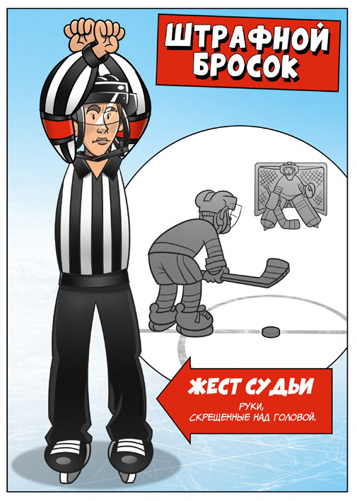

#### ПРАВИЛО 41. ТОЛЧОК НА БОРТ

Удар кулаком одной руки о ладонь противоположной перед грудью.

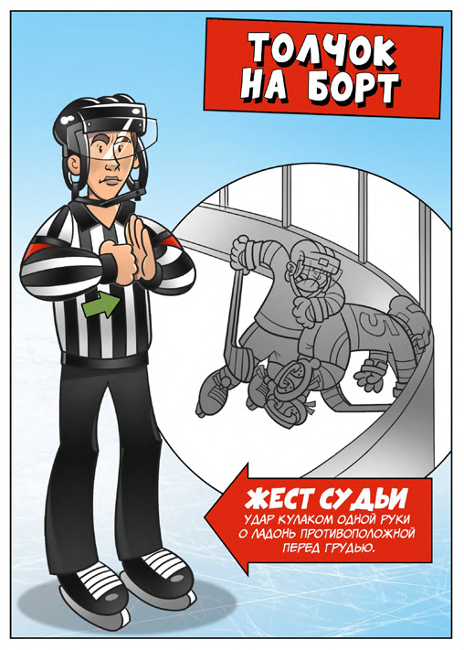

#### ПРАВИЛО 42. НЕПРАВИЛЬНАЯ АТАКА

Вращение кулаков относительно друг друга на уровне груди в направлении от себя и не более одного полного оборота.

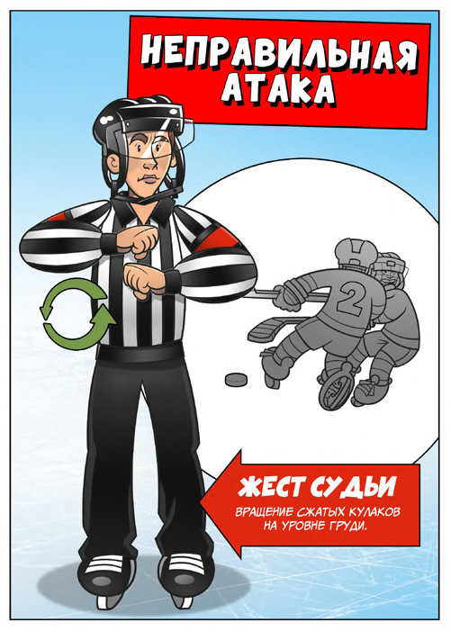

#### ПРАВИЛО 44. ОТСЕЧЕНИЕ

Удар ладонью по обратной стороне колена, при том оба конька должны оставаться на льду.

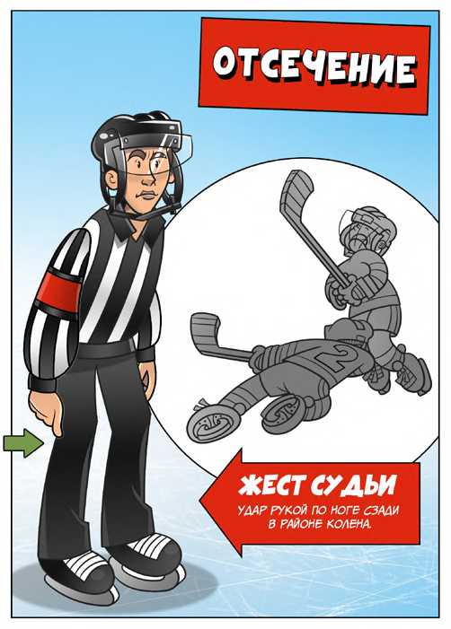

#### ПРАВИЛО 45. УДАР ЛОКТЕМ

Удар ладонью по локтю противоположной руки.

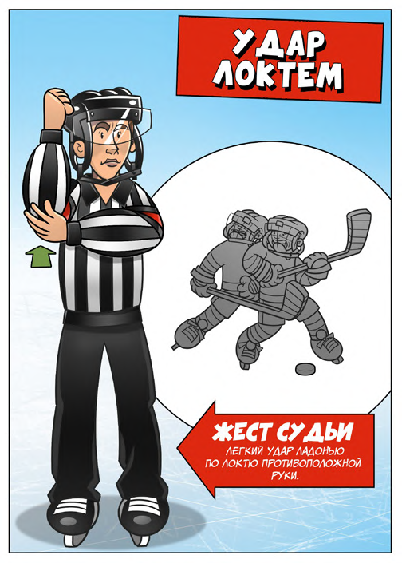

#### ПРАВИЛО 48. АТАКА В ГОЛОВУ И ШЕЮ

Боковое движение открытой ладонью в направлении виска.

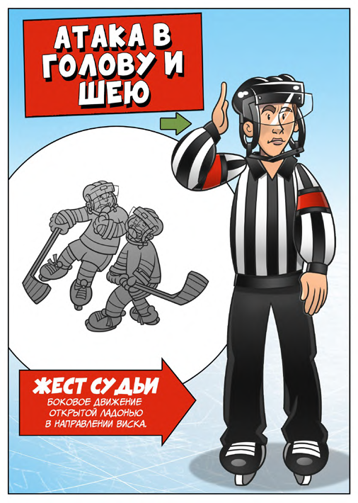

#### ПРАВИЛО 51. ГРУБОСТЬ

Согнутую в локте руку с кулаком выпрямить в сторону.

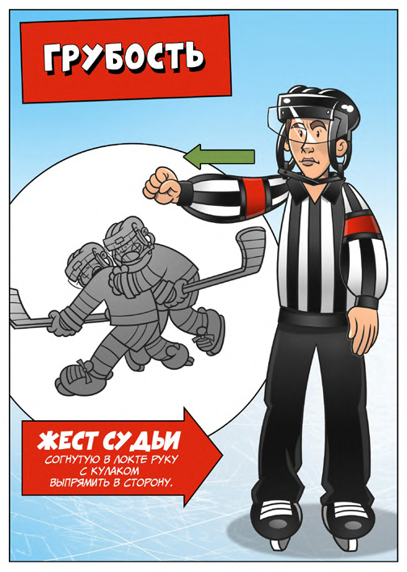

#### ПРАВИЛО 54. ЗАДЕРЖКА СОПЕРНИКА

Кистью одной руки обхватить запястье другой руки.

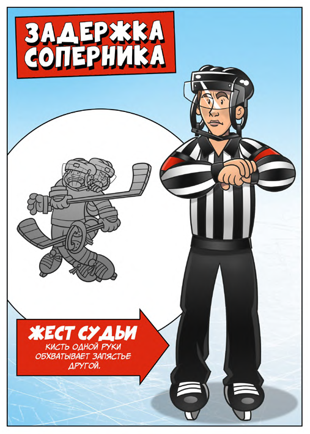

#### ПРАВИЛО 54. ЗАДЕРЖКА СОПЕРНИКА (КЛЮШКИ СОПЕРНИКА)

Кистью одной руки обхватить запястье другой руки, опустить руки вниз, имитируя клюшку, удерживаемую двумя руками.

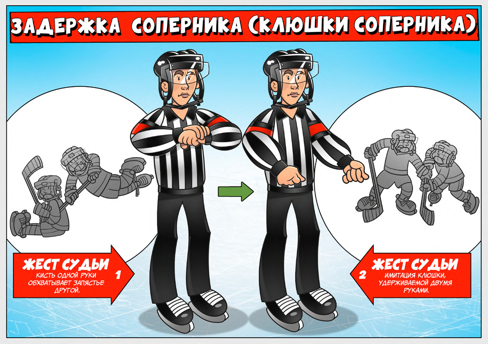

#### ПРАВИЛО 55. ЗАДЕРЖКА КЛЮШКОЙ

Движение двумя руками, которое начинается сбоку тела и заканчивается на уровне живота и напоминает перетягивание каната.

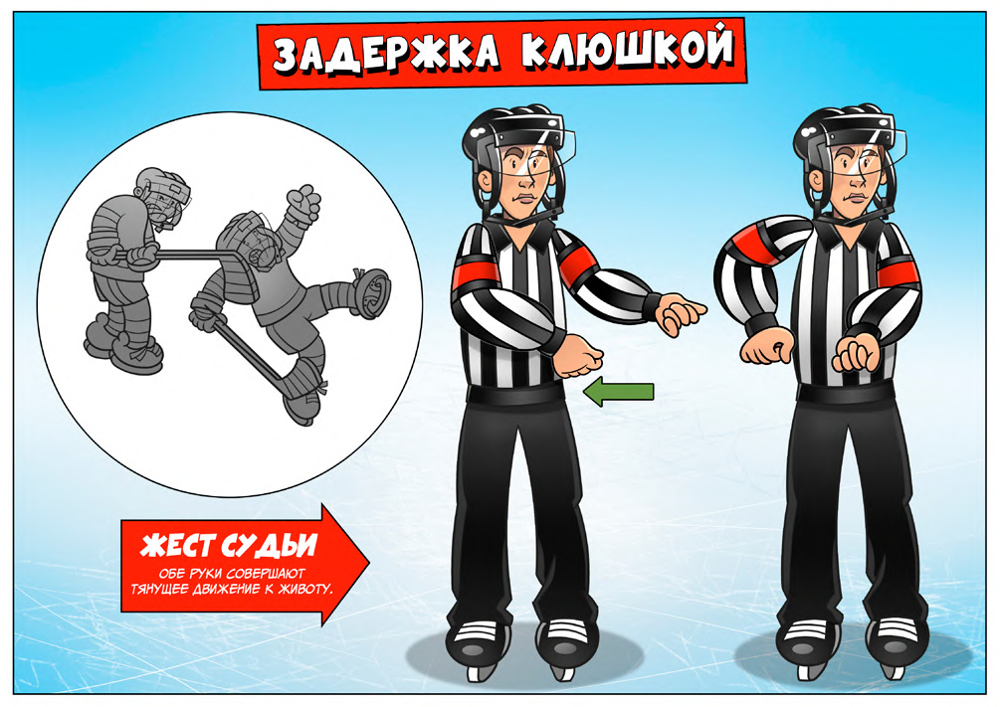

#### ПРАВИЛО 56. БЛОКИРОВКА

Скрещенные перед грудью руки со сжатыми кулаками.

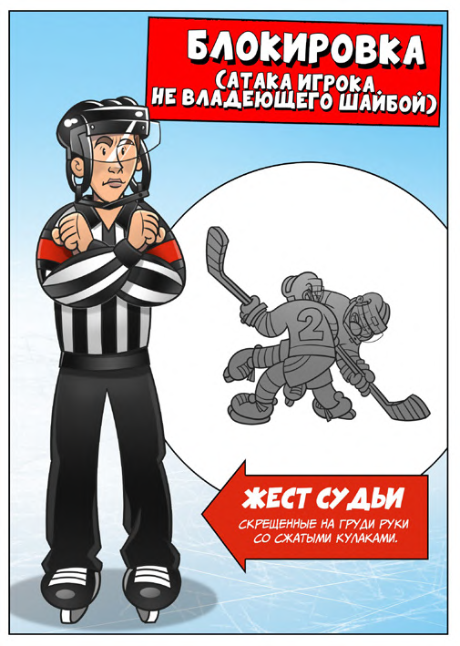

#### ПРАВИЛО 57. ПОДНОЖКА

Скользящий удар ребром ладони по ноге ниже колена, при этом оба конька должны оставаться на льду.

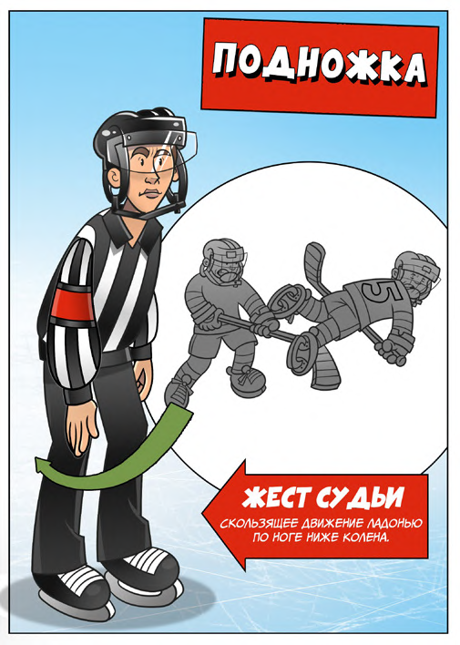

#### ПРАВИЛО 58. УДАР КОНЦОМ КЛЮШКИ

Встречное движение предплечьями, одно под другим. Ладонь верхней руки направлена вниз, нижняя рука — в сжатом кулаке.

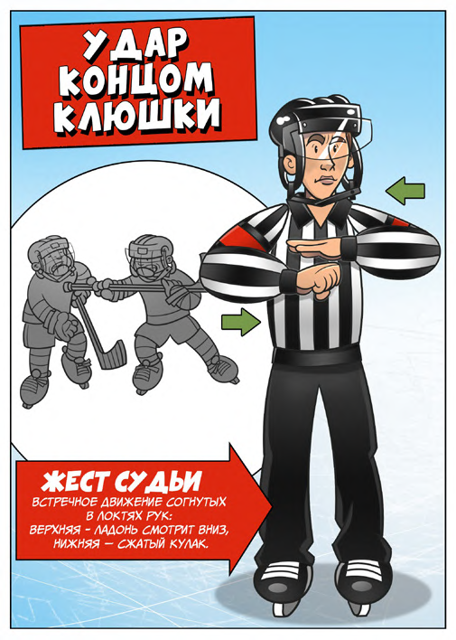

#### ПРАВИЛО 59. ТОЛЧОК КЛЮШКОЙ

Движение вперед обеими руками от уровня груди, имитирующее толчок клюшкой.

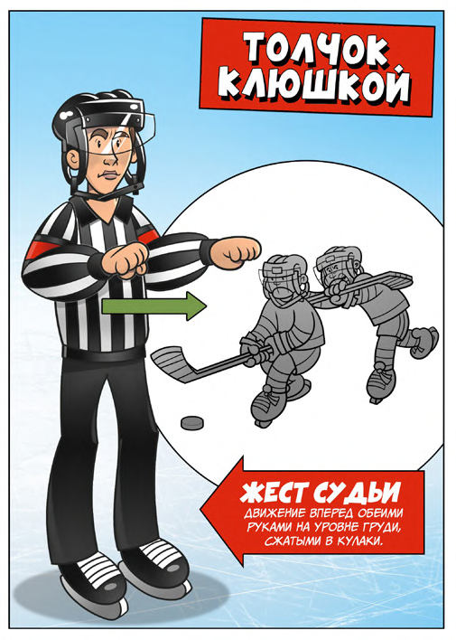

#### ПРАВИЛО 60. ИГРА ВЫСОКО ПОДНЯТОЙ КЛЮШКОЙ

Оба кулака один над другим. Верхний на уровне головы, нижний на уровне груди.

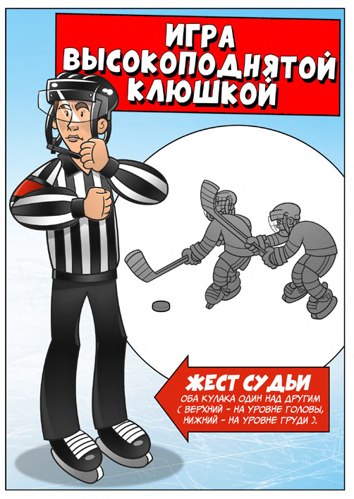

#### ПРАВИЛО 61. УДАР КЛЮШКОЙ

Удар ребром ладони по запястью противоположной руки.

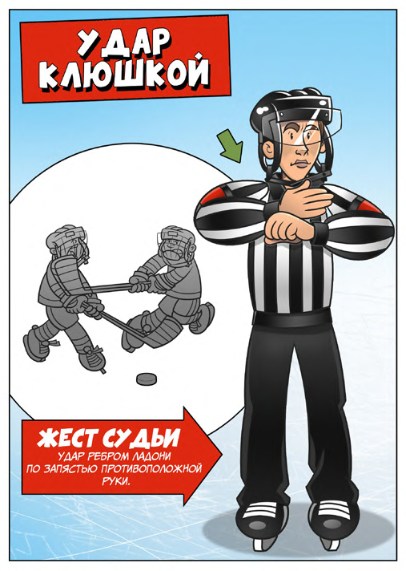

#### ПРАВИЛО 62. КОЛЮЩИЙ УДАР

Движение обеими руками от уровня живота вперед, имитирующее колющий удар клюшкой.

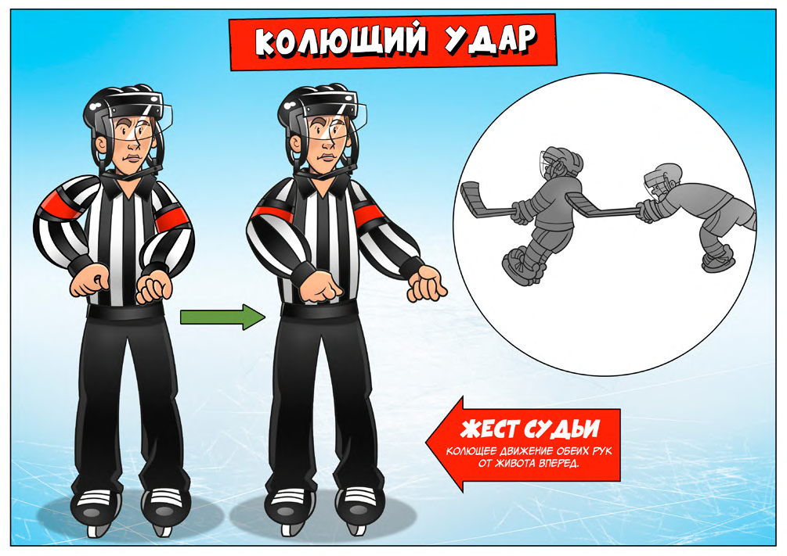

#### ПРАВИЛО 63. ЗАДЕРЖКА ИГРЫ (ВЫБРОС ШАЙБЫ)

Поместить ладонь одной руки на ладонь другой руки на уровне груди и вытянуть ладонь верхней руки в сторону под небольшим углом.

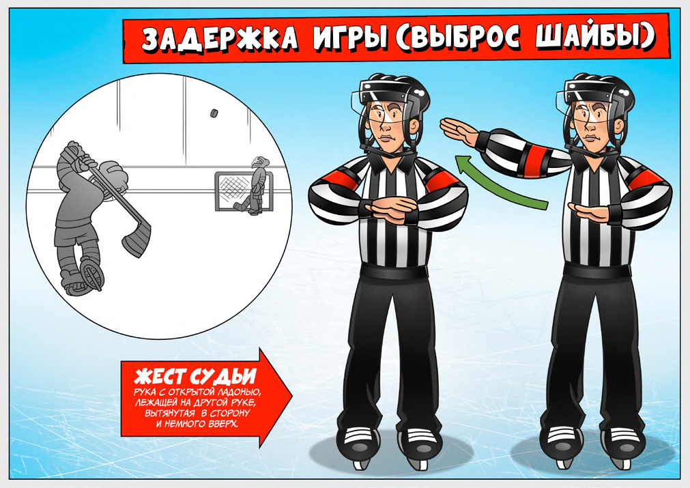

#### ПРАВИЛО 74. НАРУШЕНИЕ ЧИСЛЕННОГО СОСТАВА

Шесть пальцев (одна рука с открытой ладонью и большой палец из сжатого кулака другой руки) перед грудью.

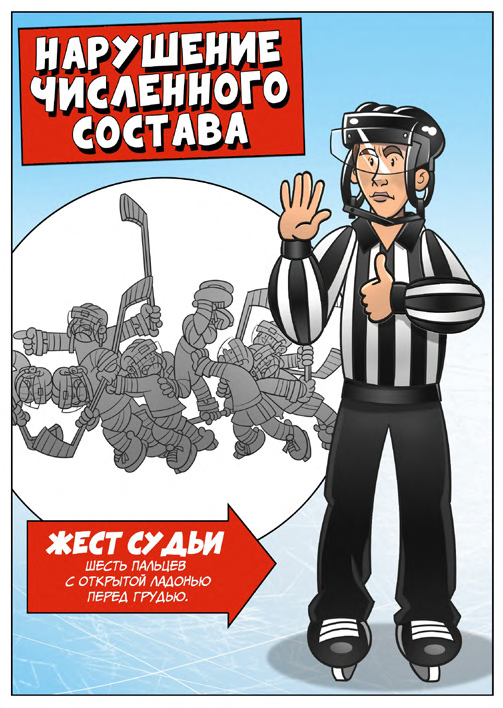

#### ПРАВИЛО 75. НЕСПОРТИВНОЕ ПОВЕДЕНИЕ

Одновременный короткий удар обеими руками по бедрам.

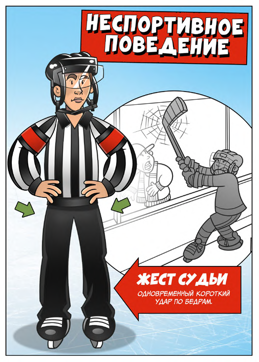

#### ПРАВИЛО 76. НАРУШЕНИЕ ПРОЦЕДУРЫ ВБРАСЫВАНИЯ

Предупреждение (жест 1). Согнутая в локте рука с открытой ладонью, со стороны нарушившей правила команды.

Нарушение (жест 2). Прямая рука со сжатым кулаком, направленная в сторону нарушившей правила команды.

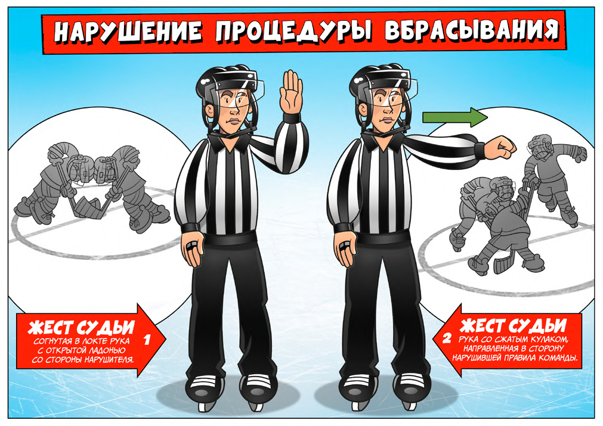

#### ПРАВИЛО 78. ВЗЯТИЕ ВОРОТ

Прямая рука в направлении ворот, когда шайба пересекает линию ворот.

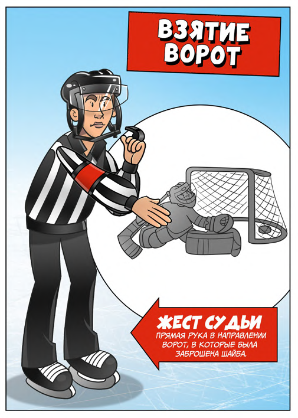

#### ПРАВИЛО 79. ПАС РУКОЙ

Открытая ладонь в движении от себя.

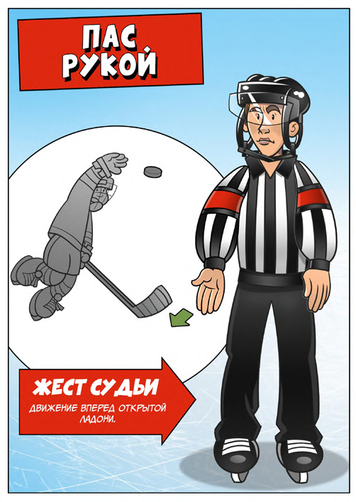

#### ПРАВИЛО 81. ПРОБРОС ШАЙБЫ

Дальний линейный судья (или главный судья в системе судейства «два судьи») сигнализирует о возможном пробросе шайбы, выпрямляя руку над головой (жест 1). Рука остается в поднятом положении до тех пор, пока ближний линейный судья или главный судья не даст свисток, фиксирующий проброс шайбы, либо до тех пор, пока проброс шайбы не будет отменен. Как только проброс шайбы состоялся, дальний линейный судья (или главный судья в системе судейства «два судьи») складывает руки перед грудью одну на другую ладонями вниз, а затем указывает рукой на соответствующую точку вбрасывания и едет по направлению к ней (жест 2).

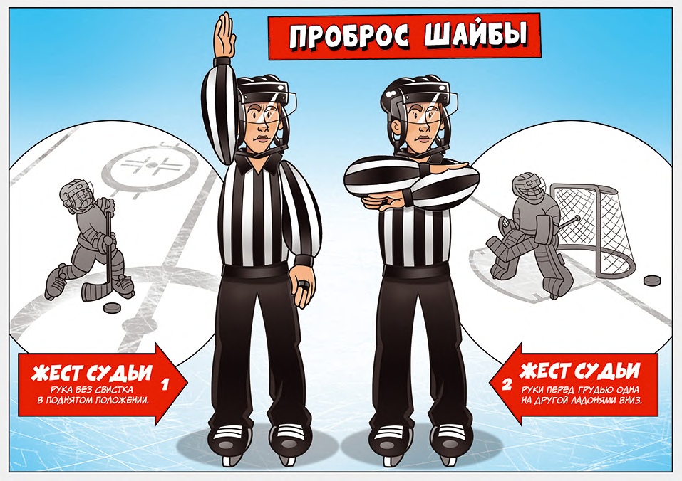

#### ПРАВИЛО 83. ОТЛОЖЕННОЕ ПОЛОЖЕНИЕ «ВНЕ ИГРЫ»

Прямая рука без свистка поднята вверх над головой. Для отмены отложенного положения «вне игры» судья должен опустить руку вниз.

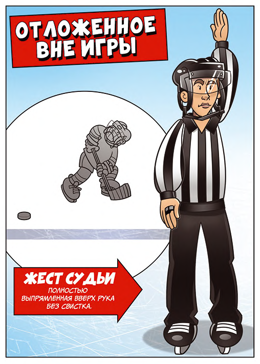

#### ПРАВИЛО 83. ПОЛОЖЕНИЕ «ВНЕ ИГРЫ»

Вытянутая вперед свободная от свистка рука, направленная вдоль синей линии.

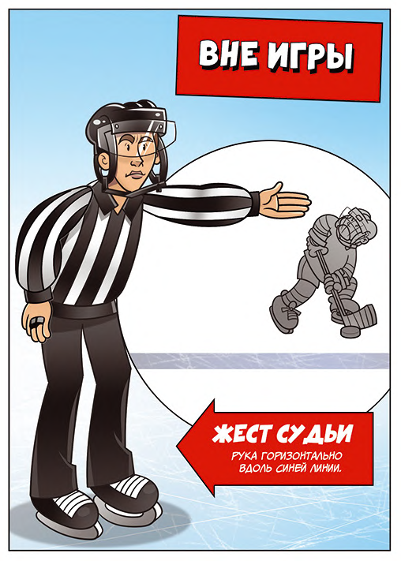

#### ПРАВИЛО 87. ТАЙМ-АУТ

Обе руки в форме буквы «Т» перед грудью.

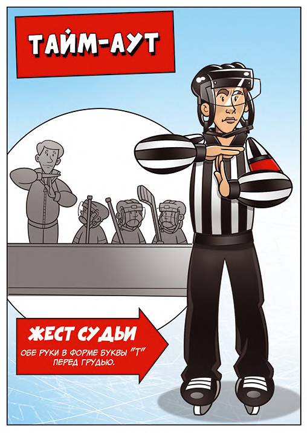

#### ОТРИЦАНИЕ

Разведенные в сторону руки на уровне груди. Ладони смотрят вниз. Применяется для отмены взятия ворот, паса рукой, нет игры высоко поднятой клюшкой и так далее.

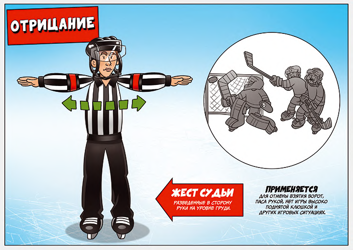

#### ОТРИЦАНИЕ

Разведенные в сторону руки на уровне груди. Ладони смотрят вниз. Применяется для отмены проброса шайбы и отмены положения «вне игры», и так далее.

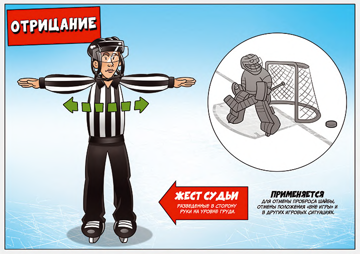

#### АТАКУЮЩИЙ ИГРОК В ПЛОЩАДИ ВОРОТ

Движение перед собой одной рукой параллельно поверхности льда, описывающее полукруг и имитирующее площадь ворот, с последующим вытягиванием другой руки в направлении нейтральной зоны.

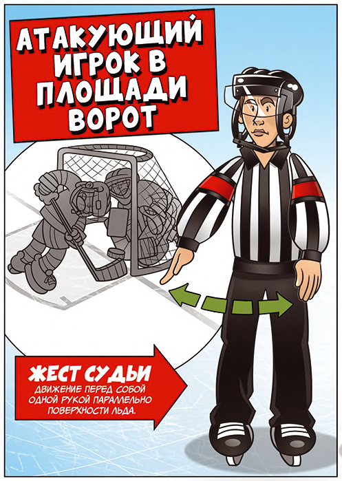

#### ОТЛОЖЕННЫЙ ШТРАФ

Рука без свистка полностью вытянута над головой. Допускается сначала указывать рукой со свистком на нарушившего хоккеиста, а затем поднимать руку без свистка.

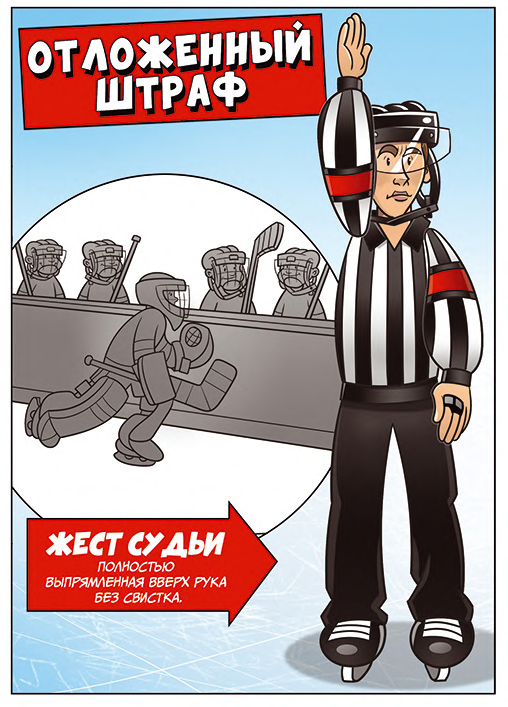

#### ПРАВИЛО 82. СМЕНА СОСТАВА

Судья расположен лицом к команде гостей, которая проводит смену игроков. Рука с открытой ладонью без свистка поднята вверх и немного согнута в локте, сигнализирует окончание смены игроков команде гостей. Судья может дополнительно использовать другую руку, указывая на команду, которая должна менять свой состав.

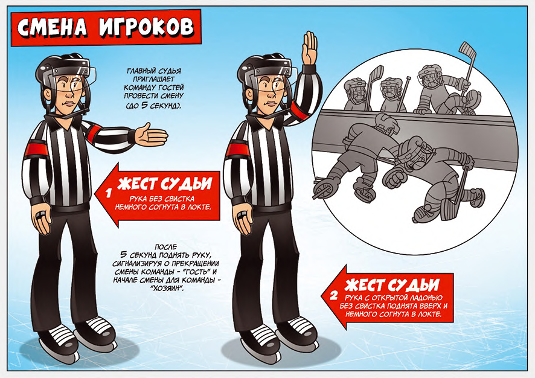

# ПРИЛОЖЕНИЕ 2. ОПРЕДЕЛЕНИЯ, ТЕРМИНОЛОГИЯ И ПОНЯТИЯ

| Термин | Определение |
|--------|-------------|
| Атакующий игрок | Игрок, чья команда контролирует шайбу и продвигает ее к воротам соперника. Кроме того, все игроки в своей зоне атаки считаются атакующими игроками. |
| Безответственное действие | Любое действие, которое ставит под угрозу здоровье соперника. Нарушение, состоящее из действий, которые создают существенный риск причинения серьезного физического вреда другому лицу. От атакующего игрока не требуется, чтобы он намеревался причинить последующий или потенциальный вред, но он должен был действовать таким образом, чтобы продемонстрировать пренебрежение к предсказуемым последствиям своих действий. |
| Борьба за шайбу | Контакт между двумя или более игроками, находящимися в непосредственной близости от шайбы и пытающимися завладеть шайбой. Этим хоккеистам разрешается в разумных пределах толкаться и налегать друг на друга, при условии, что владение шайбой остается главной целью контакта. |
| Владение шайбой | Последний игрок, физически коснувшийся/сыгравший в шайбу своей клюшкой или телом, будет считаться владеющим шайбой. Игрок может владеть шайбой без контроля шайбы. Игрок должен сначала овладеть шайбой, прежде чем он будет считаться контролирующим шайбу. Против игрока, владеющего шайбой, не может быть применен силовой прием. Игрок пытается овладеть шайбой, используя клюшку, а затем тело, чтобы установить контроль над шайбой или помешать сопернику сохранить или получить контроль над шайбой. Игрок, который пытается овладеть шайбой, имеет право применить силовой прием против соперника, контролирующего шайбу, и/или участвовать в борьбе за шайбу. |
| Вратарь | Хоккеист, назначенный командой, которому даются привилегии вратаря и право на ношение специального защитного снаряжения с целью защиты ворот и игры с шайбой. |
| Выход «один на один» | Условие, при котором хоккеист владеет и контролирует шайбу или может получить «владение и контроль над шайбой», которая направлена в сторону зоны атаки и находится за синей линией своей зоны защиты, и между хоккеистом и вратарем нет соперника. |
| Завершение игрового момента | Завершение игрового момента командой, владеющей шайбой, означает, что шайбой должен завладеть игрок команды соперника. Или шайба должна попасть под контроль игрока или вратаря команды соперника или быть «прижатой». Под этим не подразумевается отскок/рикошет от вратаря, ворот или борта, или любого контакта с телом, клюшкой или защитным снаряжением соперника. |
| Запасной вратарь | Вратарь, внесенный в официальный протокол матча, но не участвующий в игре. Запасной вратарь должен быть одет в полное игровое снаряжение и готов к игре. Запасной вратарь может участвовать в игре только в качестве вратаря. |
| Защитное снаряжение | Снаряжение, которое используют хоккеисты, с единственной целью обеспечения безопасности и защиты от травм. Всё защитное снаряжение должно быть изготовлено для хоккея с шайбой и надето надлежащим образом. |
| Зона атаки | Зона атаки команды находится между синей линией, наиболее близкой к воротам соперника, и лицевым бортом, расположенными за воротами соперника. |
| Зона защиты | Зона защиты команды находится между их собственной синей линией и лицевым бортом за их воротами. |
| Игровое действие | Игра при включенном секундомере. |
| Игровой контакт | Контакт, который происходит между соперниками во время обычного процесса игры с шайбой, при условии, что не было прямого контакта бедра, плеча или руки, чтобы физически оттеснить соперника от шайбы. |
| Контроль шайбы | Действия, связанные с манипуляцией шайбой, клюшкой, руками или ногами. Контроль над шайбой не теряется, когда осуществляется контроль шайбы игроком, с использованием борта или воротами, при условии, что игрок, контролирующий шайбу, продолжает контролировать и двигать шайбу. Контроль означает длительное владение шайбой. |
| Надлежащие инстанции | Руководящий орган или орган, принимающий решения по спорным вопросам, который контролирует поведение хоккеистов и представителей команд во время матча. |
| Направление шайбы | Преднамеренное перемещение или позиционирование тела, конька или клюшки таким образом, чтобы изменить траекторию движения шайбы в желаемом направлении. |
| Нейтральная зона | Центральная часть ледовой площадки между двумя синими линиями. |
| Организатор | Юридическое лицо, которое утверждает положение (регламент) спортивного соревнования, определяет условия и календарный план его проведения, условия допуска к участию в спортивном соревновании, порядок выявления лучшего участника или лучших участников, порядок организационного и иного обеспечения спортивного соревнования, обеспечивает финансирование спортивного соревнования в утвержденном им порядке, а также осуществляет иные полномочия в соответствии с настоящим федеральным законом. |
| Отложенное положение «вне игры» | Ситуация, когда атакующий игрок раньше шайбы пересек синюю линию зоны атаки, но защищающаяся команда завладела шайбой и может вывести шайбу из своей зоны защиты без каких-либо задержек или контакта с атакующим игроком. |
| Отскок/рикошет | Контакт шайбы с хоккеистом, судьей или другим предметом, приводящий к изменению направления полета шайбы. Контакт с шайбой не приводит хоккеиста к владению и/или контролю шайбы. |
| Персонал команды, представитель команды | Персонал команды — это любые представители команды, одетые в неигровую униформу, на скамейке игроков. Один из таких представителей команды должен являться главным тренером. Игрок или вратарь, указанные в официальном протоколе матча и не выходящие на лед играть по любой причине, кроме как из-за дисквалификации, могут находиться на скамейке игроков, не считаясь персоналом команды, если они имеют полное игровое снаряжение. |
| Площадь ворот | Площадь ворот, отмеченная на льду перед каждыми воротами, предназначена для защиты вратарей от вмешательства атакующих игроков. |
| Поздний силовой прием | Это безответственные действия атакующего игрока, представляющие опасность для соперника, который больше не контролирует шайбу или не владеет ею. Игрок, который находится в процессе освобождения или потери контроля или владения шайбой, является объектом проведения силового приема, при условии, что атакующий игрок находится в непосредственной близости от игрока с шайбой. Если игрок атакует соперника и совершает с чрезмерной силой контакт, он рискует превратить силовой прием в поздний силовой прием в силу уязвимого положения соперника и степени силы воздействия. |
| Процедура смены игроков | Смена игрока во время всех остановок игры. |
| Пятка клюшки | Точка пересечения черенка клюшки и нижней части крюка клюшки. |
| Реальная возможность взятия ворот | Ситуация, когда атакующий игрок имеет возможность забросить шайбу в ворота, но по определенным причинам этого не происходит, и шайба не пересекает плоскость линии ворот. |
| Силовой прием | Правильный силовой прием — это прием, при котором игрок атакует соперника, владеющего шайбой, используя свое бедро или тело спереди, по диагонали спереди или прямо сбоку. Правильный силовой прием должен проводиться с целью отделения соперника от шайбы только туловищем (бедра и плеч) и выполняться выше колен соперника и на уровне или ниже плеч. |
| Смена контроля над шайбой | Отскок от щитков вратаря или другой части снаряжения не должен рассматриваться как владение или контроль над шайбой или завершение игрового эпизода при применении *Правила 15 Наложение штрафов*. |
| Совпадающие штрафы | Штрафы одинаковой продолжительности (например, малые или большие), назначенные во время одной и той же остановки игры на обе команды, из-за которых численный состав ни одной из команд не уменьшается на льду. Совпадающие штрафы никогда не приводят к тому, что одна из команд будет играть в «численном меньшинстве» по причине окончания штрафа, если произойдет взятие ворот. |
| Судьи в бригаде | Назначаются для оказания помощи главным судьям в проведении матча. Состав судей в бригаде может состоять из: секретаря матча, судьи времени матча, судьи штрафного времени, судей при оштрафованных игроках (и двух судей за воротами, если это необходимо). |
| Судьи на льду | Назначенные лица, ответственные за судейство матча, которые находятся на льду — главный(е) и линейные судьи. Главный судья осуществляет общее наблюдение за игрой и полный контроль за судьями. В случае любого спора решение главного судьи является окончательным. |
| Территориальное преимущество | Любое решение, которое определяет точку вбрасывания шайбы ближе к зоне защиты, принятое для обеспечения отсутствия территориального преимущества у команды-нарушителя. |
| Торс | В отношении игрока, потерявшего свой свитер во время конфронтации, торс означает верхнюю часть тела игрока. Если игрок все еще держит одну руку в рукаве своего свитера, а прорезь для шеи все еще находится на его шее, то свитер не будет считаться полностью снятым с его торса. Однако, если обе руки были вынуты из рукавов, а свитер висит на шее игрока, он будет считаться полностью снятым с его торса. Если у игрока обе руки в рукавах, но прорезь для шеи не надета на его голову, свитер также считается полностью снятым с его торса. |
| Травма | Кровь не обязательно должна быть видна для определения травмы. Кровоподтек — не единственный определяющий фактор. Например, травма, нанесенная высоко поднятой клюшкой по лицу, может иметь одну из следующих характеристик: сильные ушибы, ссадины, рубец, порез кожи или повреждение зубов высоко поднятой клюшкой. |
| Тренер | Человек, в первую очередь ответственный за руководство и управление игрой своей команды. Вместе с менеджером команды они несут ответственность за поведение игроков своей команды до, во время и после игры. |
| Уязвимое положение | Хоккеист считается находящимся в уязвимом положении, когда он больше не контролирует шайбу или не владеет ею, и он либо не знает о предстоящей атаке, либо не готов к ней. Атака уязвимого соперника автоматически считается безответственной, даже если эта атака будет считаться законной для соперника, находящегося в не уязвимом положении. |
| Численное меньшинство | Численное меньшинство означает, что численный состав команды на льду меньше, чем численный состав на льду команды соперника, из-за одного или нескольких штрафов, которые они отбывают. |
| Численный состав | Численный состав означает количество хоккеистов на льду. |
| Штраф | Результат нарушения правил игроком или персоналом команды. Обычно это предполагает удаление из игры игрока-нарушителя или персонала команды на определенный период времени. Если штраф налагается на команду, владеющую и контролирующую шайбу, судья должен дать свисток немедленно. Если штраф налагается на команду, не владеющую шайбой, главный судья сигнализирует отложенный штраф и не дает свисток до тех пор, пока команда-нарушительница не завладеет шайбой и не получит контроль над ней. В некоторых случаях наказанием может быть назначение штрафного броска или присуждение взятия ворот. |

# ПРИЛОЖЕНИЕ 3. СНАРЯЖЕНИЕ

#### СНАРЯЖЕНИЕ ВРАТАРЯ

Маска, защита шеи, защита рук и груди (нагрудник), ловушка, блин, шорты, щитки, клюшка, коньки.

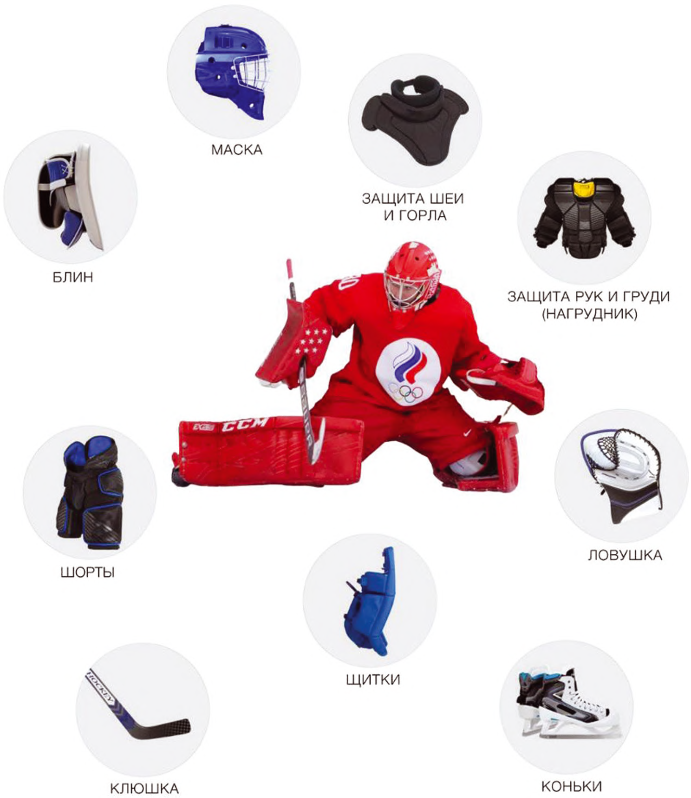

#### СНАРЯЖЕНИЕ ИГРОКА

Шлем и защита лица, защита шеи, нагрудник, налокотники, перчатки, шорты, щитки, коньки, клюшка.

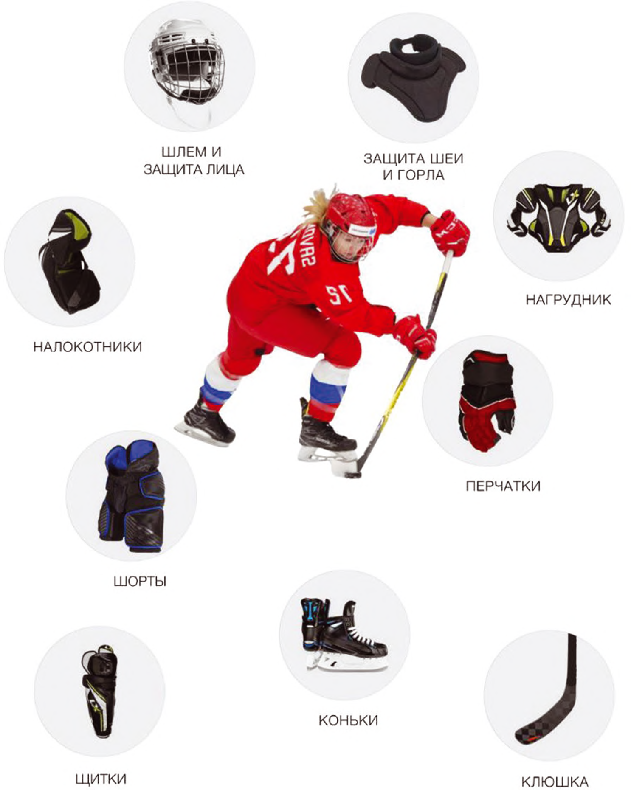

#### ШЛЕМ И МАСКА ВРАТАРЯ

*Правило 11.8.* Все измерения в см.

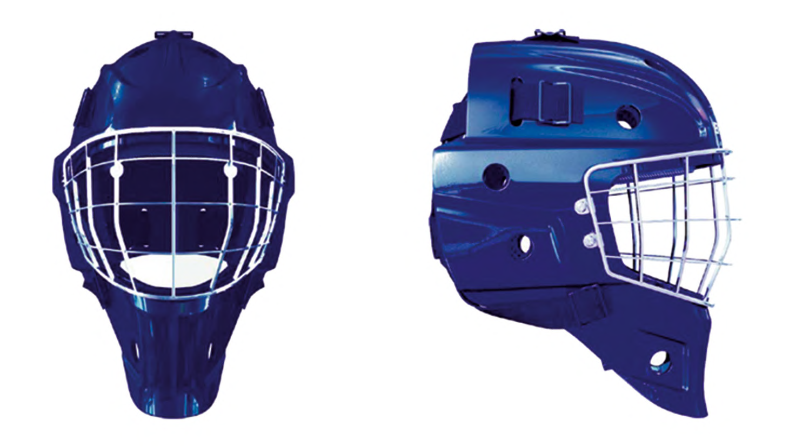

#### ШЛЕМ И МАСКА ИГРОКА

*Правило 9.6* и *Правило 9.7.*

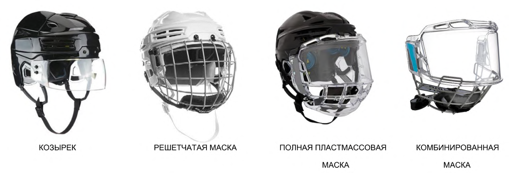

#### ЗАЩИТА РУК И ГРУДИ (НАГРУДНИК) ВРАТАРЯ

*Правило 11.3.* Все измерения в см.

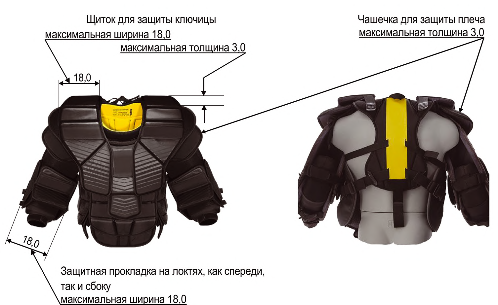

#### ЗАЩИТА ОТ ПОРЕЗОВ ШЕИ

*Правило 9.12.* Все измерения в см.

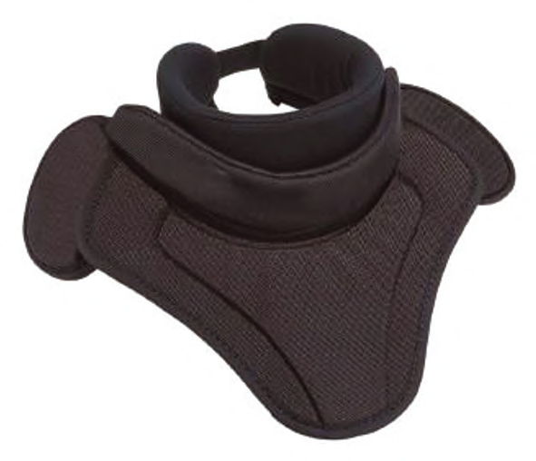

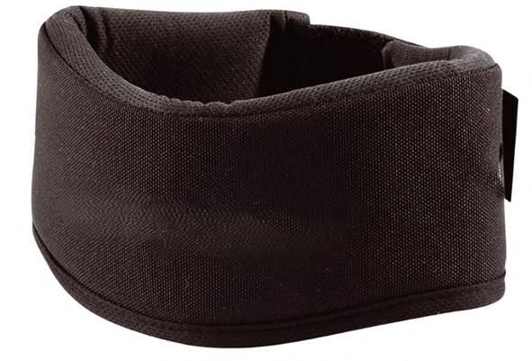

#### ЛОВУШКА ВРАТАРЯ

*Правило 11.6.* Все измерения в см.

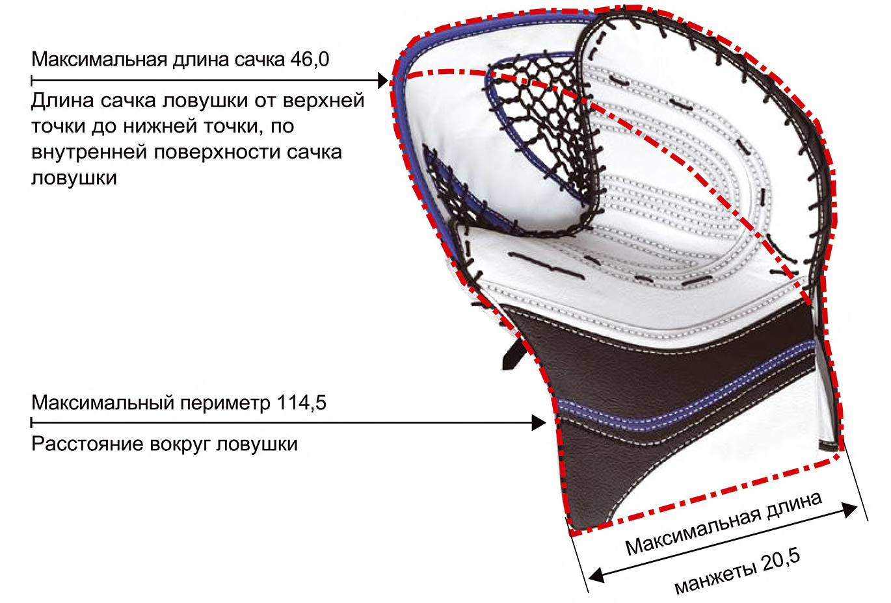

#### БЛИН ВРАТАРЯ

*Правило 11.7.* Все измерения в см.

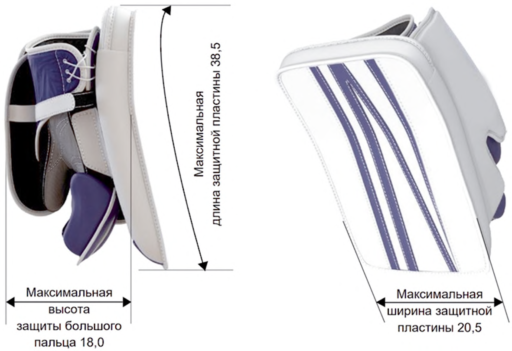

#### ШОРТЫ ВРАТАРЯ

*Правило 11.4.* Все измерения в см.

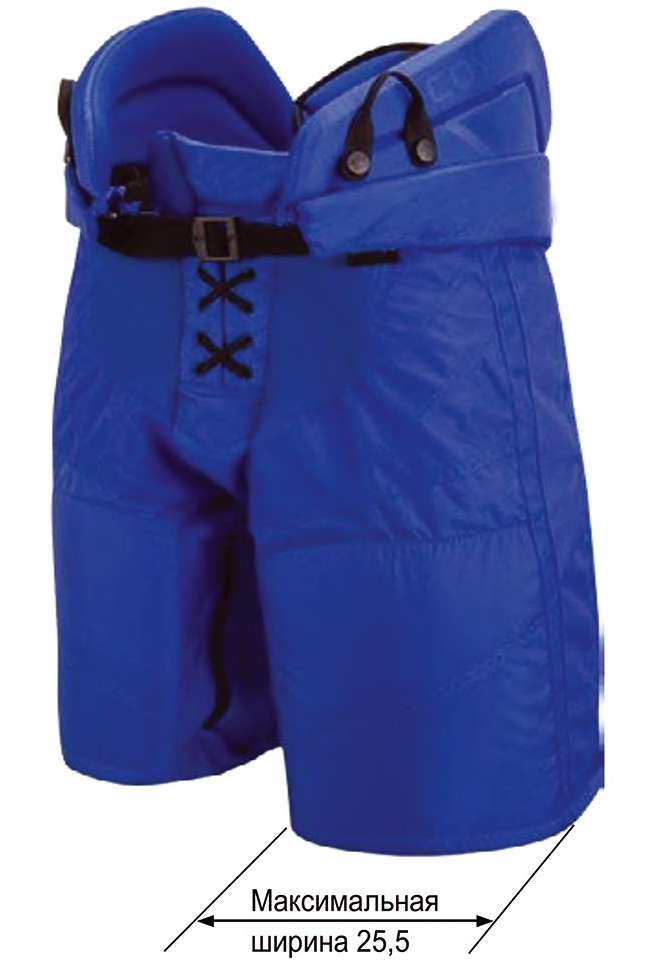

#### ЗАЩИТА КОЛЕНЕЙ

*Правило 11.5.* Все измерения в см.

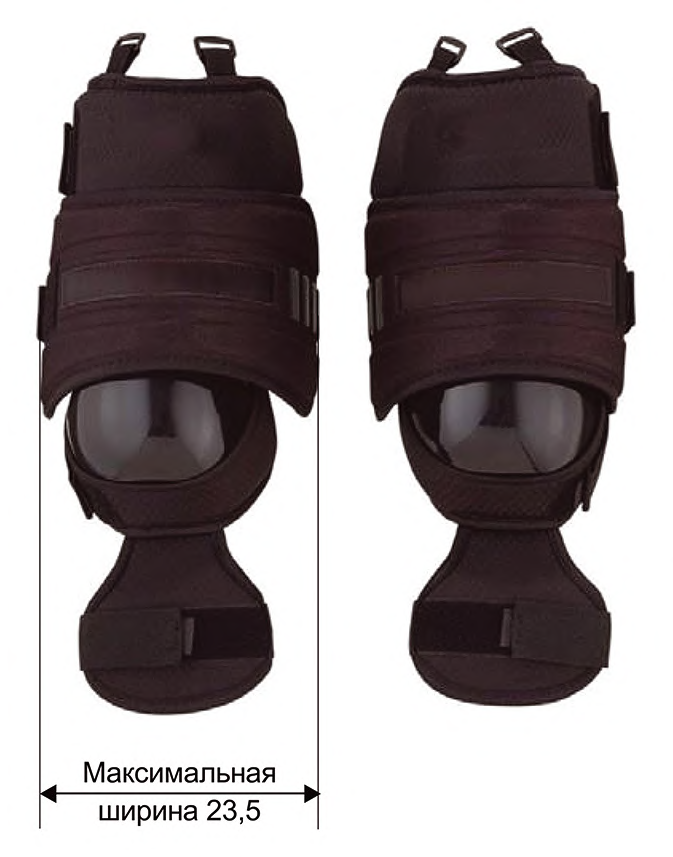

#### ЩИТКИ ВРАТАРЯ

*Правило 11.2.* Все измерения в см.

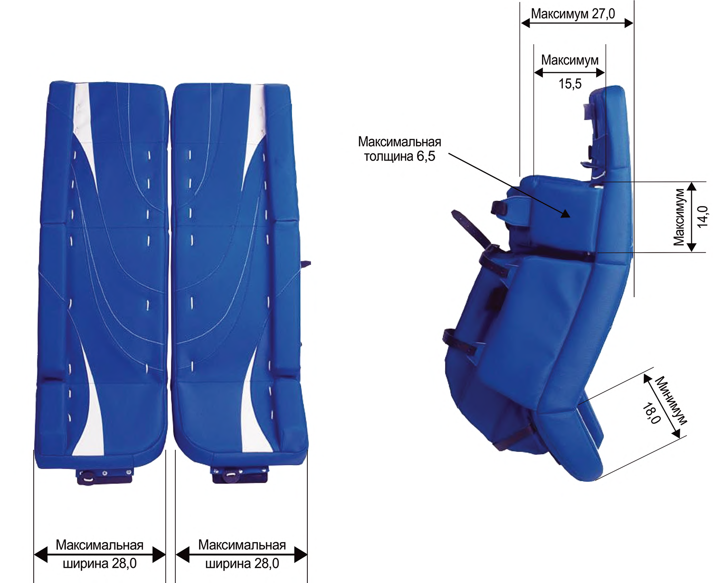

#### КОНЬКИ ИГРОКА И ВРАТАРЯ

*Правило 9.10* и *Правило 9.11.* Все измерения в см.

#### КЛЮШКА ИГРОКА

*Правило 10.1.* Все измерения в см.

#### КЛЮШКА ВРАТАРЯ

*Правило 10.2.* Все измерения в см.

# ПРИЛОЖЕНИЕ 4. СПРАВОЧНЫЕ ТАБЛИЦЫ

#### ТАБЛИЦА 1. ПРАВИЛО 15. Наложение штрафов — перечень штрафов, налагаемых на тренеров и персонал команды

| Описание | Правило |
|----------|---------|
| Бросает клюшку (зона защиты) | 53.8. |
| Бросает на лед клюшку игроку, который потерял или сломал клюшку | 10.3. |
| Бросает на лед клюшку (выход на пустые ворота) | 53.9. |
| Бросает на лед посторонние предметы (неспортивное поведение) | 75.1; 75.3. |
| Вмешивается в действия судьи на льду | 39.3 (3) |
| Действия, которые могут привести к травме соперника | 75.5 (4) |
| Мешает движению соперника и шайбы во время игры | 56.3. |
| Мешает движению соперника и шайбы, когда вратарь убран со льда | 56.7; 56.8. |
| Мешает движению соперника при выходе один на один | 56.7. |
| Непристойные, нецензурные или оскорбительные выражения или жесты | 39.3.(2); 39.5 (2, 6, 8); 39.9; 75.3 (3); 75.5 (2, 3, 5) |
| Отказываются начать игру (команды в раздевалках) | 73.1; 73.3. |
| Отказываются начать игру (команды на льду) | 73.1; 73.2. |
| Плюет в соперника или кого-либо | 75.5 (6) |
| Покидает скамейку игроков и выходит на лед до окончания периода | 70.5. |
| Ударяет по борту и защитному стеклу клюшкой или каким-либо предметом | 39.3 (1); 75.3 (2) |
| Физически воздействует на судью | 40.7. |

#### ТАБЛИЦА 2. ПРАВИЛО 16. Перечень малых штрафов

| Описание | Правило |
|----------|---------|
| Агрессор | 46.3; 46.4. |
| Блокировка | 56.2. |
| Блокировка вратаря | 69.2. |
| Бросание снаряжения | 53.2. |
| Бросок шайбы в направлении ворот соперника | 67.3, абз. 2 (3) |
| Грубость | 51.2. |
| Задержка | 54.2. |
| Задержка игры | 63.2. |
| Задержка клюшки соперника | 54.2. |
| Задержка клюшкой | 55.2. |
| Задержка шайбы рукой | 67.2. |
| Зачинщик/подстрекатель | 46.3. |
| Игра высоко поднятой клюшкой | 60.2. |
| Игра за центральной линией (вратарь) | 27.7. |
| Игра рукой на вбрасывании | 67.2, абз. 3 (1) |
| Накрытие шайбы рукой | 67.2, абз. 2 (2) |
| Незаконная клюшка | 10.5; 10.6. |
| Незаконное снаряжение | 9.6; 12; 65.2. |
| Незаконный удар в голову и шею | 48.2. |
| Неправильная атака | 42.2. |
| Неспортивное поведение | 75.2. |
| Оставление площади ворот (Вратарь) | 27.6. |
| Отсечение | 44.2. |
| Подножка | 57.2. |
| Преждевременное оставление скамейки оштрафованных игроков | 70.4. |
| Сломанная клюшка | 10.3. |
| Толчок клюшкой | 59.2. |
| Толчок на борт | 41.2. |
| Удар клюшкой | 61.2. |
| Удар локтем | 45.2. |

#### ТАБЛИЦА 3. ПРАВИЛО 17. Перечень малых скамеечных штрафов

| Описание | Правило |
|----------|---------|
| Бросание предметов на лед | 75.3. |
| Вмешательство со скамейки игроков/скамейки оштрафованных игроков | 56.3. |
| Выход на лед во время периода (тренер) | 70.5. |
| Задержка игры | 63.3. |
| Нарушение процедуры вбрасывания | 76.4; 76.6; 76.7. |
| Нарушение численного состава | 70.4; 74.1; 74.2; 74.3. |
| Незаконная замена | 68.2. |
| Необоснованная просьба об измерении клюшки | 10.5; 10.6. |
| Неспортивное поведение | 75.3. |
| Оскорбление судей | 39.3. |
| Оставление скамейки игроков в начале игры и периода | 86.2; 86.8. |
| Отказ начать игру | 73.2; 73.3. |
| Умышленная незаконная замена | 74.4. |

#### ТАБЛИЦА 4. ПРАВИЛО 18.3. Перечень двойных малых штрафов

| Описание | Правило |
|----------|---------|
| Драка | 46.3. |
| Драка зачинщик и агрессор, агрессор | 46.3; 46.4. |
| Игра высоко поднятой клюшкой (случайное, травма) | 60.3. |
| Колющий удар (попытка, без контакта) | 62.2. |
| Первый игрок, покидающий скамейку игроков во время или для начала конфронтации | 70.3. |
| Удар головой (пытается, или толкает) | 47.2. |
| Удар концом клюшки (попытка, без контакта) | 58.2. |

#### ТАБЛИЦА 5. ПРАВИЛО 20. Перечень больших штрафов (с автоматическим наложением дисциплинарного штрафа до конца матча)

| Описание | Правило |
|----------|---------|
| Атака в голову и шею | 48.3. |
| Блокировка | 56.4. |
| Бросок клюшки | 57.3. |
| Бросание снаряжения | 53.4. |
| Грубость (вратарь — удар блином) | 51.3. |
| Драка агрессор | 46.4. |
| Драка зачинщик и агрессор | 46.3. |
| Драка за пределами Игровой площадки | 46.11. |
| Драка (зачинщик последние пять минут) | 46.14. |
| Драка зачинщик | 46.3. |
| Драка (опасный удар) | 46.5. |
| Задержка клюшкой | 55.3. |
| Игра высоко поднятой клюшкой | 60.4. |
| Колющий удар | 62.3. |
| Неправильная атака соперника | 42.3. |
| Неспортивное поведение | 75.2 (2) |
| Подсечка | 52.2. |
| Толчок соперника клюшкой | 59.3. |
| Толчок соперника на борт | 41.3. |
| Удар головой | 47.3. |
| Удар клюшкой | 61.3. |
| Удар концом клюшки | 58.3. |
| Удар локтем | 45.3. |
| Удар ногой | 49.3. |
| Отсечение | 44.3. |

#### ТАБЛИЦА 6. ПРАВИЛО 22. Перечень дисциплинарных штрафов

| Описание | Правило |
|----------|---------|
| Отбрасывает шайбу из зоны досягаемости судьи | 39.4 (3) |
| Заходит и остается в площади судьи | 39.4 (5) |
| Использует непристойные, нецензурные или оскорбительные выражения | 75.4 (1) |
| Мешает или отвлекает соперника, выполняющего штрафной бросок | 24.4. |
| Непреднамеренно или случайно выбрасывает любую часть снаряжения за пределы игровой площадки | 39.4 (6) |
| Намеренно выбрасывает любую часть снаряжения за пределы игровой площадки | 75.4 (2) |
| Намеренно ломает клюшку или отказывается предоставить ее для измерений | 10.5; 10.6. |
| Отказывается заменить нестандартный предмет защитного снаряжения (после предупреждения) | 9.5. |
| Провоцирует соперника к драке | 75.4 (3) |
| Покидает скамейку чтобы выразить протест | 6.1. |
| Словесно выражается в адрес судьи | 39.4 (1) |
| Стучат по борту или стеклу клюшкой или другим предметом | 39.2 (5); 39.4 (4); 39.4 (7) |
| Стучат по борту клюшкой в знак протеста на судейское решение | 39.2 (5); 39.4 (4); 39.4 (7) |

#### ТАБЛИЦА 7. ПРАВИЛО 23. Перечень дисциплинарных штрафов до конца матча

| Описание | Правило |
|----------|---------|
| Атака в голову или шею | 48.4. |
| Блокировка | 56.6. |
| Вратарь использующий блин для удара соперника (грубость) | 51.5. |
| Выброс клюшки или предмета снаряжения за пределы игровой площадки | 39.5 (5); 53.2 (4); 53.5. |
| Драка | 46. |
| Задержка клюшкой | 55.4. |
| Игра высоко поднятой клюшкой | 60.6. |
| Использование непристойных, нецензурных или оскорбительных выражений и жестов | 39.5 (2) |
| Колющий удар | 62.5. |
| Неправильная атака | 42.5. |
| Неспортивное поведение | 75.5. |
| Опасные действия | 21.1. |
| Оставление скамейки оштрафованных игроков во время конфронтации | 39.5 (7); 70.4; 70.6. |
| Отсечение | 44.5. |
| Первый хоккеист, вмешивающийся в уже идущую конфронтацию/драку | 46.7 |
| Первый хоккеист, покидающий скамейку игроков во время или для начала конфронтации | 70.3. |
| Подножка | 57.5. |
| Продолжает оспаривать или подвергать сомнению решение судьи | 39.5 (1) |
| Расовые насмешки, оскорбления или комментарии сексуального характера | 23.8. |
| Толчок клюшкой | 59.5. |
| Толчок на борт | 41.5. |
| Удар головой | 47.5. |
| Удар клюшкой | 61.5. |
| Удар концом клюшки | 58.5. |
| Удар локтем | 45.5. |
| Удар ногой | 49.5. |
| Укус соперника или зрителя | 23.8, абз. 1 (4) |
| Физически воздействует на зрителя | 23.8, абз. 1 (1) |
| Физически воздействует на судью | 39.5 (5); 40.1. |

#### ТАБЛИЦА 8. ПРАВИЛО 24. Перечень ситуаций назначения штрафного броска

| Описание | Правило |
|----------|---------|
| Игрок в положении выхода один на один, которому помешал игрок, незаконно вступивший в игру | 70.7. |
| Игрок в положении выхода один на один, которому помешал предмет, выброшенный или кинутый командой соперника | 53.7; 56.7. |
| Игрок выбрасывает или кидает клюшку или какой-либо предмет в шайбу в своей Зоне Защиты | 53.8. |
| Игрок, против которого совершили нарушение правил сзади | 24.8; 54.3; 55.5; 57.6; 61.6. |
| Игрок намеренно сдвигает ворота с эластичных фиксаторов, когда невозможно отбыть штраф полностью в основное время игры | 63.6. |
| Падение на шайбу в площади ворот | 63.6; 67.4; 69.7. |
| Подбор шайбы руками в площади ворот | 63.6; 67.2 (2); 67.4. |
| Умышленная незаконная замена | 68.3; 74.4. |

#### ТАБЛИЦА 9. ПРАВИЛО 25. Перечень ситуаций присуждения взятия ворот, когда вратарь был заменен на дополнительного игрока

| Описание | Правило |
|----------|---------|
| Блокировка | 56.8. |
| Бросок клюшки или какого-либо предмета | 53.8. |
| Задержка игры (ворота сдвинуты) | 63.7. |
| Нарушение сзади — включая задержку клюшкой, задержку, удар клюшкой, подножку, и т.п.) | 54.4; 55.6; 57.7; 61.7. |
| Незаконная замена | 68.4. |
| Оставление скамейки игроков или скамейки штрафованных игроков | 70.8. |

#### ТАБЛИЦА 9.1. ПРАВИЛО 25. Перечень ситуаций присуждения взятия ворот, когда вратарь на льду

| Описание | Правило |
|----------|---------|
| Сдвигает ворота при выходе один на один или при неминуемом взятии ворот | 63.7. |
| Снимает маску при выполнении штрафного броска | 9.6. |

#### ТАБЛИЦА 10. ПРАВИЛО 27. Перечень штрафов, специально налагаемых на вратаря

| Описание | Правило |
|----------|---------|
| Бросает шайбу вперед в направлении ворот соперника | 67.3 (3) |
| Вратарь в дополнительном периоде | 74.5. |
| Игра с шайбой вне обозначенной зоны | 1.8; 27.8; 63.2 (8) |
| Использует «блин» для удара соперника (грубость) | 51.3. |
| Нагромождает снег или другие препятствия | 67.3 (5) |
| Намеренно выкидывает или выбрасывает шайбу из игры | 63.2 (2) |
| Намеренно кладет шайбу в свои щитки или на сетку ворот | 67.3 (4) |
| Намеренно прижимает шайбу в пределах или за пределами площади ворот | 63.2 (1), (4) и (7); 67.3 (1) и (2) |
| Направление к скамейке игроков с целью замены клюшки | 10.4. |
| Незаконная клюшка | 10.4. |
| Незаконное снаряжение | 9; 12.1. |
| Оставление площади ворот во время конфронтации | 27.6. |
| Участие в игре за центральной красной линией | 27.7. |
#### ТАБЛИЦА 11. ПРАВИЛО 16. Малые штрафы — взятие ворот команды, играющей в численном меньшинстве

Критерии окончания малого штрафа:

- А. Произвела ли команда взятие ворот соперника, играющего в численном меньшинстве?
- Б. Отбывает ли игрок команды соперника малый штраф, показываемый на табло?
- В. Если ответ на А и Б — да, малый штраф с наименьшим временем на табло должен закончиться, за исключением отбывания совпадающих штрафов.

**А. Один игрок с двойным малым штрафом:**

##### Пример А1

| Время | Команда А | Команда Б | Решение |
|-------|-----------|-----------|---------|
| 3:00 | А15 — 2+2 |  |  |
| 4:30 |  | ГОЛ | Никто из игроков не возвращается |

*Комментарий: Первый малый штраф заканчивается, второй начинается в 4:30.*

##### Пример А2

| Время | Команда А | Команда Б | Решение |
|-------|-----------|-----------|---------|
| 3:00 | А15 — 2+2 |  |  |
| 5:30 |  | ГОЛ | А15 возвращается |

*Комментарий: Первый малый штраф закончился в 5:00, второй закончился со взятием ворот.*

**Б. Один игрок с малым и большим штрафом:**

##### Пример Б1

| Время | Команда А | Команда Б | Решение |
|-------|-----------|-----------|---------|
| 3:00 | А15 — 5+20+2 |  |  |
| 4:30 |  | ГОЛ | Ни один из штрафов не прекращается |

*Комментарий: Большой штраф должен отбываться первым.*

##### Пример Б2

| Время | Команда А | Команда Б | Решение |
|-------|-----------|-----------|---------|
| 3:00 | А15 — 5+20+2 |  |  |
| 8:30 |  | ГОЛ | А15 возвращается |

*Комментарий: Большой штраф закончился, малый штраф закончился со взятием ворот.*

**В. Два игрока одной команды — комбинация малого и большого штрафов — сигнализируемый штраф (С*):**

##### Пример В1

| Время | Команда А | Команда Б | Решение |
|-------|-----------|-----------|---------|
| 3:00 | А15 — 2 |  |  |
| 4:00 | А23 — 2 |  |  |
| 4:00 |  | ГОЛ | А15 возвращается. А23 помещается на скамейку |

##### Пример В2

| Время | Команда А | Команда Б | Решение |
|-------|-----------|-----------|---------|
| 3:00 | А15 — 2 |  |  |
| 4:00 | А23 — 5+20 |  |  |
| 4:30 |  | ГОЛ | А15 возвращается |

##### Пример В3

| Время | Команда А | Команда Б | Решение |
|-------|-----------|-----------|---------|
| 3:00 | А15 — 5+20 |  |  |
| 4:00 | А23 — 2 |  |  |
| 4:30 |  | ГОЛ | А23 возвращается |

##### Пример В4

| Время | Команда А | Команда Б | Решение |
|-------|-----------|-----------|---------|
| 3:00 | А15 — 2+2 |  |  |
| 4:00 | А23 — 2 |  |  |
| 4:30 |  | ГОЛ | Никто не возвращается |
| 5:30 |  | ГОЛ | А23 возвращается |

*Комментарий: Первый малый штраф А15 заканчивается.*

*Комментарий: А23 возвращается т.к. имеет наименьшее штрафное время на табло.*

##### Пример В5

| Время | Команда А | Команда Б | Решение |
|-------|-----------|-----------|---------|
| 3:00 | А15 — 2 |  |  |
| (С*) | А23 — 2+2 |  |  |
| 4:30 |  | ГОЛ | А15 возвращается |

*Комментарий: Сигнализируемый двойной малый штраф налагается в 4:30.*

##### Пример В6

| Время | Команда А | Команда Б | Решение |
|-------|-----------|-----------|---------|
| 3:00 | А15 — 5+20+2 |  |  |
| 4:00 | А23 — 2 |  |  |
| 4:30 |  | ГОЛ | А23 возвращается |

*Комментарий: А15 должен сначала отбыть большой штраф.*

*Комментарий: А23 возвращается т.к. отбывает малый штраф.*

##### Пример В7

| Время | Команда А | Команда Б | Решение |
|-------|-----------|-----------|---------|
| 3:00 | А15 — 5+20+2 |  |  |
| 7:30 | А23 — 2 |  |  |
| 8:30 |  | ГОЛ | А23 возвращается. |

*Комментарий: А23 возвращается т.к. имеет наименьшее штрафное время на табло.*

##### Пример В8

| Время | Команда А | Команда Б | Решение |
|-------|-----------|-----------|---------|
| 3:00 | А15 — 5+20+2 |  |  |
| 6:00 | А23 — 2 |  |  |
| 8:00 |  | ГОЛ | Оба А15 и А23 возвращаются. |

*Комментарий: Большой штраф А15 закончился. Малый штраф А15 заканчивается со взятием ворот. Малый штраф А23 закончился.*

##### Пример В9

| Время | Команда А | Команда Б | Решение |
|-------|-----------|-----------|---------|
| 3:00 | А15 — 5+20+2 |  |  |
| 8:00 | А23 — 2 |  |  |
| 9:00 |  | ГОЛ | Выбор капитана. |

*Комментарий: Большой штраф А15 закончился. Один из малых штрафов должен закончится.*

*С* — сигнализируемый штраф.*

**Г. Три игрока одной команды — отложенный (О*) или сигнализируемый (С*) штраф (нет остановки в игре):**

##### Пример Г1

| Время | Команда А | Команда Б | Решение |
|-------|-----------|-----------|---------|
| 3:00 | А15 — 2 |  |  |
| 3:30 | А23 — 2 |  |  |
| 4:00 | А6 — 2(О*) |  |  |
| 4:30 |  | ГОЛ | А15 возвращается |
| 5:00 |  | ГОЛ | А23 возвращается |
| 5:30 |  | ГОЛ | А6 возвращается |

*Комментарий: Отложенный штраф А6 начинается в 4:30.*

##### Пример Г2

| Время | Команда А | Команда Б | Решение |
|-------|-----------|-----------|---------|
| 3:00 | А15 — 2 |  |  |
| 3:30 | А23 — 2 |  |  |
| (С*) | А6 — 2 |  |  |
| 4:30 |  | ГОЛ | А15 возвращается и штраф А6 начинается. |
| 5:00 |  | ГОЛ | А23 возвращается и А6 остается на скамейке оштрафованных игроков. |

##### Пример Г3

| Время | Команда А | Команда Б | Решение |
|-------|-----------|-----------|---------|
| 3:00 | А15 — 5+20 |  |  |
| 3:30 | А23 — 2 |  |  |
| (С*) | А6 — 2 |  |  |
| 4:30 |  | ГОЛ | А23 возвращается и штраф А6 начинается. |

##### Пример Г4

| Время | Команда А | Команда Б | Решение |
|-------|-----------|-----------|---------|
| 3:00 | А15 — 5+20 |  |  |
| 7:30 | А23 — 2 |  |  |
| (С*) | А6 — 2 |  |  |
| 8:00 |  | ГОЛ | А15 и А23 возвращаются и штраф А6 начинается. |

*Комментарий: Большой штраф А15 завершен. Малый штраф А23 заканчивается со взятием ворот.*

*О* — отложенный штраф.*

**Д. По одному игроку из каждой команды — комбинация малых и больших штрафов:**

##### Пример Д1

| Время | Команда А | Команда Б | Решение |
|-------|-----------|-----------|---------|
| 3:00 | А15 — 2 |  |  |
| 3:30 |  | Б12 — 2 |  |
| 4:30 |  | ГОЛ | Никто не возвращается |
| 5:00 |  | ГОЛ | А15 возвращается |

*Комментарий: Команды играют в равных составах.*

*Комментарий: Малый штраф А15 завершился.*

##### Пример Д2

| Время | Команда А | Команда Б | Решение |
|-------|-----------|-----------|---------|
| 3:00 | А15 — 5+20+2 |  |  |
| 3:30 |  | Б12 — 2 |  |
| 4:30 |  | ГОЛ | Никто не возвращается. |

*Комментарий: Команды играют в равных составах.*

##### Пример Д3

| Время | Команда А | Команда Б | Решение |
|-------|-----------|-----------|---------|
| 3:00 | А15 — 5+20+2 |  |  |
| 7:30 |  | Б12 — 2 |  |
| 8:00 |  | ГОЛ | Никто не возвращается. |

*Комментарий: Большой штраф А15 завершился и команды играют в равных составах.*

##### Пример Д4

| Время | Команда А | Команда Б | Решение |
|-------|-----------|-----------|---------|
| 3:00 | А15 — 2+2 |  |  |
| 3:30 |  | Б12 — 2 |  |
| 4:30 |  | ГОЛ | Никто не возвращается. |
| 5:00 |  | ГОЛ | Никто не возвращается. |
| 5:30 |  | ГОЛ | А15 возвращается. |

*Комментарий: Команды играют в равных составах.*

*Комментарий: Первый малый штраф А15 закончился, но команды сохраняют равные составы.*

*Комментарий: Первый малый штраф А15 и Б12 закончились.*

*Комментарий: Второй малый штраф А15 заканчивается со взятием ворот.*

##### Пример Д5

| Время | Команда А | Команда Б | Решение |
|-------|-----------|-----------|---------|
| 3:00 | А15 — 5+20+2 |  |  |
| 6:00 |  | Б12 — 2 |  |
| 8:00 |  | ГОЛ | А15 возвращается |

*Комментарий: Большой штраф А15 и малый штраф Б12 закончились.*

*Комментарий: Малый штраф А15 закончился со взятием ворот.*

##### Пример Д6

| Время | Команда А | Команда Б | Решение |
|-------|-----------|-----------|---------|
| 3:00 | А15 — 2 |  |  |
| 3:30 |  | Б12 — 2 |  |
| (С*) | А23 — 2 |  |  |
| 4:10 |  | ГОЛ | Никто не возвращается |

*Комментарий: Взятие ворот отменяет сигнализируемый штраф А23 (причина: команда А играет не в численном меньшинстве).*

**Е. Не одинаковое количество игроков — комбинация малых и больших штрафов:**

##### Пример Е1

| Время | Команда А | Команда Б | Решение |
|-------|-----------|-----------|---------|
| 3:00 | А15 — 2 |  |  |
| 3:30 |  | Б12 — 2 |  |
| 4:00 | А23 — 2 |  |  |
| 4:30 |  | ГОЛ | А15 возвращается. |

*Комментарий: А15 возвращается т.к. имеет наименьшее штрафное время на табло.*

##### Пример Е2

| Время | Команда А | Команда Б | Решение |
|-------|-----------|-----------|---------|
| 3:00 | А15 — 2 |  |  |
| 3:30 |  | Б12 — 2 |  |
| 4:00 | А23 — 2 |  |  |
| 5:00 |  | ГОЛ | А15 возвращается. |

*Комментарий: Малый штраф А15 закончился. Команды играют в равных составах на момент взятия ворот.*

##### Пример Е3

| Время | Команда А | Команда Б | Решение |
|-------|-----------|-----------|---------|
| 3:00 | А15 — 2 |  |  |
| 3:30 |  | Б12 — 2 |  |
| 4:00 | А23 — 2 |  |  |
| 4:30 |  | ГОЛ | А15 возвращается. |

*Комментарий: А15 возвращается т.к. имеет наименьшее штрафное время на табло.*

##### Пример Е4

| Время | Команда А | Команда Б | Решение |
|-------|-----------|-----------|---------|
| 3:00 |  | Б12 — 2 |  |
| 3:30 | А15 — 2 |  |  |
| 4:00 | А23 — 5+20 |  |  |
| 4:30 |  | ГОЛ | А15 возвращается. |

*Комментарий: А15 возвращается т.к. имеет наименьшее штрафное время на табло.*

##### Пример Е5

| Время | Команда А | Команда Б | Решение |
|-------|-----------|-----------|---------|
| 3:00 |  | Б12 — 2 |  |
| 3:30 | А15 — 2 |  |  |
| 4:00 | А23 — 2 |  |  |
| 4:30 |  | ГОЛ | А15 возвращается. |
| 5:00 |  | ГОЛ | А23 возвращается |

*Комментарий: А15 возвращается т.к. имеет наименьшее штрафное время на табло.*

##### Пример Е6

| Время | Команда А | Команда Б | Решение |
|-------|-----------|-----------|---------|
| 3:00 | А15 — 5+20 |  |  |
| 3:30 |  | Б12 — 5 |  |
| 4:00 | А23 — 2 |  |  |
| 4:30 |  | ГОЛ | А23 возвращается. |

*Комментарий: А23 возвращается т.к. имеет наименьшее штрафное время на табло, и команда А играет в численном меньшинстве по причине малого штрафа.*

##### Пример Е7

| Время | Команда А | Команда Б | Решение |
|-------|-----------|-----------|---------|
| 3:00 | А15 — 2 |  |  |
| 3:30 |  | Б12 — 5 |  |
| 4:00 | А23 — 5+20 |  |  |
| 4:30 |  | ГОЛ | А15 возвращается. |

*Комментарий: А15 возвращается т.к. имеет наименьшее штрафное время на табло, и команда А играет в численном меньшинстве по причине малого штрафа.*

##### Пример Е8

| Время | Команда А | Команда Б | Решение |
|-------|-----------|-----------|---------|
| 3:00 | А15 — 5+20 |  |  |
| 3:30 |  | Б12 — 2 |  |
| 4:00 | А23 — 2 |  |  |
| 4:30 |  | ГОЛ | А23 возвращается. |

*Комментарий: В численном меньшинстве по причине малого штрафа А23.*

##### Пример Е9

| Время | Команда А | Команда Б | Решение |
|-------|-----------|-----------|---------|
| 3:00 | А15 — 5+20 |  |  |
| 3:30 |  | Б12 — 2 |  |
| 4:00 | А23 — 2 |  |  |
| 4:30 |  | ГОЛ | А23 возвращается |

*Комментарий: В численном меньшинстве по причине малого штрафа А15.*

##### Пример Е10

| Время | Команда А | Команда Б | Решение |
|-------|-----------|-----------|---------|
| 3:00 | А15 — 2 |  |  |
| 3:30 | А23 — 5+20 |  |  |
| 4:00 |  | Б12 — 2 |  |
| 4:30 |  | ГОЛ | А15 возвращается |

*Комментарий: В численном меньшинстве по причине малого штрафа.*

##### Пример Е11

| Время | Команда А | Команда Б | Решение |
|-------|-----------|-----------|---------|
| 3:00 |  | Б12 — 2 |  |
| 3:30 | А15 — 2 |  |  |
| 4:00 | А23 — 2 |  |  |
| 4:30 |  | ГОЛ | А15 возвращается |

*Комментарий: А15 имеет наименьшее штрафное время на табло.*

##### Пример Е12

| Время | Команда А | Команда Б | Решение |
|-------|-----------|-----------|---------|
| 3:00 | А15 — 2+2 |  |  |
| 3:30 |  | Б12 — 2 |  |
| 4:00 | А23 — 2 |  |  |
| 4:30 |  | ГОЛ | Никто не возвращается. |

*Комментарий: Первый малый штраф А15 заканчивается.*

##### Пример Е13

| Время | Команда А | Команда Б | Решение |
|-------|-----------|-----------|---------|
| 3:00 | А15 — 2 |  |  |
| 3:15 | А23 — 2 |  |  |
| 3:30 |  | Б12 — 2 |  |
| 3:45 | А6 — 2(О*) |  |  |
| 4:00 |  | ГОЛ | А15 возвращается. |
| 4:30 |  | ГОЛ | А23 возвращается |

*Комментарий: Штраф А6 начинается в 4:00. А15 имеет наименьшее штрафное время на табло.*

##### Пример Е14

| Время | Команда А | Команда Б | Решение |
|-------|-----------|-----------|---------|
| 3:00 | А15 — 2 | Б12 — 2 |  |
| 3:15 | А23 — 2 |  |  |
| 3:30 | А6 — 2 | Б3 — 2 |  |
| 5:10 |  | ГОЛ | А23 возвращается |

*Комментарий: А23 имеет наименьшее штрафное время на табло. Время совпадающих штрафов А6 и Б3 нет на табло.*

##### Пример Е15

| Время | Команда А | Команда Б | Решение |
|-------|-----------|-----------|---------|
| 3:00 | А15 — 2 |  |  |
| 3:30 |  | Б12 — 2 |  |
| 4:00 | А23 — 2 |  |  |
| (С*) |  | Б3 — 2 | Б3 не будет наложен |
| 4:30 |  | ГОЛ |  |

*Комментарий: Штраф Б12 не приводит команду Б к игре в меньшинстве.*

##### Пример Е16

| Время | Команда А | Команда Б | Решение |
|-------|-----------|-----------|---------|
| 3:00 | А15 — 2 |  |  |
| 3:30 |  | Б12 — 2 |  |
| 4:00 | А23 — 5+20 |  |  |
| (С*) | А6 — 2 |  |  |
| 4:30 |  | ГОЛ | А15 возвращается |

*Комментарий: А15 имеет наименьшее штрафное время на табло. Малый штраф А6 начинается в 4:30.*

**Ж. Совпадающие штрафы — одинаковое количество игроков в каждой команде:**

##### Пример Ж1

| Время | Команда А | Команда Б | Решение |
|-------|-----------|-----------|---------|
| 3:00 | А15 — 5+20+2 | Б12 — 2+2 |  |
| 4:30 |  | ГОЛ | Никто не возвращается. Дополнительный игрок за А15 возвращается. |

*Комментарий: Команды в равных составах.*

##### Пример Ж2

| Время | Команда А | Команда Б | Решение |
|-------|-----------|-----------|---------|
| 3:00 | А15 — 2+5+20 | Б12 — 5+20 |  |
| 4:30 |  | ГОЛ |  |

*Комментарий: Время больших совпадающих штрафов нет на табло.*

##### Пример Ж3

| Время | Команда А | Команда Б | Решение |
|-------|-----------|-----------|---------|
| 3:00 | А15 — 2 |  |  |
| 3:30 | А23 — 2 | Б12 — 2 |  |
| 4:30 |  | ГОЛ | А15 возвращается. |

*Комментарий: Время совпадающих штрафов А23 и Б12 нет на табло.*

##### Пример Ж4

| Время | Команда А | Команда Б | Решение |
|-------|-----------|-----------|---------|
| 3:00 | А15 — 2 | Б12 — 2 |  |
| 3:30 | А23 — 2 |  |  |
| 4:30 |  | ГОЛ | А23 возвращается. |

*Комментарий: Время совпадающих штрафов А15 и Б12 нет на табло.*

##### Пример Ж5

| Время | Команда А | Команда Б | Решение |
|-------|-----------|-----------|---------|
| 3:00 | А15 — 2 | Б12 — 2 |  |
| 3:30 | А23 — 5+20 |  |  |
| 4:30 |  | ГОЛ | Никто не возвращается. |

*Комментарий: Команда А в численном меньшинстве, по причине большого штрафа.*

##### Пример Ж6

| Время | Команда А | Команда Б | Решение |
|-------|-----------|-----------|---------|
| 3:00 | А15 — 2 | Б12 — 5+20 |  |
| 3:30 | А23 — 5+20 |  |  |
| 4:30 |  | ГОЛ | А15 возвращается. |

*Комментарий: Команда А в численном меньшинстве.*

*Комментарий: Малый штраф А15 заканчивается со взятием ворот.*

##### Пример Ж7

| Время | Команда А | Команда Б | Решение |
|-------|-----------|-----------|---------|
| 3:00 | А15 — 2 |  |  |
| 3:30 | А23 — 5+20 |  |  |
| 4:30 |  | ГОЛ | А15 возвращается. |

##### Пример Ж8

| Время | Команда А | Команда Б | Решение |
|-------|-----------|-----------|---------|
| 3:00 | А15 — 2 |  |  |
| 3:30 | А23 — 5+20 | Б12 — 5+20 |  |
| 4:30 |  | ГОЛ | А15 возвращается. |

*Комментарий: Время совпадающих штрафов А15 и Б12 нет на табло.*

##### Пример Ж9

| Время | Команда А | Команда Б | Решение |
|-------|-----------|-----------|---------|
| 3:00 | А15 — 5+20 |  |  |
| 3:30 | А23 — 2 | Б12 — 2 |  |
| 4:30 |  | ГОЛ | Никто не возвращается. |

*Комментарий: А15 отбывает большой штраф. Время совпадающих штрафов А23 и Б12 нет на табло.*

##### Пример Ж10

| Время | Команда А | Команда Б | Решение |
|-------|-----------|-----------|---------|
| 3:00 | А15 — 5+20 | Б12 — 5+20 |  |
| 3:30 | А23 — 2 |  |  |
| 4:30 |  | ГОЛ | А23 возвращается. |

*Комментарий: Время совпадающих штрафов А15 и Б12 нет на табло. В численном меньшинстве по причине малого штрафа.*

##### Пример Ж11

| Время | Команда А | Команда Б | Решение |
|-------|-----------|-----------|---------|
| 3:00 | А15 — 2+2 | Б12 — 5+20 |  |
| 3:30 | А23 — 2 |  |  |
| 4:30 |  | ГОЛ | Никто не возвращается. |

*Комментарий: Первый малый штраф А15 заканчивается.*

##### Пример Ж12

| Время | Команда А | Команда Б | Решение |
|-------|-----------|-----------|---------|
| 3:00 | А15 — 2 | Б12 — 2 |  |
| 3:30 | А23 — 5+20 |  |  |
| 4:00 (С*) | А26 — 2 |  |  |
| 4:30 |  | ГОЛ | Никто не возвращается. |

*Комментарий: Штраф на А26 не налагается (если это не большой штраф).*

##### Пример Ж13

| Время | Команда А | Команда Б | Решение |
|-------|-----------|-----------|---------|
| 3:00 | А15 — 2 |  |  |
| 3:30 | А23 — 2 | Б12 — 2 |  |
| 4:00 | А26 — 2 |  |  |
| 4:30 |  | ГОЛ | А15 возвращается. |
| 4:45 |  | ГОЛ | А26 возвращается |

*Комментарий: Время совпадающих штрафов А23 и Б12 нет на табло.*

##### Пример Ж14

| Время | Команда А | Команда Б | Решение |
|-------|-----------|-----------|---------|
| 3:00 | А15 — 2 |  |  |
| 3:30 | А23 — 2 | Б12 — 2 |  |
| (С*) | А26 — 2 |  |  |
| 4:30 |  | ГОЛ | А15 возвращается. |

*Комментарий: Малый штраф А26 начинается в 4:30. Время совпадающих штрафов А23 и Б12 нет на табло.*

##### Пример Ж15

| Время | Команда А | Команда Б | Решение |
|-------|-----------|-----------|---------|
| 3:00 | А15 — 2+2 | Б12 — 2 |  |
| 3:30 |  | ГОЛ | Первый малый штраф А15 заканчивается. Дополнительный игрок за А15 возвращается. |

*Комментарий: Команде А необходимо поместить на скамейку оштрафованных дополнительного игрока.*

**З. Совпадающие штрафы — не одинаковое количество игроков в каждой команде:**

##### Пример З1

| Время | Команда А | Команда Б | Решение |
|-------|-----------|-----------|---------|
| 3:00 | А15 — 2; А23 — 2 | Б12 — 2 |  |
| 4:30 |  | ГОЛ | Выбор капитана. |

*Комментарий: Выбор должен быть сделан в момент наложения штрафов.*

##### Пример З2

| Время | Команда А | Команда Б | Решение |
|-------|-----------|-----------|---------|
| 3:00 | А15 — 2; А23 — 5+20 | Б12 — 2 |  |
| 4:30 |  | ГОЛ | Никто не выходит. |

*Комментарий: Большой штраф приводит команду А к численному меньшинству. Совпадающих малых штрафов А15 и Б12 нет на табло.*

##### Пример З3

| Время | Команда А | Команда Б | Решение |
|-------|-----------|-----------|---------|
| 3:00 | А15 — 2; А23 — 2 | Б12 — 5+20 |  |
| 3:30 |  | ГОЛ | Выбор капитана |

*Комментарий: Малые штрафы заканчиваются в одно время. Выбор должен быть сделан в момент наложения штрафов.*

##### Пример З4

| Время | Команда А | Команда Б | Решение |
|-------|-----------|-----------|---------|
| 3:00 | А15 — 2; А23 — 5+20 | Б12 — 5+20 |  |
| 4:30 |  | ГОЛ | А15 возвращается. |

*Комментарий: Совпадающих больших штрафов нет на табло.*

##### Пример З5

| Время | Команда А | Команда Б | Решение |
|-------|-----------|-----------|---------|
| 3:00 | А15 — 5+20; А23 — 2 | Б12 — 2 |  |
| 4:30 |  | ГОЛ | Никто не возвращается. |

*Комментарий: Команда А играет в численном меньшинстве по причине большого штрафа. Совпадающих малых штрафов А23 и Б12 нет на табло.*

##### Пример З6

| Время | Команда А | Команда Б | Решение |
|-------|-----------|-----------|---------|
| 3:00 | А15 — 2+2; А23 — 2 | Б12 — 2 |  |
| 4:30 |  | ГОЛ | Выбор капитана. Малый штраф Б12 может компенсировать любой один из малых штрафов, наложенных на двух игроков Команды А. |

*Комментарий: В зависимости от выбора, сделанного командой А, А23 может возвратиться на лед или первый малый штраф А15 будет завершен со взятием ворот, и заменяющий игрок, отбывающий дополнительный малый штраф, выйдет на лед.*

##### Пример З7

| Время | Команда А | Команда Б | Решение |
|-------|-----------|-----------|---------|
| 3:00 | А15 — 2; А23 — 2+2 | Б12 — 2 |  |
| 4:30 |  | ГОЛ | Выбор капитана. Малый штраф Б12 может компенсировать любой один из малых штрафов, наложенных на двух игроков Команды А. |

*Комментарий: В зависимости от выбора, сделанного командой А, А15 может возвратиться на лед или первый малый штраф А23 будет завершен со взятием ворот, и заменяющий игрок, отбывающий дополнительный малый штраф, выйдет на лед.*

##### Пример З8

| Время | Команда А | Команда Б | Решение |
|-------|-----------|-----------|---------|
| 3:00 | А15 — 2; А23 — 2; А6 — 2 | Б12 — 2 |  |
| 4:00 |  | ГОЛ | Выбор капитана. |
| 4:30 |  | ГОЛ | Оставшийся игрок, чье время отражено на табло, возвращается. |

*Комментарий: В12 и один малый штраф команды А (в зависимости от выбора) не будут на табло. Основываясь на сделанном командой А выборе, когда штрафы были наложены.*

##### Пример З9

| Время | Команда А | Команда Б | Решение |
|-------|-----------|-----------|---------|
| 3:00 | А15 — 5+20; А23 — 2; А6 — 2 | Б12 — 2 |  |
| 4:30 |  | ГОЛ | Выбор капитана. |

*Комментарий: Правило совпадающих штрафов применяется к Б12 и к А23 или А6 (и эти штрафы не будут на табло).*

##### Пример З10

| Время | Команда А | Команда Б | Решение |
|-------|-----------|-----------|---------|
| 4:00 | А15 — 2 | Б12 — 2 |  |
| 4:30 | А23 — 2+2 |  |  |
| 5:00 |  | ГОЛ | Никто не возвращается. |

*Комментарий: Первый штраф А23 заканчивается и второй штраф А23 начинается.*

*Примечание: совпадающие штрафы должны всегда отбываться в полном объеме.*

#### ТАБЛИЦА 12. ПРАВИЛО 19. Совпадающие штрафы (все штрафы наложены в одной остановке игры)

| Пример | Команда А | Команда Б | Численный состав на льду |
|--------|-----------|-----------|--------------------------|
| 1 | А3 — 2 | Б10 — 2+2 | Команда Б будет играть в численном меньшинстве на одного игрока в течение 2 минут. Команда Б должна поместить замещающего игрока для отбывания дополнительного малого штрафа за Б10. |
| 2 | А3 — 2; А5 — 2+2 | Б10 — 2+2; Б12 — 2 | Команды будут играть в полных численных составах. |
| 3 | А3 — 2+2; А5 — 5+20 | Б10 — 2+2; Б12 — 5+20 | Команды будут играть в полных численных составах. |
| 4 | А3 — 2+5+20 | Б10 — 2; Б12 — 5+20 | Команды будут играть в полных численных составах. |
| 5 | А3 — 2+5+20; А5 — 2 | Б10 — 2; Б12 — 5+20 | Команда А будет играть в численном меньшинстве на одного игрока в течение 2 минут. Выбор капитана, чтобы определить, штрафное время какого игрока будет на табло. Если будет выбран А3, тогда замещающий игрок команды А должен быть помещен на скамейку оштрафованных игроков для отбывания малого штрафа за А3. |
| 6 | А3 — 2+2; А5 — 5+20 | Б10 — 2+2 | Команда А будет играть в численном меньшинстве в течение 5 минут. |
| 7 | А3 — 2+2; А5 — 2 | Б10 — 2 | Выбор капитана команды А: играть ли в численном меньшинстве на одного игрока 4 минуты или на двух игроков 2 минуты. Если команда выберет последний вариант, то команда А должна поместить дополнительного игрока на скамейку оштрафованных игроков для отбывания малого штрафа за А3. |
| 8 | А9 — 2; А24 — 2 | Б2 — 2+2; Б18 — 2 | Команда Б будет играть в численном меньшинстве на одного игрока в течение 2 минут. Выбор капитана, чтобы определить, штрафное время какого игрока будет на табло. Если команда выберет Б2, то она должна поместить дополнительного игрока на скамейку оштрафованных игроков для отбывания малого штрафа за Б2. |
| 9 | А24 — 5+20 | Б5 — 5+20 | Команды будут играть в полных численных составах. |
| 10 | А3 — 5+20 | Б5 — 5+20; Б7 — 5+20 | Команда Б будет играть в численном меньшинстве на одного игрока в течение 5 минут (выбор капитана). |
| 11 | А3 — 5+20; А4 — 5+20 | Б5 — 5+20; Б7 — 5+20 | Команды будут играть в полных численных составах. |
| 12 | А3 — 5+20+5+20 | Б5 — 5+20 | Команда А будет играть в численном меньшинстве пять минут. Команда А должна поместить дополнительного игрока на скамейку оштрафованных игроков для отбывания большого штрафа. |
| 13 | А3 — 5+20+5+20 | Б5 — 5+20; Б7 — 5+20 | Команды будут играть в полных численных составах. |
| 14 | А3 — 5+20+5+20; А4 — 5+20 | Б7 — 5+20 | Выбор капитана А: компенсировать один из двух больших штрафов, наложенных на А3, или просто компенсировать один штраф А4. Если команда выберет А3, то потребуется поместить дополнительного игрока на скамейку оштрафованных игроков. |
| 15 | А3 — 5+20+5+20; А4 — 5+20 | Б5 — 5+20; Б7 — 5+20 | Команда А будет играть в численном меньшинстве в течение 5 минут. Выбор капитана. |
| 16 | А3 — 2+5+20 | Б7 — 5+20 | Команда А должна поместить дополнительного игрока на скамейку оштрафованных игроков для отбывания малого штрафа за А3 немедленно. |
| 17 | А3 — 2+5+20 | Б5 — 2+5+20 | Команды будут играть в полных численных составах. |
| 18 | А3 — 2+5+20 | Б5 — 5+20; Б7 — 5+20 | Команда А будет играть в неполном численном составе на одного игрока в течение 2 минут. Команда Б будет играть в неполном численном составе на одного игрока в течение 5 минут (выбор капитана). Команда А должна поместить дополнительного игрока на скамейку оштрафованных игроков для отбывания малого штрафа. |
| 19 | А3 — 2 | Б5 — 5+20 | Команды будут играть в неполных численных составах четыре на четыре. |
| 20 | А3 — 2+2 | Б5 — 5+20 | Команды будут играть в неполных численных составах четыре на четыре. |
| 21 | А3 — 5+20 | Б5 — 2; Б7 — 2 | Команда А будет играть с четырьмя игроками, команда Б — с тремя игроками. |
| 22 | А3 — 5+20; А4 — 2 | Б5 — 2+2; Б7 — 2 | Обе команды будут играть в неполных численных составах четыре на четыре (времени А4 и Б7 нет на табло). |
| 23 | А3 — 2+5+20 | Б5 — 2+2+5+20 | Команда Б будет играть в численном меньшинстве две минуты. Команде Б потребуется поместить дополнительного игрока на скамейку оштрафованных игроков для отбывания малого штрафа. |
| 24 | А3 — 2+5+20; А4 — 5+20 | Б5 — 5+20; Б7 — 5+20 | Команда А будет играть в численном меньшинстве 2 минуты. Команде А потребуется поместить дополнительного игрока на скамейку оштрафованных игроков для отбывания малого штрафа. |
| 25 | А3 — 2+5+20; А4 — 5+20 | Б5 — 2+5+20; Б7 — 5+20+5+20 | Команда А будет играть в неполном численном составе на одного игрока в течение 4 минут или на двоих игроков в течение 2 минут (выбор капитана). Команда Б будет играть в неполном численном составе на одного игрока в течение 5 минут (выбор капитана). |
| 26 | А3 — 2+5+20; А4 — 5+20 | Б5 — 2+2+5+20; Б7 — 5+20+5+20 | Команда Б будет играть в численном меньшинстве либо на одного игрока в течение 7 минут, либо на двух игроков в течение 2 минут и затем на одного игрока в течение 3 минут (выбор капитана). |
| 27 | А3 — 2+5+20; А4 — 5+20 | Б5 — 5+20 | Команда А будет играть в численном меньшинстве либо на одного игрока в течение 7 минут, либо на двух игроков в течение 2 минут и затем на одного игрока в течение 3 минут (выбор капитана). |
| 28 | А3 — 2+5+20+5+20; А4 — 5+20 | Б5 — 2+5+20; Б7 — 5+20 | Команды будут играть в полных численных составах. |
| 29 | А5 — 2; А6 — 5+20+5+20; А7 — 5+20 | Б12 — 5+20+5+20; Б13 — 2; Б14 — 5+20 | Команды будут играть в полных численных составах. |
| 30 | А3 — 2+10 | Б5 — 2 | Команды будут играть 4 на 4. |
| 31 | А3 — 2+10 | Б5 — 2+10 | Команды будут играть 4 на 4. |
| 32 | А3 — 2; А4 — 10 | Б5 — 2; Б7 — 10 | Команды будут играть 4 на 4. |

#### ТАБЛИЦА 13. ПРАВИЛО 69. Ситуации, связанные с блокировкой вратаря

| Ситуация | Описание | Результат |
|----------|----------|-----------|
| **1. Вратарь в площади ворот** | | |
| 1 А | Атакующий игрок оказывается в площади ворот в тот момент, когда шайба попадает в площадь ворот и пересекает линию ворот. Он никоим образом не влияет на способность вратаря защищать свои ворота. | Взятие ворот засчитывается. |
| 1 Б | Атакующий игрок совершает контакт с вратарем, однако взятия ворот с игры не происходит. | Игра продолжается. Нет свистка. |
| 1 В | Атакующий игрок совершает случайный, существенный контакт с вратарем и в тот же момент происходит взятие ворот. | Взятие ворот не засчитывается. Главный судья при принятии своего решения может наложить соответствующий штраф на атакующего игрока. Объявление должно прозвучать следующим образом: «Взятие ворот не засчитывается из-за блокировки вратаря». |
| 1 Г | Атакующий игрок совершает не случайный контакт с вратарем, но взятия ворот с игры не происходит. | Главный судья при принятии своего решения должен наложить соответствующий штраф на атакующего игрока. |
| 1 Д | Атакующий игрок совершает не случайный контакт с вратарем, и в тот же момент происходит взятие ворот. | Взятие ворот не засчитывается. Главный судья при принятии своего решения должен наложить соответствующий штраф на атакующего игрока. Блокировка вратаря. |
| 1 Е | Атакующий игрок стоит в площади ворот и не реагирует на указание главного судьи покинуть площадь ворот. | Остановка игры. Главный судья должен назначить вбрасывание в нейтральной зоне, у зоны атаки нарушившей правила команды. |
| **2. Вратарь за пределами площади ворот** | | |
| 2 А | Атакующий игрок совершает случайный контакт с вратарем, однако взятия ворот с игры не происходит. | Игра продолжается. Нет свистка. |
| 2 Б | Атакующий игрок совершает случайный контакт с вратарем, и в тот же момент происходит взятие ворот. | Взятие ворот засчитывается. |
| 2 В | Атакующий игрок совершает не случайный контакт с вратарем, но взятия ворот с игры не происходит. | Главный судья при принятии своего решения должен наложить соответствующий штраф на атакующего игрока. |
| 2 Г | Атакующий игрок совершает не случайный контакт с вратарем, и в тот же момент происходит взятие ворот. | Взятие ворот не засчитывается. Главный судья при принятии своего решения должен наложить соответствующий штраф на атакующего игрока. |
| **3. Игрок с силой направляет другого игрока во вратаря, находящегося «в» или «за» пределами площади ворот** | | |
| 3 А | Атакующий игрок, приложив разумные усилия, чтобы избежать контакта, все же совершает контакт с вратарем в момент взятия ворот. | Взятие ворот засчитывается. |
| 3 Б | Контакт атакующего игрока с вратарем не является случайным, и атакующий игрок, по мнению главного судьи, не предпринял разумных усилий, чтобы избежать такого контакта. Однако взятие ворот не происходит с игры. | Главный судья при принятии своего решения должен наложить соответствующий штраф на атакующего игрока. |
| 3 В | Контакт атакующего игрока с вратарем не является случайным, и атакующий игрок, по мнению главного судьи, не предпринял разумных усилий, чтобы избежать такого контакта в момент взятия ворот. | Взятие ворот не засчитывается. Главный судья при принятии своего решения должен наложить соответствующий штраф на атакующего игрока. |
| 3 Г | Атакующий игрок пихает, толкает или совершает противоправные действия против защищающегося соперника, направляя его во вратаря в момент взятия ворот. | Взятие ворот не засчитывается. Главный судья при принятии своего решения должен наложить соответствующий штраф на атакующего игрока. |
| **4. Борьба за свободную шайбу с вратарем в или за пределами площади ворот** | | |
| 4 А | Атакующий игрок совершает случайный контакт с вратарем, когда они оба пытаются сыграть в свободную шайбу в момент взятия ворот. | Взятие ворот засчитывается. |
| 4 Б | Атакующий игрок совершает не случайный контакт с вратарем, когда они оба пытаются сыграть в свободную шайбу в момент взятия ворот. | Взятие ворот не засчитывается. Главный судья при принятии своего решения должен наложить соответствующий штраф на атакующего игрока. |
| **5. Ситуации, связанные с лишением вратаря обзора** | | |
| 5 А | Атакующий игрок прокатывается перед вратарем по верхней кромке площади ворот, и в то же время происходит взятие ворот. Атакующий игрок остается в движении и не сохраняет доминирующего положения в площади ворот перед вратарем. | Взятие ворот засчитывается. |
| 5 Б | Атакующий игрок прокатывается перед вратарем, довольно глубоко в площади ворот, и в то же время происходит взятие ворот. Атакующий игрок остается в движении и, по мнению главного судьи, сохраняет доминирующее положение в площади ворот, снижая способность вратаря защитить свои ворота. | Взятие ворот не засчитывается. Объявление должно звучать следующее: «Взятие ворот не засчитывается, из-за помехи вратарю». |
| 5 В | Атакующий игрок прокатывается перед вратарем за пределами площади ворот, и в то же время происходит взятие ворот. Атакующий игрок остается в движении и снижает способность вратаря защищать свои ворота. | Взятие ворот засчитывается. |
| 5 Г | Атакующий игрок располагает себя в площади ворот, чтобы заслонить обзор вратарю и снизить его способность защищать свои ворота, и происходит взятие ворот. | Взятие ворот не засчитывается. Объявление должно звучать следующее: «Взятие ворот не засчитывается, вследствие создания помехи вратарю». |
| 5 Д | Атакующий игрок располагает себя по линии площади ворот или вне площади ворот, чтобы заслонить обзор вратарю и снизить его способность защищать свои ворота, и происходит взятие ворот. | Взятие ворот засчитывается. |
| **6. Вытеснение вратаря** | | |
| 6 А | Вратарь инициирует контакт с атакующим игроком, чтобы занять позицию в площади ворот, и атакующий игрок немедленно предоставляет ему место. Взятие ворот не происходит в процессе игры. | Игра продолжается, и свисток не дается. |
| 6 Б | Вратарь инициирует контакт с атакующим игроком, чтобы занять позицию в площади ворот, а атакующий игрок не уступает ему место, однако взятие ворот не происходит в процессе игры. Возможно нарушение правил, принятие решения главного судьи о наложении штрафа зависит от степени контакта и степени противоборства с атакующим игроком, а также от того, действительно ли вратарь пытался занять позицию. | Главный судья при принятии своего решения должен наложить соответствующий штраф на атакующего игрока. Этот игрок «играет с огнем», находясь в площади ворот. |
| 6 В | Вратарь инициирует контакт с атакующим игроком в площади ворот, чтобы занять позицию, и атакующий игрок немедленно освобождает ему место в момент взятия ворот. Даже если атакующий игрок немедленно покидает свое расположение, контакт снижает способность вратаря защищать свои ворота. | Взятие ворот не засчитывается. Объявление должно звучать следующее: «Взятие ворот не засчитывается, вследствие создания помехи вратарю». |
| 6 Г | Вратарь инициирует контакт с атакующим игроком, чтобы занять позицию в площади ворот, а атакующий игрок отказывается освободить место в момент взятия ворот. | Взятие ворот не засчитывается. Малый штраф не налагается (только отмена взятия ворот). Объявление должно звучать следующее: «Взятие ворот не засчитывается, вследствие создания помехи вратарю». |
| 6 Д | Вратарь намеренно инициирует контакт с атакующим игроком, кроме как в ситуации, необходимой для того, чтобы занять позицию в площади ворот, или, другими словами, действует, чтобы создать ненужный контакт с атакующим игроком. | Главный судья, вынося свое решение, должен наложить соответствующий штраф на вратаря. |
| 6 Е | Вратарь инициирует контакт с атакующим игроком, чтобы занять позицию в площади ворот, используя чрезмерную силу или действуя таким образом, который требовал бы наложение штрафа, а атакующий игрок отказывается уступать ему место в момент взятия ворот. | Главный судья, вынося свое решение, должен наложить соответствующий штраф/штрафы на вратаря и/или атакующего игрока. Этим главный судья дал бы четко понять игрокам и болельщикам, что он наложил штрафы до того, как шайба попала в сетку ворот, и, таким образом, игра была остановлена в момент совершения нарушений, поэтому взятие ворот не засчитывается. |
| 6 Ж | Вратарь инициирует контакт с атакующим игроком, чтобы занять позицию в площади ворот, используя чрезмерную силу или действуя таким образом, который требовал бы наложение штрафа, и атакующий игрок покидает площадь ворот в момент взятия ворот. | Взятие ворот не засчитывается. Кроме того, главный судья, вынося свое решение, должен наложить соответствующий штраф вратарю. Это пример, когда атакующий игрок помешал вратарю выполнить свою работу, находясь в площади ворот. Объявление должно быть таким: «Взятие ворот не засчитывается из-за блокировки вратаря» (плюс объявление штрафа вратаря). |
| 6 З | Вратарь инициирует контакт с атакующим игроком, чтобы занять позицию в площади ворот, используя чрезмерную силу или действуя таким образом, который требовал бы наложение штрафа, и атакующий игрок покидает площадь ворот, но взятия ворот не происходит. | Главный судья, вынося свое решение, должен наложить соответствующий штраф на вратаря. |
| **7. Контакт с вратарем** | | |
| 7 А | Атакующий игрок инициирует контакт с вратарем в или за пределами площади ворот таким образом, что за это полагается наложение штрафа (например, «врезается» во вратаря). | Главный судья при принятии решения должен наложить соответствующий штраф на атакующего игрока. |
| 7 Б | Атакующий игрок находится в площади ворот и прилагает все усилия, чтобы покинуть ее, а вратарь инициирует контакт, чтобы сымитировать нарушение и выпросить наложение штрафа. В процессе игры взятия ворот не происходит. | Это симуляция, и малый штраф должен быть наложен на вратаря (симуляция, приукрашивание). |
| 7 В | Защищающийся игрок направляет шайбу в свои ворота, в то время как атакующий игрок совершает контакт с вратарем. | Взятие ворот не засчитывается. В добавление ко всему главный судья при принятии решения должен наложить соответствующий штраф на атакующего игрока. |
| 7 Г | Защищающийся игрок направляет шайбу в свои ворота, в то время как атакующий игрок стоит в площади ворот. Атакующий игрок не влияет на способность вратаря защитить ворота. | Взятие ворот засчитывается. |

**Правило 69. Блокировка/помеха вратарю — определение существенного контакта.**

Существенный случайный контакт — наличие одновременно этих трех описанных действий и будет считаться «существенным контактом»:

- **Место контакта.** В каком месте (тело вратаря или снаряжения) был произведен контакт? Важна ли точка соприкосновения для выполнения оборонительных функций вратаря?
- **Сила контакта.** С какой силой и эффективностью был осуществлен контакт с вратарем? Применение силы было эффективным, чтобы дезорганизовать соответственно защитные функции вратаря?
- **Время контакта.** В какой момент произошел контакт с вратарем? Имел ли вратарь возможность перестроиться и сыграть на своей позиции?

#### ТАБЛИЦА 14. ПРАВИЛО 84. Действующие штрафы перед началом дополнительного периода (овертайма), когда дополнительный период играется три на три

| Пример | Время в 3-м периоде | Команда А | Команда В | Комментарии |
|--------|---------------------|-----------|-----------|-------------|
| 1 | 19:30 | А5 — 2 | В17 — 2 | Штрафное время снимается с табло по окончании третьего периода, и команды начинают дополнительный период (овертайм), играя три на три. При первой остановке игры, следующей после окончания штрафов, оштрафованных игроков выпускают со скамейки оштрафованных игроков. |
| 2 | 19:10 | А5 — 2 | В17 — 2 | Команды начнут дополнительный период (овертайм), играя три на четыре. Штрафное время А5 и В17 снимается с табло. При первой остановке игры, следующей после окончания штрафов А5 и В17, этих игроков выпускают со скамейки оштрафованных игроков. |
| | 19:50 | А7 — 2 | | |
| 3 | 19:10 | А5 — 2 | | Команды начнут дополнительный период (овертайм), играя три на четыре. По мере обычного окончания штрафного времени оштрафованные игроки будут возвращаться на лед. При непрерывной игре численный состав на льду может оказаться пять на пять. Однако численный состав на льду будет приведен в соответствие в следующей остановке игры. |
| | 19:25 | | | |
| | 19:40 | А7 — 2 | В17 — 2 | |
| 4 | 19:10 | А5 — 2 | В17 — 2 | Дополнительный период (овертайм) начнется с численным составом три на три. Штрафы А5 и В17 снимаются с табло. В случае остановки игры, следующей после окончания штрафов А5 и В17, эти игроки должны быть выпущены со скамейки оштрафованных игроков. По мере того, как истекают штрафы А7 и В36, численный состав на льду может достичь четыре на четыре. В следующей остановке игры численность должна быть приведена в соответствие к игре три на три. |
| | 19:30 | А7 — 2 | | |
| | 19:40 | | В36 — 2 | |
| 5 | 19:10 | А5 — 2 | | Дополнительный период (овертайм) начнется игрой три на три. По мере обычного окончания штрафов оштрафованные игроки будут возвращаться на лед. При непрерывной игре численный состав на льду может оказаться пять на пять. Однако численный состав на льду будет приведен в соответствие в следующей остановке игры — к четыре на три или три на три, в зависимости от ситуации в конкретной остановке игры. |
| | 19:20 | | В17 — 2 | |
| | 19:30 | А7 — 2 | | |
| | 19:50 | | В36 — 2 | |

#### ТАБЛИЦА 15. ПРАВИЛО 84. Штрафы, наложенные в дополнительном периоде (овертайме)

| Пример | Время в доп. периоде (овертайме) | Команда А | Команда В | Комментарии |
|--------|----------------------------------|-----------|-----------|-------------|
| 1 | 00:30 | А23 — 2 | В17 — 2 | Команда А — 3 игрока, команда В — 4 игрока |
| | 01:00 | | | Команда А — 3 игрока, команда В — 3 игрока |
| | 01:30 | А7 — 2 | | Команда А — 3 игрока, команда В — 4 игрока |

Как только команда А получает свой второй малый штраф, каждая команда должна добавить по одному игроку к своему численному составу на льду. Если штраф А23 по окончании приведет численный состав на льду обратно к игре четыре на четыре и произойдет последующая остановка игры, численный состав на льду должен быть скорректирован на игру три на три в этот момент.

Однако если произойдет остановка игры после истечения времени действия штрафа В17 (но до истечения времени действия штрафа А7), численный состав на льду должен быть скорректирован на игру четыре на три.

Если в игре не будет остановки до тех пор, пока обе команды не вернутся к игре в 5 хоккеистов каждая, в следующей остановке игры численный состав на льду должен быть скорректирован обратно к игре три на три.

# ПРИЛОЖЕНИЕ 5. ТЕХНИЧЕСКИЕ ТРЕБОВАНИЯ

См. Положение (Регламент) о соревновании.

# ПРИЛОЖЕНИЕ 6. ИНФОГРАФИКА

*Все размеры даны в см.*

#### Размеры игровой площадки — от 56 до 61×30 (Правило 1.2)

#### Размеры игровой площадки — от 56 до 61×26 (Правило 1.2)

#### Игровая площадка (Правило 1.1)

#### Игровая площадка и скамейки (Правила 1.2, 1.3, 3)

#### Игровая площадка и линии (Правила 1.5, 1.7, 1.8, 1.9)

#### Зона замены игроков (Правило 74)

#### Деление ледовой поверхности (Правило 1.6)

#### Центральная точка вбрасывания и центральный круг (Правило 1.9)

#### Точка вбрасывания и круг вбрасывания в конечной зоне (Правило 1.9)

#### Площадь ворот и ограниченная зона игры вратаря (Правила 1.7, 1.8)

#### Площадь ворот в проекции (Правило 1.7)

#### Сетка на воротах (Правило 2.2)

#### Высоко поднятая клюшка (Правила 60, 80)

#### Борт и защитное стекло, защитная сетка (Правила 1.3, 1.4)

